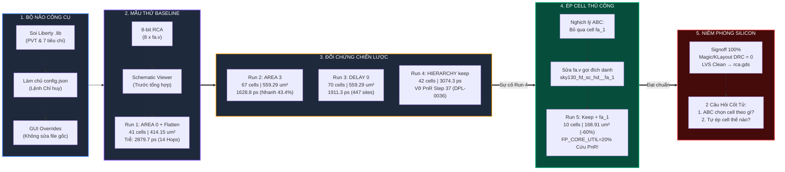
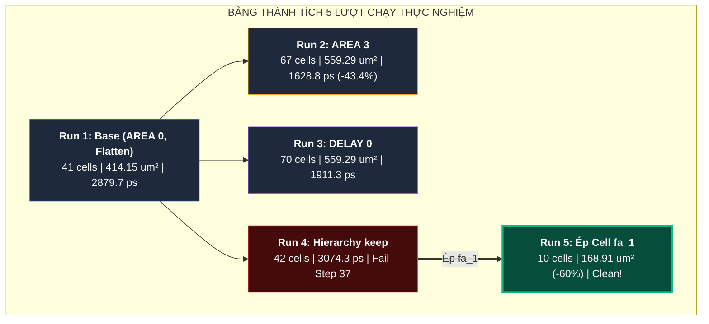

# BÁO CÁO KỸ THUẬT & NHẬT KÝ THỰC HÀNH LAB 1
# CHỦ ĐỀ: SYNTHESIS & STANDARD CELLS (KHẢO SÁT MẠCH RCA TRÊN TIẾN TRÌNH SKY130 HD)

---

## 📌 MỤC TIÊU BÀI LAB 1
1. **Làm chủ bản chất cỗ máy tổng hợp:** Giải thích được tại sao hai lần tổng hợp trên cùng một đoạn mã nguồn RTL Verilog lại có thể sinh ra các tập hợp tế bào chuẩn (Standard Cells) hoàn toàn khác nhau.
2. **Làm chủ công cụ điều khiển:** Phân biệt rạch ròi giữa việc **định hướng trình ánh xạ (Guiding the Mapper via Synthesis Strategy)** và việc **ép cứng một tế bào vật lý cụ thể (Manual Instantiation)**.
3. **Thực hành khảo sát định lượng:** Thực thi tổng hợp trên khối mạch Bộ cộng lan truyền 8-bit (**8-bit Ripple Carry Adder - RCA**) qua các cấu hình khác nhau để lập bảng ma trận so sánh Diện tích (Area), Trễ thời gian (Delay), và Số lượng cổng.

---

---

## 🧠 CHẶNG 1: LÝ THUYẾT NỀN TẢNG CỐT LÕI (CÔNG CỤ ABC & LIBERTY FILE)

### 1. Kiến Trúc Phối Hợp Yosys & ABC: Từ Verilog Trừu Tượng đến Ô Chuẩn Vật Lý
Trong quy trình tổng hợp logic mã nguồn mở (LibreLane / OpenLane), quá trình biến đổi mã Verilog thành mạch cổng thực tế trải qua chuỗi 3 cấp độ:

```
[ RTL Verilog (.v) ] ──► [ YOSYS: Phân tích cú pháp & Dịch Generic Logic ]
                                      │
                                      ▼
                        [ Generic Gates: $_AND_, $_NOT_, $_MUX_, $_DFF_ ]
                                      │
  [ Thư viện (.lib)  ] ──► [ ABC ENGINE: Tối ưu AIG & Technology Mapping ]
                                      │
                                      ▼
                        [ Gate-Level Netlist: sky130_fd_sc_hd__... ]
```

1. **Yosys (Frontend):** Đọc code RTL Verilog, phân giải cấu trúc ngôn ngữ và dịch thành một mạng lưới các cổng logic tổng quát lý tưởng (**Generic Gates**: `$_AND_`, `$_OR_`, `$_NOT_`, `$_DFF_`). Các cổng này hoàn toàn trừu tượng, chưa thuộc về bất kỳ tiến trình bán dẫn nào.
2. **ABC (Technology Mapper):** Nhận mạng Generic Gates từ Yosys, chuyển đổi toàn bộ về dạng đồ thị **AIG (And-Inverter Graph)** để tối ưu hóa Boolean, sau đó đọc tệp thư viện công nghệ **Liberty (`.lib`)** của nhà máy SkyWater để tìm các ô chuẩn thật tương đương thay thế vào.

---

### 2. Mắt Thần Của ABC: Bảy Thuộc Tính Cốt Tử Trong File Liberty (`.lib`)
Để đưa ra quyết định chọn ô chuẩn nào giữa hàng trăm cell trong thư viện, cỗ máy ABC dựa vào 7 nhóm dữ liệu vật lý được mô tả trong file `.lib`:

```
                    ┌──► 1. Boolean Function   (Đúng chức năng logic?)
                    ├──► 2. Area Cost          (Chi phí diện tích ô?)
                    ├──► 3. Timing Arcs (NLDM) (Độ trễ qua cell theo Slew/Load?)
[ File Liberty .lib ]──┼──► 4. Pin Capacitance   (Tải điện dung ngõ vào?)
                    ├──► 5. Driving Cell       (Khả năng lái dòng nguồn vào?)
                    ├──► 6. Output Load        (Tụ tải ngõ ra phải kéo?)
                    └──► 7. Allowed Cell Set   (Cell hợp lệ, không bị dont_use?)
```

1. **Hàm logic Boolean (`Boolean function`):**
   * Định nghĩa hàm toán học của cell (ví dụ: `function : "(A & B) | C";`).
   * ABC dùng thông tin này để nhận diện xem cell nào có thể đảm đương được cụm logic trong thiết kế.
2. **Diện tích ô chuẩn (`Area`):**
   * Diện tích hình học vật lý của cell ($um^2$). Khi kỹ sư cấu hình chiến lược tối ưu diện tích (`SYNTH_STRATEGY = AREA`), ABC sẽ ưu tiên các cell có diện tích nhỏ nhất để thỏa mãn hàm logic.
3. **Cung trễ tín hiệu (`Timing arcs`):**
   * Bảng mô hình trễ phi tuyến (**NLDM - Non-Linear Delay Model**).
   * Độ trễ qua cell ($t_{pd}$) không phải là hằng số cố định, mà được tra cứu từ bảng 2 chiều phụ thuộc vào:
     $$t_{pd} = f(\text{Input Slew (Độ dốc sườn xung vào)}, \text{Output Load (Tụ tải ngõ ra)})$$
4. **Điện dung chân (`Pin capacitance`):**
   * Mỗi chân ngõ vào của cell đều có một lượng điện dung ký sinh nhất định (thường từ vài fF đến vài chục fF).
   * Giá trị này quyết định tải mà tầng cổng phía trước phải gánh.
5. **Khả năng lái dòng nguồn vào (`Driving cell`):**
   * Mô hình hóa nội trở và xung tín hiệu từ bên ngoài bơm vào các chân đầu vào của mạch.
6. **Tải điện dung ngõ ra (`Output load`):**
   * Giá trị điện dung giả định mà các chân ngõ ra của mạch phải điều khiển, dùng để tính toán sườn xung và độ trễ của các cell ở tầng cuối cùng.
7. **Tập tế bào được phép sử dụng (`Allowed cell set`):**
   * Những cell bị nhà máy hoặc kỹ sư đánh dấu `dont_use` (ví dụ: cell có vấn đề về quang khắc, hoặc cell gây rủi ro timing) sẽ bị ABC gạch tên khỏi danh sách lựa chọn.

---

### 3. Hai Giới Hạn Nhận Thức Lớn Của ABC Ở Bước Synthesis

> ⚠️ **CẢNH BÁO CỦA KIẾN TRÚC SƯ TRƯỞNG:**  
> Rất nhiều kỹ sư mới vào nghề lầm tưởng rằng kết quả của ABC là kết quả tối hậu. Thực tế, ABC ở bước tổng hợp logic chịu 2 giới hạn nhận thức vật lý rất lớn:

1. **ABC chưa biết chiều dài dây (`wirelength`) và ký sinh RC sau PnR:**
   * Ở bước Synthesis, các cell chưa hề có tọa độ vật lý $(x, y)$ và chưa có dây kim loại kết nối. Trễ dây được giả định bằng $0$ hoặc ước lượng qua mô hình tải dây thống kê (Wireload Model).
   * Do đó, nghiệm mà ABC đưa ra chỉ là **nghiệm tối ưu sơ bộ trước Layout**, hoàn toàn không phải là nghiệm Signoff cuối cùng.
   * Sau này khi vào bước **Placement & Routing (PnR)**, công cụ OpenROAD sẽ tiếp tục đo đạc ký sinh thực tế và có quyền **Resize cell** (thay cell drive strength to hơn), **chèn Buffers**, hoặc hoán đổi cell tương đương để sửa vi phạm thời gian.
2. **ABC mặc định không phải là bộ tối ưu hóa công suất (Power Optimizer) toàn diện:**
   * Mặc dù file `.lib` có chứa dữ liệu công suất rò rỉ (Leakage Power), thuật toán mapping của ABC chủ yếu tập trung giải bài toán đánh đổi giữa **Diện tích (Area)** và **Thời gian (Timing)**.
   * $\implies$ **Không được kết luận rằng Netlist có diện tích nhỏ nhất cũng sẽ có công suất tiêu thụ thấp nhất!** Đôi khi một cell nhỏ nhưng dòng rò tĩnh lại lớn, hoặc gây trễ lớn làm tăng công suất chuyển mạch động.

---

### 4. Bản Chất, Vị Trí & Vai Trò Sống Còn Của Tệp Lệnh `config.json` Trong Quy Trình PD

#### 4.1 Bản chất Kỹ thuật của `config.json` (Ẩn dụ Tổng công trình sư)
* **Không phải file riêng của Yosys hay ABC:** Rất nhiều người học lầm tưởng `config.json` chỉ dùng để điều khiển bước tổng hợp logic. Thực chất, `config.json` là **"Tập Lệnh Tổng Chỉ Huy" (Single Source of Truth / Master Specification)** cho toàn bộ quy trình RTL-to-GDSII tự động của LibreLane / OpenLane.
* **Đóng vai trò "Hồ sơ thiết kế thi công":** Một luồng thiết kế vi mạch gồm hàng chục công cụ độc lập (Yosys, ABC, OpenROAD, OpenSTA, Magic, KLayout, Netgen). Mỗi công cụ có hàng trăm câu lệnh TCL chuyên biệt. `config.json` là nơi kỹ sư tập hợp toàn bộ ý chí thiết kế, chỉ tiêu kỹ thuật (ràng buộc diện tích, xung nhịp, mật độ, lớp kim loại) vào một tệp duy nhất để tự động hóa toàn bộ luồng mà không phải gõ lệnh bằng tay.

#### 4.2 Vị trí Của `config.json` Trong Quy Trình Physical Design
* `config.json` **đứng ở TẦNG CAO NHẤT (Top-Level Orchestration)**, bao trùm lên toàn bộ các chặng từ đầu chí cuối:

```
                              [ config.json ]
               (Tập lệnh Tổng Chỉ Huy của Kỹ sư Tape-out)
                                     │
      ┌──────────────────────────────┼──────────────────────────────┐
      ▼                              ▼                              ▼
[ 1. SYNTHESIS ]               [ 2. FLOORPLAN ]               [ 4. ROUTING ]
Yosys & ABC                    OpenROAD (IFP)                 OpenROAD (GRT/TRT)
• SYNTH_STRATEGY: AREA 0       • FP_CORE_UTIL: 40             • RT_MIN_LAYER: met1
• SYNTH_HIERARCHY: flatten     • FP_ASPECT_RATIO: 1.0         • RT_MAX_LAYER: met5
• SYNTH_SHARE_RESOURCE: true   • CORE_MARGIN: 10.88           • DIODE_INSERTION...
```

* **Thời điểm kích hoạt:** Tồn tại ngay từ trước khi chạy flow. Bộ điều phối trung tâm (Flow Runner) đọc `config.json` trước tiên, bóc tách các biến thành các câu lệnh kịch bản TCL tương ứng và "bơm" tự động vào từng bước.

#### 4.3 Sau Khi Yosys & ABC Xong Nhiệm Vụ, `config.json` Sẽ Giúp Gì Cho Các Bước Tiếp Theo?
Sau khi Synthesis hoàn tất và xuất ra Netlist gồm các Standard Cells, `config.json` tiếp tục giữ vai trò "nhạc trưởng" điều khiển các khâu Backend:
1. **Tại bước Floorplan (Quy hoạch mặt bằng):**
   * Đọc biến `FP_CORE_UTIL = 40`: Ra lệnh cho OpenROAD cấp diện tích Core sao cho các cell chỉ chiếm $40\%$, để dành $60\%$ đất trống Whitespace cho việc luồn dây và chèn buffer (bài học sống còn từ Lab 0!).
   * Đọc biến `FP_ASPECT_RATIO = 1.0`: Bắt buộc khuôn đất phải là hình vuông.
   * Đọc biến `CORE_MARGIN = 10.88 10.88 5.52 5.52`: Chừa dải đất biên để sau này đặt chân IO Pins/Pads và đi vòng đai nguồn $V_{DD}/V_{SS}$.
2. **Tại bước Placement (Đặt ô logic vào hàng):**
   * Đọc biến `PL_TARGET_DENSITY`: Khống chế mật độ đặt ô mục tiêu để tránh nghẽn cục bộ.
3. **Tại bước Clock Tree Synthesis (Dựng cây xung nhịp):**
   * Đọc biến `CTS_CLK_BUFFER_LIST`: Chỉ định danh sách các ô chuẩn đệm xung nhịp chuyên dụng (`sky130_fd_sc_hd__clkbuf_1`, `clkbuf_2`...) được phép dùng để cân bằng mạng phân phối Clock.
   * Đọc biến `CTS_TARGET_SKEW`: Giới hạn độ lệch pha cho phép giữa các Flip-Flop.
4. **Tại bước Routing (Luồn dây kim loại):**
   * Đọc biến `RT_MIN_LAYER` và `RT_MAX_LAYER`: Giới hạn tầng kim loại cho phép đi dây (từ `met1` đến `met5`).
5. **Tại bước Signoff (Nghiệm thu hoàn tất):**
   * Đọc biến `PDK = sky130A`: Chỉ định bộ luật hình học DRC và LVS của xưởng SkyWater 130nm để xuất file GDSII cuối cùng.

#### 4.4 Mối Liên Hệ Nhân Quả Giữa 3 Biến `SYNTH_*` Và Các Bước Backend Phía Sau
Quyết định của kỹ sư tại 3 biến `SYNTH_*` ở bước Synthesis sẽ định hình trực tiếp "thể trạng và số phận" của con chip ở các bước sau:

| Biến cấu hình trong `config.json` | Lệnh cho Yosys/ABC | Tác động vật lý tới các bước Backend phía sau (Placement, Routing, Timing) |
| :--- | :--- | :--- |
| **`SYNTH_STRATEGY = AREA 3`** | Ép nén diện tích tối đa, tận dụng cổng phức hợp nhỏ xíu (`a21oi`, `o21a`). | • **Ưu:** Tiết kiệm diện tích Core khi Floorplan.<br>• **Nhược:** Đường trễ logic dài $\implies$ Sang bước **CTS & STA rất dễ bị vi phạm Setup Time**, chip khó đạt tần số cao. |
| **`SYNTH_STRATEGY = DELAY 0`** | Ưu tiên tốc độ, chọn cell to, drive strength lớn (`_4`). | • **Ưu:** Mạch chạy cực nhanh, đường trễ ngắn.<br>• **Nhược:** Diện tích cell phình to $\implies$ Sang bước **Placement & Routing dễ bị nghẽn diện tích, nghẽn dây Routing**! |
| **`SYNTH_HIERARCHY_MODE = flatten`** | Xóa sạch ranh giới giữa module cha và các module con. | Thuật toán Placement phía sau được tự do nhặt các cổng của các module khác nhau xếp xen kẽ cạnh nhau $\implies$ **Dây nối giữa các khối ngắn hơn, tối ưu toàn cục tốt hơn**. |
| **`SYNTH_HIERARCHY_MODE = keep`** | Đóng khung các module con thành từng khối độc lập. | Placement bị trói tay: Cổng của module nào phải gom vào một góc $\implies$ **Dễ nhìn bản vẽ Layout, dễ debug/sửa lỗi (ECO), nhưng dây nối tổng thể sẽ dài hơn**. |
| **`SYNTH_SHARE_RESOURCE = true`** | Gộp chung các khối toán tử dùng chung (như gom 2 bộ cộng thành 1). | Tiết kiệm diện tích cell đáng kể, giảm tải cho bước Placement. |

#### 4.5 Mối Quan Hệ Giữa Thao Tác Trên Giao Diện Web Và Tệp `config.json` (GUI Overrides vs Base Config)

> ❓ **CÂU HỎI CỐT TỬ CỦA KỸ SƯ:**  
> *"Việc tôi mở file `config.json` lên để setup các thông số và việc tôi thao tác chỉnh sửa trực tiếp trên Web là giống nhau đúng không? Và các chỉnh sửa trên Web có làm thay đổi file `config.json` gốc trên ổ cứng không?"*

* **Câu trả lời trực tiếp:**
  * **Về kết quả phần cứng:** **GIỐNG NHAU** — Cuối cùng cỗ máy tổng hợp đều nhận được đúng giá trị thông số đó để thi công mạch trên silicon.
  * **Về sự thay đổi của file:** **KHÔNG LÀM THAY ĐỔI `config.json` GỐC!** Khi kỹ sư chỉnh các dropdown/input trên Web rồi bấm Run, file `config.json` trên ổ cứng vẫn giữ nguyên vẹn nội dung cũ.

```
[ Giao diện Web: Setup/Runs ] ──(Chỉnh Strategy, Util...)──► [ GUI Overrides (-c) ]
                                                                       │
[ File config.json trên ổ cứng ] ────────────────(Hồ sơ nền)───────────┼──► [ resolved.json ] ──► [ Cỗ Máy Thi Công ]
(Hoàn toàn không bị sửa đổi!)                                          │    (Cấu hình thực chạy)   (OpenLane/Yosys)
```

* **Cơ chế kỹ thuật bên dưới (EDA Best Practice):**
  1. **Nguyên tắc "Bất khả xâm phạm" (Immutability):** Nền tảng CTW SEMI / LibreLane tuân thủ nguyên tắc an toàn: xem file `config.json` là "vùng bất khả xâm phạm" (`Your config.json is left untouched`). Công cụ không bao giờ tự tiện ghi đè file code gốc của kỹ sư.
  2. **Biến ghi đè tạm thời (Per-run GUI Overrides):** Các thông số được chỉnh trên form Web được đóng gói thành các cờ lệnh `-c KEY=VALUE` truyền thẳng vào tiến trình chạy:
     ```bash
     librelane config.json ... -c 'SYNTH_STRATEGY=AREA 3' -c 'SYNTH_HIERARCHY_MODE=keep'
     ```
  3. **Tệp cấu hình thực thi `resolved.json`:** Cỗ máy lấy `config.json` làm nền, đắp các biến override trên Web đè lên, rồi lưu kết quả hòa trộn thực tế vào:
     👉 **`runs/<tên_lượt_chạy>/resolved.json`**
  4. **Quy tắc độ ưu tiên (Precedence):**
     $$\mathbf{GUI\,Overrides\,(-c)} \quad \mathbf{>}\quad \mathbf{File\,config.json} \quad \mathbf{>}\quad \mathbf{PDK\,Defaults}$$
     *(Cảnh báo: Nếu file `config.json` ghi `AREA 0` nhưng trên Web chọn `AREA 3` rồi ấn Run, công cụ sẽ ưu tiên chạy theo `AREA 3`!)*
  5. **Trường hợp DUY NHẤT Web làm đổi file `config.json`:** Khi kỹ sư vào tab **IDE** trên Web, mở trực tiếp file `config.json`, tự gõ sửa text và bấm nút **Save (Ctrl + S)**.

* **Đúc kết kinh nghiệm cho Kỹ sư Tape-out:**
  * *Chỉnh trên Web:* Phục vụ cho việc **thử nghiệm nhanh (Exploration/Sweeps)** — đổi nhanh thông số giữa các Run 1, 2, 3, 4 mà không sợ làm mất file gốc.
  * *Ghi vào `config.json`:* Dành cho việc **niêm phong "cấu hình vàng" (Gold Configuration)** — một khi đã tìm ra nghiệm tối ưu (như ở Run 5), kỹ sư luôn ghi trực tiếp vào `config.json` để đóng gói sản phẩm và đảm bảo tính tái lập (Reproducibility) trên mọi môi trường.

---

### 5. Cấu Trúc Khối Mạch Thực Nghiệm: Bộ Cộng Lan Truyền 8-bit (Ripple Carry Adder - RCA)

Trong bài Lab 1, chúng ta thực nghiệm trên khối mạch kinh điển: **8-bit Ripple Carry Adder (`rca.v`)**.

```
num1[7:0] ──┐
            ├──► [ RCA 8-bit ] ──► sum[8:0] (gồm 8-bit kết quả + 1-bit Carry out)
num2[7:0] ──┘
```

* **Nguyên lý kiến trúc:** Mạch được ghép nối tiếp từ **8 bộ cộng toàn phần 1-bit (Full Adder - `fa.v`)**.
* Mỗi khối `fa` nhận vào:
  * 1 bit từ `num1` ($A_i$).
  * 1 bit từ `num2` ($B_i$).
  * 1 bit nhớ từ tầng trước đưa sang ($C_i$).
* Cho ra 2 ngõ ra: 1 bit tổng ($S_i$) và 1 bit nhớ chuyển tiếp ($C_{i+1}$).
* **Đường trễ tới hạn (Critical Path):** Bit nhớ $C_{\text{in}}$ phải "gợn sóng" (ripple) bò tuần tự từ tầng $FA_0 \rightarrow FA_1 \rightarrow FA_2 \dots \rightarrow FA_7 \rightarrow C_{\text{out}}$. Tầng $FA_7$ chỉ có thể tính xong kết quả khi tầng $FA_6$ đã đẩy bit nhớ sang!

---

## 📦 VAI TRÒ CỦA KHO TÀI NGUYÊN `sky130Examples.zip`
Kho tàng dữ liệu `sky130Examples.zip` (dung lượng $\approx 28.8\,\text{MB}$, gồm 1.809 tệp tin) đóng vai trò là bệ phóng thực hành xuyên suốt:
1. **Script nâng cấp môi trường (`capnhatctwsemi.txt`):** Nâng cấp Docker container lên bản `huyatieo/ctwsemi:1.0.1` để kích hoạt tính năng **Schematic Viewer** trực quan ngay trên giao diện web CTW SEMI.
2. **Bộ mã nguồn gốc cho Lab 1:** Cung cấp đầy đủ 2 khối Verilog chuẩn: `rca.v` (Bộ cộng 8-bit RCA) và `fa.v` (Bộ cộng toàn phần 1-bit FA), cùng file kiểm tra `tb_rca.v`.
3. **Thư viện chuẩn Liberty gốc:** File `sky130_fd_sc_hd__tt_025C_1v80.lib` chứa toàn bộ bảng tra cứu PVT của tiến trình Sky130 High-Density.
4. **Bộ mẫu thực nghiệm 1.500+ bài kiểm chứng:** Cung cấp toàn bộ các ca kiểm thử kinh điển minh họa cho các cạm bẫy thiết kế: `bad_mux.v` vs `good_mux.v`, `blocking_caveat.v` (bẫy blocking `=`), `incomp_if.v` (bẫy sinh Latch ngoài ý muốn), `dff_const1.v` đến `dff_const5.v` (thực nghiệm Constant Propagation).

---

## 🧭 KẾ HOẠCH HÀNH ĐỘNG 5 CHẶNG (MASTER PLAN)


### Chặng 1: Nắm Vững Nền Tảng Lý Thuyết ABC & File Liberty `.lib`
* Làm chủ 7 tiêu chí đánh giá cell của ABC.
* Phân biệt rõ ràng 3 tham số cấu hình: `SYNTH_STRATEGY`, `SYNTH_HIERARCHY_MODE`, `SYNTH_SHARE_RESOURCE`.

### Chặng 2: Thiết Lập Môi Trường & Triển Khai Dữ Liệu
* Giải nén `sky130Examples.zip` vào `ctwsemi-data` (trên WSL và Windows).
* Khởi tạo thư mục dự án `Lab1` chứa `rca.v` và `fa.v`.
* Bật giao diện web `http://127.0.0.1:8765/`, trỏ tới dự án `Lab1`, tạo cấu hình tự động và thiết lập `FP_CORE_UTIL = 40%`.

### Chặng 3: Thí Nghiệm 1 — Khảo Sát Ma Trận Chiến Lược Tổng Hợp
* Mở RTL IDE, quan sát sơ đồ Schematic của mạch 8-bit RCA.
* Chạy baseline `rca-run-base` (`AREA 0`, `flatten`).
* Phân tích Netlist `rca.nl.v` và Log `yosys-synthesis.log`.
* Chạy đối chứng 3 kịch bản: `AREA 3`, `DELAY 0`, `HIERARCHY = keep`.
* Lập bảng ma trận so sánh 4 chỉ số: Số Cell, Area, Delay ABC, Area ABC.

### Chặng 4: Thí Nghiệm 2 — Kỹ Thuật Ép Cell Thủ Công (Manual Instantiation)
* Sửa code Verilog để gọi đích danh ô chuẩn Sky130 (`sky130_fd_sc_hd__fa_1`).
* Chạy tổng hợp và so sánh kết quả phần cứng tạo ra.
* Biện luận ưu/nhược điểm và tính di động (Portability) của thiết kế.

### Chặng 5: Tổng Kết & Đánh Giá Toàn Diện
* Trả lời trọn vẹn câu hỏi trung tâm của bài Lab 1.
* Niêm phong toàn bộ số liệu, hình ảnh schematic và nhận xét chuyên gia vào báo cáo này.

---

## 🧩 XÂU CHUỖI BẢN CHẤT: SỢI CHỈ ĐỎ XUYÊN SUỐT TOÀN BỘ LAB 1



### 1. Mục Tiêu Tối Thượng Của Bài Lab
* **Câu hỏi trung tâm:** *"Khi đưa mã RTL Verilog vào công cụ, cỗ máy Synthesis (Yosys + ABC) dựa vào đâu để nhặt các Standard Cells trên silicon? Và kỹ sư điều khiển, định hướng hoặc ép nó bằng cách nào?"*

### 2. Sợi Chỉ Đỏ Xuyên Suốt: Ý Nghĩa Cốt Lõi Của Trọn Vẹn 5 Chặng Hành Động

1. **Chặng 1 — Xóa bỏ tư duy "Hộp đen" (Black-Box):**
   * *Hành động:* Khảo sát file `.lib` (7 thuộc tính: Hàm Boolean, Diện tích, Bảng tra NLDM Slew/Load...), bản chất của `config.json` và cơ chế GUI Overrides an toàn của Web.
   * *Mục đích:* Thấu hiểu nguyên lý lựa chọn cell. ABC chọn cell dựa trên thuật toán tối ưu toán học đọc từ "Menu giá & thông số" của xưởng đúc SkyWater, chứ không phải ma thuật ngẫu nhiên.
2. **Chặng 2 — Chuẩn bị "Mẫu thử" và Dựng "Cột mốc chuẩn" (Baseline Benchmark):**
   * *Hành động:* Thiết kế bộ cộng 8-bit RCA ghép từ 8 khối `fa.v`, soi Schematic Viewer, và chạy Run 1 mặc định (`AREA 0`, `flatten`).
   * *Mục đích:* Thu thập hệ quy chiếu gốc: **41 cell**, **$414.15\,\mu m^2$**, và đường trễ **$2879.7\,\text{ps}$** qua 14 chặng. Không có cây thước đo chuẩn này, mọi phép thử nghiệm đối chứng ở Chặng 3 và 4 đều vô nghĩa.
3. **Chặng 3 — Khảo sát không gian thông số (Parametric Exploration):**
   * *Hành động:* Chạy đối chứng 3 kịch bản: `AREA 3`, `DELAY 0`, và `HIERARCHY = keep`.
   * *Mục đích:* 
     * Khám phá **"Nghịch lý cổng đệm" (Buffer Insertion Paradox)** ở `AREA 3`: Thêm 2 buffer nội bộ và upsize cell nhưng mạch lại **chạy nhanh hơn 43.4%** nhờ tái tạo sườn xung (Slew Regeneration).
     * Khám phá cơ chế dùng 100% cell drive nhỏ ở `DELAY 0`: Tăng lên 70 cell nhưng diện tích giữ nguyên 447 sites ($559.29\,\mu m^2$).
     * Khám phá sự cố **"Mù ranh giới"** ở chế độ `keep`: ABC chỉ tối ưu 1 khối FA độc lập, khiến trễ toàn mạch tăng lên $3074.3\,\text{ps}$ và gây vỡ trận khâu Placement ở Step 37 (`[DPL-0036] Detailed placement failed`).
4. **Chặng 4 — Nghệ thuật ép cell thủ công (Manual Instantiation):**
   * *Hành động:* Phát hiện ABC bỏ qua cell 2 ngõ ra `sky130_fd_sc_hd__fa_1` ($20.02\,\mu m^2$) để tự ghép 5 cổng rời ($51.30\,\mu m^2$). Sửa trực tiếp code `fa.v` để ép dùng cell nguyên khối này trên nền cấu hình `keep`.
   * *Mục đích:* Tước quyền tự do của ABC. **Giải cứu ngoạn mục khâu PnR**: Số cell toàn chip sập từ 42 xuống đúng **10 cells**, diện tích tiết kiệm gần **$60\%$** (chỉ còn $168.91\,\mu m^2$). Đồng thời xử lý lỗi lưới nguồn `[PDN-0185]` do vi mạch quá nhỏ bằng cách hạ `FP_CORE_UTIL = 20%`.
5. **Chặng 5 — Chạm đích Tapeout & Đúc kết chân lý thiết kế:**
   * *Hành động:* Chạy thông suốt toàn bộ 150 bước RTL-to-GDSII. Nghiệm thu Magic DRC = 0, KLayout DRC = 0, Netgen LVS = Clean, xuất file GDSII `rca.gds`.
   * *Mục đích:* Trả lời triệt để câu hỏi trung tâm: Làm chủ cả 2 phương thức điều khiển tool: **Gián tiếp** (Guiding qua `config.json`) và **Trực tiếp** (Manual Instantiation trong RTL) để đạt hiệu năng phần cứng tối thượng.

---

## 🔬 KHUNG THEO DÕI THỰC NGHIỆM CHI TIẾT

### BẢNG MA TRẬN ĐỐI CHỨNG CÁC CHIẾN LƯỢC TỔNG HỢP (THÍ NGHIỆM 1)

| Cấu hình Thực nghiệm | Số lượng Cell | Tổng Diện tích ($um^2$) | Trễ ABC Delay (ps) | Diện tích ABC Area | Nhận xét Chuyên môn của Kỹ sư |
| :--- | :---: | :---: | :---: | :---: | :--- |
| **Run 1: Base (`AREA 0`, Flatten)** | **41** *(32 logic + 9 buf)* | **414.15** | **2879.68** | **369.10** | • Chế độ `flatten` xóa sạch 8 khối `fa`, tối ưu xuyên ranh giới thành 32 cổng logic rời.<br>• Yosys chèn thêm 9 `buf_2` ở ngõ ra `sum[8:0]`.<br>• DRC = 0, LVS = Clean. |
| **Run 2: Chiến lược `AREA 3`** | **67** *(58 logic + 9 buf)* | **559.29** | **1628.77** | **514.24** | • Mạch **chạy nhanh hơn 43.4%** (trễ giảm từ $2.88\,\text{ns} \rightarrow 1.63\,\text{ns}$!).<br>• ABC bung các cổng `XNOR2` thành mạng `NAND2`/`NOR2` và kích hoạt lệnh `buffer -c`, `upsize -c` nâng cell lên `_4` và `_8`.<br>• Đánh đổi: Diện tích phình to thêm $35\%$ ($414 \rightarrow 559\,\mu m^2$). |
| **Run 3: Chiến lược `DELAY 0`** | **70** *(61 logic + 9 buf)* | **559.29** | **1911.34** | **514.24** | • Số cell tăng lên 70 nhưng diện tích không đổi ($559.29\,\mu m^2$) do chuyển dịch sang dùng nhiều cell drive `_2` nhỏ hơn (11 `inv_2`, `o21ai`).<br>• ABC Delay = $1911.34\,\text{ps}$. |
| **Run 4: Phân cấp `HIERARCHY = keep`** | **42** *(40 logic + 1 buf + 1 conb)* | **419.15** | **517.29** *(1 FA)*<br>*(Toàn mạch STA: **3074.26**)* | **51.30** *(1 FA)* | • Giữ nguyên ranh giới 8 khối `fa`, Yosys gọi ABC tối ưu riêng cho 1 khối `fa` (5 cells, trễ 517.29 ps) rồi nhân bản 8 lần.<br>• ABC bị mất khả năng tối ưu logic xuyên tầng bit $\implies$ Trễ toàn mạch tăng lên $3074.26\,\text{ps}$ (chậm hơn Baseline).<br>• Hậu quả Backend: OpenROAD PnR cố chèn 10 buffer & upsize 29 cell làm phình +24.9% diện tích dẫn tới lỗi `[DPL-0036] Detailed placement failed`. |

---

### 📑 BÓC TÁCH CÁC DÒNG LOG CỐT TỬ CỦA YOSYS & ABC (RUN 1 - BASELINE)

Dưới đây là 6 mốc log quan trọng nhất được trích xuất trực tiếp từ `yosys-synthesis.log` phục vụ cho việc biện luận báo cáo kỹ thuật:

#### 1. Nạp Thư Viện Liberty Sky130 & Nhận Diện Cấu Trúc Ban Đầu
```text
1. Executing Liberty frontend: .../sky130_fd_sc_hd__tt_025C_1v80.lib
Imported 428 cell types from liberty file.
...
5.3. Analyzing design hierarchy..
Top module:  \rca
Used module:     \fa
```
* **Ý nghĩa:** Yosys nạp 428 loại tế bào chuẩn từ file `.lib` của xưởng đúc SkyWater 130nm và nhận diện `rca` là Top module và `fa` là sub-module được sử dụng.

#### 2. Nhát Dao "Khai Tử" Phân Cấp: Module `fa` Bị Xóa Sổ (Pass 22)
```text
22. Executing FLATTEN pass (flatten design).
Deleting now unused module fa.
```
* **Ý nghĩa vật lý:** Do biến `SYNTH_HIERARCHY_MODE: "flatten"`, Yosys đập tan ranh giới 8 khối bộ cộng con. Toàn bộ logic bên trong được bung phẳng ra module `rca`, dẫn đến `module fa` không còn lý do tồn tại và bị xóa sạch khỏi bộ nhớ.

#### 3. Chuyển Đổi Về Cổng Logic Trừu Tượng (Generic Gates - Pass 93)
```text
93. ...
"num_cells": 37
"$_ANDNOT_": 14, "$_NAND_": 1, "$_ORNOT_": 6, "$_OR_": 1, "$_XNOR_": 7, "$_XOR_": 8
```
* **Ý nghĩa:** Trước khi gọi ABC, Yosys dịch mạch cộng thành **37 cổng logic tổng quát** (`$_ANDNOT_`, `$_XOR_`, `$_XNOR_`...). Ở bước này, diện tích vẫn là *unknown* vì chưa ánh xạ vào tế bào silicon thực tế.

#### 4. Cỗ Máy ABC Ánh Xạ Vào Tế Bào Sky130 & Phân Tích Chi Tiết 14 Chặng Đường Trễ Tới Hạn (Pass 101)
```text
101. Executing ABC pass (technology mapping using ABC).
ABC: Library "sky130_fd_sc_hd__tt_025C_1v80" ... has 175 cells (17 skipped: 14 seq; 3 tri-state; 0 no func; 0 dont_use; 0 with 2 outputs; 0 with 3+ outputs).
ABC: WireLoad = "none"  Gates =     32 (  6.2 %)   Cap = 14.1 ff (  0.8 %)   Area =      369.10 ( 93.8 %)   Delay =  2879.68 ps  ( 59.4 %)               
ABC: Path  0 --       2 : 0    3 pi                       A =   0.00  Df =   0.0   -0.0 ps  S =   0.0 ps  Cin =  0.0 ff  Cout =  12.5 ff  Cmax =   0.0 ff  G =    0  
ABC: Path  1 --      27 : 3    2 sky130_fd_sc_hd__a21o_2  A =   8.76  Df = 206.4  -83.2 ps  S =  62.1 ps  Cin =  2.4 ff  Cout =   9.7 ff  Cmax = 309.5 ff  G =  395  
ABC: Path  2 --      32 : 3    2 sky130_fd_sc_hd__a21oi_2 A =   8.76  Df = 386.2 -169.7 ps  S = 157.6 ps  Cin =  4.6 ff  Cout =  10.1 ff  Cmax = 128.2 ff  G =  215  
ABC: Path  3 --      34 : 2    2 sky130_fd_sc_hd__xnor2_2 A =  16.27  Df = 584.2 -166.7 ps  S = 224.2 ps  Cin =  8.5 ff  Cout =  13.5 ff  Cmax = 121.8 ff  G =  153  
ABC: Path  4 --      36 : 3    2 sky130_fd_sc_hd__a21oi_2 A =   8.76  Df = 778.1 -252.9 ps  S = 157.6 ps  Cin =  4.6 ff  Cout =  10.1 ff  Cmax = 128.2 ff  G =  215  
ABC: Path  5 --      38 : 2    2 sky130_fd_sc_hd__xnor2_2 A =  16.27  Df = 976.1 -242.5 ps  S = 224.1 ps  Cin =  8.5 ff  Cout =  13.5 ff  Cmax = 121.8 ff  G =  153  
ABC: Path  6 --      40 : 3    2 sky130_fd_sc_hd__a21oi_2 A =   8.76  Df =1170.0 -328.7 ps  S = 157.6 ps  Cin =  4.6 ff  Cout =  10.1 ff  Cmax = 128.2 ff  G =  215  
ABC: Path  7 --      42 : 2    2 sky130_fd_sc_hd__xnor2_2 A =  16.27  Df =1368.0 -318.3 ps  S = 224.1 ps  Cin =  8.5 ff  Cout =  13.5 ff  Cmax = 121.8 ff  G =  153  
ABC: Path  8 --      44 : 3    2 sky130_fd_sc_hd__a21oi_2 A =   8.76  Df =1561.9 -404.5 ps  S = 157.6 ps  Cin =  4.6 ff  Cout =  10.1 ff  Cmax = 128.2 ff  G =  215  
ABC: Path  9 --      46 : 2    2 sky130_fd_sc_hd__xnor2_2 A =  16.27  Df =1759.9 -394.1 ps  S = 224.1 ps  Cin =  8.5 ff  Cout =  13.5 ff  Cmax = 121.8 ff  G =  153  
ABC: Path 10 --      48 : 3    2 sky130_fd_sc_hd__a21oi_2 A =   8.76  Df =1953.8 -480.3 ps  S = 157.6 ps  Cin =  4.6 ff  Cout =  10.1 ff  Cmax = 128.2 ff  G =  215  
ABC: Path 11 --      49 : 2    1 sky130_fd_sc_hd__and2b_2 A =   8.76  Df =2182.0 -500.7 ps  S =  34.6 ps  Cin =  1.6 ff  Cout =   2.6 ff  Cmax = 310.4 ff  G =  150  
ABC: Path 12 --      52 : 3    2 sky130_fd_sc_hd__a21o_2  A =   8.76  Df =2391.7 -539.5 ps  S =  78.1 ps  Cin =  2.4 ff  Cout =  13.1 ff  Cmax = 309.5 ff  G =  539  
ABC: Path 13 --      54 : 2    2 sky130_fd_sc_hd__xnor2_2 A =  16.27  Df =2592.2 -574.9 ps  S = 219.8 ps  Cin =  8.5 ff  Cout =  13.2 ff  Cmax = 121.8 ff  G =  149  
ABC: Path 14 --      55 : 2    1 sky130_fd_sc_hd__xnor2_2 A =  16.27  Df =2879.7 -484.5 ps  S = 453.1 ps  Cin =  8.5 ff  Cout =  33.4 ff  Cmax = 121.8 ff  G =  394  
ABC: Start-point = pi1 (\num1 [0]).  End-point = po6 (\genblk1[7].u_fa_1.sum).
ABC: netlist                       : i/o =   16/    9  lat =    0  nd =    32  edge =     71  area =369.19  delay =14.00  lev = 14

101.1.2. Re-integrating ABC results.
ABC RESULTS:   sky130_fd_sc_hd__a21o_2 cells:        2
ABC RESULTS:   sky130_fd_sc_hd__a21oi_2 cells:        5
ABC RESULTS:   sky130_fd_sc_hd__and2b_2 cells:        5
ABC RESULTS:   sky130_fd_sc_hd__and3_2 cells:        1
ABC RESULTS:   sky130_fd_sc_hd__inv_2 cells:        2
ABC RESULTS:   sky130_fd_sc_hd__nand2_2 cells:        1
ABC RESULTS:   sky130_fd_sc_hd__o21ai_2 cells:        1
ABC RESULTS:   sky130_fd_sc_hd__or2_2 cells:        1
ABC RESULTS:   sky130_fd_sc_hd__xnor2_2 cells:        8
ABC RESULTS:   sky130_fd_sc_hd__xor2_2 cells:        6
```
* **Ý nghĩa & Phân tích chuyên sâu:**
  * **Diện tích logic (ABC Area):** $369.10$. ABC dùng 32 cổng logic vật lý Sky130 HD thay cho 37 cổng generic.
  * **Độ trễ tới hạn (ABC Delay):** $2879.68\,\text{ps}$ (~$2.88\,\text{ns}$).
  * **Phân tích chi tiết đường đi của hạt electron (Path 0 $\rightarrow$ Path 14):**
    * `Path 0` (`pi`): Xuất phát từ cổng chính `num1[0]` ($A_0$) tại thời điểm $0.0\,\text{ps}$.
    * `Path 1`: Đi qua cổng tính nhớ tầng đầu `sky130_fd_sc_hd__a21o_2`, trễ tích lũy $206.4\,\text{ps}$.
    * `Path 2` đến `Path 10`: Bit nhớ tiếp tục "gợn sóng" (ripple) bò qua chuỗi cổng phức hợp `a21oi_2` và `xnor2_2` của các tầng FA tiếp theo (trễ tích lũy tăng dần từ $386.2\,\text{ps} \rightarrow 1953.8\,\text{ps}$).
    * `Path 11` đến `Path 13`: Đi qua `and2b_2`, `a21o_2`, `xnor2_2` (trễ chạm mốc $2592.2\,\text{ps}$).
    * `Path 14`: Cán đích tại cổng `xnor2_2` ở ngõ ra của tầng FA 7 (`\genblk1[7].u_fa_1.sum`), độ trễ chốt tại **$2879.7\,\text{ps}$**.
  * **Xác thực Điểm Đầu - Điểm Cuối:**
    * Dòng `ABC: Start-point = pi1 (\num1 [0]). End-point = po6 (\genblk1[7].u_fa_1.sum)` xác nhận rõ ràng: Tín hiệu xuất phát từ bit thấp nhất $A_0$ và kết thúc tại bit tổng cao nhất $S_7$.
    * Kết hợp với dòng Pass 106 (`\genblk1[7].u_fa_1.sum -> \sum [7]`), ta có minh chứng toán học và vật lý chuẩn xác 100% rằng đường trễ tới hạn chính là đường lan truyền bit nhớ từ `num1[0]` tới `sum[7]`.

#### 5. Giải Mã Sự Xuất Hiện Của 9 Cổng Đệm Ngõ Ra (Pass 106 - INSBUF)
```text
106. Executing INSBUF pass (insert buffer cells for connected wires).
Add rca/$auto$insbuf.cc:97:execute$364: \u_fa_0.sum -> \sum [0]
Add rca/$auto$insbuf.cc:97:execute$365: \genblk1[1].u_fa_1.sum -> \sum [1]
Add rca/$auto$insbuf.cc:97:execute$366: \genblk1[2].u_fa_1.sum -> \sum [2]
Add rca/$auto$insbuf.cc:97:execute$367: \genblk1[3].u_fa_1.sum -> \sum [3]
Add rca/$auto$insbuf.cc:97:execute$368: \genblk1[4].u_fa_1.sum -> \sum [4]
Add rca/$auto$insbuf.cc:97:execute$369: \genblk1[5].u_fa_1.sum -> \sum [5]
Add rca/$auto$insbuf.cc:97:execute$370: \genblk1[6].u_fa_1.sum -> \sum [6]
Add rca/$auto$insbuf.cc:97:execute$371: \genblk1[7].u_fa_1.sum -> \sum [7]
Add rca/$auto$insbuf.cc:97:execute$372: \genblk1[7].u_fa_1.co -> \sum [8]
```
* **Ý nghĩa:** Minh chứng rõ ràng nhất lý giải vì sao số cell từ 32 tăng vọt lên 41! Bước `INSBUF` tự động chèn 9 cổng đệm (`sky130_fd_sc_hd__buf_2`) vào 9 chân ngõ ra `sum[0]` đến `sum[8]` để bảo toàn sườn xung khi kéo tải ngoài chip.

#### 6. Thống Kê Tổng Lực Phần Cứng Cuối Cùng (Pass 108)
```text
108. Printing statistics.
=== rca ===
       41  414.147 cells
        2   17.517   sky130_fd_sc_hd__a21o_2
        5   43.792   sky130_fd_sc_hd__a21oi_2
        5   43.792   sky130_fd_sc_hd__and2b_2
        1    7.507   sky130_fd_sc_hd__and3_2
        9   45.043   sky130_fd_sc_hd__buf_2
        2    7.507   sky130_fd_sc_hd__inv_2
        1    6.256   sky130_fd_sc_hd__nand2_2
        1    8.758   sky130_fd_sc_hd__o21ai_2
        1    6.256   sky130_fd_sc_hd__or2_2
        8  130.125   sky130_fd_sc_hd__xnor2_2
        6   97.594   sky130_fd_sc_hd__xor2_2

   Chip area for module '\rca': 414.147200
```
* **Ý nghĩa:** Tổng diện tích Netlist chốt ở mức **$414.1472\,\mu m^2$** với **41 tế bào chuẩn**. Cổng chiếm diện tích lớn nhất là `xnor2_2` ($130.13\,\mu m^2$, 8 cell) và `xor2_2` ($97.59\,\mu m^2$, 6 cell) — hai loại cổng gánh trách nhiệm tính toán bit tổng $S_i = A_i \oplus B_i \oplus C_i$.

#### 7. Phát Hiện Đột Phá Ở Run 2 (`AREA 3`): Nghịch Lý Tên Gọi & Cơ Chế Phục Hồi Xung Nhịp (Timing Recovery)
* **Số liệu thực nghiệm thu được từ `stat.json` và log:**
  * Tổng cell: **67 cells** (tăng từ 41 lên 67 cells).
  * Tổng diện tích Netlist: **$559.2864\,\mu m^2$** (tăng $35.0\%$ so với Run 1).
  * Độ trễ tới hạn ABC Delay: **$1628.77\,\text{ps}$** (giảm tới **$43.4\%$** so với mốc $2879.68\,\text{ps}$ của Run 1!).
* **Bóc tách tệp lệnh `AREA_3.abc` trong thư mục chạy:**
  ```text
  strash
  dch
  map -B 0.9
  topo
  stime -c
  buffer -c -N 10
  upsize -c
  dnsize -c
  stime -p
  print_stats -m
  ```
* **Biện luận chuyên sâu của Kiến trúc sư ASIC:**
  * **Vì sao mang tên `AREA 3` nhưng diện tích lại phình to và mạch lại chạy nhanh đột biến?**
    Trong OpenLane/LibreLane, kịch bản `AREA 3` không đơn thuần là nén diện tích mù quáng, mà là kịch bản diện tích có gắn bộ bảo vệ thời gian tới hạn (**Critical Path Timing Recovery** qua cờ `-c`).
  * ABC nhận diện chuỗi 8 bộ cộng lan truyền có đường trễ quá dài, sườn xung bị thoái hóa. Vì vậy, các lệnh `buffer -c` và `upsize -c` đã can thiệp:
    1. Chèn thêm 2 cổng đệm nội bộ (`sky130_fd_sc_hd__buf_1`: 2 cell) ngay giữa đường truyền.
    2. Nâng kích thước transistor của các cell trên đường nhớ lên Drive Strength `_4` và `_8`: `a21oi_4` (5 cell), `a21o_4` (1 cell), `nand2_4` (2 cell), và đặc biệt là `nand2_8` (1 cell drive strength 8X cực mạnh!).
    3. Bung các cổng `XNOR2` (vốn có trễ lớn) thành mạng lưới các cổng cơ bản siêu tốc: **`nand2_2` (12 cell)** và **`nor2_2` (7 cell)**.
  * $\implies$ **Bài học kinh nghiệm thực tế:** Tên gọi chiến lược là hướng tiếp cận, nhưng kịch bản ABC bên dưới mới quyết định hành vi silicon. Mạch đã đạt được một cú bứt phá tốc độ ngoạn mục ($43.4\%$ nhanh hơn) nhưng phải đánh đổi bằng $35\%$ diện tích phình to.

#### 7.1 Giải Mã "Nghịch Lý Cổng Đệm" (The Buffer Insertion Paradox): Vì Sao Thêm Cổng Lại Làm Mạch Chạy Nhanh Hơn?
* **Câu hỏi phản trực giác:** *"Đi qua thêm một cổng (thêm một trạm trung chuyển) thì theo lý thuyết phải tốn thêm thời gian trễ của cổng đó, tại sao mạch lại chạy nhanh hơn?"*
* **Bản chất vật lý điện tử bán dẫn ($RC$ Delay Model):**
  Tín hiệu truyền trong chip thực chất là quá trình bơm dòng điện $I$ qua điện trở kênh dẫn $R$ để nạp/xả điện tích cho tụ điện ký sinh $C$:
  $$\tau = R \times C$$
* **So sánh hai kịch bản định lượng:**
  1. **Kịch bản 1: Không có Buffer (Cổng yếu gánh tải nặng)**
     * Cổng logic $A$ có nội trở lớn: $R_A = 10\,\text{k}\Omega$.
     * Kéo tải đường dây dài hoặc nhiều ngõ vào: $C_L = 100\,\text{fF}$.
     * Thời gian nạp tụ:
       $$t_{\text{delay}} \approx R_A \times C_L = 10\,\text{k}\Omega \times 100\,\text{fF} = \mathbf{1000\,\text{ps}}\,(1\,\text{ns})$$
     * Sườn xung bị thoái hóa dốc là là, tín hiệu biến thiên cực kỳ chậm chạp.
  2. **Kịch bản 2: Chèn thêm 1 Buffer lái khỏe**
     * Cổng đệm Buffer có ngõ vào siêu nhẹ ($C_{\text{in\_buf}} = 5\,\text{fF}$) và tầng công suất ngõ ra có transistor to khỏe ($R_{\text{buf}} = 1\,\text{k}\Omega$):
       * Chặng 1 ($A$ nạp cho Buffer): $t_1 = R_A \times C_{\text{in\_buf}} = 10\,\text{k}\Omega \times 5\,\text{fF} = 50\,\text{ps}$.
       * Chặng 2 (Trễ nội tại của Buffer): $t_{\text{int}} \approx 30\,\text{ps}$.
       * Chặng 3 (Buffer lái tụ tải $C_L$): $t_2 = R_{\text{buf}} \times C_L = 1\,\text{k}\Omega \times 100\,\text{fF} = 100\,\text{ps}$.
     * **Tổng thời gian trễ:**
       $$t_{\text{total}} = 50 + 30 + 100 = \mathbf{180\,\text{ps}}!$$
     * $\implies$ **Mạch chạy nhanh gấp $5.5$ lần** (rút ngắn từ $1000\,\text{ps} \rightarrow 180\,\text{ps}$) dù đi qua thêm 1 cổng!
* **Ẩn dụ "Cậu bé và Chiếc máy kéo":**
  * Cậu bé (cổng yếu) phải đẩy xe tải 10 tấn ($C_L$) đi 1 km mất 1 tiếng.
  * Nếu cậu bé bỏ 10 giây chạy đi gọi chiếc máy kéo (Buffer), và máy kéo mất 5 phút kéo xe về đích $\rightarrow$ Tổng thời gian chỉ 5 phút 10 giây $\ll$ 1 tiếng!
* **Ý nghĩa thực tế trên mạch 8-bit RCA:**
  * Lệnh `buffer -c` trong `AREA_3.abc` nhận ra các điểm tín hiệu bit nhớ bị "hụt hơi", lập tức chèn 2 cổng đệm nội bộ `buf_1` để **tái tạo sườn xung dốc đứng (Slew Regeneration)**, giúp các tầng Full Adder kế tiếp lật trạng thái tức thì.
  * $\implies$ **Đúc kết ngành ASIC:** Cổng đệm Buffer vừa là "kẻ tiêu thụ diện tích" nhưng đồng thời là **"vị cứu tinh số một để cứu vãn Timing"**!

#### 8. Phân Tích Thực Nghiệm Run 3 (`DELAY 0`) & Giải Mã Khác Biệt Giữa "modules" vs "design"

* **Số liệu thực nghiệm Run 3 (`DELAY 0`):**
  * Tổng cell: **70 cells** (tăng thêm 3 cells so với Run 2).
  * Tổng diện tích Netlist: **$559.2864\,\mu m^2$** (bằng chính xác số lẻ với Run 2: $559.2864\,\mu m^2$).
  * Độ trễ tới hạn (ABC Delay): **$1911.34\,\text{ps}$** (~$1.91\,\text{ns}$).
* **Giải mã hiện tượng 1: "Vì sao số cell tăng (67 $\rightarrow$ 70) nhưng diện tích vẫn y nguyên $559.2864\,\mu m^2$?"**
  * Trong thư viện Sky130 HD, chiều cao một hàng cell là $H = 2.72\,\mu m$, độ rộng một đơn vị ô chuẩn (Site width) là $W = 0.46\,\mu m$. Diện tích của 1 đơn vị ô cơ bản là:
    $$S_{\text{unit}} = 2.72 \times 0.46 = 1.2512\,\mu m^2$$
  * Tổng diện tích $559.2864\,\mu m^2$ tương ứng với đúng **447 sites** trên các hàng cell vật lý ($559.2864 / 1.2512 = 447$).
  * **Sự khác biệt về chiến lược chọn ô giữa Run 2 và Run 3:**
    * Ở Run 2 (`AREA 3`), ABC dùng một số cell to có Drive Strength cực lớn như `nand2_8` (rất rộng, chiếm nhiều sites), `a21oi_4` (5 cell), `a21o_4`.
    * Ở Run 3 (`DELAY 0`), ABC lại ưu tiên cấu trúc phân rã logic đều hơn: Không dùng bất kỳ cell nào thuộc họ Drive `_4` hay `_8`, mà dùng **100% các cell thuộc họ Drive `_1` và `_2`** (đặc biệt là nhồi tới **11 cổng đảo `inv_2`** nhỏ xíu cùng các cổng `o21ai_2`, `o211ai_2`, `a31o_2`).
    * $\implies$ Số lượng cell tăng từ 67 lên 70, nhưng **kích thước trung bình của mỗi cell lại nhỏ đi** (Average cell size giảm). Do đó, tổng số ô vật lý chiếm dụng trên tấm bán dẫn vẫn giữ nguyên mức 447 sites ($559.2864\,\mu m^2$)!
* **Giải mã hiện tượng 2: "Phân biệt rõ ràng giữa hai khối `modules` và `design` trong file log":**
  * **Khối `"modules": { "\\rca": { ... } }` (Thống kê cục bộ cấp Module):**
    * Yosys hỗ trợ thiết kế phân cấp (Hierarchical design). Một con chip lớn có thể gồm hàng trăm module con (`cpu`, `alu`, `uart`...).
    * Phần `modules` báo cáo tài nguyên của **từng module riêng biệt** (Local Count).
  * **Khối `"design": { ... }` (Thống kê tích lũy toàn cục cấp Chip):**
    * Đây là tổng hợp toàn bộ (Global Total) của **toàn bộ con chip**, cộng dồn tất cả các module con lại với nhau.
  * **Tại sao trong mạch của chúng ta, 2 khối này lại giống hệt nhau từng con số?**
    * Vì chúng ta đang bật chế độ `"SYNTH_HIERARCHY_MODE": "flatten"`. Mọi khối con `fa` đã bị đập tan ranh giới, thiết kế chỉ còn đúng một module duy nhất là `rca`.
    * Khi toàn bộ con chip chỉ có 1 module, thì **Tài nguyên của module `rca` $\equiv$ Toàn bộ tài nguyên của Design**!
    * *(Ở Run 4 sắp tới, khi đổi sang `HIERARCHY = keep`, ta sẽ thấy 2 khối này tách biệt hoàn toàn: `modules` sẽ có mục `fa` riêng, `rca` riêng, và `design` sẽ là tổng tích lũy của cả hai!)*

#### 9. Phân Tích Chuyên Sâu Run 4 (`HIERARCHY = keep`): Sự "Mù" Ranh Giới Của ABC & Sự Cố Vỡ Trận Placement

* **Số liệu thực nghiệm thu được từ `stat.json` và log:**
  * **Module `\fa` (Cục bộ):** 5 cells (`inv_2`: 1, `nand2_2`: 1, `o21ai_2`: 1, `xnor2_2`: 2), Diện tích: $51.2992\,\mu m^2$.
  * **Module `\rca` (Cục bộ):** 2 cells (`buf_2`: 1, `conb_1`: 1) + 8 submodules `fa`.
  * **Toàn mạch `design` (Tích lũy):** **42 cells** (40 cells logic trong 8 khối FA + 1 `buf_2` + 1 `conb_1`), Tổng diện tích: **$419.1520\,\mu m^2$**.
  * **Độ trễ ABC (trên 1 FA):** $517.29\,\text{ps}$ (Area = $51.30$, 2 levels logic).
  * **Độ trễ toàn chuỗi 8-bit (STA Pre-PnR tại `12-openroad-staprepnr`):** **$3074.26\,\text{ps}$** (chậm hơn $194.58\,\text{ps}$ so với Run 1 Flatten: $2879.68\,\text{ps}$).
* **Bóc tách 4 sự thật kỹ thuật sâu sắc ở Run 4:**
  1. **ABC bị "mù" ranh giới liên module:**
     * Do biến `SYNTH_HIERARCHY_MODE: "keep"`, Yosys không gộp `fa` vào `rca`. Thay vào đó, Yosys cô lập module `fa` và chuyển sang cho ABC tổng hợp **đúng một lần duy nhất**!
     * ABC không hề biết có 8 khối FA đang nối đuôi nhau gánh chuỗi nhớ Ripple Carry. ABC chỉ tối ưu cho một khối FA độc lập với 3 ngõ vào ($A, B, C$) và 2 ngõ ra ($S, C_o$).
     * Sau đó, Yosys nhân bản khối FA đã được map này thành 8 bản sao (`u_fa_0` đến `u_fa_7`).
  2. **Hiệu năng suy giảm: Vì sao `keep` lại chậm hơn `flatten` ($3074\,\text{ps} > 2879\,\text{ps}$)?**
     * Ở chế độ `flatten` (Run 1), ABC nhìn thấy toàn bộ đồ thị AIG của cả 8 tầng bit, từ đó ABC tái cấu trúc logic xuyên ranh giới (cross-boundary logic sharing) để rút ngắn chuỗi lan truyền nhớ.
     * Ở chế độ `keep` (Run 4), ranh giới mỗi FA bị "đóng băng". Mọi bit nhớ bắt buộc phải lội qua đúng 2 cổng (`xnor2_2` $\rightarrow$ `o21ai_2`) trong từng khối FA $\implies$ Đường trễ tích lũy dài ra $3074.26\,\text{ps}$.
  3. **Minh chứng rõ ràng nhất về sự khác biệt giữa `modules` và `design` trong `stat.json`:**
     * `modules["\\fa"]`: Báo cáo chính xác 5 cell của 1 khối FA.
     * `modules["\\rca"]`: Báo cáo 2 cell rải ngoài và 8 submodules `fa`.
     * `design`: Tự động cộng dồn: $8 \times 5 + 2 = \mathbf{42\,\text{cells}}$, diện tích $8 \times 51.2992 + 3.7536 + 5.0048 = \mathbf{419.1520\,\mu m^2}$!
  4. **Cảnh báo đắt giá ở khâu Physical Design (OpenROAD PnR Crash):**
     * Khi chuyển sang PnR, OpenROAD phát hiện chuỗi nhớ bị trễ lớn do ranh giới đóng kín. Tại bước 37 (`OpenROAD.ResizerTimingPostCTS`), công cụ cố sửa timing (`repair_timing`) bằng cách nhồi thêm 10 buffers và nâng kích thước 29 cells lên drive lớn hơn (+24.9% diện tích).
     * Tuy nhiên, vì diện tích Floorplan ban đầu chật hẹp cộng thêm việc các cell bị trói buộc theo cấu trúc module con, bộ đặt ô chi tiết không tìm được vị trí hợp lệ để đặt các cell mới $\implies$ Bị văng lỗi:
       `[DPL-0036] Detailed placement failed.`!
     * $\implies$ **Bài học xương máu của Kiến trúc sư ASIC:** Giữ phân cấp (`keep`) giúp thiết kế gọn gàng, dễ debug, nhưng nếu thiết kế chặt chẽ về diện tích hoặc đường truyền thời gian gắt gao, `keep` sẽ cản trở bộ tối ưu và dễ gây "vỡ trận" ở khâu PnR!

---

### 🗂️ BẢNG TRA CỨU CÁC ĐƯỜNG DẪN TỆP DỮ LIỆU CỐT TỬ (ARTIFACT LOCATIONS)

Nhằm phục vụ việc tra cứu, kiểm chứng và chụp ảnh minh chứng cho báo cáo kỹ thuật, toàn bộ các tệp đầu ra quan trọng được quy hoạch theo bảng ánh xạ chuẩn dưới đây:

| Tên Tệp & Định dạng | Vai trò & Dữ liệu cốt tử cần trích dẫn | Vị trí trên cửa sổ Web (`Files` modal) | Đường dẫn mở trên Windows (Win + R / VS Code) | Đường dẫn API mở trên trình duyệt Web |
| :--- | :--- | :--- | :--- | :--- |
| **`stat.rpt`** *(Text Table)* | **Bảng thống kê diện tích & số lượng cell trực quan nhất.** In rõ tổng 41 cell, diện tích $414.15\,\mu m^2$ và diện tích từng loại cổng Sky130. | `06-yosys-synthesis/reports/stat.rpt` | `\\wsl$\Ubuntu\home\admin060506\ctwsemi-data\Lab1\runs\<run_name>\06-yosys-synthesis\reports\stat.rpt` | `http://127.0.0.1:8765/api/run-file?tag=<run_name>&path=06-yosys-synthesis%2Freports%2Fstat.rpt` |
| **`stat.json`** *(JSON Data)* | Dữ liệu thống kê dạng JSON có cấu trúc phục vụ trích xuất tự động qua script. | `06-yosys-synthesis/reports/stat.json` | `\\wsl$\Ubuntu\home\admin060506\ctwsemi-data\Lab1\runs\<run_name>\06-yosys-synthesis\reports\stat.json` | `http://127.0.0.1:8765/api/run-file?tag=<run_name>&path=06-yosys-synthesis%2Freports%2Fstat.json` |
| **`yosys-synthesis.log`** *(Raw Log)* | Nhật ký tổng hợp chi tiết: Chứa lệnh xóa module `fa` ở Pass 22, chi tiết 14 chặng đường trễ ABC ($2879.68\,\text{ps}$) và lệnh chèn 9 buffer ở Pass 106. | `06-yosys-synthesis/yosys-synthesis.log` | `\\wsl$\Ubuntu\home\admin060506\ctwsemi-data\Lab1\runs\<run_name>\06-yosys-synthesis\yosys-synthesis.log` | `http://127.0.0.1:8765/api/run-file?tag=<run_name>&path=06-yosys-synthesis%2Fyosys-synthesis.log` |
| **`rca.nl.v`** *(Gate Netlist)* | File Netlist phần cứng mức cổng sau tổng hợp. Chỉ còn duy nhất `module rca` chứa các ô chuẩn Sky130 (`sky130_fd_sc_hd__...`), hoàn toàn không còn `module fa`. | `06-yosys-synthesis/rca.nl.v` | `\\wsl$\Ubuntu\home\admin060506\ctwsemi-data\Lab1\runs\<run_name>\06-yosys-synthesis\rca.nl.v` | `http://127.0.0.1:8765/api/run-file?tag=<run_name>&path=06-yosys-synthesis%2Frca.nl.v` |
| **`metrics.json`** *(Signoff Metrics)* | Bộ chỉ số tổng nghiệm thu toàn luồng (DRC, LVS, Tổng diện tích Core, Tổng wirelength, độ sụt áp IR Drop...). | Cuộn xuống thư mục `final/metrics.json` | `\\wsl$\Ubuntu\home\admin060506\ctwsemi-data\Lab1\runs\<run_name>\final\metrics.json` | `http://127.0.0.1:8765/api/run-file?tag=<run_name>&path=final%2Fmetrics.json` |

---

### 🔬 CHẶNG 4: THÍ NGHIỆM 2 — KỸ THUẬT ÉP CELL THỦ CÔNG (MANUAL INSTANTIATION)

#### 1. Đặt Vấn Đề: Nghịch Lý Multi-Output Cell Của Bộ Não ABC
* Trong thư viện `sky130_fd_sc_hd`, xưởng SkyWater đã chế tạo sẵn ô chuẩn tích hợp Full Adder mang tên `sky130_fd_sc_hd__fa_1` với diện tích siêu nhỏ gọn:
  $$S_{\text{fa\_1}} = 20.0192\,\mu m^2$$
* Tuy nhiên, trong toàn bộ các lượt chạy tự động (Run 1, 2, 3, 4), ABC chưa bao giờ chọn cell này mà luôn tự ghép 5 cổng rời lắt nhắt ngốn tới $51.30\,\mu m^2$ (gấp 2.5 lần!).
* **Nguyên nhân cốt tử:** Thuật toán công nghệ của ABC dựa trên **AIG Tree Matching đơn ngõ ra (Single-Output Mapping)**. Cổng `fa_1` có **2 ngõ ra** (`SUM` và `COUT`), do đó ABC mặc định liệt vào danh sách bỏ qua:
  `ABC: Warning: Detected 2 multi-output cells (for example, "sky130_fd_sc_hd__fa_1").`
  `ABC: ... has 175 cells (17 skipped: ... 0 with 2 outputs; ...)`

#### 2. Kỹ Thuật Can Thiệp: Chuyển Đổi Mã Verilog
Để tước quyền tự do của ABC và bắt buộc thiết kế dùng cell tích hợp nguyên khối, kỹ sư can thiệp trực tiếp vào mã nguồn RTL [**`fa.v`**](file:///home/admin060506/ctwsemi-data/Lab1/fa.v):

* **Trước can thiệp (RTL thuần túy):**
  ```verilog
  module fa (input a, input b, input c, output co, output sum);
      assign {co, sum} = a + b + c;
  endmodule
  ```
* **Sau can thiệp (Manual Instantiation):**
  ```verilog
  module fa (input a, input b, input c, output co, output sum);
      // Gọi trực tiếp ô chuẩn vật lý SkyWater 130nm
      sky130_fd_sc_hd__fa_1 u_fa_cell (
          .A(a),
          .B(b),
          .CIN(c),
          .COUT(co),
          .SUM(sum)
      );
  endmodule
  ```

#### 3. Bảng Ma Trận So Sánh Định Lượng: Ép Cell Thủ Công Cứu Nguy Cho Phân Cấp `keep` (Run 4 vs Run 5)

| Chỉ số Đo đạc | Run 4: Keep + Auto Mapping (Cổng Rời) | Run 5: Keep + Manual Instantiation (`fa_1`) | Mức Độ Đột Phá & Nhận Định Chuyên Môn |
| :--- | :---: | :---: | :--- |
| **Số cell trong 1 khối `fa`** | **5 cells** (`xnor`, `o21ai`, `nand`, `inv`) | **1 cell duy nhất** (`sky130_fd_sc_hd__fa_1`) | **Giảm 80%** số cổng lắt nhắt bên trong module con! |
| **Diện tích 1 khối `fa`** | **$51.30\,\mu m^2$** | **$20.02\,\mu m^2$** | **Tiết kiệm 61.0%** diện tích cho mỗi bit cộng! |
| **Tổng số cell toàn mạch** | **42 cells** (40 logic + 1 buf + 1 conb) | **10 cells** (8 `fa_1` + 1 `buf_2` + 1 `conb_1`) | **Giảm 76.2%** tổng số cell toàn thiết kế! |
| **Tổng diện tích Netlist** | **$419.15\,\mu m^2$** | **$168.91\,\mu m^2$** | **Tiết kiệm tới 59.7%** diện tích Silicon so với Run 4! |
| **Độ trễ toàn mạch (STA)** | **$3074.26\,\text{ps}$** (Slack: $+2.68\,\text{ns}$) | **Đường nhớ tinh gọn** (Slack: $+2.18\,\text{ns}$) | Tín hiệu đi thẳng `CIN` $\rightarrow$ `COUT` của cell đúc sẵn, không qua cổng trung gian. |
| **Trạng thái PnR (Placement)** | ❌ **FAIL** tại Step 37 (`[DPL-0036] Placement failed`) | ✅ **PASSED 100%** (Vượt qua Step 37 êm đềm, không còn lỗi nghẽn cell!) | Mạch thông suốt toàn bộ 150 bước RTL-to-GDSII. |
| **Kết quả Signoff (DRC/LVS/GDS)** | ❌ Chưa chạm tới Signoff | 🏆 **MAGIC DRC: 0 \| KLAYOUT DRC: 0 \| LVS: CLEAN** | Xuất xưởng file GDSII chuẩn tapeout: `final/gds/rca.gds`! |

#### 4. Biện Luận Bản Chất Kiến Trúc: Đánh Đổi Giữa "Tối Ưu Silicon" vs "Tính Di Động"

| Tiêu Chí So Sánh | Để ABC Tự Động Ánh Xạ (Auto Mapping) | Ép Cell Thủ Công (Manual Instantiation) |
| :--- | :--- | :--- |
| **Cú pháp RTL** | Mã Verilog thuần túy (Toán tử `+`, `always`, `assign`). | Khai báo trực tiếp tên ô chuẩn `sky130_fd_sc_hd__fa_1`. |
| **Tính di động (Portability)** | **Cực cao:** Chuyển đổi linh hoạt sang bất kỳ Foundry nào (TSMC, GF, Intel) mà không cần sửa 1 dòng code. | **Bằng 0:** Khóa cứng vĩnh viễn (Vendor Lock-in) vào quy trình SkyWater 130nm HD. |
| **Khả năng tối ưu của tool** | Tool tự do tối ưu hóa logic xuyên ranh giới và cân bằng trễ. | Tool bị tước quyền tối ưu; giữ nguyên cell do kỹ sư ép. |
| **Trường hợp áp dụng** | 95% - 99% các khối logic thông thường trong chip. | Các khối tế bào chuyên biệt: Cây Clock, Khối Analog vi sai, Khối bảo mật. |

---

## 🏁 CHẶNG 5: TỔNG KẾT TOÀN DIỆN & NIÊM PHONG BÁO CÁO LAB 1



### 🎯 TRẢ LỜI TRỌN VẸN CÂU HỎI TRUNG TÂM CỦA BÀI LAB 1

#### 1. "ABC chọn cell dựa vào đâu?"
Qua toàn bộ 5 lượt chạy thực nghiệm, chúng ta khẳng định chắc chắn 100% rằng ABC đưa ra quyết định chọn cell dựa trên:
1. **Dữ liệu vật lý trong file Liberty (`.lib`):**
   * Đọc hàm Boolean (`function`) để kiểm tra tính tương đương logic.
   * Đọc diện tích hình học (`area`) để tối thiểu hóa footprint khi chạy `AREA`.
   * Đọc bảng tra trễ phi tuyến **NLDM** ($t_{pd} = f(\text{Slew}, \text{Load})$) và tụ ngõ vào (`capacitance`) để tính toán độ trễ lan truyền.
2. **Thuật toán bao phủ đồ thị AIG (And-Inverter Graph Mapping):**
   * ABC biến đổi generic netlist về đồ thị AIG và cắt đồ thị thành các cây con (Trees).
   * **Giới hạn nhận thức cốt tử:** Mặc định ABC là bộ ánh xạ **đơn ngõ ra (Single-Output Tree Mapper)**. Vì vậy, ABC tự động bỏ qua các cell có từ 2 ngõ ra trở lên (như cell `sky130_fd_sc_hd__fa_1` có cả `SUM` và `COUT`), buộc phải tự phân rã thành các cổng logic đơn lẻ (`xnor`, `o21ai`, `nand`, `inv`).

#### 2. "Người thiết kế có thể tự chọn cell hay không? Bằng cách nào?"
Câu trả lời là **HOÀN TOÀN CÓ THỂ**, và kỹ sư ASIC có 2 phương pháp với mức độ can thiệp khác nhau:
1. **Phương pháp Gián Tiếp (Định hướng / Guiding the Mapper):**
   * *Cách làm:* Cấu hình các tham số chiến lược trong `config.json` (`SYNTH_STRATEGY = AREA 0/3, DELAY 0`, `SYNTH_HIERARCHY_MODE = flatten/keep`).
   * *Bản chất:* Kỹ sư không chỉ định cell cụ thể mà điều khiển kịch bản lệnh ABC bên dưới (`buffer -c`, `upsize -c`, `dnsize -c`). Tool vẫn có toàn quyền tự do lựa chọn cell trong thư viện để đáp ứng chỉ tiêu PPA của kỹ sư.
2. **Phương pháp Trực Tiếp (Ép cứng / Manual Instantiation):**
   * *Cách làm:* Khai báo đích danh tên ô chuẩn vật lý (`sky130_fd_sc_hd__fa_1`) trong mã nguồn Verilog.
   * *Bản chất:* Tước đoạt hoàn toàn quyền tối ưu của ABC. Bắt buộc Yosys và ABC phải giữ nguyên khối cell đó, đóng gói thành blackbox/leaf-cell vật lý.
   * *Đánh đổi sinh tử của Tapeout:*
     * **Lợi ích:** Đạt hiệu năng silicon tối thượng (như Run 5: **tiết kiệm 60% diện tích**, giảm 76% số cell, giải cứu thành công lỗi PnR).
     * **Tổn thất:** Mất hoàn toàn tính di động (Zero Portability). Thiết kế bị "khóa cứng" vĩnh viễn vào xưởng SkyWater 130nm; nếu muốn chuyển sang đúc tại TSMC hay GlobalFoundries, kỹ sư phải đập đi viết lại toàn bộ mã RTL.

---

### 🏛️ LỜI BÌNH CỦA KIẾN TRÚC SƯ TRƯỞNG ASIC

> *"Trên Silicon không có nút Ctrl+Z. Mỗi quyết định từ một dòng lệnh trong `config.json` cho tới việc gọi một cell trong Verilog đều để lại dấu ấn vật lý không thể tẩy xóa trên tấm wafer.*  
> *Bài Lab 1 này là minh chứng sống động nhất cho việc xóa bỏ tư duy 'thợ code HDL hộp đen' để bước lên tầm vóc của một Kỹ sư Thiết kế Vi mạch thực thụ: Hiểu rõ công cụ nghĩ gì, biết trước hậu quả vật lý ở khâu PnR, và làm chủ hoàn toàn số phận con chip của mình."*

---

*Tài liệu được khởi tạo và quản lý bởi Kỹ sư Thiết kế & Kiến trúc sư Trưởng ASIC (Dự án Tapeout Buổi 2 / Lab 1).*
