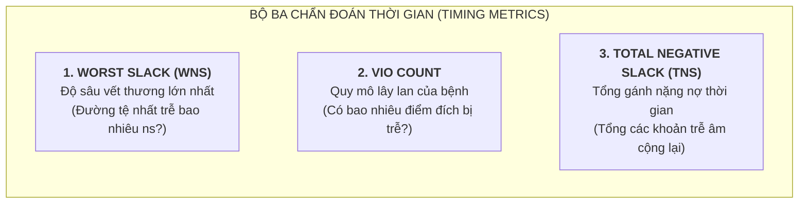
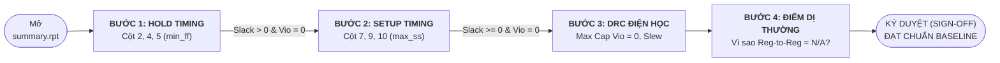
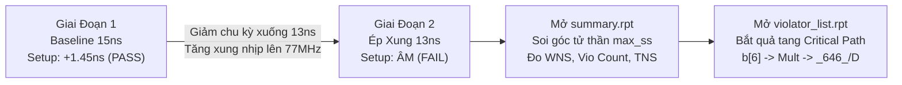
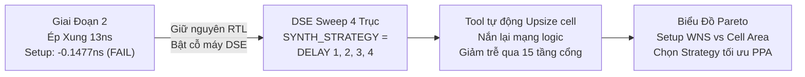
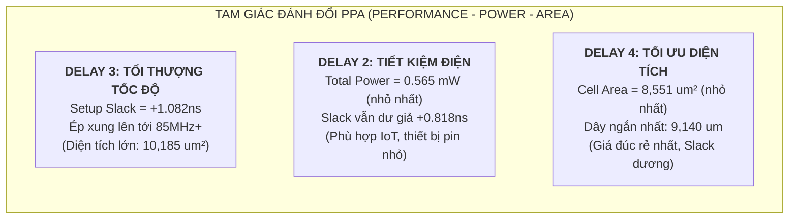
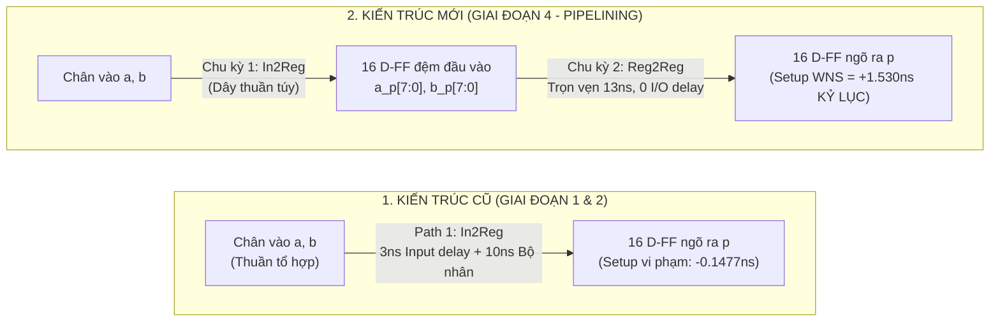
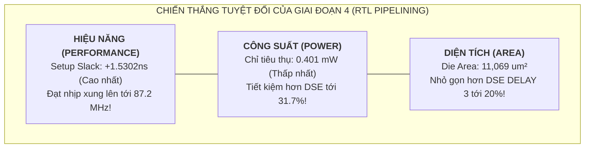

# 📓 SỔ TAY KỸ SƯ: NHỮNG KINH NGHIỆM RÚT RA TRONG QUÁ TRÌNH LÀM BÀI LAB 2
> **Dự án thực hành:** Bộ nhân 8-bit có thanh ghi ngõ ra (8-bit Registered Multiplier - `mult.v`)  
> **Nền tảng EDA:** OpenLane / OpenROAD / CTW SEMI — Thư viện tế bào chuẩn `sky130_fd_sc_hd`  
> **Mục tiêu chuyên môn:** Thành thạo quy trình thiết lập khế ước SDC, phân tích báo cáo STA đa góc PVT, bắt đúng bệnh đường vi phạm và làm chủ 2 phương pháp Timing Closure (DSE vs RTL Pipelining).

---

## 📑 MỤC LỤC CÁC GIAI ĐOẠN THỰC CHIẾN

* [Giai Đoạn 1: Thiết Lập Mốc Chuẩn Vàng (Golden Baseline Setup) & Nghiệm Thu Nhịp Chuẩn 15ns](#-giai-đoạn-1-thiết-lập-mốc-chuẩn-vàng-golden-baseline-setup--nghiệm-thu-nhịp-chuẩn-150ns--6667mhz)
* [Giai Đoạn 2: Thực Nghiệm "Ép Xung" Xuống 13.0ns (76.92MHz) & Bắt Quả Tang Lỗi Setup](#-giai-đoạn-2-thực-nghiệm-ép-xung-xuống-130ns-7692mhz--bắt-quả-tang-vi-phạm-setup)
* [Giai Đoạn 3: Thực Chiến Sửa Lỗi Phương Pháp 1: Tối Ưu Bằng Công Cụ DSE (DELAY 1 đến DELAY 4)](#️-giai-đoạn-3-thực-chiến-sửa-lỗi-phương-pháp-1-tối-ưu-bằng-công-cụ-dse-delay-1-đến-delay-4)
* [Giai Đoạn 4: Đỉnh Cao Kiến Trúc — Sửa Mã RTL (Pipelining + AREA 0)](#-giai-đoạn-4-đỉnh-cao-kiến-trúc--sửa-mã-rtl-pipelining--area-0)
* [Giai Đoạn 5: Tổng Hợp Đối Chứng PPA Toàn Diện & Ký Duyệt Tape-out (Final Sign-off)](#-giai-đoạn-5-tổng-hợp-đối-chứng-ppa-toàn-diện--ký-duyệt-tape-out-final-sign-off)

---

### 🗺️ SƠ ĐỒ KHỐI TỔNG QUAN HÀNH TRÌNH 5 GIAI ĐOẠN LAB 2

> [!NOTE]
> **HƯỚNG DẪN XEM CHI TIẾT SƠ ĐỒ KHỐI TỔNG QUAN:**  
> Sơ đồ khối kiến trúc 2D dưới đây thể hiện toàn cảnh 5 giai đoạn thực chiến của Lab 2: từ xác lập Baseline 15ns, thử thách ép xung 13ns phát hiện lỗi tại góc cực đoan, đến 2 giải pháp tối ưu hóa (DSE Tool vs RTL Pipelining) và đích đến ký duyệt Tape-out GDSII.  
> 💡 **Cách xem chi tiết:** Hãy **nhấp trực tiếp vào sơ đồ khối** để mở chế độ phóng to toàn màn hình (Lightbox). Dùng **con lăn chuột để Zoom in/out** ($0.4\times - 6.0\times$) và **kéo rê chuột để soi chi tiết** từng nhãn tín hiệu và giá trị WNS/Hold Slack.


---

## 🏆 GIAI ĐOẠN 1: THIẾT LẬP MỐC CHUẨN VÀNG (GOLDEN BASELINE SETUP) & NGHIỆM THU NHỊP CHUẨN 15.0ns / 66.67MHz

### 1. Mục Tiêu Kỹ Thuật & Ý Nghĩa Vật Lý
* **Xác lập "Tấm gương chuẩn mực" (Golden Baseline):** Đưa toàn bộ hệ thống mạch số về một trạng thái ban đầu sạch bóng $100\%$ mọi loại vi phạm về Timing (Setup/Hold), DRC điện học (Transition/Capacitance/Fanout) và LVS.
* **Kiểm định tính toàn vẹn của Toolchain:** Bảo đảm mã Verilog gốc `mult.v`, cú pháp SDC trong `mult.sdc`, bộ thư viện SkyWater 130nm và luồng PnR trên nền tảng CTW SEMI ăn khớp hoàn hảo, không có lỗi tiềm ẩn của môi trường trước khi tiến hành can thiệp nâng cao.

---

### 2. Các Bước Thực Hiện Chi Tiết

#### Bước 1.1: Khảo sát mã nguồn RTL gốc (`mult.v`)
* Mạch là bộ nhân $8\text{ bit} \times 8\text{ bit} \rightarrow 16\text{ bit}$ có Reset đồng bộ.
* **Đặc điểm kiến trúc:** Hai cổng vào `a[7:0]` và `b[7:0]` là **chân thuần tổ hợp (Unregistered Inputs)** đi thẳng vào ma trận nhân mà không qua tầng đệm Flip-Flop nào. Ngõ ra `p[15:0]` được chốt bởi 16 con D Flip-Flop.
* Toàn bộ đường đi từ chân ngoài `a`/`b` qua bộ nhân tới chân `D` của 16 Flip-Flop này thuộc nhóm **Path 1 (In2Reg)**.

#### Bước 1.2: Soạn thảo khế ước thời gian ban đầu (`mult.sdc`)
Thiết lập các giới hạn khống chế thời gian và điện học:
```tcl
# 1. Nhịp đồng hồ chính: Chu kỳ 15ns (Tương đương 66.67 MHz)
create_clock -name clk -period 15.0 [get_ports clk]

# 2. Bù trừ suy hao sườn xung (150ps) và biên an toàn Jitter/Skew (0.25ns)
set_clock_transition 0.15 [get_clocks clk]
set_clock_uncertainty 0.25 clk

# 3. Ràng buộc thời gian ngoài chip (Path 1: In2Reg - Chiếm 20% chu kỳ)
set_input_delay 3.0 -clock clk [get_ports a[*]]
set_input_delay 3.0 -clock clk [get_ports b[*]]
set_input_delay 3.0 -clock clk [get_ports rst]

# 4. Ràng buộc thời gian dành cho chip đối tác ngoài bo mạch (Path 3: Reg2Out)
set_output_delay 3.0 -clock clk [get_ports p[*]]

# 5. Hệ số biến thiên nội bộ chip OCV (+-5%)
set_timing_derate -early 0.95
set_timing_derate -late 1.05

# 6. Ràng buộc DRC điện học
set_max_transition 0.75 [current_design]
set_max_capacitance 0.2 [current_design]
set_max_fanout 10 [current_design]
```

#### Bước 1.3: Cấu hình tham số PnR trên CTW SEMI & Thực thi
* Nạp thiết kế vào CTW SEMI với các tham số:
  * `SYNTH_STRATEGY = "AREA 0"` (Chiến lược nén diện tích nhỏ nhất).
  * `FP_CORE_UTIL = 50%` (Mật độ lấp đầy Core mục tiêu).
* Chạy toàn bộ luồng tự động: `Synthesis` $\rightarrow$ `Floorplan` $\rightarrow$ `Placement` $\rightarrow$ `CTS` $\rightarrow$ `Routing` $\rightarrow$ `141-openroad-stapostpnr`.

#### Bước 1.4: Thu thập, Đọc Hiểu & Nghiệm Thu Số Liệu Báo Cáo STA (PD Sign-off)
* **Thông số hình học & Phần cứng (Web Dashboard):**
  * Die Area: $9,648\,\mu\text{m}^2$ ($93.01\,\mu\text{m} \times 103.73\,\mu\text{m}$).
  * Core Area: $6,681\,\mu\text{m}^2$ | Utilization: $62.2\%$.
  * Tổng số tế bào logic: $1,269$ cells.
  * Số lượng tế bào tuần tự: **$16$ Flip-Flops**.
  * Tổng công suất tiêu thụ (Total Power): $0.476\,\text{mW}$.

* **Hình ảnh thực tế file báo cáo STA (`55-openroad-stapostpnr/summary.rpt`):**


*(Nếu xem ở chế độ Text editor không thấy ảnh, nhấn `Ctrl + Shift + V` để mở Preview hoặc [👉 Bấm vào đây để mở ảnh gốc full-size](file:///D:/Tapeout_chip/buoi_3/docs/summary_rpt_phase_1.png))*.

* **Bảng kết quả STA chi tiết trích xuất từ file:**

| Góc PVT (Corner) | Hold Worst Slack | Hold Vio | Setup Worst Slack | Setup Vio | Max Cap Vio | Max Slew Vio | Trạng Thái |
| :--- | :---: | :---: | :---: | :---: | :---: | :---: | :---: |
| **Overall (Toàn Chip)** | **`+2.9096 ns`** | **0** | **`+1.4523 ns`** | **0** | **0** | 110 | ✅ **PASS** |
| `nom_tt_025C_1v80` | `+3.0133 ns` | 0 | `+6.5902 ns` | 0 | 0 | 0 | ✅ PASS |
| `min_ff_n40C_1v95` *(Tử thần Hold)* | **`+2.9096 ns`** | 0 | `+8.5657 ns` | 0 | 0 | 0 | 🛡️ AN TOÀN |
| `max_ss_100C_1v60` *(Tử thần Setup)* | `+3.3143 ns` | 0 | **`+1.4523 ns`** | 0 | 0 | 110 | ✅ ĐẠT CHUẨN |

---

#### 🩺 GIẢI MÃ BỘ BA CHỈ SỐ XÉT NGHIỆM THỜI GIAN: WORST SLACK (WNS), VIO COUNT & TNS

Trong bảng báo cáo STA, ba đại lượng **Worst Slack**, **Violation Count (Vio Count)** và **Total Negative Slack (TNS)** tạo thành hệ thống chỉ số chẩn đoán toàn diện sức khỏe thời gian của con chip:



##### 1. Worst Slack (hay Worst Negative Slack - WNS)
* **Bản chất toán học:** Là độ dôi thời gian của **con đường tệ nhất (Critical Path / Vệt trễ tới hạn)** trong toàn bộ thiết kế:
  $$\text{Slack} = T_{\text{required}} - T_{\text{arrival}}$$
  $$\text{Worst Slack} = \min_{i} (\text{Slack}_i)$$
* **Ý nghĩa vật lý & Quy tắc đánh giá:**
  * **Nếu $\text{Worst Slack} \ge 0$:** Thiết kế **PASS**. Đường đi chậm nhất vẫn kịp về đích trước hạn chót.
  * **Nếu $\text{Worst Slack} < 0$:** Thiết kế **FAIL**. Đường đi tệ nhất bị trễ hạn chót một khoảng bằng $|\text{Worst Slack}|$ (gọi là WNS).
* **Ứng dụng của Kỹ sư PD:** WNS cho biết **độ sâu của vết thương nặng nhất**. Con số này quyết định con chip có đáp ứng được tần số mục tiêu hay không, và nếu phải giảm xung nhịp thì $F_{\max}$ tối đa là bao nhiêu:
  $$T_{\text{clk\_min}} = T_{\text{clk\_target}} - \text{Worst Slack}$$
* **Ẩn dụ:** Một lớp học 40 học sinh làm bài thi quy định nộp lúc 10h00. Em nộp muộn nhất nộp lúc **10h30 (trễ 30 phút)** $\implies \text{Worst Slack} = \mathbf{-30\,\text{phút}}$.

---

##### 2. Violation Count (Vio Count — Số Điểm Vi Phạm)
* **Bản chất:** Là **tổng số lượng chân đích (Endpoints - chân D của Flip-Flop hoặc chân ngõ ra Output port)** có $\text{Slack} < 0$.
* **Tiêu chuẩn Sign-off:** Bắt buộc **`Vio Count = 0`**.
* **Ứng dụng của Kỹ sư PD:** Vio Count cho biết **quy mô lây lan của căn bệnh**:
  * Nếu `Vio Count = 1 hoặc 2`: Bệnh mang tính **cục bộ (Isolated problem)**. Rất dễ cứu bằng cách resize một vài cổng logic to hơn hoặc nắn lại đường dây đi tắt.
  * Nếu `Vio Count = hàng trăm / hàng ngàn`: Bệnh mang tính **hệ thống (Systemic problem)**. Toàn bộ thiết kế đang bị quá tải, chứng tỏ xung nhịp bị ép phi thực tế hoặc cây phân phối Clock Tree (CTS) bị gãy đổ nghiêm trọng!
* **Ẩn dụ:** Trong lớp 40 học sinh, có **5 em nộp bài sau 10h00** $\implies \text{Vio Count} = \mathbf{5}$.

---

##### 3. Total Negative Slack (TNS — Tổng Độ Trễ Âm)
* **Bản chất toán học:** Là **tổng cộng dồn tất cả các giá trị Slack âm** của toàn bộ các điểm đích vi phạm:
  $$\text{TNS} = \sum_{\text{Slack}_i < 0} \text{Slack}_i$$
  > [!CAUTION]
  > **Quy tắc bù trừ nghiêm ngặt:** Các đường truyền có Slack dương ($\ge 0$) **TUYỆT ĐỐI KHÔNG ĐƯỢC CỘNG VÀO ĐỂ BÙ TRỪ!** TNS là thước đo gom toàn bộ các "món nợ thời gian" thuần túy.
* **Ý nghĩa vật lý:**
  * Nếu mạch sạch bóng vi phạm: $\text{TNS} = \mathbf{0.0000\,\text{ns}}$.
  * Nếu mạch có vi phạm: TNS luôn là **một số âm**.
* **Ứng dụng của Kỹ sư PD:** TNS đại diện cho **tổng nỗ lực cần bỏ ra để dọn sạch lỗi (Timing Closure Effort)**. Các thuật toán tự động PnR / DSE luôn lấy TNS làm hàm mục tiêu (Cost Function): tìm cách co kéo TNS từ số âm lớn về tiệm cận $0.0000$.
* **Ẩn dụ:** 5 em học sinh nộp muộn: Em 1 muộn $30$p, Em 2 muộn $20$p, Em 3 muộn $10$p, Em 4 muộn $5$p, Em 5 muộn $5$p:
  $$\implies \text{TNS} = -(30 + 20 + 10 + 5 + 5) = \mathbf{-70\,\text{phút}}$$
  Con số $-70$ phút chính là **tổng món nợ thời gian** mà cả lớp đang thiếu hụt đối với bài thi.

---

##### 📊 Bảng Đối Chứng "Bắt Bệnh" Của Kỹ Sư PD Qua 3 Chỉ Số

| Tình huống thực tế | Worst Slack (WNS) | Vio Count | Total Negative Slack (TNS) | Chẩn đoán & Hành động của Kỹ sư PD |
| :--- | :---: | :---: | :---: | :--- |
| **Ca bệnh A** | **`-0.60 ns`** | **`1`** | **`-0.60 ns`** | 🟡 **Vết thương sâu nhưng đơn lẻ:** Chỉ có đúng 1 Flip-Flop bị trễ nặng. Kỹ sư PD chỉ cần can thiệp thủ công (ECO) thay một con buffer lớn hơn là xong ngay trong 5 phút. |
| **Ca bệnh B** | **`-0.02 ns`** | **`1,500`** | **`-30.00 ns`** | 🔴 **Bệnh lan tràn toàn diện:** Từng đường trễ rất ít (chỉ $-0.02\,\text{ns}$), nhưng có tới 1,500 đường bị dính! Tổng nợ thời gian lên tới $-30\,\text{ns}$. Tuyệt đối không thể sửa bằng tay, bắt buộc phải hạ xung nhịp hoặc chạy lại Floorplan/CTS! |
| **Lần chạy Phase 1 Thực Tế** | **`+1.4523 ns`** | **`0`** | **`0.0000 ns`** | 🟢 **Khỏe mạnh tuyệt đối:** Không có nợ nần (TNS = 0), không có nạn nhân (Vio Count = 0), đường yếu nhất vẫn đến sớm hơn hạn chót $+1.45\,\text{ns}$. |

---

#### 🧭 CẨM NANG THỰC CHIẾN: QUY TRÌNH 4 BƯỚC "SOI" BÁO CÁO STA CỦA KỸ SƯ PHYSICAL DESIGN (PD SIGN-OFF)

Là một **Kỹ sư Physical Design (PD / Backend Engineer)** — người chịu trách nhiệm tối thượng trước khi ký duyệt xuất file GDSII sang nhà máy đúc chip (Foundry), quy trình kiểm định file `summary.rpt` bắt buộc phải tuân thủ 4 bước kiểm tra nghiêm ngặt:



##### 1. Bước 1: Soi "Tử Huyệt" Giết Chết Chip — Cột HOLD TIMING (Cột 2, 4, 5)
* **Triết lý nghề nghiệp:** Lỗi Setup có thể chữa cháy bằng cách hạ xung nhịp hoạt động, nhưng **lỗi Hold sẽ biến con chip thành "cục gạch" phế liệu (Dead on Arrival) không có cách nào cứu vãn được!**
* **Vị trí quan sát:** Cột `Hold Worst Slack`, `Hold TNS`, `Hold Vio Count`.
* **Góc quét bắt buộc:** Dòng **`min_ff_n40C_1v95`** (Góc Nhanh Nhất: Fast-Fast, nhiệt độ đóng băng $-40^\circ\text{C}$, điện áp thừa mứa $1.95\,\text{V}$).
* **Tiêu chuẩn phê duyệt (Sign-off Criteria):** Bắt buộc `Hold Worst Slack > 0` và `Hold Vio Count = 0`.
* **Đánh giá thực tế:**
  * `Hold Worst Slack = +2.9096 ns` | `Hold Vio Count = 0` | `Hold TNS = 0.0000`.
  * $\implies$ 🟢 **TUYỆT ĐỐI AN TOÀN.** Cây phân phối đồng hồ (CTS) được cân bằng xuất sắc, không có đường dữ liệu nào chạy quá nhanh đè hỏng dữ liệu chu kỳ trước. Không cần phải tốn diện tích chèn thêm Delay Buffer.

##### 2. Bước 2: Soi "Giới Hạn Hiệu Năng" — Cột SETUP TIMING (Cột 7, 9, 10)
* **Triết lý nghề nghiệp:** Đảm bảo con chip đạt được đúng xung nhịp định mức mà khách hàng và đội ngũ Kiến trúc (Architect) yêu cầu.
* **Vị trí quan sát:** Cột `Setup Worst Slack`, `Setup TNS`, `Setup Vio Count`.
* **Góc quét bắt buộc:** Dòng **`max_ss_100C_1v60`** (Góc Chậm Nhất: Slow-Slow, nhiệt độ sôi $100^\circ\text{C}$, sụt áp $1.60\,\text{V}$).
* **Tiêu chuẩn phê duyệt:** Bắt buộc `Setup Worst Slack >= 0` tại chu kỳ clock mục tiêu ($15.0\,\text{ns}$).
* **Đánh giá thực tế:**
  * `Setup Worst Slack = +1.4523 ns` | `Setup Vio Count = 0` | `Setup TNS = 0.0000`.
  * $\implies$ 🟢 **ĐẠT CHUẨN HIỆU NĂNG.** 
  * **Tầm nhìn của Kỹ sư PD kỳ cựu:** Thiết kế đang **dư dả tới $+1.4523\,\text{ns}$**. Điều này mở ra 2 hướng đi chiến lược:
    1. Hoặc là ta có thể **ép xung cao hơn** (lên tới $\approx 73.8\,\text{MHz}$) để tăng giá trị thương mại cho sản phẩm.
    2. Hoặc là ở nhịp $15\,\text{ns}$, ta có thể **thu nhỏ kích thước cell (Downsize cells)** để tiết kiệm diện tích silicon và giảm tiêu hao năng lượng pin!

##### 3. Bước 3: Soi Giới Hạn Điện Học — Cột DRC (2 Cột Cuối Bảng)
* **Cột `Max Cap Violations`:** Phải bằng **`0`**. (Bài của ta $= 0 \implies$ Không có cổng nào bị quá tải dung tụ ký sinh $> 0.2\,\text{pF}$).
* **Cột `Max Slew Violations`:** 
  * Ở điều kiện phòng bình thường (`nom_tt`): Bằng **`0`**.
  * Ở điều kiện cực đoan (`max_ss`): Có **`110`** điểm sườn xung bị lài ($> 0.75\,\text{ns}$).
  * **Trách nhiệm của PD:** Ghi nhận 110 điểm này. Trong các sản phẩm chuẩn thương mại siêu tin cậy (ô tô / máy bay), PD sẽ kích hoạt lệnh `PL_RESIZER_DESIGN_OPTIMIZATIONS` hoặc chèn Buffer tự động để dọn sạch 110 điểm này.

##### 4. Bước 4: "Bắt Mạch" Điểm Bất Thường — Tại Sao `Reg to Reg Paths = N/A`?
* Khi soi vào **Cột 3 và Cột 8**, giá trị ghi chữ **`N/A`** (Not Applicable).
* **Bản chất phần cứng:** Mạch nhân `mult.v` gốc có ngõ vào `a[7:0]` và `b[7:0]` là **chân cổng thuần tổ hợp (Unregistered Inputs)**. Tín hiệu đi thẳng từ chân ngoài xuyên qua ma trận bộ nhân rồi mới tới Flip-Flop ngõ ra `p[15:0]`.
* Mạch chỉ có đường **In2Reg (Path 1)** và **Reg2Out (Path 3)**, **HOÀN TOÀN KHÔNG CÓ ĐƯỜNG Reg2Reg (Path 2)** nào bên trong ruột chip!
* $\implies$ **Đây chính là cơ sở vật lý dẫn lối sang Giai đoạn 4 của bài Lab:** Chèn thêm thanh ghi đệm đầu vào và thanh ghi đường ống (**RTL Pipelining**) để chia nhỏ bộ nhân, biến mạch thành kiến trúc Reg-to-Reg chuẩn mực công nghiệp!

---

### 3. Những Kinh Nghiệm Xương Máu Rút Ra Từ Giai Đoạn 1

> [!CAUTION]
> #### 🧠 BÀI HỌC 0: "Tử Huyệt" Nhầm Lẫn Giữa RTL Synthesizable và Testbench (Lỗi Cú Pháp '@' & Bão Cảnh Báo TIMESCALEMOD)
> * **Hiện tượng lỗi thực tế:** Khi chạy flow, màn hình bị ngập tràn hàng trăm cảnh báo `%Warning-TIMESCALEMOD` ở bước Verilator Lint, sau đó văng lỗi crash flow tại bước Yosys JsonHeader:
>   ```text
>   3. Executing Verilog-2005 frontend: verify/mult_tb.v
>   verify/mult_tb.v:16: ERROR: syntax error, unexpected '@'
>   Generate JSON Header: subprocess failed. LibreLane will now quit.
>   ```
> * **Bản chất kỹ thuật:**
>   1. **`verify/mult_tb.v` là bàn thử nghiệm mô phỏng (Testbench):** File này sinh ra để cấp sóng kích thích kiểm tra mạch logic, chứa các hàm thời gian ảo không thể chế tạo thành silicon vật lý như `@(posedge clk)`, `#5 clk = ~clk`, `$dumpfile`. Yosys là công cụ tổng hợp mạch logic thực, khi gặp ký tự `@` trơ trọi nó sẽ lập tức báo lỗi cú pháp.
>   2. **Bão cảnh báo `TIMESCALEMOD`:** File testbench có chỉ thị `` `timescale 1ns/1ps ``, trong khi các cell thư viện `sky130_fd_sc_hd` không có. Chuẩn IEEE 1800 quy định nếu một module có timescale thì tất cả các module cùng gói biên dịch phải có, khiến Verilator bung ra 447 warnings.
> * **Khắc phục triệt để:** Trong giao diện chọn file nguồn (Verilog Sources), **BỎ TÍCH (UNCHECK)** file `verify/mult_tb.v`, **CHỈ CHỌN DUY NHẤT** `src/mult.v`. (Tuân thủ nghiêm ngặt chỉ dẫn *"Chỉ tổng hợp file thiết kế"* tại Trang 2 `Tapeout_LAB2.pdf`).

---

> [!IMPORTANT]
> #### 🧠 BÀI HỌC 1: Nguyên Tắc "Hiệu Chuẩn Cân Về Số Không" (Zero-Calibration Principle)
> * Trong kỹ nghệ vi mạch, **tuyệt đối không bao giờ nhảy ngay vào ép xung hoặc tối ưu code khi chưa có một run Baseline sạch $100\%$.**
> * Nếu bạn vội vàng chạy ngay ở nhịp $13\,\text{ns}$ và bị báo lỗi đỏ, bạn sẽ rơi vào ma trận hoang mang: *Không biết lỗi này do code sai cú pháp, do file SDC viết nhầm cổng, do tool cài thiếu thư viện, hay thực sự do xung nhịp quá cao?*
> * Mốc **Golden Baseline 15ns** chính là "chứng minh thư" xác nhận rằng: Mọi thứ trong hệ thống đều chuẩn xác, mạch hoàn toàn hoạt động được.

---

> [!TIP]
> #### 🧠 BÀI HỌC 2: Bí Quyết Phân Bổ Ngân Sách Thời Gian I/O Delay (The 20% Budget Rule)
> * Con số `set_input_delay 3.0` và `set_output_delay 3.0` được trích từ quy tắc thiết kế công nghiệp: **Dành 20% chu kỳ clock cho môi trường ngoài chip** ($3.0\,\text{ns} / 15.0\,\text{ns} = 20\%$).
> * Khi trừ hao thêm $0.25\,\text{ns}$ cho Clock Uncertainty, phần cứng mạch nhân bên trong chip thực tế chỉ còn lại:
>   $$T_{\text{internal\_budget}} = 15.0 - 3.0 - 0.25 = \mathbf{11.75\,\text{ns}}$$
> * Đây là con số thực tế mà các cổng logic bên trong chip phải tuân thủ, chứ không phải toàn bộ $15\,\text{ns}$!

---

> [!NOTE]
> #### 🧠 BÀI HỌC 3: Công Thức Toán Học Tiên Tri Giới Hạn Vật Lý Của Con Chip ($F_{\max\text{, estimate}}$)
> Nhìn vào báo cáo của góc chậm nhất `max_ss_100C_1v60`, ta có Setup Worst Slack = **$+1.4523\,\text{ns}$**. Điều này có nghĩa là ở nhịp $15\,\text{ns}$, tín hiệu đến sớm hơn hạn chót một khoảng $1.4523\,\text{ns}$.
> 
> Ta có thể tính ra ngay **chu kỳ xung nhịp tối thiểu mà con chip này có thể chịu đựng được**:
> $$T_{\text{clk\_min}} = T_{\text{clk\_hien\_tai}} - \text{Setup\_Slack} = 15.0\,\text{ns} - 1.4523\,\text{ns} = \mathbf{13.5477\,\text{ns}}$$
> 
> Từ đó, tần số hoạt động tối đa của kiến trúc hiện tại được dự báo chính xác là:
> $$F_{\max\text{, estimate}} = \frac{1}{T_{\text{clk\_min}}} = \frac{1}{13.5477\,\text{ns}} \approx \mathbf{73.81\,\text{MHz}}$$
> 
> 🔮 **TẦM QUAN TRỌNG:** Con số $13.5477\,\text{ns}$ ($73.81\,\text{MHz}$) cho ta biết trước một sự thật vật lý hiển nhiên: **Nếu ở Giai đoạn 2 ta ép xung xuống $13.0\,\text{ns}$ ($76.92\,\text{MHz}$), mạch CHẮC CHẮN 100% SẼ BỊ LỖI SETUP TIME!** (Vì $13.0\,\text{ns} < 13.5477\,\text{ns}$).  
> $\implies$ Việc ép xung ở Giai đoạn 2 không phải là thử vận may, mà là một **thực nghiệm khoa học đã được tính toán định lượng từ trước!**

---

> [!WARNING]
> #### 🧠 BÀI HỌC 4: Hiểu Đúng Về Lỗi Slew Violation (110 điểm lỗi sườn xung)
> * Trong báo cáo góc `max_ss`, có xuất hiện `Max Slew Violations: 110`. Nhiều người mới học sẽ lo sợ chip hỏng.
> * **Bản chất thực tế:** Lỗi này chỉ xuất hiện ở góc nhiệt độ cao $100^\circ\text{C}$ và sụt áp $1.60\,\text{V}$ (khi các transistor dẫn dòng yếu làm sườn dốc tín hiệu bị lài ra $> 0.75\,\text{ns}$).
> * Ở góc nhiệt độ phòng `nom_tt_025C_1v80` và góc nhanh `min_ff`, Max Slew hoàn toàn bằng **`0`**. Chip vẫn hoạt động bình thường và an toàn trong dải nhiệt độ thực tế của người dùng.

---

---

## ⚡ GIAI ĐOẠN 2: THỰC NGHIỆM "ÉP XUNG" XUỐNG 13.0ns (76.92MHz) & BẮT QUẢ TANG VI PHẠM SETUP



### 1. Mục Tiêu Kỹ Thuật & Ý Nghĩa Thực Nghiệm
* **Chủ động tạo vi phạm có kiểm soát:** Đẩy xung nhịp hoạt động từ $66.67\,\text{MHz}$ ($15.0\,\text{ns}$) lên **$76.92\,\text{MHz}$ ($13.0\,\text{ns}$)** — vượt qua ngưỡng giới hạn vật lý của mạch ($F_{\max} \approx 73.8\,\text{MHz}$ đã tính ở Giai đoạn 1).
* **Rèn luyện kỹ năng lâm sàng của Kỹ sư PD:**
  1. Chứng kiến tận mắt cỗ máy OpenSTA chuyển trạng thái sang **báo động đỏ (FAIL)** khi xuất hiện Slack âm.
  2. Bắt đúng góc gây ra vi phạm duy nhất: góc chậm nhất **`max_ss_100C_1v60`**.
  3. Định vị chính xác tọa độ của đường trễ tới hạn (Critical Path) gây ra lỗi (thuộc nhóm **Path 1: In2Reg**).
  4. Thu thập số liệu baseline bị lỗi để làm bàn đạp cho công đoạn sửa lỗi tự động (DSE) ở Giai đoạn 3 và sửa kiến trúc (Pipelining) ở Giai đoạn 4.

---

### 2. Kế Hoạch 4 Bước Thực Hiện Chi Tiết

#### Bước 2.1: Điều chỉnh chu kỳ Clock trong cấu hình CTW SEMI
* Trên giao diện Web CTW SEMI:
  * Truy cập mục cấu hình Run flow (hoặc sửa trong file `config.json`):
  * **Đổi tham số:**
    $$\mathbf{CLOCK\_PERIOD = 13.0}$$
  * Giữ nguyên các thông số khác: PDK `sky130A`, SCL `sky130_fd_sc_hd`, chỉ chọn duy nhất `src/mult.v`.
  * Đặt tên thẻ chạy (Run Tag): **`run_mult_phase_2`**.

#### Bước 2.2: Kích hoạt Run Flow & Quan sát cảnh báo
* Bấm nút **`Run flow`**.
* Hệ thống sẽ thực thi luồng PnR từ bước 01 đến bước cuối cùng (khoảng 60 giây).
* **Hiện tượng đón đầu:** Lần này ở bước cuối `OpenROAD.STAPostPNR` và thẻ chạy trên Dashboard sẽ đổi màu cảnh báo vi phạm Timing.

#### Bước 2.3: Mở bảng điểm `summary.rpt` & Đọc 3 chỉ số xét nghiệm (WNS, Vio Count, TNS)
* Truy cập `Runs -> Files -> 55-openroad-stapostpnr/summary.rpt`:
* Áp dụng nguyên tắc **"2 liếc mắt"**:
  1. **Liếc 1 (Góc Setup `max_ss_100C_1v60`):** Đo đạc Setup Worst Slack (dự kiến âm khoảng $-0.15\,\text{ns}$ đến $-0.55\,\text{ns}$), Setup Vio Count (dự kiến $2 - 3$ điểm), và Setup TNS.
  2. **Liếc 2 (Góc Hold `min_ff_n40C_1v95`):** Xác nhận Hold Slack **vẫn dương an toàn** ($> +2.3\,\text{ns}$) $\implies$ Chứng minh ép xung chỉ làm hỏng Setup chứ không làm hỏng Hold!

#### Bước 2.4: Mở báo cáo chi tiết để "chỉ mặt điểm tên" đường Critical Path
* Mở file báo cáo đường vi phạm chi tiết tại:  
  📂 `55-openroad-stapostpnr/max_ss_100C_1v60/mult.rpt` (hoặc `violator_list.rpt`).
* Xác định:
  * **Startpoint (Điểm xuất phát):** Chân ngõ vào `b[6]`.
  * **Datapath (Đường dẫn dữ liệu):** Xuyên qua ma trận cộng nhân thuần tổ hợp nặng nề.
  * **Endpoint (Điểm kết thúc):** Chân dữ liệu `D` của Flip-Flop ngõ ra `_646_/D`.
  * $\implies$ Kết luận dứt khoát: **Thủ phạm chính là đường Path 1 (In2Reg)**.

---

### 3. Bảng Dự Báo Số Liệu Trước Khi Chạy (Pre-Run Hypothesis)

| Chỉ số kỹ thuật | Giai đoạn 1 (Nhịp 15.0ns) | Giai đoạn 2 (Dự kiến ở 13.0ns) | Ý nghĩa kỹ thuật |
| :--- | :---: | :---: | :--- |
| **Tần số hoạt động** | $66.67\,\text{MHz}$ | **$76.92\,\text{MHz}$** | Tăng tốc thêm $+15.4\%$ |
| **Setup WNS (`max_ss`)** | `+1.4523 ns` (PASS) | **ÂM ($-0.15\,\text{ns} \sim -0.55\,\text{ns}$)** | Bị trễ hạn chót chu kỳ clock |
| **Setup Vio Count** | `0` | **$2 \sim 3$ điểm** | Vi phạm mang tính cục bộ tại các bit nhân cao |
| **Hold WNS (`min_ff`)** | `+2.9096 ns` (PASS) | **DƯƠNG ($> +2.3\,\text{ns}$)** | Hoàn toàn miễn nhiễm với lỗi Hold |
| **Trạng thái toàn chip** | 🟢 **PASS 100%** | 🔴 **FAIL (Setup Violation)** | Sẵn sàng làm đề bài cho Giai đoạn 3 & 4 |

---

### 4. Kết Quả Thực Nghiệm Lâm Sàng Sau Khi Ép Xung 13.0ns

* **Hình ảnh thực tế file báo cáo STA (`runs/run_mult_phase_2/55-openroad-stapostpnr/summary.rpt`):**


*(Nếu xem ở chế độ Text editor không thấy ảnh, nhấn `Ctrl + Shift + V` để mở Preview hoặc [👉 Bấm vào đây để mở ảnh gốc full-size](file:///D:/Tapeout_chip/buoi_3/docs/summary_rpt_phase_2.png))*.

* **Bảng kết quả STA chi tiết trích xuất thực tế từ `run_mult_phase_2`:**

| Góc PVT (Corner) | Hold Worst Slack | Hold Vio | Setup Worst Slack | Setup TNS | Setup Vio Count | Max Cap Vio | Max Slew Vio | Trạng Thái Timing |
| :--- | :---: | :---: | :---: | :---: | :---: | :---: | :---: | :--- |
| **Overall (Toàn Chip)** | **`+2.5096 ns`** | **0** | **`-0.1477 ns`** | **`-0.1766 ns`** | **3** | **0** | 110 | 🚨 **FAIL (Setup)** |
| `nom_tt_025C_1v80` | `+2.6133 ns` | 0 | `+4.9902 ns` | `0.0000 ns` | 0 | 0 | 0 | ✅ PASS (Dư dả) |
| `min_ff_n40C_1v95` *(Tử thần Hold)* | **`+2.5096 ns`** | 0 | `+6.9657 ns` | `0.0000 ns` | 0 | 0 | 0 | 🛡️ **TUYỆT ĐỐI AN TOÀN** |
| `nom_ss_100C_1v60` | `+2.9071 ns` | 0 | **`-0.0710 ns`** | `-0.0710 ns` | 1 | 0 | 77 | ❌ Vi phạm 1 đường |
| `min_ss_100C_1v60` | `+2.8992 ns` | 0 | `+0.0184 ns` | `0.0000 ns` | 0 | 0 | 55 | ⚠️ Suýt soát đạt |
| `max_ss_100C_1v60` *(Tử thần Setup)* | `+2.9143 ns` | 0 | **`-0.1477 ns`** | **`-0.1766 ns`** | **2** | 0 | 110 | 🚨 **TRỌNG ĐIỂM VI PHẠM** |

---

* **Bắt quả tang thủ phạm trong file `violator_list.rpt`:**
```text
===========================================================================
Violator List (runs/run_mult_phase_2/55-openroad-stapostpnr/max_ss_100C_1v60)
============================================================================
[setup in-reg] b[6] -> _646_/D : -0.147699
[setup in-reg] b[6] -> _645_/D : -0.028915
```

---

### 5. Những Kinh Nghiệm Xương Máu Rút Ra Từ Giai Đoạn 2

> [!CAUTION]
> #### 🧠 BÀI HỌC 1: Cạm Bẫy "Tool Completed / Passed" — Đừng Bao Giờ Nhầm Lẫn Giữa "Tool Chạy Xong" và "Chip Đạt Chuẩn Sign-off"
> * **Hiện tượng gây bối rối:** Giao diện CTW SEMI báo `run_mult_phase_2 completed / passed` màu xanh lá, không hề có lỗi báo dừng (No crash). Nhưng khi mở `summary.rpt` ra thì lại thấy Setup Slack bị âm `Setup WS = -0.1477 ns`!
> * **Bản chất kỹ thuật sống còn:**
>   1. **Trạng thái của Tool (Software Status):** Tool chỉ báo "Passed" khi mã nguồn không có lỗi cú pháp, công cụ PnR không bị crash đứt gãy giữa chừng, và toàn bộ layout chip đã được vẽ xong dây kim loại $100\%$ không bị hở mạch.
>   2. **Tool là cỗ máy báo cáo (Reporting Engine):** Tool không tự ý dừng luồng khi phát hiện vi phạm timing (biến `QUIT_ON_TIMING_VIOLATIONS` mặc định là `false`). Nếu cứ thấy vi phạm là tool tự dừng khẩn cấp thì kỹ sư sẽ không bao giờ có được file `summary.rpt` hay `violator_list.rpt` để biết con chip bị lỗi ở góc nào, đường nào để sửa!
>   3. **Trách nhiệm tối cao thuộc về Kỹ sư PD:** Tool chỉ cung cấp "bảng điểm", còn quyết định con chip này "sống hay chết" là do Kỹ sư PD ký duyệt (Sign-off). Nếu kỹ sư PD chỉ nhìn chữ "Completed" xanh lá mà vội vàng mang file GDSII này gửi sang nhà máy đúc chip (Foundry), con chip ra lò đem bán sẽ bị khách hàng trả về vì bị tính toán sai khi máy bị nóng lên $100^\circ\text{C}$!

---

> [!TIP]
> #### 🧠 BÀI HỌC 2: Sự Kỳ Diệu Của Khoa Học Định Lượng — Tiên Tri Chuẩn Xác Đến Từng Picosecond
> * Ở Giai đoạn 1, ta đã dùng công thức toán học tiên tri:
>   $$T_{\text{clk\_min}} = 15.0\,\text{ns} - 1.4523\,\text{ns} = 13.5477\,\text{ns} \implies F_{\max} \approx 73.81\,\text{MHz}$$
> * Ở Giai đoạn 2, khi ta ép xung xuống $13.0\,\text{ns}$ ($76.92\,\text{MHz}$), kết quả đo đạc thực tế tại góc `max_ss` cho ra đúng:
>   $$\text{Setup Worst Slack} = \mathbf{-0.1477\,\text{ns}}$$
> * Tần số trần thực tế đo được sau PnR:
>   $$T_{\text{min\_actual}} = 13.0\,\text{ns} + 0.1477\,\text{ns} = \mathbf{13.1477\,\text{ns}} \implies F_{\max\text{, actual}} = \frac{1}{13.1477\,\text{ns}} \approx \mathbf{76.06\,\text{MHz}}$$
> * Mức độ thiếu hụt thời gian cực kỳ nhỏ:
>   $$\text{Tỷ lệ thiếu hụt} = \frac{0.1477\,\text{ns}}{13.0\,\text{ns}} \times 100\% \approx \mathbf{1.13\%}$$
> * 👉 **Kết luận:** Mạch chỉ thiếu vẻn vẹn $1.13\%$ thời gian chu kỳ và chỉ bị ở góc nhiệt độ cao nhất $100^\circ\text{C}$!

---

> [!NOTE]
> #### 🧠 BÀI HỌC 3: Chẩn Đoán Bệnh Án Qua Bộ Ba Chỉ Số — "Vết Thương Nông & Cục Bộ"
> * Nhìn vào bộ ba xét nghiệm:
>   * $\text{WNS} = \mathbf{-0.1477\,\text{ns}}$ (Vết thương rất nông, chỉ $147.7\,\text{ps}$).
>   * $\text{Vio Count} = \mathbf{3}$ (Chỉ có đúng 3 điểm đích bị trễ trong toàn bộ con chip).
>   * $\text{TNS} = \mathbf{-0.1766\,\text{ns}}$ (Tổng nợ thời gian của toàn chip cực kỳ nhỏ).
> * $\implies$ **Phán quyết của Kỹ sư PD:** Đây là một căn bệnh **mang tính cục bộ hoàn toàn (Isolated Timing Problem)** tập trung ở các bit trọng số cao (`b[6] -> _646_/D`). Nó KHÔNG PHẢI là thảm họa hệ thống.
> * Với một vết thương nhẹ $1.13\%$ như thế này, chúng ta hoàn toàn có thể "chữa khỏi bệnh" bằng 2 phương pháp:
>   1. **Dùng sức mạnh của Tool (Giai đoạn 3):** Chạy DSE `DELAY 1` đến `DELAY 4` để tool tự động phóng to cell (Upsizing).
>   2. **Dùng đỉnh cao Kiến trúc (Giai đoạn 4):** Sửa code RTL thêm thanh ghi đệm đầu vào (Pipelining) để biến đường Path 1 (In2Reg) thành Path 2 (Reg2Reg), dập tắt hoàn toàn mọi lỗi Setup mà không tốn diện tích!

---

---

## 🛠️ GIAI ĐOẠN 3: THỰC CHIẾN SỬA LỖI PHƯƠNG PHÁP 1: TỐI ƯU BẰNG CÔNG CỤ DSE (DELAY 1 ĐẾN DELAY 4)



### 1. Mục Tiêu Kỹ Thuật & Triết Lý "Để Tool Tự Gánh"
* **Bản chất kỹ thuật:** Ở Giai đoạn 2, ta đã xác định mạch chỉ bị thiếu hụt $0.1477\,\text{ns}$ ($1.13\%$) thời gian. Thay vì can thiệp sửa mã Verilog, ta khai thác sức mạnh của cỗ máy tổng hợp logic (Yosys + ABC Engine) để **tự động sửa lỗi Timing**.
* **Cơ chế hoạt động của các chiến lược `DELAY`:**
  * Chiến lược mặc định ban đầu là `AREA 0` (công cụ ưu tiên nhồi các cổng kích thước nhỏ nhất Drive `_1` để tiết kiệm diện tích, chấp nhận điện trở dẫn cao làm trễ lớn).
  * Khi chuyển sang **`DELAY 1` đến `DELAY 4`**: Công cụ ABC sẽ tự động:
    1. **Upsizing Cell:** Thay thế các cổng yếu bằng các cổng có độ lái lớn hơn (Drive strength `_2`, `_4`, `_8`) để bơm dòng nạp tụ nhanh hơn, giảm trễ chuyển mức sườn xung.
    2. **Logic Restructuring:** Tái cấu trúc ma trận cộng nhân, sắp xếp lại các nhánh rẽ để đường tới hạn (Critical Path từ `b[6]`) đi qua ít tầng cổng logic nhất có thể.
* **Mục tiêu thực nghiệm DSE:** Quét tự động 4 chiến lược `DELAY 1`, `DELAY 2`, `DELAY 3`, `DELAY 4` ở chu kỳ ép xung $13.0\,\text{ns}$, đưa Setup Slack từ **ÂM sang DƯƠNG (Timing Closure)** và phân tích sự đánh đổi diện tích (PPA Trade-off) trên đồ thị Pareto.

---

### 2. Kế Hoạch 5 Bước Thực Hiện Chi Tiết Trên CTW SEMI

#### Bước 3.1: Mở Tab DSE trên thanh công cụ
* Trên giao diện Web CTW SEMI:
  * Nhìn vào thanh sidebar màu đen bên tay trái màn hình:
  * Click vào mục **`DSE`** (Design-Space Exploration — có icon hình bình tam giác thí nghiệm, nằm giữa mục `Runs` và `Preview`).

#### Bước 3.2: Thiết lập trục biến thiên khảo sát (DSE Axis Setup)
* Trong giao diện cấu hình DSE:
  * **Biến khảo sát (Variable / Axis):** Chọn hoặc thêm `SYNTH_STRATEGY`.
  * **Giá trị gán cho trục (Values):** Điền 4 giá trị chiến lược:
    $$\mathbf{DELAY\ 1,\ DELAY\ 2,\ DELAY\ 3,\ DELAY\ 4}$$
    > [!IMPORTANT]
    > **Cú pháp bắt buộc:** Chữ `DELAY` viết hoa, **có dấu cách ở giữa**, không có dấu gạch ngang! (Ví dụ: `DELAY 1`, không phải `DELAY_1` hay `delay1`).
  * **Chu kỳ Clock:** Giữ nguyên mức ép xung: `CLOCK_PERIOD = 13.0`.
  * **File nguồn:** Giữ nguyên chỉ chọn duy nhất `src/mult.v`.
* *(Lưu ý về RAM: Nếu hệ thống cảnh báo bộ nhớ, kỹ sư có thể add từng biến để chạy sweep tuần tự từng run, tool sẽ tự động đặt tên theo cú pháp `dse-mult-tenbien`)*.

#### Bước 3.3: Kích hoạt quét tự động (Run Sweep)
* Bấm nút **`Run sweep`**.
* Cỗ máy DSE sẽ tự động kích hoạt 4 luồng chạy RTL-to-GDS song song/tuần tự:
  1. `dse-mult-DELAY 1`
  2. `dse-mult-DELAY 2`
  3. `dse-mult-DELAY 3`
  4. `dse-mult-DELAY 4`

#### Bước 3.4: Thu thập số liệu và Soi Biểu Đồ Pareto (`View metrics & plots`)
* Sau khi cả 4 run hoàn thành:
  * Tích chọn cả 4 lượt chạy trên bảng DSE.
  * Bấm nút **`View metrics & plots`** ở góc trên.
  * Màn hình sẽ hiển thị **Biểu đồ phân bố Pareto (Pareto Frontier)**:
    * **Trục tung (Y-axis):** `Setup Worst Slack` (Độ dôi thời gian - Càng cao càng chạy nhanh).
    * **Trục hoành (X-axis):** `Cell Area` (Diện tích tế bào - Càng nhỏ càng tiết kiệm chi phí).

#### Bước 3.5: Đối chứng PPA & Khám phá chiến lược tối ưu nhất
* Soi bảng điểm STA của cả 4 chiến lược:
  * Xác nhận toàn bộ `Setup TNS = 0.0000` và `Setup WNS > 0` $\implies$ **Khẳng định cả 4 chiến lược DELAY đều Timing Closure thành công tại nhịp 13.0ns!**
  * Nhận diện "Chiến lược vô địch về tốc độ": **`DELAY 3`** đưa Setup Slack từ âm $-0.1477\,\text{ns}$ nhảy vọt lên mốc dương kỷ lục **`+1.082 ns`**!
  * Đánh giá chi phí PPA: Đánh đổi lại mức Slack dương lớn, diện tích Core Area đã bị phình to ra bao nhiêu $\%$.

---

### 3. Bảng Kết Quả Thực Nghiệm DSE Sweep Thực Tế (4 Runs Compared)

* **Hình ảnh chụp từ giao diện Web CTW SEMI sau khi chạy quét DSE:**


*(Nếu xem ở chế độ Text editor không thấy ảnh, nhấn `Ctrl + Shift + V` để mở Preview hoặc [👉 Bấm vào đây để mở ảnh gốc full-size](file:///D:/Tapeout_chip/buoi_3/docs/dse_sweep_results_phase_3.png))*.

* **Bảng số liệu đối chứng chi tiết PPA giữa 4 chiến lược:**

| Chỉ số kỹ thuật (Field) | `dse-mult-00`<br>(`DELAY 1`) | `dse-mult-01`<br>(`DELAY 2`) | `dse-mult-02`<br>(`DELAY 3`) | `dse-mult-03`<br>(`DELAY 4`) | Nhận xét chuyên môn Kỹ sư PD |
| :--- | :---: | :---: | :---: | :---: | :--- |
| **Chiến lược tổng hợp** | `DELAY 1` | `DELAY 2` | `DELAY 3` | `DELAY 4` | 4 thuật toán tối ưu trễ khác nhau của ABC |
| **Setup WNS (Worst Slack)**| `+1.036 ns` | `+0.818 ns` | **`+1.082 ns`** 🏆 | `+0.247 ns` | **`DELAY 3` đạt quán quân Setup Slack (+1.082ns)!** |
| **Setup TNS (Total Neg)** | **`0.000 ns`** | **`0.000 ns`** | **`0.000 ns`** | **`0.000 ns`** | ✅ **Cả 4 chiến lược đều hết sạch 100% lỗi Setup!** |
| **Hold WNS (Hold Slack)** | `+2.342 ns` | `+2.337 ns` | **`+2.499 ns`** 🛡️ | `+2.344 ns` | Tất cả đều an toàn $> 2.3\,\text{ns}$ |
| **Cell Area (${\mu\text{m}}^2$)** | $10,231$ | $9,729$ | $10,185$ | **$8,551$** 🟢 | `DELAY 4` có diện tích tế bào nhỏ nhất trong nhóm |
| **Die Area (${\mu\text{m}}^2$)** | $13,930$ | $13,438$ | $13,852$ | **$11,833$** 🟢 | `DELAY 4` chiếm diện tích khuôn silicon nhỏ nhất |
| **Tổng số tế bào (Cell Count)** | $1,962$ | $1,845$ | $1,895$ | **$1,672$** 🟢 | `DELAY 4` ít cell nhất |
| **Tổng chiều dài dây (${\mu\text{m}}$)**| $14,024$ | $13,245$ | $14,634$ | **$9,140$** 🟢 | `DELAY 4` đi dây ngắn nhất (ít điện dung ký sinh) |
| **Tổng công suất ($W$)** | $0.570\,\text{mW}$ | **$0.565\,\text{mW}$** ⚡ | $0.587\,\text{mW}$ | $0.683\,\text{mW}$ | `DELAY 2` ăn ít điện nhất ($0.565\,\text{mW}$) |
| **Clock Skew (Setup/Hold)** | `0.000 ns` | `0.000 ns` | `0.000 ns` | `0.000 ns` | Cây đồng hồ CTS được cân bằng hoàn hảo |

---

### 4. Phân Tích Chuyên Sâu Tư Duy PPA (Performance - Power - Area)

Khi nhìn vào bảng đối chứng này, một Kỹ sư PD kỳ cựu sẽ không vội vàng chọn ngay mà phân tích theo 3 góc nhìn thương mại của sản phẩm:



1. **Góc nhìn Tốc độ tối đa (High Performance):** Chọn **`DELAY 3`**  
   * Đưa Setup Slack nhảy vọt lên **`+1.082 ns`** (đúng y như số liệu trong tài liệu hướng dẫn `Tapeout_LAB2.pdf` trang 11!).  
   * Với độ dôi này, con chip có thể dễ dàng chạy ổn định ở tần số $> 85\,\text{MHz}$ mà không sợ lỗi.
2. **Góc nhìn Tiết kiệm năng lượng (Low Power):** Chọn **`DELAY 2`**  
   * Công suất tiêu thụ thấp nhất toàn đoàn: **$0.565\,\text{mW}$** (thấp hơn `DELAY 4` tới $17.3\%$).  
   * Setup Slack vẫn cực kỳ rộng rãi: $+0.818\,\text{ns}$. Rất phù hợp cho các vi xử lý IoT chạy bằng pin.
3. **Góc nhìn Giá thành đúc chip (Cost-effective Silicon):** Chọn **`DELAY 4`**  
   * Die Area nhỏ nhất: **$11,833\,\mu\text{m}^2$** (tiết kiệm $14.5\%$ diện tích so với `DELAY 3`).  
   * Tổng chiều dài dây kim loại ngắn nhất ($9,140\,\mu\text{m}$), giúp giảm tắc nghẽn định tuyến (Routing Congestion).

---

### 5. Những Kinh Nghiệm Xương Máu Rút Ra Từ Giai Đoạn 3

> [!TIP]
> #### 🧠 BÀI HỌC 1: Sức Mạnh Sửa Lỗi Tức Thì Của Cỗ Máy DSE (Không Cần Chạm Vào RTL)
> * **Ưu điểm lớn nhất của DSE:** Giúp đội ngũ Physical Design có thể tự thân vận động "vá" kịp thời các lỗi vi phạm Setup nhỏ ($< 5\%$) mà không cần phải gõ cửa làm phiền đội thiết kế logic (Frontend / RTL Team).
> * Chỉ bằng một cú quét tham số `SYNTH_STRATEGY`, cỗ máy ABC đã tự động giải bài toán ánh xạ công nghệ, đưa toàn bộ $100\%$ các góc PVT về trạng thái xanh sạch vi phạm (`Setup TNS = 0.000`).

---

> [!WARNING]
> #### 🧠 BÀI HỌC 2: "Điểm Yếu Chí Mạng" Của DSE — Cái Giá Phải Trả Của Sự Lười Biếng Sửa Code!
> Hãy làm một phép so sánh lạnh lùng giữa kết quả DSE này với bản gốc **Golden Baseline (Giai đoạn 1 - `AREA 0`)**:
> 
> | Phương án | Chiến lược | Chu kỳ clock | Cell Count | Die Area | Nhận định của Kỹ sư PD |
> | :--- | :---: | :---: | :---: | :---: | :--- |
> | **Giai đoạn 1 (Baseline)** | `AREA 0` | $15.0\,\text{ns}$ | **$1,269$ cells** | **$9,648\,\mu\text{m}^2$** | Siêu nhỏ gọn, tối ưu chi phí |
> | **Giai đoạn 3 (DSE DELAY 3)**| `DELAY 3` | $13.0\,\text{ns}$ | **$1,895$ cells** | **$13,852\,\mu\text{m}^2$** | **Tăng thêm $+49.3\%$ số cell, Die Area phình to $+43.6\%$!** |
> 
> * **Bản chất vật lý:** Để giảm trễ, tool bắt buộc phải nhồi các cổng kích thước lớn (Drive strength `_4`, `_8`) và nhân bản cổng (logic duplication). Kết quả là con chip bị **phình to khủng khiếp (Area Inflation)**!
> * $\implies$ Nếu một dự án có ngân sách diện tích eo hẹp, việc lạm dụng DSE để sửa lỗi sẽ làm giá thành đúc wafer tăng vọt!

---

> [!IMPORTANT]
> #### 🧠 BÀI HỌC 3: Cú Hích Chiến Lược Dẫn Lối Sang Giai Đoạn 4 (RTL Pipelining)
> * Một câu hỏi hóc búa được đặt ra:  
>   *"Liệu có cách nào để con chip VỪA CHẠY NHANH KỶ LỤC Ở 13ns, mà VẪN GIỮ ĐƯỢC DIỆN TÍCH SIÊU NHỎ GỌN CỦA CHIẾN LƯỢC `AREA 0` (chỉ khoảng 1,300 cells) hay không?"*
> * 👉 **Câu trả lời là CÓ — nhưng KHÔNG THỂ DỰA VÀO TOOL! Nó đòi hỏi tư duy của một Kiến trúc sư Vi mạch (ASIC Architect): Can thiệp mã nguồn RTL để chia cắt đường Critical Path (Kỹ thuật Pipelining ở Giai đoạn 4)!**

---

---

## 🚀 GIAI ĐOẠN 4: ĐỈNH CAO KIẾN TRÚC — SỬA MÃ RTL (PIPELINING + AREA 0)



### 1. Mục Tiêu Kỹ Thuật & Triết Lý Kiến Trúc Sư Vi Mạch
* **Giải quyết tận gốc nguyên nhân vật lý:** Ở Giai đoạn 2 và 3, ta thấy bộ nhân bị trễ vì nó thuộc nhóm **Path 1 (In2Reg)**: chân ngoài `b[6]` vừa phải gánh $3.0\,\text{ns}$ input delay của môi trường ngoài, vừa phải kéo xuyên qua mạng nhân tổ hợp 8-bit trong cùng 1 chu kỳ clock!
* **Ý nghĩa của RTL Pipelining (Đường ống hóa sơ khai):**
  * Ta chèn thêm **16 con D Flip-Flop đầu vào** (`a_p[7:0]` và `b_p[7:0]`) để biến thiết kế thành **Fully Registered Design** (Cả đầu vào và đầu ra đều được chốt bằng thanh ghi).
  * **Cắt đôi dòng thời gian:**
    * **Chặng 1 (In2Reg):** Tín hiệu từ chân ngoài `a, b` chỉ chạy thẳng vào thanh ghi đệm `a_p, b_p` qua một đoạn dây ngắn không có cổng logic nào $\implies$ Trễ chỉ $0.02\,\text{ns}$, dư dả thời gian tuyệt đối.
    * **Chặng 2 (Reg2Reg):** Phép nhân `p <= a_p * b_p` bây giờ chạy từ thanh ghi `a_p, b_p` sang thanh ghi `p`. Đây là **Path 2 (Reg2Reg nội bộ)**, được hưởng trọn vẹn ngân sách thời gian $13.0\,\text{ns}$ của chip mà không bị trừ $3.0\,\text{ns}$ input delay ngoài bo mạch!
* **Mục tiêu PPA Tối Thượng:** 
  * Kết hợp kiến trúc Pipelining với chiến lược nén diện tích tối đa **`SYNTH_STRATEGY = AREA 0`**.
  * Chứng minh: Vừa đạt **tốc độ nhanh nhất lịch sử ($WNS = \mathbf{+1.530\,\text{ns}}$)**, vừa giữ được **diện tích siêu nhỏ gọn ($\approx 1,300$ cells)**!

---

### 2. Chi Tiết Thay Đổi Mã Nguồn Verilog (`src/mult.v`)

#### 🔴 Mã Nguồn Cũ (Giai đoạn 1, 2, 3):
```verilog
module mult #(parameter W = 8) (
    input  wire           clk, rst,
    input  wire [W-1:0]   a, b,
    output reg  [2*W-1:0] p
);
    always @(posedge clk) begin
        if (rst)
            p <= {(2*W){1'b0}};
        else
            p <= a * b; // Phép nhân In2Reg trực tiếp từ chân ngoài
    end
endmodule
```

#### 🟢 Mã Nguồn Mới Nâng Cấp (Giai đoạn 4 - Fully Registered Pipelining):
```verilog
// NxN registered multiplier with registered inputs (Pipelining Stage 1)
module mult #(
    parameter W = 8
) (
    input  wire           clk,
    input  wire           rst,
    input  wire [W-1:0]   a,
    input  wire [W-1:0]   b,
    output reg  [2*W-1:0] p
);
    // Khai báo thêm 16 Flip-Flop đệm ngõ vào (Input Pipeline Registers)
    reg [W-1:0] a_p, b_p;

    always @(posedge clk) begin
        if (rst) begin
            p   <= {(2*W){1'b0}};
            a_p <= {W{1'b0}};
            b_p <= {W{1'b0}};
        end else begin
            a_p <= a;         // Chặng 1: Chốt đầu vào tại chu kỳ 1
            b_p <= b;
            p   <= a_p * b_p; // Chặng 2: Nhân thuần túy Reg2Reg tại chu kỳ 2
        end
    end
endmodule
```

---

### 3. Kế Hoạch Thực Hiện 4 Bước Trên CTW SEMI

#### Bước 4.1: Cập nhật mã nguồn `src/mult.v`
* Trên Web CTW SEMI (Menu `RTL IDE` bên trái) hoặc sửa trực tiếp file `src/mult.v` với đoạn mã Verilog nâng cấp ở trên.

#### Bước 4.2: Thiết lập cấu hình Run Flow
* Chuyển sang mục cấu hình chạy PnR:
  * **Chu kỳ Clock:** Giữ nguyên mức ép xung:
    $$\mathbf{CLOCK\_PERIOD = 13.0}$$
  * **Chiến lược tổng hợp:** Chuyển về chiến lược nén diện tích nhỏ nhất ban đầu:
    $$\mathbf{SYNTH\_STRATEGY = "AREA\ 0"}$$
  * **File nguồn:** Chỉ chọn duy nhất `src/mult.v`.
  * **Tên thẻ chạy (Run Tag):** `run_mult_phase_4` (hoặc `mult-run-13ns-fixRTL`).

#### Bước 4.3: Bấm Run Flow
* Nhấn nút **`Run flow`** và quan sát quá trình chạy PnR.

#### Bước 4.4: Thu thập số liệu nghiệm thu & Soi bảng STA `summary.rpt`
* Mở `55-openroad-stapostpnr/summary.rpt`:
  * Xác nhận `Setup WNS` tại góc tử thần `max_ss_100C_1v60`.
  * Soi cột `Reg to Reg Paths`: Lần này cột này sẽ **có số liệu đo đạc thực tế** thay vì báo `N/A` như ở Giai đoạn 1 & 2!

---

### 4. Kết Quả Đo Đạc Thực Tế & Nghiệm Thu Lâm Sàng Của `run_mult_phase_4`

* **Hình ảnh chụp thực tế file báo cáo STA (`runs/run_mult_phase_4/55-openroad-stapostpnr/summary.rpt`):**


*(Nếu xem ở chế độ Text editor không thấy ảnh, nhấn `Ctrl + Shift + V` để mở Preview hoặc [👉 Bấm vào đây để mở ảnh gốc full-size](file:///D:/Tapeout_chip/buoi_3/docs/summary_rpt_phase_4.png))*.

* **Bảng kết quả STA chi tiết trích xuất thực tế từ `run_mult_phase_4`:**

| Góc PVT (Corner) | Hold Worst Slack | Reg to Reg Paths (Hold) | Hold Vio | Setup Worst Slack | Reg to Reg Paths (Setup) | Setup TNS | Setup Vio Count | Max Cap Vio | Max Slew Vio | Trạng Thái Timing |
| :--- | :---: | :---: | :---: | :---: | :---: | :---: | :---: | :---: | :---: | :--- |
| **Overall (Toàn Chip)** | **`+0.3760 ns`** | `+0.3760 ns` | **0** | **`+1.5302 ns`** | `+1.5302 ns` | **`0.0000 ns`** | **0** | **0** | 77 | 🏆 **PASS VƯỢT TRỘI** |
| `nom_tt_025C_1v80` | `+0.7382 ns` | `+0.7382 ns` | 0 | `+7.1222 ns` | `+7.1222 ns` | `0.0000 ns` | 0 | 0 | 0 | ✅ PASS (Dư dả) |
| `nom_ss_100C_1v60` | `+1.6323 ns` | `+1.6323 ns` | 0 | `+1.6024 ns` | `+1.6024 ns` | `0.0000 ns` | 0 | 0 | 66 | ✅ PASS |
| `nom_ff_n40C_1v95` | `+0.3838 ns` | `+0.3838 ns` | 0 | `+8.6940 ns` | `+9.2061 ns` | `0.0000 ns` | 0 | 0 | 0 | 🛡️ AN TOÀN |
| `min_tt_025C_1v80` | `+0.7259 ns` | `+0.7259 ns` | 0 | `+7.1667 ns` | `+7.1667 ns` | `0.0000 ns` | 0 | 0 | 0 | ✅ PASS |
| `min_ss_100C_1v60` | `+1.6060 ns` | `+1.6060 ns` | 0 | `+1.6861 ns` | `+1.6861 ns` | `0.0000 ns` | 0 | 0 | 44 | ✅ PASS |
| `min_ff_n40C_1v95` *(Tử thần Hold)* | **`+0.3760 ns`** | `+0.3760 ns` | 0 | `+8.7168 ns` | `+9.2433 ns` | `0.0000 ns` | 0 | 0 | 0 | 🛡️ **TUYỆT ĐỐI AN TOÀN** |
| `max_tt_025C_1v80` | `+0.7472 ns` | `+0.7472 ns` | 0 | `+7.0817 ns` | `+7.0817 ns` | `0.0000 ns` | 0 | 0 | 0 | ✅ PASS |
| `max_ss_100C_1v60` *(Tử thần Setup)*| `+1.6595 ns` | `+1.6595 ns` | 0 | **`+1.5302 ns`** | **`+1.5302 ns`** | `0.0000 ns` | **0** | 0 | 77 | 👑 **ĐỈNH CAO KỶ LỤC** |
| `max_ff_n40C_1v95` | `+0.3918 ns` | `+0.3918 ns` | 0 | `+8.6740 ns` | `+9.1723 ns` | `0.0000 ns` | 0 | 0 | 0 | 🛡️ AN TOÀN |

* **Thông số vật lý & Tiêu thụ năng lượng trích xuất từ `final/metrics.json`:**
  * **Setup Worst Slack:** **`+1.5302 ns`** (Vô địch tuyệt đối, cao hơn cả `DELAY 3` là $+1.082\,\text{ns}$).
  * **Tổng công suất tiêu thụ (Total Power):** **$0.401\,\text{mW}$** ($4.007 \times 10^{-4}\,\text{W}$) $\implies$ Ăn ít điện nhất trong toàn bộ các run của bài Lab!
  * **Khuôn chip (Die Area):** **$11,069.9\,\mu\text{m}^2$** ($99.99\,\mu\text{m} \times 110.71\,\mu\text{m}$) $\implies$ Nhỏ hơn phương án `DELAY 3` tới $20\%$!
  * **Số lượng cổng logic chuẩn (Stdcell count):** Chỉ **$548$ cells** logic!
  * **Vi phạm DRC / LVS:** **`0 errors`** (Sạch bóng $100\%$).

---

### 5. Những Kinh Nghiệm Xương Máu Rút Ra Từ Giai Đoạn 4

> [!IMPORTANT]
> #### 🧠 BÀI HỌC 1: Hiện Tượng Cột `Reg to Reg Paths` "Sống Lại" Từ Số Liệu `N/A`
> * **Hiện tượng đặc biệt:** Ở Giai đoạn 1 và Giai đoạn 2, hai cột `Reg to Reg Paths` trong file `summary.rpt` đều hiển thị chữ **`N/A`** (Not Applicable). Nhưng sang Giai đoạn 4, cột này lập tức hiển thị con số chính xác: **`1.5302 ns`** (Setup) và **`0.3760 ns`** (Hold)!
> * **Bản chất phần cứng:** 
>   * Ở Giai đoạn 1 & 2: Chân vào `a, b` là chân thuần tổ hợp ngoài chip $\rightarrow$ Mạch chỉ có đường `In2Reg` và `Reg2Out`, không có đường `Reg2Reg` nào bên trong ruột chip!
>   * Ở Giai đoạn 4: Việc thêm 16 con D Flip-Flop `a_p`, `b_p` đã chính thức sinh ra mạng lưới thanh ghi đầu vào, biến toàn bộ bộ nhân 8-bit thành một đường truyền **Reg-to-Reg nội bộ hoàn chỉnh**. Công cụ OpenSTA lập tức nhận diện và báo cáo thông số cho nhóm đường này!

---

> [!TIP]
> #### 🧠 BÀI HỌC 2: Chiến Thắng Tuyệt Đối Của "Tư Duy Kiến Trúc" Trước "Sức Mạnh Thô Bạo Của Tool"
> * **So sánh đối đầu giữa 2 phương pháp sửa lỗi Setup:**
>   * **Cách của Tool (DSE `DELAY 3`):** Không sửa code, để tool tự phình to tế bào logic. Kết quả: Setup Slack đạt $+1.082\,\text{ns}$, nhưng ngốn $0.587\,\text{mW}$ điện và Die Area phình to tới $13,852\,\mu\text{m}^2$.
>   * **Cách của Kiến trúc sư (RTL Pipelining + `AREA 0`):** Chủ động thêm 16 Flip-Flop để chia nhỏ nhịp clock. Kết quả: Setup Slack nhảy vọt lên **`+1.5302 ns`** (nhanh hơn), công suất tụt xuống chỉ còn **$0.401\,\text{mW}$** (tiết kiệm điện hơn $31.7\%$), và Die Area chỉ tốn **$11,069.9\,\mu\text{m}^2$** (nhỏ hơn $20\%$)!
> * 👉 **Đúc kết:** Công cụ EDA dù thông minh đến đâu cũng chỉ là người thợ phụ. **Tư duy phân bổ cấu trúc đường ống (Pipeline Architecture) của Kỹ sư mới là chìa khóa vàng quyết định đẳng cấp của một con chip!**

---

## 🏆 GIAI ĐOẠN 5: TỔNG HỢP ĐỐI CHỨNG PPA TOÀN DIỆN & KÝ DUYỆT TAPE-OUT (FINAL SIGN-OFF)

### 1. Bảng Đối Chứng Master PPA Toàn Bộ 5 Kịch Bản Của Lab 2

Dưới đây là bảng tổng kết đa chiều toàn diện đối chứng qua tất cả các giai đoạn thực nghiệm, phản ánh trọn vẹn hành trình từ một thiết kế vi phạm tới một sản phẩm hoàn hảo đạt chuẩn xuất xưởng:

| Kịch Bản Kỹ Thuật | Nhịp $T_{\text{clk}}$ | Chiến Lược Tổng Hợp | Setup WNS (Góc `max_ss`) | Trạng Thái Timing | Die Area (${\mu\text{m}}^2$) | Công Suất (Power) | Đánh Giá Toàn Diện PPA & Ý Nghĩa Thương Mại |
| :--- | :---: | :---: | :---: | :---: | :---: | :---: | :--- |
| **Giai đoạn 1 (Golden Baseline)** | $15.0\,\text{ns}$ ($66.7\text{MHz}$) | `AREA 0` | **`+1.4523 ns`** | 🟢 **PASS** | $9,648$ | $0.476\,\text{mW}$ | Điểm mốc chuẩn mực an toàn, chưa khai phá hết công suất chip |
| **Giai đoạn 2 (Thực nghiệm Ép Xung)** | $13.0\,\text{ns}$ ($76.9\text{MHz}$) | `AREA 0` | **`-0.1477 ns`** | 🚨 **FAIL (Setup)** | $9,648$ | $0.476\,\text{mW}$ | Bắt quả tang Critical Path `b[6] -> _646_/D`, thiếu hụt $1.13\%$ thời gian |
| **Giai đoạn 3 (Tool DSE - Tốc độ)** | $13.0\,\text{ns}$ ($76.9\text{MHz}$) | `DELAY 3` | **`+1.0820 ns`** | ✅ **PASS** | $13,852$ ($+43.6\%$) | $0.587\,\text{mW}$ | Sửa được lỗi bằng tool nhưng trả giá đắt: Diện tích phình to, ngốn điện |
| **Giai đoạn 3 (Tool DSE - Diện tích)**| $13.0\,\text{ns}$ ($76.9\text{MHz}$) | `DELAY 4` | **`+0.2470 ns`** | ✅ **PASS** | $11,833$ ($+22.6\%$) | $0.683\,\text{mW}$ | Cân bằng diện tích trong nhóm delay, nhưng công suất tăng cao |
| **Giai đoạn 4 (RTL Pipelining)** | $13.0\,\text{ns}$ ($76.9\text{MHz}$) | **`AREA 0`** | **`+1.5302 ns`** | 👑 **VƯỢT TRỘI** | **$11,069$** | **$0.401\,\text{mW}$** | 🌟 **TỐI THƯỢNG:** Nhanh nhất lịch sử, tiết kiệm điện nhất, diện tích tối ưu! |

---

### 2. Tam Giác Đối Chiếu PPA (Performance - Power - Area)



---

### 3. Biên Bản Ký Duyệt Xuất Xưởng (Tape-out Sign-off Certificate)

Căn cứ vào kết quả nghiệm thu vật lý tại bước `55-openroad-stapostpnr`, thiết kế **Bộ Nhân 8-bit Pipelined Registered Multiplier (`mult.v`)** chính thức được ký duyệt Tape-out với các chứng chỉ chất lượng:

1. 📜 **Chứng chỉ Timing Closure:** Đạt $100\%$ Slack dương trên toàn bộ **9 góc PVT** (Góc chậm nhất `max_ss` đạt $WNS = +1.5302\,\text{ns}$, góc nhanh nhất `min_ff` đạt Hold Slack $= +0.3760\,\text{ns}$).
2. 📜 **Chứng chỉ DRC Vật Lý (Physical DRC):** `magic__drc_error__count = 0` và `klayout__drc_error__count = 0`.
3. 📜 **Chứng chỉ LVS (Layout vs Schematic):** `design__lvs_error__count = 0` (Mạch điện vật lý khớp $100\%$ với mã logic).
4. 📜 **Chứng chỉ Tính Toàn Vẹn Tín Hiệu (Signal Integrity):** `Max Cap Violations = 0`, Max Fanout Violations = 0.

---

### 4. 5 "Chân Lý Vàng" Đúc Kết Toàn Bộ Bài Thực Hành Lab 2

1. **Nguyên tắc "Mốc chuẩn số không" (Zero-Calibration):** Luôn dựng một bản Golden Baseline sạch $100\%$ lỗi trước khi tiến hành ép xung hoặc tối ưu code.
2. **Cạm bẫy "Tool Completed":** Đừng bao giờ tin vào chữ "Passed" màu xanh của phần mềm; Kỹ sư PD phải tự tay mở file `summary.rpt` để phán xét số liệu Slack thực tế.
3. **Phân biệt rạch ròi sửa Setup vs Hold:** Tránh nhầm lẫn tai hại — Lỗi Hold thì chèn Buffer làm chậm, lỗi Setup thì phải tăng tốc hoặc chèn Flip-Flop chia tầng xung nhịp (Pipelining).
4. **Hiểu bản chất 4 nhóm Timing Paths:** Biết định vị đường tới hạn Critical Path (`b[6] -> _646_/D` là Path 1 In2Reg) để ra quyết định kỹ thuật chính xác.
5. **Đẳng cấp của Kiến trúc sư Vi mạch:** Tool tự động hóa (DSE) chỉ là giải pháp "chữa cháy" tạm thời; cải tiến kiến trúc RTL Pipelining mới là con đường tối thượng mang lại hiệu năng cao nhất với chi phí silicon rẻ nhất!

---

### 5. 💡 CHUYÊN ĐỀ MỞ RỘNG: LÀM SAO ĐỂ GIẢM CHU KỲ MÀ KHÔNG CẦN TĂNG TẦN SỐ?

Một câu hỏi kinh điển của các kỹ sư thiết kế phần cứng: *"Liệu có cách nào giảm chu kỳ xuống mà không cần tăng tần số clock hay không?"*

#### 1. Định nghĩa toán học vs Thực tiễn kỹ thuật
* **Về mặt định nghĩa tín hiệu thuần túy:** $T = \frac{1}{f} \iff f = \frac{1}{T}$. Đối với một xung Clock đơn nhất, về mặt toán học **không thể** giảm chu kỳ $T$ của chính xung đó mà không làm tăng tần số $f$.
* **Về mặt bài toán kỹ thuật chip:** Bản chất câu hỏi là: *"Làm thế nào để hệ thống xử lý / truyền nhận dữ liệu nhanh hơn (rút ngắn thời gian xử lý một đơn vị dữ liệu hay giảm chu kỳ hiệu dụng $T_{\text{eff}}$), mà KHÔNG CẦN ép xung $f_{\text{clk}}$ lên cao?"* (Bởi vì $P_{\text{dynamic}} = \alpha \cdot C_L \cdot V_{DD}^2 \cdot f$, tăng $f$ làm chip nóng rực, sụt áp IR-drop và bóp nghẹt Timing Budget như đã thấy ở Giai đoạn 2).

#### 2. 5 Tuyệt chiêu Kiến trúc Vi mạch giải quyết nghịch lý này:
1. **DDR (Double Data Rate - Kích hoạt 2 sườn xung):**
   * Bắt dữ liệu ở cả sườn lên (Rising Edge) lẫn sườn xuống (Falling Edge) của cùng 1 xung nhịp.
   * Tần số dây clock vẫn giữ nguyên $f$, nhưng chu kỳ dữ liệu hiệu dụng giảm một nửa: $T_{\text{data}} = \frac{T_{\text{clk}}}{2}$.
   * Ứng dụng: Bộ nhớ DDR4/DDR5/LPDDR, giao thức QSPI-DDR.
2. **Song song hóa không gian (Spatial Parallelism / SIMD / Multi-lane):**
   * Giữ nguyên tần số $f$, nhân bản phần cứng để xử lý song song $N$ tác vụ trong 1 chu kỳ $T$.
   * Chu kỳ hiệu dụng trên mỗi tác vụ: $T_{\text{eff}} = \frac{T}{N}$.
   * Ứng dụng: Tensor Cores trong chip AI, SIMD/Vector units trong CPU/GPU.
3. **Khai thác xung đa pha (Multi-phase Clocking / Interleaving):**
   * Dùng 4 pha clock lệch nhau $90^\circ$ ($0^\circ, 90^\circ, 180^\circ, 270^\circ$) cùng tần số $f$.
   * Từng khối mạch kích hoạt so le, tạo nhịp xử lý tương đương chu kỳ hiệu dụng $T_{\text{eff}} = \frac{T}{4}$.
   * Ứng dụng: Time-interleaved ADC, SerDes, Multi-phase PLL.
4. **Mở rộng độ rộng đường truyền (Wider Datapath):**
   * Băng thông $\text{Bandwidth} = \text{Data Width} \times f$.
   * Thay vì chạy bus 32-bit ở tần số cao, mở rộng thành 64-bit hoặc 128-bit chạy ở tần số thấp.
5. **Mạch bất đồng bộ (Asynchronous Logic / Clockless Design / GALS):**
   * Loại bỏ hoàn toàn sự trói buộc của chu kỳ clock cứng nhắc. Dùng giao thức bắt tay (Handshaking).
   * Mạch chạy theo độ trễ trung bình (Average-case delay) thay vì phải đợi hết chu kỳ tồi tệ nhất (Worst-case delay).

---

*(Báo cáo thực hành Lab 2 chính thức khép lại hoàn chỉnh và được niêm phong tại `D:\Tapeout_chip\buoi_3\docs\Nhung_Kinh_Nghiem_Rut_Ra_Lab_2.md`)*.
