# BÁO CÁO KỸ THUẬT TỔNG HỢP: BẢN CHẤT VẬN HÀNH DÂY CHUYỀN PnR 72 BƯỚC, Ý NGHĨA TRẠNG THÁI .ODB VÀ PHƯƠNG PHÁP BẮT BỆNH PHYSICAL DESIGN (LAB 3)
*Dự án Tape-out Chip ASIC | Khóa đào tạo RTL-to-GDSII*
*Biên soạn theo Quy tắc Xâu chuỗi Kiến thức (ASIC Knowledge Chain Rules)*

---

> [!IMPORTANT]
> **TÔN CHỈ KỸ THUẬT:**
> Physical Design không phải là việc bấm nút chạy tool một cách may rủi. Mỗi bước trong 72 bước của OpenLane/LibreLane đều tuân theo các định luật vật lý bán dẫn chặt chẽ. Hiểu đúng mối quan hệ giữa **Thông số Setup $\leftrightarrow$ Dây chuyền 72 bước $\leftrightarrow$ File trạng thái `.odb`** và làm chủ **Bộ ba công cụ chẩn đoán (Log $\leftrightarrow$ Lệnh TCL/Linux $\leftrightarrow$ Hình ảnh .odb)** là chìa khóa sống còn để một Kỹ sư ASIC làm chủ toàn bộ tiến trình Tape-out.

---

## PHẦN I: XÂU CHUỖI TIẾN TRÌNH TỪ RTL ĐẾN PHYSICAL DESIGN

Trước khi đi sâu vào bản chất của file `.odb` và các thông số vật lý, ta cần định vị chính xác vị trí của bài toán hiện tại trong bức tranh tổng thể:

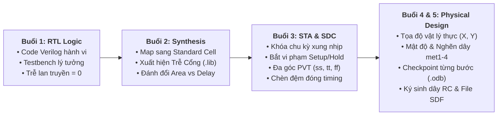

1. **Ở Buổi 1 & Buổi 2:** Mạch logic chỉ tồn tại dưới dạng biểu thức Boolean và các cell rời rạc. Ta tối ưu diện tích và độ trễ cổng (Gate Delay) trên giấy tờ.
2. **Ở Buổi 3 (Lab 2 - Mạch Nhân `mult`):** Ta đưa xung nhịp vào ép mạch chạy ở $13\,\text{ns}$ ($76.92\,\text{MHz}$). Mạch bị vi phạm Setup Time tại đường Critical Path `b[6]`. Ta đã xử lý bằng Pipelining chèn thanh ghi đầu vào, đưa Setup Slack đạt kỷ lục $+1.53\,\text{ns}$.
3. **Tại Buổi 4, Buổi 5 & Lab 3:** Con chip không còn là mô hình lý tưởng. Các cell được "thả" xuống đế silicon thực tế. Dây dẫn kim loại có điện trở $R$ và tụ ký sinh $C$. Mọi bước đi đều phải được kiểm soát thông qua các trạm kiểm định vật lý.

---

---

## PHẦN II: LỘ TRÌNH 5 GIAI ĐOẠN CHINH PHỤC LAB 3

Để đảm bảo quá trình thực hành bám sát kỷ luật kỹ thuật và phương pháp luận chuyên nghiệp của một kỹ sư ASIC Tape-out, toàn bộ nội dung của Lab 3 được hoạch định thành **Lộ trình 5 Giai đoạn chuẩn xác**:

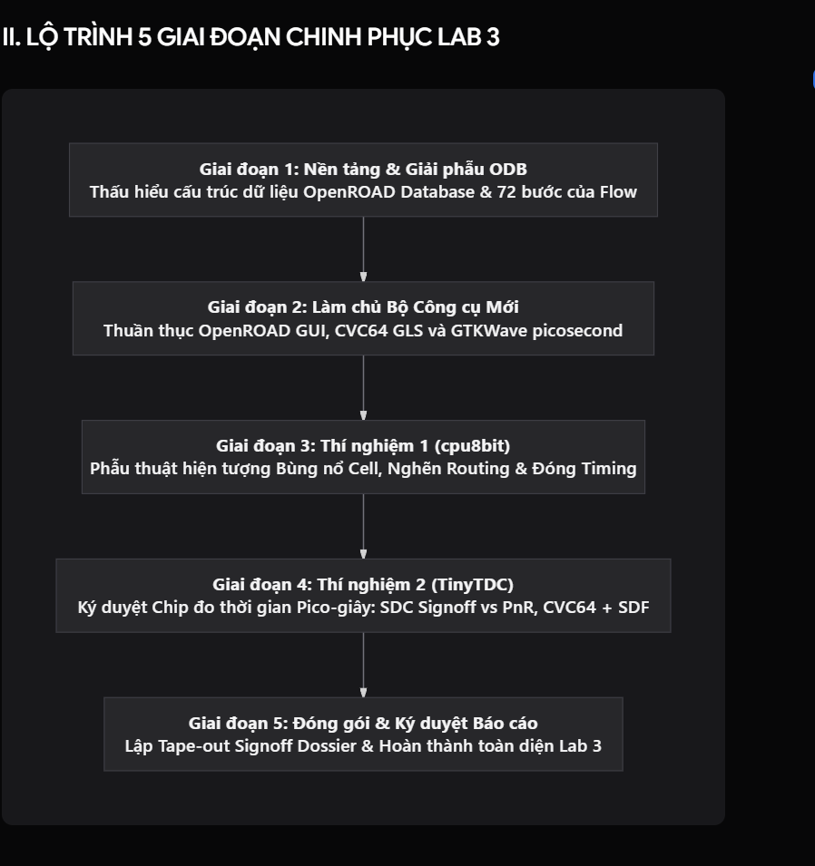

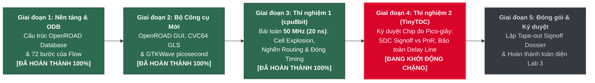

### Bảng Đánh Giá Tiến Độ Hiện Tại Của Kỹ Sư:

| Giai Đoạn | Tên Mục Tiêu | Trạng Thái | Hạng Mục Đã Đạt Được / Kế Hoạch Tiếp Theo |
| :--- | :--- | :---: | :--- |
| **Giai đoạn 1** | **Nền tảng & Giải phẫu ODB** | **ĐÃ XONG 100%** | • Giải phẫu Standard Cell $2.72\,\mu\text{m}$, Via, Mcon, Licon.<br/>• Bóc tách Cây xung nhịp Clock Tree & Skew $40\,\text{ps}$.<br/>• Bóc tách Lưới nguồn PDN `VPWR` (2762 items). |
| **Giai đoạn 2** | **Làm chủ Bộ Công cụ Mới** | **ĐÃ XONG 100%** | • **OpenROAD GUI & TCL Toolkit:** **HOÀN THÀNH 100%** (Heatmap, Custom commands).<br/>• **CVC64 GLS:** **HOÀN THÀNH 100%** (`0 SDF errors`, `Coarse=3`, `Fine=5/17`, xuất `tinytdc_postlayout.vcd`).<br/>• **GTKWave picosecond:** **HOÀN THÀNH 100%** (5/5 phép đo `ps`, tái tạo $\Delta t = 248.596\,\text{ns}$, Phản biện lượng tử `TinyTDC`). |
| **Giai đoạn 3** | **Thí nghiệm 1 (`cpu8bit`)** | **ĐÃ XONG 100%** | • **Baseline & Heat Maps (Bước 1–2):** Phát hiện lỗi `GRT-0116` (`Overflow = 93`) do `Util%` nổ từ `61.36% -> 84.28%` (`615` upsize + `274` buffers).<br/>• **A/B `hold=0.02` (Bước 3):** Cắt `HoldBuf` `79 -> 2`, hạ `Util%` xuống `79.78%`, thông chốt `final/` (`0` DRC/LVS/Antenna/Hold).<br/>• **OpenROAD TCL & GUI Signoff (Bước 4):** Tách nhóm *Full-Cycle* (`+4.71/+7.85 ns` đạt `50 MHz`) vs *Half-Cycle* (`-7.09 ns`), `40 clkdlybuf`, quét $f_{\max} = 28.57\,\text{MHz}$ (`35 ns`) ở `max_ss_100C_1v60` & chụp Critical Path GUI (Hình 19). |
| **Giai đoạn 4** | **Thí nghiệm 2 (`TinyTDC`)** | **ĐANG TIẾN HÀNH** | • Đang khởi động chặng (Tổng quan mở đầu): Kiểm định dây chuyền PnR **`TinyTDC`**, phân tách `PNR_SDC` vs `SIGNOFF_SDC`, và bảo toàn toàn vẹn chuỗi 512 delay cells. |
| **Giai đoạn 5** | **Đóng gói Báo cáo Signoff** | *Chờ kích hoạt* | • Tổng hợp toàn bộ hồ sơ kỹ thuật, nghiệm thu Tape-out toàn diện. |

---

## PHẦN III: GIAI ĐOẠN 1 - NỀN TẢNG VẬT LÝ & GIẢI PHẪU DỮ LIỆU ODB (ĐÃ HOÀN THÀNH 100%)


### 1. Mối Quan Hệ Cốt Lõi: Đâu Mới Là Mục Tiêu Thực Sự?

Khi cài đặt các thông số như `FP_CORE_UTIL`, `PL_TARGET_DENSITY_PCT`, hay `SYNTH_STRATEGY`, mục tiêu hướng tới gồm 2 tầng:

* **Tầng Trung Gian (Phương tiện):** Đảm bảo từng bước PnR trong OpenROAD không bị tràn dung lượng, không bị kẹt giải thuật, để xuất xưởng thành công file trạng thái **`.odb`** của bước đó.
* **Tầng Tối Thượng (Đích đến):** Vượt qua trọn vẹn toàn bộ 72 bước của dây chuyền để xuất ra file hình học mặt nạ quang khắc **`.gds` (GDSII)** đạt chuẩn Signoff (0 lỗi DRC, 0 lỗi LVS, Timing Slack dương trên mọi góc PVT) gửi thẳng sang xưởng đúc (Foundry).

> [!NOTE]
> **File `.odb` (OpenROAD Database) là gì?**
> File `.odb` không phải là file để gửi đi nhà máy đúc chip. Nó là **bản lưu snapshot nhị phân hoàn chỉnh** của OpenROAD tại một thời điểm nhất định, chứa:
> * Tọa độ $(X, Y)$ và hướng xoay (Orientation) của từng cell logic.
> * Vị trí của các cell vật lý (Tap cell, Endcap, Fill cell).
> * Đường đi của các sợi dây kim loại (`met1` $\rightarrow$ `met5`) và các tiếp xúc xuyên tầng (`via1` $\rightarrow$ `via4`).

---

### 2. Sơ Đồ Dây Chuyền Tự Động 72 Bước & Các Hộp Đen `.odb`

Không phải kỹ sư tạo ra một file `.odb` rồi cầm file đó đi qua 72 bước thủ công. Quá trình này diễn ra hoàn toàn tự động như một dây chuyền sản xuất:

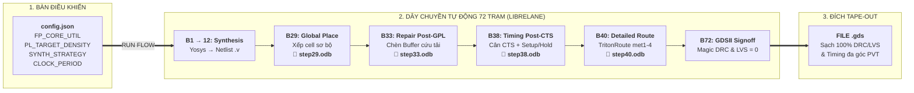

Mỗi khi một trạm hoàn thành nhiệm vụ, nó chụp lại một bức ảnh trạng thái lưu vào file `.odb` tương ứng trong thư mục `runs/<tag>/<step_name>/...odb` rồi bàn giao cho trạm kế tiếp.

---

### 3. Giải Phẫu Không Gian 6 Tầng (Multi-Layer 3D) và 4 Nhóm "Cư Dân" Cell Trong File .ODB

Khi mở file `.odb` trên OpenROAD GUI, ta thấy một ma trận rực rỡ gồm hàng ngàn linh kiện và các lớp dây kim loại đan xen. Bản chất file `.odb` chính là bản thiết kế 3D hoàn chỉnh của một **"Tòa nhà 6 tầng" (1 tầng trệt mặt silicon + 5 tầng cầu vượt kim loại trên không)** theo tiến trình SkyWater 130nm:

```mermaid
flowchart LR
    subgraph SUBSTRATE["<b>TẦNG TRỆT (Silicon & li1)</b>: 4 Nhóm Cư Dân Cell"]
        direction TB
        C1["<b>1. Standard Cells</b> (Logic Buổi 2: NAND, DFF)"]
        C2["<b>2. Physical Cells</b> (Tap, Endcap, Fill)"]
        C3["<b>3. Timing Buffers</b> (Repair Setup/Hold Buổi 3)"]
        C4["<b>4. Clock Buffers</b> (Cây xung nhịp CTS)"]
    end

    subgraph M1["<b>TẦNG 1: met1 (Xanh)</b>"]
        L1["<b>Chỉ đi NGANG (H)</b><br/>Ray nguồn VDD/VSS<br/>& chân Pin cell"]
    end

    subgraph M2["<b>TẦNG 2: met2 (Đỏ)</b>"]
        L2["<b>Chỉ đi DỌC (V)</b><br/>Dây tín hiệu nối<br/>giữa các hàng cell"]
    end

    subgraph M3["<b>TẦNG 3: met3 (Lá)</b>"]
        L3["<b>Chỉ đi NGANG (H)</b><br/>Cao tốc nối các khối<br/>logic cách xa nhau"]
    end

    subgraph M4["<b>TẦNG 4: met4 (Cam)</b>"]
        L4["<b>Chỉ đi DỌC (V)</b><br/>Trần tín hiệu &<br/>Power Stripes dọc"]
    end

    subgraph M5["<b>THƯỢNG: met5 (Tím)</b>"]
        L5["<b>Kim loại dày nhất</b><br/>Cáp nguồn tổng<br/>của toàn chip"]
    end

    SUBSTRATE ===>|"mcon"| M1
    M1 ===>|"via1"| M2
    M2 ===>|"via2"| M3
    M3 ===>|"via3"| M4
    M4 ===>|"via4"| M5
```

#### A. Phân Loại 4 Nhóm "Cư Dân" Cell Dưới Tầng Trệt (Mặt Silicon):

| Nhóm Cell trong `.odb` | Nguồn gốc sinh ra | Vai trò vật lý trên mặt chip |
| :--- | :--- | :--- |
| **1. Standard Cells**<br/>*(Cư dân tính toán)* | Sinh ra từ **Buổi 2 (Synthesis)** khi dịch code Verilog sang cổng logic. | Thực hiện các hàm logic (`and`, `or`, `mux`, `dfxtp`). |
| **2. Physical Cells**<br/>*(Đội bảo vệ kết cấu)* | Không có trong code Verilog! Do OpenROAD tự chèn ở **Bước Floorplan**. | • **Tap cell (`tapvpwrvgnd`):** Cọc tiếp đất ghim điện thế đế silicon vào VDD/GND để chống hiện tượng **Latch-up** (chập nguồn làm nổ chip).<br/>• **Endcap (`decap`):** Bức tường chắn ở hai đầu mỗi hàng cell, ngăn tia laser quang khắc làm méo mó các cell ở rìa.<br/>• **Fill cell (`fill`):** Gạch lót nền lấp kín mọi chỗ trống để mặt chip phẳng tuyệt đối khi tráng hóa chất. |
| **3. Timing Repair Buffers**<br/>*(Đội cứu hộ đường truyền)* | Tự động chèn ở **Bước 33 & 38** dựa trên ràng buộc SDC của **Buổi 3**. | Khuếch đại tín hiệu bị suy hao do dây dài (Max Cap/Fanout) hoặc làm chậm/nhanh tín hiệu để sửa lỗi **Setup/Hold Slack**. *(Chính đội này tăng đột biến gây ra hiện tượng "Bùng nổ Cell" ở `cpu8bit`!)*. |
| **4. Clock Tree Buffers**<br/>*(Hệ thống nhịp tim)* | Sinh ra ở **Bước 36 (CTS - Clock Tree Synthesis)**. | Các cell `clkbuf` chuyên dụng giúp phân phát xung Clock tới hàng trăm Flip-Flop cùng một thời điểm (Zero Skew). |

#### B. Quy Tắc Giao Thông Vuông Góc (Orthogonal Routing) và Cầu Thang Máy (`via`):
* **Luật bất thành văn trong `.odb`:** Lớp kim loại lẻ đi Ngang (`met1`, `met3`), lớp kim loại chẵn đi Dọc (`met2`, `met4`). Nếu đi cùng một hướng trên cùng một tầng, dây sẽ cắt nhau và gây chập mạch (Short Violation).
* **Cơ chế chuyển tầng:** Muốn rẽ từ Ngang sang Dọc, tín hiệu leo qua một tiếp xúc kim loại xuyên tầng gọi là **`via`** (như chiếc thang máy: `via1` nối `met1` lên `met2`, `via2` nối `met2` lên `met3`...).

#### C. Sự "Lớn Lên" Của Tòa Nhà `.odb` Qua 72 Bước:
* **Ở Bước 29 (`globalplacement`):** Tầng trệt đã có các ngôi nhà (`Standard Cells` + `Tap` + `Endcap`) nhưng đang chồng lấn lên nhau. Các tầng cầu vượt `met1` $\rightarrow$ `met3` hoàn toàn trống trơn (chưa đi dây).
* **Ở Bước 33 & 38 (`repairdesign` & `postcts`):** Tầng trệt mọc thêm hàng trăm căn nhà mới (`Timing Buffers` & `Clock Buffers`), làm mặt đất bị nén chật cứng.
* **Ở Bước 40 trở đi (`detailedrouting`):** Toàn bộ các tầng cầu vượt `met1` $\rightarrow$ `met4` và hàng vạn thang máy `via` mới chính thức hiện hình, nối toàn bộ các chân linh kiện lại với nhau!

---

### 4. HỒ SƠ THỰC NGHIỆM ĐỘC QUYỀN: BÓC TÁCH KHÔNG GIAN SILICON & GIẢI MÃ BẢN CHẤT CÂY XUNG NHỊP (CLOCK TREE)

> [!IMPORTANT]
> **CHỨNG NHẬN THỰC NGHIỆM:**
> Toàn bộ các hình ảnh dưới đây được chụp trực tiếp từ phiên làm việc thực tế của Kỹ sư trên công cụ **OpenROAD GUI** (kết nối qua nền tảng CTW SEMI), thực hiện trên thiết kế vi mạch nhân số nguyên **`mult` (Run Phase 4 - SkyWater 130nm)**.

#### A. Thực Nghiệm 1: Khám Phá Hình Học Chuẩn Hóa Của Standard Cell và Luật Đi Dây Dọc `met2`

Khi nhìn toàn cảnh layout không gian 2D, các cổng logic không mang ký hiệu tam giác hay chữ D như trong sách giáo khoa, mà được hiển thị dưới dạng các khối chữ nhật chuẩn hóa xếp thành hàng.

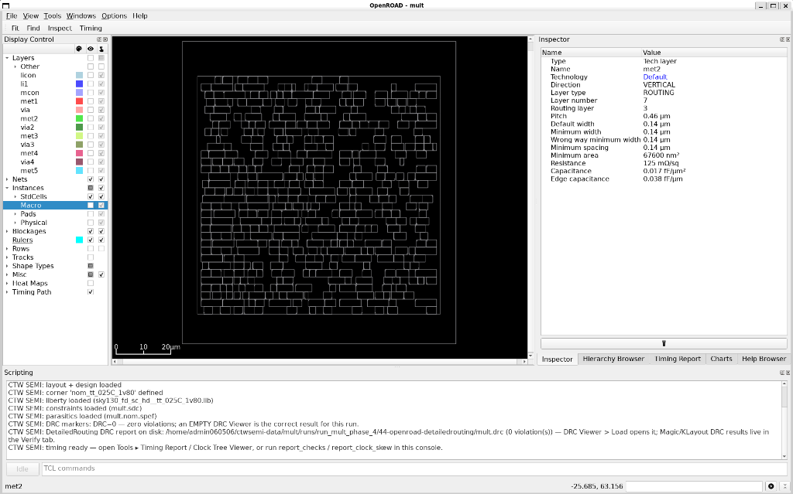

* **Bản chất hình học:** Các cổng logic thực tế được ghép từ các cặp transistor PMOS và NMOS. Để máy móc có thể tự động xếp hàng ngàn linh kiện mà không bị hở mạch nguồn, tất cả các cell đều có **chiều cao cố định $2.72\,\mu\text{m}$** (chuẩn `sky130_fd_sc_hd`), chỉ có chiều rộng co giãn linh hoạt tùy theo số lượng transistor bên trong.
* **Xác thực định luật vật lý:** Bảng Inspector bên phải xác nhận lớp kim loại `met2` có thuộc tính cứng: **`Direction: VERTICAL`** (Quy hoạch giao thông: Chỉ đi theo chiều dọc), pitch $0.46\,\mu\text{m}$, chiều rộng tối thiểu $0.14\,\mu\text{m}$.
* **Bản chất của Macro và Pads:**
  * `Macro`: Khối IP cứng khổng lồ (như RAM, PLL, ADC). Trong thiết kế mạch số thuần túy `mult`, mục này rỗng (0 linh kiện).
  * `Pads`: Các khối đệm I/O cực lớn chứa mạch chống tĩnh điện ESD bao quanh 4 cạnh chip để hàn dây vàng ra vỏ chip.

---

#### B. Thực Nghiệm 2: Giải Phẫu Cổng XNOR2 (`_657_`), Sự Khác Biệt Giữa `mcon` và `via`, và Bí Mật `R180`

Phóng to vào một ô Standard Cell bất kỳ (mã linh kiện `_657_`), bảng Inspector định danh chính xác đây là cổng **`sky130_fd_sc_hd__xnor2_2`** (Cổng XNOR 2 đầu vào, kích dòng cấp 2).

````carousel
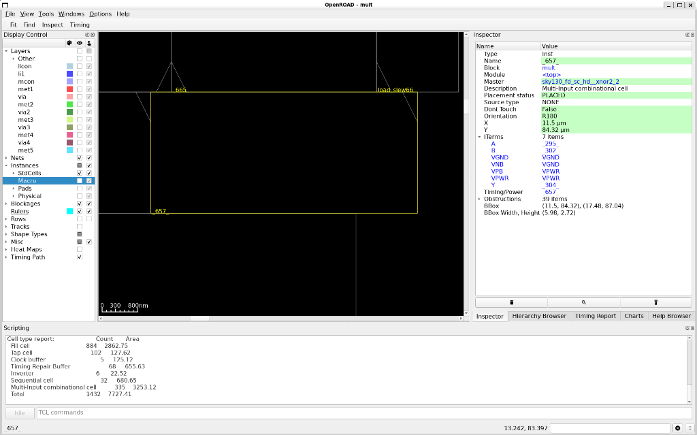
<!-- slide -->
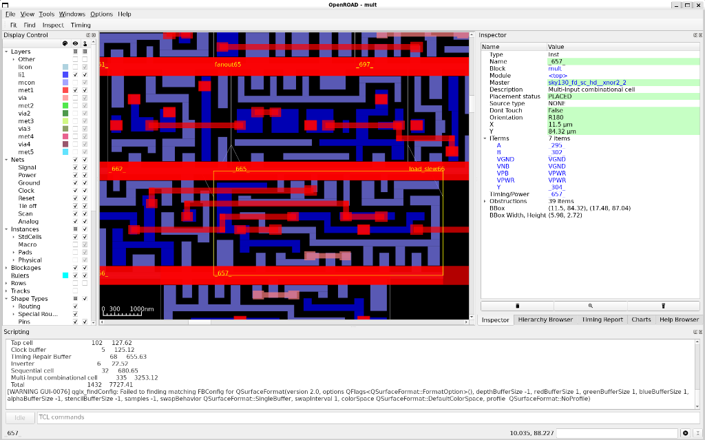
````

1. **Khi tắt các lớp kim loại (Hình 2A):** Bên trong ô cell đen ngòm, chỉ có khung viền màu vàng (Bounding Box) kích thước $(5.98\,\mu\text{m} \times 2.72\,\mu\text{m})$ do chưa bật hiển thị vật liệu dẫn điện.
2. **Khi bật lớp `li1` và `met1` (Hình 2B):**
   * **Hai thanh đỏ chạy ngang mép trên và mép dưới:** Đường ray cấp nguồn **`VPWR` (VDD 1.8V)** và tiếp đất **`VGND` (VSS 0V)**.
   * **Mê cung màu tím (`li1` - Local Interconnect):** Lớp Titanium Nitride (TiN) nối các cực Source/Drain/Gate của 12 transistor CMOS bên trong cổng XNOR.
   * **Các mẩu đỏ nhỏ nằm ngang bên trong:** Dây tín hiệu `met1` nối ra các chân Pin `A`, `B`, `Y`.
3. **Tại sao từ `li1` lên `met1` dùng `mcon` mà không dùng `via`?**
   * Quy ước quốc tế: Lỗ xuyên từ mặt sàn bán dẫn/kim loại cục bộ nền (`li1`) ngoi lên chạm vào lớp kim loại đầu tiên (`met1`) được gọi là **Contact (`mcon` - Metal Contact)**.
   * Chỉ những lỗ xuyên kết nối **giữa 2 lớp kim loại dẫn điện thực thụ với nhau** (`met1` $\leftrightarrow$ `met2`, `met2` $\leftrightarrow$ `met3`...) mới được gọi là **`Via`**.
4. **Bí mật xoay lộn ngược `Orientation: R180`:**
   * Con cell `_657_` bị lộn ngược $180^\circ$ để thanh `VGND` nằm ở đáy và thanh `VPWR` nằm ở đỉnh, giúp hai hàng cell kề cận **dùng chung duy nhất một thanh ray nguồn**, tiết kiệm $15-20\%$ diện tích silicon!

---

#### C. Thực Nghiệm 3: Cô Lập Mạng Lưới Cây Xung Nhịp (Clock Tree Isolation) và Mối Xâu Chuỗi Với Buổi 3

Bằng cách tắt toàn bộ dây `Signal`, `Power`, `Ground` và chỉ kích hoạt duy nhất mạng dây **`Clock`**, toàn bộ Cây Xung Nhịp trên con chip hiện hình độc lập:

![Hình 3: Mạng lưới Cây Xung Nhịp Clock Tree phân nhánh đối xứng và chiếc lá cấp xung cho Flip-Flop _712_ (b_p[6])](./images/openroad_clock_tree_isolation_leaf_bp6.png)

* **Gốc cây (Root):** Mũi tên xanh lá cây ở góc trên bên trái chính là chân Pin đầu vào `clk`.
* **Luật Giao Thông Tuyệt Đối:** Dây xung nhịp màu đỏ (`met1`) luôn chạy **NGANG**, dây xung nhịp màu xanh lá (`met2`) luôn chạy **DỌC**.
* **Xâu chuỗi mắt xích với Buổi 3 (Timing Closure):**
  * Con cell `_712_` đang nhận ngọn lá clock chính là con **D-Flip-Flop (`sky130_fd_sc_hd__dfxtp_2`)**.
  * Chân ngõ ra **`Q`** của nó nối vào net **`b_p[6]`**!
  * Đây chính là con thanh ghi đệm đầu vào mà Kỹ sư đã chèn vào code RTL ở Buổi 3 để triệt tiêu vi phạm Critical Path tại bit `b[6]`. Trên layout thực tế, nó đang tọa lạc tại $(X=9.66\,\mu\text{m}, Y=59.84\,\mu\text{m})$ và nhận xung từ ngọn lá **`clknet_2_3__leaf_clk`**!

---

#### D. Thực Nghiệm 4: Giải Mã Nghịch Lý "Cell Ở Gần vs Cell Ở Xa" và Cơ Chế Cân Bằng Của CTS

Một câu hỏi cốt tử được đặt ra: *"Con cell `_696_` nằm ngay sát nách chân cắm `clk` ở góc trên bên trái, tại sao nó không nhận xung nhịp sớm hơn các con ở tít góc xa?"*

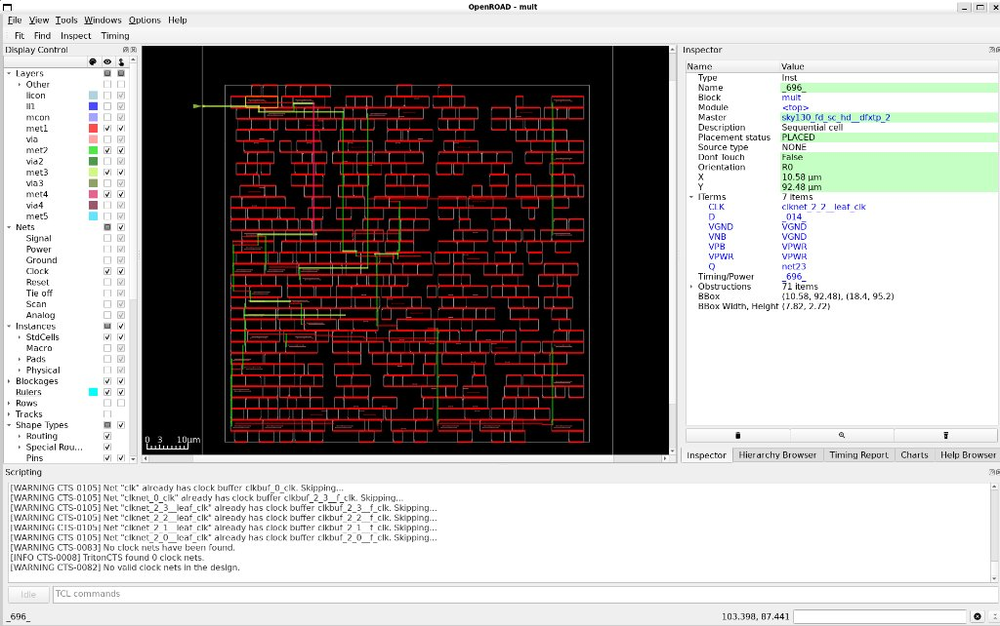

Màn hình thực nghiệm chứng minh 3 cơ chế san phẳng độ trễ của bộ tổng hợp **TritonCTS**:
1. **Không cấp xung trực tiếp:** Chân `CLK` của `_696_` không nối vào chân `clk`, mà nối vào net **`clknet_2_2__leaf_clk`**. Tín hiệu phải chạy vào con đệm gốc `clkbuf_0_clk`, đi qua thân cây, rồi mới rẽ vào trạm trung chuyển `clkbuf_2_2` cấp ngược lại cho `_696_`.
2. **Kỹ thuật uốn lượn kéo dài dây (Snake Routing):** Dây clock dẫn tới các cell ở cự ly gần bị bắt buộc chạy zíc-zắc ngoằn ngoèo để **cố tình làm tăng độ trễ** bằng đúng độ trễ của các đường dây chạy thẳng tới các cell ở xa.
3. **Buffer Sizing (Điều chỉnh công suất đệm):** Các nhánh kéo tải nặng được trang bị buffer dòng lớn (`clkbuf_8`/`clkbuf_16`) để phóng điện tích cực nhanh, trong khi nhánh tải nhẹ dùng buffer nhỏ (`clkbuf_1`/`clkbuf_2`) để kìm hãm tốc độ.

---

#### E. Thực Nghiệm 5: Nghiệm Thu Định Lượng Bằng Lệnh `report_clock_skew`

Kết quả gõ lệnh `report_clock_skew` tại Scripting Console của OpenROAD cung cấp bảng phân tích định lượng nhịp tim toàn diện:

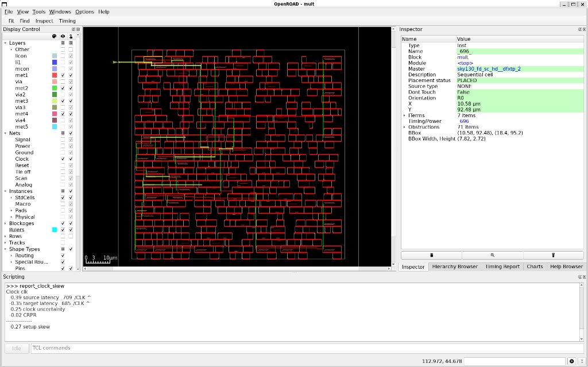

$$\begin{aligned}
\text{Source Latency (Flip-Flop } \_709\_): &\quad 0.39\,\text{ns} \quad (390\,\text{ps}) \\
\text{Target Latency (Flip-Flop } \_685\_): &\quad 0.35\,\text{ns} \quad (350\,\text{ps}) \\
\mathbf{\Delta t \text{ (Độ Lệch Pha Vật Lý Thực Tế):}} &\quad 0.39 - 0.35 = \mathbf{0.04\,\text{ns} = 40\,\text{PICOSECOND}}
\end{aligned}$$

* **Ý nghĩa thực chiến:** Giữa 32 con Flip-Flop nằm rải rác trên toàn bộ diện tích chip, xung nhịp đến con sớm nhất và con muộn nhất chỉ chênh nhau vỏn vẹn **$40\,\text{ps}$ (40 phần nghìn tỉ giây)**! Độ lệch pha vật lý gần như bị triệt tiêu hoàn toàn về 0.
* **Giải mã con số `0.27 setup skew`:**
  $$\text{Setup Skew} = \underbrace{(0.39 - 0.35)}_{\text{Lệch vật lý } 0.04\,\text{ns}} + \underbrace{0.25}_{\text{Dung sai SDC Buổi 3}} - \underbrace{0.02}_{\text{Bù trừ CRPR}} = \mathbf{0.27\,\text{ns}}$$
  Con số $0.25\,\text{ns}$ chính là ràng buộc dung sai `set_clock_uncertainty` mà Kỹ sư đã chủ động cài đặt ở Buổi 3 để bảo vệ mạch trước hiện tượng rung pha (Jitter) của tinh thể thạch anh!

---

#### F. Thực Nghiệm 6: Bóc Tách Mạng Lưới Phân Phối Nguồn (PDN - Power Distribution Network) và Ray Nguồn `VPWR`

Nhìn ở góc nhìn vĩ mô toàn con chip, khi cô lập mạng dây **`Power`** và hiển thị lớp **`met1`** kết hợp **`li1`**, hệ thống phân phối nguồn điện của chip hiện lên như một mạng lưới giao thông đường sắt hoàn hảo:

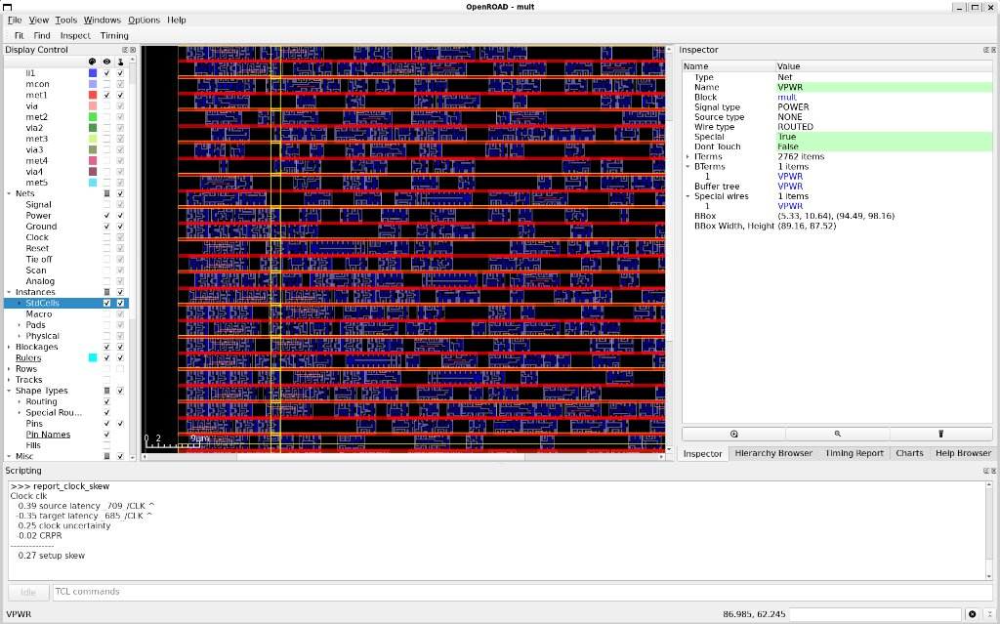

* **Bằng chứng từ Inspector:**
  * **Net Name:** **`VPWR`** (Nguồn cấp dương 1.8V).
  * **Signal type:** **`POWER`** | **Special:** **`True`** (Được định tuyến đặc biệt bởi bộ tạo lưới nguồn PDN ở Bước 21: `openroad-generatepdn`).
  * **ITerms:** **`2762 items`** $\implies$ Duy nhất một đường net `VPWR` này đang cắm vòi cấp điện cho đúng **2.762 chân nguồn của toàn bộ các linh kiện** trên toàn chip!
  * **Kích thước bao phủ:** BBox $(89.16\,\mu\text{m} \times 87.52\,\mu\text{m})$ trùm kín 100% diện tích Core Area.
* **Quy hoạch vật lý của PDN:**
  * Các thanh màu **ĐỎ chạy ngang song song trên `met1`** đóng vai trò các thanh ray dẫn điện chính dọc theo từng hàng row.
  * Xen kẽ giữa các thanh ray đỏ là biển linh kiện màu xanh/tím `li1`. Nhờ cấu trúc ray chạy song song này, bất kỳ linh kiện nào được đặt vào hàng row đều tự động chạm chân nguồn vào ray mà không cần phải chạy dây riêng, đảm bảo điện áp 1.8V đồng đều và triệt tiêu sụt áp (IR Drop).

---

---

---

## PHẦN IV: GIAI ĐOẠN 2 - LÀM CHỦ BỘ CÔNG CỤ MỚI: OPENROAD GUI, CVC64 GLS VÀ GTKWAVE PICOSECOND

Giai đoạn 2 tập trung huấn luyện kỹ năng thực chiến với **Bộ ba công cụ vũ khí tối thượng** của kỹ sư Physical Design và Signoff:
1. **OpenROAD GUI & Bộ Toolkit TCL** *(Công cụ khám nghiệm layout 2D và tự động hóa)* $\implies$ **ĐÃ HOÀN THÀNH 100%**.
2. **Trình mô phỏng cấp cổng CVC64 GLS** *(Mô phỏng netlist cấp cổng với độ trễ ký sinh thực tế SDF)* $\implies$ **ĐÃ HOÀN THÀNH 100%**.
3. **Kính hiển vi dạng sóng GTKWave** *(Đo đạc xung tín hiệu ở độ phân giải picosecond)* $\implies$ **ĐÃ HOÀN THÀNH 100%**.

---

### CHƯƠNG 1: TRỤ CỘT 1 - LÀM CHỦ OPENROAD GUI & BỘ TOOLKIT TCL TỰ ĐỘNG HÓA (ĐÃ HOÀN THÀNH 100%)

Tại trụ cột này, chúng ta đã thuần thục toàn bộ các thao tác điều khiển không gian OpenROAD GUI, khai thác triệt để các chế độ bản đồ nhiệt và đóng gói thành công bộ câu lệnh tự thiết kế:

#### G. Thực Nghiệm 7: Chẩn Đoán Bản Đồ Nhiệt (Placement Density Heat Map) Giữa Step 28 và Step 32

Để trực quan hóa sự biến đổi không gian do quá trình chèn Timing Buffer gây ra, chúng tôi đã kích hoạt tính năng **Heat Maps -> Placement Density** trên OpenROAD GUI cho hai mốc file `.odb`: **Step 28** (trước khi sửa timing) và **Step 32** (sau khi chèn buffer sửa timing):

````carousel
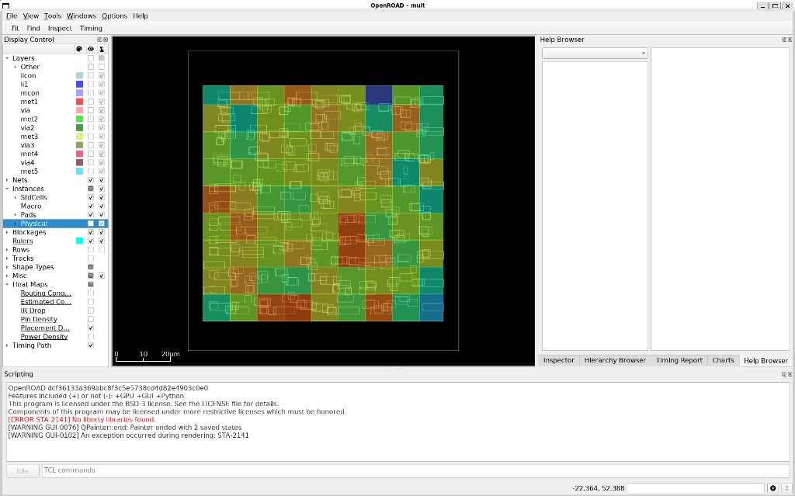
<!-- slide -->
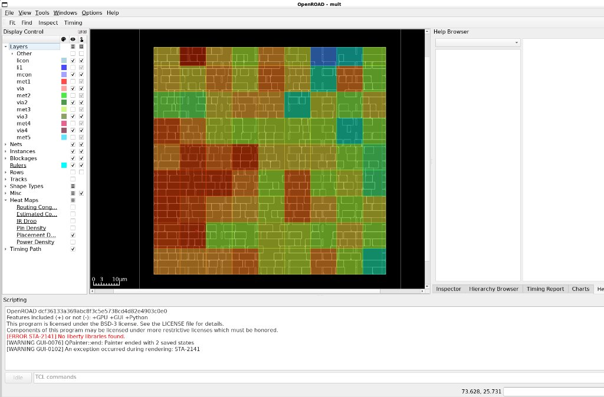
````

##### Phân Tích Giải Phẫu Không Gian Nhiệt Đối Chứng:

1. **Tại Step 28 (`28-openroad-globalplacement/mult.odb` - Hình 7):**
   * **Đặc điểm hình học:** Các cell (viền trắng xám) còn nằm rải rác, khoảng trống silicon màu đen giữa các ô còn rất nhiều.
   * **Phân bố nhiệt (Density Bins):**
     * Đa số các ô lưới (Grid Bins) mang màu **Xanh ngọc (Teal)** và **Xanh lá cây (Green)** chiếm trên $75\%$ diện tích mặt chip, biểu thị mật độ phân bố lý tưởng ($40\% - 55\%$).
     * Góc trên bên phải là một ô **Xanh dương đậm (Deep Blue)** với mật độ cực thấp ($< 25\%$), đóng vai trò vùng đệm chuyển tiếp.
     * Mật độ trung bình toàn chip dừng ở mức an toàn: **$52.85\%$** (475 cells).

2. **Tại Step 32 (`32-openroad-repairdesignpostgpl/mult.odb` - Hình 8):**
   * **Đặc điểm hình học:** Các cell dày đặc rõ rệt, xếp khít vào các hàng row.
   * **Vết tích của 68 Buffer chèn thêm:**
     * Nhìn vào **nửa bên trái và vùng trung tâm (Middle-Left & Center)**: Nếu ở Step 28 vùng này chủ yếu là màu **Xanh lá và Vàng nhạt**, thì sang Step 32, toàn bộ vùng này đã bị "nhuộm đỏ" thành một cụm **Đỏ sẫm / Nâu đỏ (Dark Red Hotspot)**!
     * **Bản chất vật lý:** Đây chính là tọa độ bố trí của khối nhân Logic Multiplier và các thanh ghi đầu vào/ra (Datapath). Khi OpenROAD phát hiện các đường tín hiệu bị vi phạm sườn xung (Max Slew) và quá tải điện dung (Max Fanout/Cap), nó đã **bơm đúng 68 con Timing Repair Buffer** vào chính các khoảng trống của cụm datapath này. Thể tích silicon của 68 con buffer đã đẩy mật độ cục bộ (Local Density) tại vùng này vọt lên trên **$80\% - 85\%$**.
     * Mật độ trung bình toàn chip tăng từ $52.85\%$ lên **$61.33\%$** (543 cells).

3. **Đánh Giá Nguy Cơ Tắc Nghẽn & Lý Do Chip Vượt Qua Detailed Routing Thành Công:**
   * Mặc dù cụm datapath bên trái chuyển sang màu đỏ sẫm, thiết kế `mult` **hoàn toàn không bị nghẽn mạch (Uncongested)** vì:
     * Toàn bộ nửa bên phải và góc trên của chip vẫn giữ được màu **Xanh lá cây và Xanh ngọc** ($45\% - 55\%$), đóng vai trò là "hành lang giải tỏa" cho các đường dây kim loại đi vòng.
     * Mật độ trung bình toàn chip là **$61.33\%$**, còn cách xa lằn ranh đỏ nguy hiểm **$85\%$**.
     * Đó là lý do tại sao ở Step 44 (`detailedrouting`), thuật toán TritonRoute dễ dàng luồn lách dây dẫn qua các tầng kim loại `met1`, `met2`, `met3`, `met4` và về đích hoàn hảo với **0 lỗi vi phạm DRC**!

---

#### H. Thực Nghiệm 8: Ma Trận Bắt Bệnh Biến Động Cell & Mật Độ (mult vs cpu8bit)

Dưới đây là bảng số liệu chẩn đoán thực tế được trích xuất tự động qua các tệp số đo `or_metrics_out.json` của thiết kế `mult` (chạy trên quy trình Sky130A):

| Bước (Step) | Tên Phân Đoạn PnR | Tổng Số Cell | Số Standard Cell | Mật Độ Chiếm Chỗ (Placement Density) | Đánh Giá Tình Trạng Vật Lý |
| :--- | :--- | :---: | :---: | :---: | :--- |
| **Step 13** | `13-openroad-floorplan` | **373** | 373 | **51.20%** | Khởi tạo khung vi mạch an toàn, thoáng đãng. |
| **Step 19** | `19-openroad-tapendcapinsertion` | **475** | 475 | **52.85%** | Chèn 102 Tap Cell phân bố đều chống Latch-up. |
| **Step 28** | `28-openroad-globalplacement` | **475** | 475 | **52.85%** | Phân bố vị trí linh kiện sơ bộ, lực hút dây nối cân bằng. |
| **Step 32** | `32-openroad-repairdesignpostgpl` | **543** | 543 | **61.33%** | OpenROAD tự động chèn **68 Timing Repair Buffer** sửa vi phạm Max Slew / Max Cap. Mật độ tăng +8.48%. |
| **Step 35** | `35-openroad-cts` | **548** | 548 | **62.95%** | Tổng hợp cây xung nhịp chèn thêm **5 Clock Buffer**, phân nhánh đồng hồ cân bằng. |
| **Step 37** | `37-openroad-resizertimingpostcts` | **548** | 548 | **62.95%** | Tối ưu hóa kích thước cổng (Gate Sizing) giữ nguyên diện tích. |
| **Step 44** | `44-openroad-detailedrouting` | **548** | 548 | **62.95%** | **Định tuyến chi tiết thành công 100% với 0 lỗi DRC** nhờ mật độ nằm an toàn dưới ngưỡng 85%! |
| **Step 52** | `52-openroad-fillinsertion` | **1432** | 548 | **62.95%** | Chèn 884 Fill Cell lấp đầy các khe hở vật lý theo chuẩn DRC của nhà máy đúc wafer. |

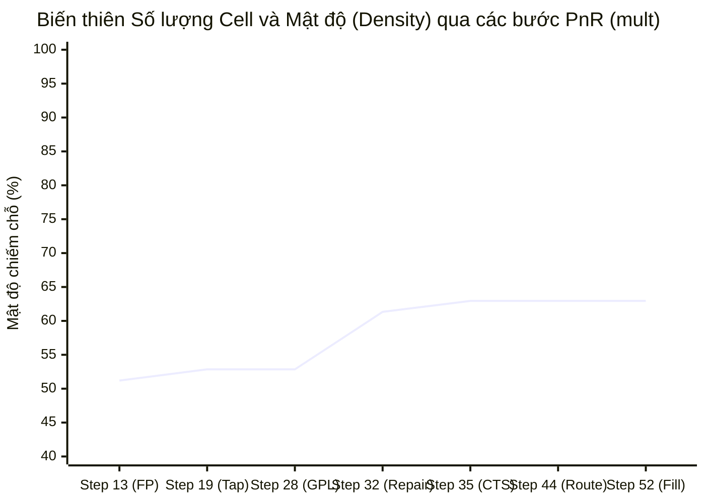

* **Đối Chiếu Sâu Sắc Với Ca Tử Vong Của `cpu8bit` (TT06 Case Study):**
  * **Tại `cpu8bit`:**
    * Sau Global Placement: 964 cells (Mật độ khởi điểm đã xấp xỉ 60%).
    * Sau Post-GPL Repair: OpenROAD chèn 137 Buffer $\implies$ Mật độ vọt lên **72.9%**.
    * Sau CTS & Hold Repair: Tool chèn thêm hàng trăm buffer kéo dài trễ $\implies$ Tổng số cell phình to lên **1.581 cells**, Mật độ Placement Density đạt đỉnh **86.98% (VƯỢT LẰN RANH ĐỎ 85%)**!
    * **Kết quả:** Không gian trống bị chiếm trọn bởi thân silicon của buffer. Các đường ray dây kim loại bị tắc nghẽn hoàn toàn. Đến Bước 40 (`detailedrouting`), thuật toán TritonRoute không còn đường rẽ dây, dẫn tới đoản mạch hàng loạt $\implies$ **Dây chuyền sụp đổ hoàn toàn (Crash flow)**.
  * **Tại `mult` của chúng ta:**
    * Nhờ kỹ thuật chèn thanh ghi pipeline (`b_p`, `a_p`) đã thực hiện từ Buổi 3, đường truyền dài nhất bị bẻ gãy làm đôi. Bộ sửa timing chỉ cần chèn 68 buffer và 5 clock buffer. Mật độ tối đa dừng ở mức **62.95%** (dưới xa ngưỡng nguy hiểm 85%). Router tìm được đường đi thông suốt chỉ sau một lần chạy!

---

### 5. CẨM NANG THỰC CHIẾN PnR: QUY TRÌNH KIỂM SOÁT & BỘ LỆNH TCL THỰC HÀNH (TIÊU CHUẨN & ĐẶC CHẾ)

Dành cho quá trình thực hành và vận hành các dự án Tapeout tiếp theo, phần này đóng vai trò như một **Sổ tay Kỹ sư (Engineer's Handbook)**, tổng hợp các bước kiểm soát bắt buộc, các câu lệnh TCL chuẩn cần dùng, và bộ lệnh độc quyền do chúng tôi tự phát triển.

#### A. Quy Trình 5 Bước Vàng Khi Khảo Sát Một File `.odb` Bất Kỳ

Mỗi khi mở một file `.odb` của bất kỳ công đoạn nào, kỹ sư cần tuân thủ nghiêm ngặt 5 bước kiểm tra tuần tự:

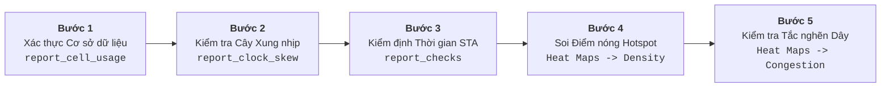

1. **Bước 1: Kiểm kê số lượng và phân loại Cell (`report_cell_usage`):**
   * Xác định số lượng Standard Cell, Tap Cell, Buffer, Inverter, Sequential Cell (DFF).
   * Phát hiện ngay xem bước này có bị bùng nổ cell (cell explosion) bất thường hay không.
2. **Bước 2: Đo lường độ lệch pha đồng hồ (`report_clock_skew`):**
   * Đo Source Latency, Target Latency và Skew thực tế giữa các Flip-Flop.
   * Nếu Skew $> 0.1\,\text{ns}$ ($100\,\text{ps}$), cây xung nhịp chưa cân bằng, nguy cơ vi phạm Hold rất cao.
3. **Bước 3: Kiểm định thời gian truyền dẫn tĩnh STA (`report_checks`):**
   * Kiểm tra Setup Slack (ở Slow corner `max_ss`) và Hold Slack (ở Fast corner `min_ff`).
   * Bấm vào đường Worst Path trên GUI để định vị vật lý xem đường dây trễ nhất chạy qua những cell nào trên chip.
4. **Bước 4: Bật Heatmap Placement Density để tìm Hotspot:**
   * Tìm kiếm các vùng màu đỏ sẫm ($> 85\%$). Nếu cụm đỏ chiếm trên $30\%$ diện tích chip, báo động nguy cơ nghẽn dây ở khâu sau.
5. **Bước 5: Bật Heatmap Routing Congestion sau bước Global/Detailed Routing:**
   * Soi các vạch màu tím/đỏ biểu thị các track dây kim loại bị quá tải (Overcongested tracks).

---

#### B. Bảng Danh Mục Các Câu Lệnh TCL Chuẩn Của OpenROAD Cho Kỹ Sư Thực Hành

Các câu lệnh tiêu chuẩn được tích hợp sẵn trong OpenROAD, sử dụng thường xuyên trong ô Scripting Console:

| Nhóm Tác Vụ | Câu Lệnh TCL Chuẩn | Ý Nghĩa Kỹ Thuật | Khi Nào Sử Dụng? |
| :--- | :--- | :--- | :--- |
| **Quản lý Cell** | `report_cell_usage` | In bảng phân loại chi tiết từng loại cell (logic, buffer, tap, fill, dff). | Sau mọi bước Placement, Resizer, CTS. |
| **Diện tích & Mật độ** | `report_design_area` | Báo cáo tổng diện tích die, diện tích core và tỷ lệ chiếm chỗ (Utilization). | Đánh giá sau Floorplan và Placement. |
| **Xung nhịp (CTS)** | `report_clock_skew` | Báo cáo chi tiết Source/Target Latency, Skew thực tế và Setup/Hold Uncertainty. | Ngay sau Step 35 (CTS) và Step 37 (Resizer Post-CTS). |
| **Thời gian (STA)** | `report_checks -path_delay max` | Báo cáo đường trễ Setup tệ nhất (Worst Setup Path) kèm Slack, Data Arrival/Required Time. | Kiểm tra vi phạm Setup ở Slow Corner. |
| **Thời gian (STA)** | `report_checks -path_delay min` | Báo cáo đường trễ Hold tệ nhất (Worst Hold Path). | Kiểm tra vi phạm Hold ở Fast Corner. |
| **Công suất** | `report_power` | Báo cáo tổng công suất tiêu tán: Internal Power, Switching Power, Leakage Power. | Đánh giá Signoff ở bước cuối cùng. |
| **Đồ họa GUI** | `gui::fit` | Tự động zoom vừa vặn toàn bộ mặt chip vào khung nhìn đồ họa. | Khi bị lạc mất góc nhìn trên canvas. |
| **Đồ họa GUI** | `gui::clear_highlights` | Xóa sạch toàn bộ các vệt highlight dây net hoặc cell đang chọn. | Dọn dẹp màn hình khi chuyển sang soi đối tượng khác. |

---

#### C. Bộ Công Cụ Lệnh TCL Đặc Chế (Custom Toolkit - `odb_helper.tcl`)

Nhận thấy các hạn chế cố hữu của OpenROAD (phải nhớ đường dẫn dài dòng, không có lệnh so sánh nhanh giữa các bước, và cơ chế C++ cấm nạp đè file `.odb` trong cùng session `ORD-0047`), chúng tôi đã tự thiết kế một bộ lệnh đặc chế độc quyền. 

File điều khiển được lưu tại không gian chạy: `runs/run_mult_phase_4/odb_helper.tcl`. Kỹ sư chỉ cần nạp 1 lần duy nhất:
```tcl
source odb_helper.tcl
```

##### Danh Mục Các Lệnh Tự Thiết Kế & Sự Hữu Dụng Thực Chiến:

| Lệnh Đặc Chế | Cú Pháp Thực Hiện | Sự Hữu Dụng Thực Chiến (Tại Sao Cần?) | Giá Trị Tiết Kiệm Thời Gian |
| :--- | :--- | :--- | :--- |
| **`list_steps`** | `list_steps` | **Quét và đánh số tự động toàn bộ 17 file `.odb`:**<br/>OpenROAD lưu file `.odb` trong các thư mục con rất dài (ví dụ `32-openroad-repairdesignpostgpl/mult.odb`). Lệnh này tự động quét thư mục hiện hành, lọc số thứ tự step `[13]`, `[28]`, `[32]`... và in thành danh sách trực quan, giúp kỹ sư **không cần phải gõ hay nhớ đường dẫn dài ngoằng**. | Tiết kiệm $90\%$ thời gian gõ phím; tránh gõ sai đường dẫn tuyệt đối. |
| **`diagnose_steps`** | `diagnose_steps` | **Bắt bệnh Cell Explosion & Hotspot toàn flow trong 3 giây:**<br/>Tự động duyệt qua toàn bộ file `or_metrics_out.json` của tất cả các step, bóc tách ra số lượng Cell và Placement Density (%), in thành một bảng ma trận duy nhất. Kỹ sư nhìn vào bảng này là biết ngay con chip bị "bơm" buffer ở bước nào, mật độ có vượt lằn ranh đỏ $85\%$ hay không mà **không cần phải mở từng bước thủ công**. | Rút ngắn thời gian chẩn đoán từ 15 phút (soi từng bước) xuống còn **3 giây**. |
| **`open_step`** | `open_step <so_step>`<br/>*(Ví dụ: `open_step 28`)* | **Mở trực tiếp file `.odb` mà không lo sập OpenROAD:**<br/>Kiến trúc C++ của OpenROAD cấm gọi `read_db` 2 lần trong cùng một phiên (`[ERROR ORD-0047]`). Lệnh `open_step` tự động tìm đúng file `.odb` tương ứng với số step và khởi chạy một tiến trình GUI độc lập trong nền (`exec openroad -gui -db $target_odb &`). Kỹ sư có thể mở song song Step 28 và Step 32 trên hai cửa sổ màn hình để đối chứng trực tiếp. | Vượt qua giới hạn kỹ thuật của OpenROAD C++ core; cho phép so sánh song song 2 layout cùng lúc. |

##### Bộ Lệnh Tương Ứng Từ Linux Terminal (WSL / Bash):

Để tối ưu hóa cho phong cách làm việc từ dòng lệnh Linux bên ngoài mà không cần mở GUI trước, hai lệnh alias đã được tích hợp sẵn vào `~/.bashrc`:

* **`ls-odb`**: Liệt kê toàn bộ các file `.odb` có trong thư mục run hiện tại kèm số thứ tự.
* **`open-odb <so_step>`** *(Ví dụ: `open-odb 28`)*: Kích hoạt ngay một cửa sổ OpenROAD GUI trỏ thẳng vào file `.odb` của bước đó lên màn hình Windows.

---

---

#### I. Thực Nghiệm 9: Khám Nghiệm Bảng Báo Cáo Thời Gian (Timing Report) & Giải Mã Chi Tiết Đường Truyền Dữ Liệu (Data Path Details)

Sau khi hoàn thành tối ưu hóa cây xung nhịp (CTS) và định tuyến chi tiết (Detailed Routing), chúng tôi đã sử dụng bảng chẩn đoán **Timing Report** tích hợp trong OpenROAD GUI để kiểm định trực quan trạng thái thời gian và giải mã chi tiết hành trình của xung tín hiệu:

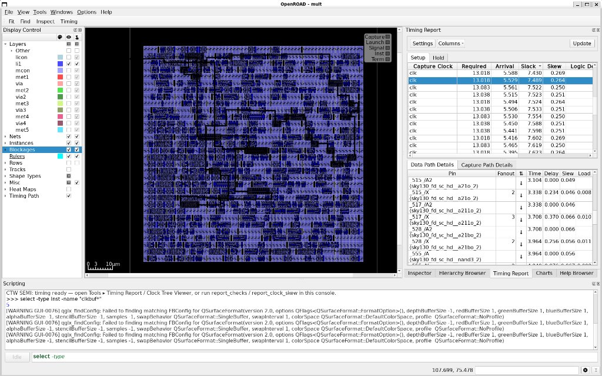

*Ảnh chụp toàn cảnh giao diện Timing Report trên OpenROAD GUI: Cửa sổ trên hiển thị danh sách các đường trễ Setup, cửa sổ dưới hiển thị chi tiết Data Path Details, và khung Canvas bên trái vẽ trực tiếp lộ trình dây dẫn Critical Path trên mặt chip silicon.*

---

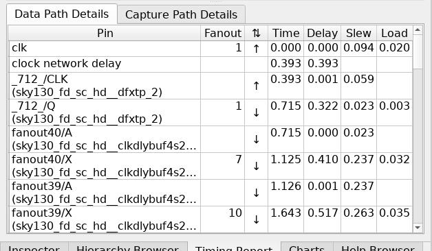

*Ảnh chụp phóng to khu vực đầu bảng Data Path Details do bạn cung cấp: Minh chứng trực quan cho các mốc thời gian phóng xung clock, độ trễ DFF, và các tầng đệm fanout phân tán.*

##### 1. Công Dụng & Vai Trò Của Bảng `Data Path Details` Trong Thiết Kế ASIC:

Trong quá trình đóng thời gian (Timing Closure), nếu như bảng tổng quan phía trên (Setup Path List) chỉ đóng vai trò như **chiếc đồng hồ đo tổng thời gian** (cho biết chuyến tàu dữ liệu đến sớm hay muộn: $\text{Slack} = \text{Required} - \text{Arrival}$), thì bảng **`Data Path Details`** (Hình 9B) chính là **nhật ký hành trình chi tiết (Detailed Travel Log)**:
* **Khám nghiệm vi mô từng trạm dừng:** Bảng liệt kê tuần tự từng chân linh kiện (`Pin`) và từng đoạn dây kim loại (`Net`) mà tín hiệu phải vượt qua từ điểm xuất phát (Startpoint DFF) đến điểm đích (Endpoint DFF).
* **Định vị chính xác nút thắt cổ chai:** Kỹ sư nhìn vào đây sẽ biết chính xác từng phần tử mạch đã tiêu tốn bao nhiêu pico-giây (`Delay`), chân nào đang bị quá tải (`Fanout`/`Load`), từ đó khoanh vùng chính xác con cell cần phải thay thế hoặc tối ưu.

---

##### 2. Giải Mã Cặn Kẽ Ý Nghĩa Các Cột Chỉ Số Trong Bảng `Data Path Details`:

Nhìn vào các cột tiêu đề ở Hình 9B, mỗi cột mang một ý nghĩa vật lý tối quan trọng:

* **`Pin` (Chân Tín Hiệu & Kiểu Ô Tiêu Chuẩn):** 
  Hiển thị tên chân cổng logic kèm kiểu ô thư viện (`Cell Master`) nằm bên dưới trong ngoặc đơn. 
  *(Ví dụ: `_712_/Q` thuộc ô `sky130_fd_sc_hd__dfxtp_2` - D Flip-Flop sườn dương chuẩn SkyWater 130nm)*.
* **`Fanout` (Số Lượng Cổng Tải):** 
  Số lượng chân ngõ vào của các cell phía sau mà chân ngõ ra này đang phải trực tiếp bơm dòng điện để điều khiển. Càng kéo nhiều cổng, tải điện dung càng lớn.
* **`⇅` (Hướng Sườn Chuyển Mạch):** 
  Chiều biến thiên của mức điện áp:
  * Mũi tên hướng lên ($\uparrow$ - **Rise Transition**): Tín hiệu chuyển mức logic từ $0 \rightarrow 1$ (từ $0\,\text{V}$ lên $1.8\,\text{V}$).
  * Mũi tên hướng xuống ($\downarrow$ - **Fall Transition**): Tín hiệu chuyển mức logic từ $1 \rightarrow 0$ (từ $1.8\,\text{V}$ xuống $0\,\text{V}$).
* **`Time` (Mốc Thời Gian Tích Lũy - Cumulative Arrival Time):** 
  Thời điểm thực tế (tính bằng $\text{ns}$) mà sườn xung tín hiệu chạm tới chân đó, tính từ mốc ban đầu $0.000\,\text{ns}$ của xung clock.
* **`Delay` (Độ Trễ Từng Chặng - Incremental Delay):** 
  Khoảng thời gian (tính bằng $\text{ns}$) tiêu tốn để tín hiệu vượt qua chính linh kiện hoặc đoạn dây dẫn đó. 
  *(Quy tắc cộng dồn: $\text{Time}_{\text{sau}} = \text{Time}_{\text{trước}} + \text{Delay}$)*.
* **`Slew` (Độ Dốc Sườn Xung - Transition Time):** 
  Thời gian để điện áp chuyển từ $10\% \rightarrow 90\%$ (sườn lên) hoặc $90\% \rightarrow 10\%$ (sườn xuống) của điện áp nguồn $V_{DD}$. Slew càng nhỏ (xung càng dốc đứng, sắc nét) thì tốc độ chuyển mạch càng nhanh; Slew càng lớn (xung bị lài bẹp) thì cell phía sau càng trễ.
* **`Load` (Điện Dung Tải Ký Sinh - Capacitance):** 
  Tổng điện dung (tính bằng $\text{pF}$) đặt lên chân ngõ ra, bao gồm tổng điện dung ngõ vào của các cell phía sau cộng với điện dung ký sinh của dây dẫn kim loại trích xuất từ file SPEF (`mult.nom.spef`).

---

##### 3. Giải Mã Từng Dòng Thực Tế Trong Bức Ảnh Của Bạn (Hình 9B):

Lần theo từng dòng từ trên xuống dưới trên giao diện OpenROAD GUI của con chip `mult`:

1. **Dòng 1 (`clk`):**
   * **Thông số:** $\text{Fanout} = 1$, Sườn lên $\uparrow$, $\text{Time} = 0.000\,\text{ns}$, $\text{Delay} = 0.000\,\text{ns}$, $\text{Slew} = 0.094\,\text{ns}$, $\text{Load} = 0.020\,\text{pF}$.
   * **Bản chất:** Xung nhịp ngoại vi đi vào chân Pad của chip. Mốc thời gian bắt đầu tính từ $0.000\,\text{ns}$.
2. **Dòng 2 (`clock network delay`):**
   * **Thông số:** $\text{Time} = 0.393\,\text{ns}$, $\text{Delay} = 0.393\,\text{ns}$.
   * **Bản chất:** Độ trễ mạng xung nhịp (Clock Insertion Delay / Latency). Xung clock mất đúng **$0.393\,\text{ns}$** ($393\,\text{ps}$) để truyền từ cổng Pad ngoại vi, xuyên qua cây đệm xung nhịp (Clock Tree gồm `clkbuf_0_clk` và `clkbuf_2_3__f_clk`) để chạm tới chân clock của Flip-Flop phát.
3. **Dòng 3 (`_712_/CLK` - `sky130_fd_sc_hd__dfxtp_2`):**
   * **Thông số:** Sườn lên $\uparrow$, $\text{Time} = 0.393\,\text{ns}$, $\text{Delay} = 0.001\,\text{ns}$, $\text{Slew} = 0.059\,\text{ns}$.
   * **Bản chất:** Chân ngõ vào Clock của Flip-Flop `_712_` chính thức nhận sườn dương của xung clock ở mốc thời gian $0.393\,\text{ns}$.
4. **Dòng 4 (`_712_/Q` - `sky130_fd_sc_hd__dfxtp_2`):**
   * **Thông số:** $\text{Fanout} = 1$, Sườn xuống $\downarrow$, $\text{Time} = 0.715\,\text{ns}$, $\text{Delay} = 0.322\,\text{ns}$, $\text{Slew} = 0.023\,\text{ns}$, $\text{Load} = 0.003\,\text{pF}$.
   * **Bản chất (DÒNG ĐẦU TIÊN CỦA DỮ LIỆU):** 
     * Dữ liệu bit thứ 6 của thanh ghi pipeline toán hạng B (`b_p[6]`) được phóng (launch) ra chân `Q`.
     * **Tại sao mất đúng $0.322\,\text{ns}$ ($322\,\text{ps}$)?** Đây chính là tham số $T_{\text{clk-q}}$ (Clock-to-Q propagation delay) nội tại của D Flip-Flop Sky130 tra cứu từ thư viện Liberty với sườn clock $0.059\,\text{ns}$ và tải cực nhẹ $3\,\text{fF}$.
     * Mốc thời gian lũy tiến vọt lên: $0.393\,\text{ns} + 0.322\,\text{ns} = \mathbf{0.715\,\text{ns}}$.
5. **Dòng 5 & 6 (`fanout40` - `sky130_fd_sc_hd__clkdlybuf4s25_1`):**
   * **Thông số:** 
     * Ngõ vào `fanout40/A`: Nhận dữ liệu tại $\text{Time} = 0.715\,\text{ns}$.
     * Ngõ ra `fanout40/X`: $\text{Fanout} = 7$, Sườn xuống $\downarrow$, $\text{Time} = 1.125\,\text{ns}$, $\text{Delay} = 0.410\,\text{ns}$, $\text{Slew} = 0.237\,\text{ns}$, $\text{Load} = 0.032\,\text{pF}$.
   * **Bản chất:** Tầng đệm phân tán tín hiệu cấp 1. Chân ngõ ra rẽ thành **7 nhánh** cắm vào 6 cổng logic tính tích từng phần ở cụm phía Tây $(X \le 29\,\mu\text{m})$ và 1 nhánh nối sang đệm cấp 2 `fanout39` ($6 + 1 = 7$). Mất trễ $0.410\,\text{ns}$ để nạp xả tải $0.032\,\text{pF}$.
6. **Dòng 7 & 8 (`fanout39` - `sky130_fd_sc_hd__clkdlybuf4s25_1`):**
   * **Thông số:** 
     * Ngõ vào `fanout39/A`: Nhận dữ liệu tại $\text{Time} = 1.126\,\text{ns}$.
     * Ngõ ra `fanout39/X`: $\text{Fanout} = 10$, Sườn xuống $\downarrow$, $\text{Time} = 1.643\,\text{ns}$, $\text{Delay} = 0.517\,\text{ns}$, $\text{Slew} = 0.263\,\text{ns}$, $\text{Load} = 0.035\,\text{pF}$.
   * **Bản chất:** Tầng đệm phân tán tín hiệu cấp 2. Chân ngõ ra rẽ thành **10 nhánh** đóng vai trò là trung tâm phân phối nội bộ (Local Hub) nuôi 10 cổng logic tính tích từng phần ở cụm phía Đông $(X \ge 33\,\mu\text{m})$.

---

##### 4. Cẩm Nang Thực Chiến Tìm Lỗi & Đóng Timing:

Toàn bộ quy trình thực tế mà kỹ sư PnR sử dụng để truy vết lỗi khi gặp trường hợp Slack âm, cách nhận diện cell chậm, và phương pháp ra đơn thuốc điều trị đã được đúc kết thành một tài liệu chuyên đề riêng biệt:
👉 **Tham khảo cẩm nang độc lập:** [**`Cẩm Nang 5 Bước Vàng Tìm Lỗi & Đóng Timing (Timing Closure)`**](file:///D:/Tapeout_chip/buoi_4+5/docs/Cam_Nang_5_Buoc_Tim_Loi_Va_Dong_Timing_PnR.md).

---

### CHƯƠNG 2: TRỤ CỘT 2 - LÀM CHỦ TRÌNH MÔ PHỎNG CẤP CỔNG CVC64 GLS (ĐÃ HOÀN THÀNH 100%)

> [!NOTE]
> **TRẠNG THÁI CHẶNG:** **Đã hoàn thành $100\%$** toàn bộ 5 bước thực hành trực tiếp trên WSL — Từ giải phẫu PDK (Mục 1), kiểm kê đầu vào (Mục 2), quy trình 3 pha phát hiện–điều tra–vá SDF đạt `0 SDF errors` (Mục 3), thực thi `cvc64` (Mục 4), đến nghiệm thu `cvc.log` và xuất xưởng file sóng `tinytdc_postlayout.vcd` (Mục 5).

#### 1. Nhiệm Vụ Tổng Quan Của Chặng
* Chuyển dịch trọng tâm kiểm thử từ mức **phân tích tĩnh (Static)** *(gồm các bước đã đi qua ở trên: từ khóa ràng buộc `.sdc`, soi Setup/Hold Slack đa góc PVT `max_ss`/`min_ff` và truy vết Critical Path ở Buổi 3; đến đo độ lệch pha cây xung nhịp `report_clock_skew`, khám nghiệm bảng `Timing Report` & `Data Path Details` đọc `Delay`/`Slew`/`Load` ký sinh `.spef` trong OpenROAD GUI, kết hợp soi `Heat Maps -> Placement Density` và `report_cell_usage` ở Giai đoạn 1 & Chương 1)* sang **mô phỏng động lực học cấp cổng có gán trễ thực tế (Post-Layout Gate-Level Simulation - GLS)** bằng trình mô phỏng **OSS CVC 64-bit (`cvc64`)**.
* Thiết lập môi trường, chuẩn bị đầy đủ hồ sơ netlist + thư viện chuẩn + file trễ ký sinh sau PnR (`SDF`), chạy kiểm chứng hành vi thực tế của con chip theo từng picosecond thời gian và xuất file dạng sóng phục vụ bước phân tích sâu tiếp theo.

#### 2. Lý Do Cần Công Cụ `cvc64` & Bắt Buộc Phải Thực Hiện Chặng Này
* **Bản chất vật lý bán dẫn:** Trên silicon thực, tín hiệu không bao giờ đổi trạng thái tức thời ($0\,\text{ns}$). Mỗi cổng CMOS có điện trở dẫn kênh $R_{\text{on}}$ và điện dung cổng $C_{\text{gate}}$; mỗi dây đồng/nhôm (`met1`–`met5`) có điện trở đường dây và tụ ký sinh nền ($RC$ network).
* **Tại sao RTL Simulation (Buổi 1) chưa đủ?** Mô phỏng RTL chỉ kiểm tra đúng/sai thuật toán Boolean với độ trễ lý tưởng bằng $0$, hoàn toàn không nhìn thấy xung gai nhiễu (**Glitch**), hiện tượng đua tín hiệu (**Race Condition**), hay lỗi lan truyền bất định (**X-propagation**) phát sinh từ chênh lệch trễ vật lý thật.
* **Tại sao STA (Buổi 3 & Chương 1) chưa thay thế được GLS?** STA chỉ đánh giá cận biên đường tĩnh dựa trên các giả định ràng buộc (SDC). Chỉ có **GLS với `cvc64`** mới nạp trực tiếp hàng nghìn thông số trễ thực tế (`IOPATH`, `INTERCONNECT`) từ Layout vào từng transistor/standard cell và cho mạch chạy thực sự theo Testbench để xác nhận phần cứng sống sót trước khi gửi đi đúc (Tape-out Signoff).

#### 3. Móc Nối Với Chặng Trước: Đã Có Gì & Đang Thiếu Gì?
| Trục Đối Chiếu | Hiện Trạng Sau Chương 1 (OpenROAD GUI & Buổi 1–3) | Lỗ Hổng Chỉ Chương 2 (`CVC64 GLS`) Mới Bù Đắp Được |
| :--- | :--- | :--- |
| **Dữ liệu & Năng lực đã có** | • Đã có netlist tổng hợp & layout 2D/3D (`.odb`), biết đặt ràng buộc SDC, đọc bảng STA tĩnh (Slack, Slew, Load, Fanout trong `Data Path Details`) và dùng bộ lệnh TCL soi không gian chip. | • **Thiếu kiểm chứng động lực học sau Layout (Dynamic Timing & Functional Signoff):** Chưa chạy mô phỏng thực tế netlist đã Place & Route cùng file trễ ký sinh `.sdf` để chứng minh mạch hoạt động đúng ở thế giới thực. |
| **Đầu ra cho bước kế tiếp** | • Đã nhìn thấy đường đi vật lý và độ trễ ước lượng trên từng chân pin trong OpenROAD GUI. | • **Thiếu file dạng sóng thực tế sau Layout (`.vcd` / `.fst`)** chứa dấu vết trễ picosecond — nguyên liệu bắt buộc để đưa vào "kính hiển vi" GTKWave ở Chương 3. |

#### 4. Mục Tiêu Đầu Ra Sau Khi Hoàn Thành Chặng Này
Sau khi hoàn thành các bước của Chương 2, kỹ sư sẽ nắm vững:
1. **Kiến trúc hồ sơ chạy GLS chuẩn công nghiệp:** Hiểu rõ vai trò kết hợp của 5 thành phần (*PDK primitives, Standard Cell Verilog có khối `specify`, Post-layout Netlist, SDF file theo góc PVT, và Testbench*).
2. **Kỹ thuật xử lý & vận hành `cvc64`:** Biết cách chuẩn bị/tương thích file SDF nếu công cụ phát sinh lỗi đọc, nắm ý nghĩa các cờ biên dịch/mô phỏng của `cvc64` và tự tay chạy mô phỏng không lỗi.
3. **Đọc hiểu nhật ký kiểm chứng & Xuất xưởng sóng:** Tự đọc kết quả trên log mô phỏng để xác nhận chức năng sau layout, đồng thời thu về file sóng mang đầy đủ thông số trễ thật sẵn sàng chuyển sang **Chương 3 (GTKWave Picosecond)**.

---

### TỔNG QUAN LỘ TRÌNH 5 BƯỚC TÁC CHIẾN CHƯƠNG 2 (BẢN ĐỒ THỰC HÀNH)

Mục này hệ thống hóa toàn bộ khung **5 bước thực hành chuẩn công nghiệp** cho **Chương 2 (`CVC64 Post-Layout GLS`)** tại `~/ctwsemi-data/ips/TinyTDC/`, tập trung vào thao tác cốt lõi, bản chất vật lý–kỹ thuật và chuẩn kiến thức cần nắm vững sau mỗi bước — khớp $1\text{–}1$ với 5 Mục thực hành chi tiết ngay phía dưới.

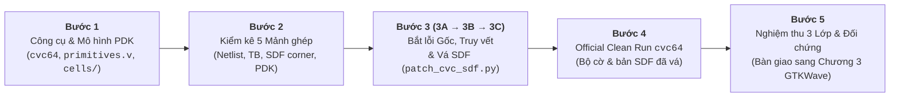

---

#### BƯỚC 1: Kiểm Tra Công Cụ `cvc64` & Giải Phẫu Mô Hình PDK (`primitives.v` & `cells/`)
* **1. Thao tác thực hành:**
  * Kiểm tra sự tồn tại của trình mô phỏng (`command -v cvc64` — đường dẫn cài đặt trên hệ thống `/usr/local/bin/cvc64`) và công cụ xem sóng `gtkwave`.
  * Mở đọc cấu trúc 2 lớp mô hình thư viện của SkyWater 130nm tại `~/ctwsemi-data/ips/TinyTDC/models/cvc-pdk/`:
    * `primitives.v`
    * Thư mục `cells/*.v` (ví dụ `sky130_fd_sc_hd__dfxtp_2.v`, `sky130_fd_sc_hd__dlygate4sd3_1.v`).
* **2. Bản chất & Mục đích:**
  * Ở **Buổi 1 (RTL)**, code Verilog dùng toán tử `+`, `always_ff` nên trình mô phỏng tự hiểu cách chạy.
  * Khi xuống cấp **Post-Layout Netlist**, mạch biến thành hàng trăm cổng vật lý (`sky130_fd_sc_hd__*`). Trình mô phỏng bắt buộc phải có "từ điển vật lý" do Foundry cấp:
    * `primitives.v` chứa **bảng chân trị chuyển mạch mức transistor / UDP** (User Defined Primitives), bao gồm cả các cổng CMOS đảo pha nguyên thủy như `udp_mux_2to1_N`.
    * `cells/*.v` (được tách lẻ từng cell cho `cvc64` nạp động) chứa mô tả hành vi kèm khối **`specify ... endspecify`** được bọc trong `` `ifdef FUNCTIONAL `` — nơi khai báo vỏ giữ chỗ `(0:0:0)` chờ SDF nạp trễ (`IOPATH`) và các "cảm biến bắt lỗi thời gian thực" như **`$setuphold`**, **`$width`**; đồng thời phân tách hai nhánh `` `ifdef USE_POWER_PINS `` vs `` `else `` (chỉ chân tín hiệu).
* **3. Cần nắm vững sau Bước 1:**
  * Phân biệt rạch ròi vai trò của `primitives.v` vs `cells/*.v` và cơ chế tối ưu CMOS đảo pha (`mux2i` vs `mux2`, chặn `X-propagation`).
  * Hiểu bản chất khối `specify` và hai chỉ thị `` `ifdef FUNCTIONAL `` / `` `ifdef USE_POWER_PINS ``: vì sao thiếu `+define+FUNCTIONAL` ở Bước 4 thì mô phỏng cấp cổng sụp về $0\,\text{ns}$ vô nghĩa, và vì sao không bật `USE_POWER_PINS` khi netlist không đi dây chân nguồn.

---

#### BƯỚC 2: Kiểm Kê 5 Mảnh Ghép Đầu Vào & Giải Phẫu Testbench / SDF (`TinyTDC`)
* **1. Thao tác thực hành:**
  * Rà soát 5 tệp bắt buộc tại `~/ctwsemi-data/ips/TinyTDC/`:
    1. Routed Netlist sau PnR: `rtl/tinytdc.nl.v`
    2. Testbench Post-Layout: `tb/tb_postlayout.v` (đọc kịch bản kích xung, Watchdog timeout và lệnh **`$sdf_annotate`**)
    3. File độ trễ ký sinh SDF góc danh định: `tb/tinytdc_tt.sdf`
    4. `models/cvc-pdk/primitives.v`
    5. Thư mục `models/cvc-pdk/cells/`
* **2. Bản chất & Mục đích:**
  * **Xâu chuỗi với Buổi 3 & 4:** OpenROAD đặt cell và trích xuất điện trở dây $R$, điện dung tải $C$ sang `.spef`, từ đó OpenSTA tính ra bảng trễ từng phần tử đóng gói thành **`.sdf` (Standard Delay Format)**.
  * **Tại sao dùng góc `nom_tt` ($25^\circ\text{C}$, $1.8\,\text{V}$)?** Khác với góc khắc nghiệt (`max_ss`, `min_ff`) để Signoff ở Buổi 3, thí nghiệm **TinyTDC** dùng góc danh định để đo tốc độ lan truyền thực tế gần điều kiện phòng lab nhất.
  * **Chốt "Đề bài chuẩn" (Ground Truth):** Đọc `tb_postlayout.v` trước khi chạy giúp biết chính xác xung clock và khoảng thời gian lập trình $\Delta t_{\text{chuẩn}}$ giữa `start_i` và `stop_i`, đồng thời nhận diện yêu cầu đường dẫn tương đối của `$sdf_annotate("tinytdc_tt.sdf", dut);`.
* **3. Cần nắm vững sau Bước 2:**
  * Định hình trọn vẹn dòng chảy: **PnR (`.odb`/`.nl.v`) + Ký sinh RC (`.spef`) $\rightarrow$ Độ trễ (`.sdf`) $\xrightarrow{\text{\$sdf\_annotate}}$ Chạy động trên `cvc64`**.
  * Phân biệt **`INTERCONNECT`** (trễ dây $RC$ giữa 2 chân cell) với **`IOPATH`** (trễ nội tại bên trong Standard Cell — phản ánh trực tiếp quy luật vật lý electron $\mu_n$ nhanh hơn lỗ trống $\mu_p$).

---

#### BƯỚC 3: Tái Hiện Lỗi Bản Gốc, Truy Vết Nguyên Nhân & Vá Tương Thích SDF (3 Pha: 3A $\rightarrow$ 3B $\rightarrow$ 3C)
* **1. Thao tác thực hành (theo đúng trình tự khám phá khoa học 3 pha):**
  * **Pha 3A (Tái hiện lỗi trên bản gốc):** Copy nguyên bản `../tb/tinytdc_tt.sdf` vào `sim/` và chạy thử `cvc64` (xuất ra `cvc_unpatched.log`) để trực tiếp bắt quả tang lỗi xảy ra trong pha `$sdf_annotate`.
  * **Pha 3B (Khám nghiệm hiện trường & Thiết kế phương án vá):** Soi chéo bằng `grep` trên file `.sdf` gốc và kiểm tra nối dây trong `rtl/tinytdc.nl.v` để truy tìm nguyên nhân gốc rễ, từ đó thiết kế cơ chế tiền xử lý an toàn.
  * **Pha 3C (Thực thi tiểu phẫu & Đối chứng văn bản):** Chạy `sim/patch_cvc_sdf.py` từ bản gốc `../tb/tinytdc_tt.sdf` tạo ra bản sao tương thích `sim/tinytdc_tt.sdf`, rồi dùng `diff -u` đối chiếu từng ký tự thay đổi.
* **2. Bản chất & Mục đích:**
  * Thay vì chạy script vá một cách mù quáng, quy trình 3 pha chứng minh **phần cứng `tinytdc.nl.v` sạch 100%** (mọi bit bus `rd_data_o[0..7]` đều có buffer lái giống hệt nhau); thủ phạm thực sự là **vector-index bug nội bộ của OSS CVC 7.00b** khi đọc các cung `INTERCONNECT` trỏ tới bit `[1..7]` của mảng output port (`ERROR [1509]` + `WARN [678]`).
  * Script thực hiện **"xóa có kiểm soát"** trên bản sao plain-text: dùng Regex xóa trắng đúng 7 dòng dây vỏ ngoài cùng (`rd_data_o[1..7]`, trễ chỉ $1\,\text{ps}$, tách biệt hoàn toàn khỏi lõi đo `u_start_line`/`u_stop_line` và không chạm vào bảng `IOPATH` bên trong các output buffer), kèm chốt tự kiểm tra đủ 7 bit và còn nguyên `u_start_line`, `u_stop_line`, `IOPATH`.
* **3. Cần nắm vững sau Bước 3:**
  * Tư duy **tìm căn nguyên trước khi sửa lỗi** và ranh giới của một workaround hợp lệ trong EDA (chỉ xử lý tương thích parser tại I/O ngoài cùng, tuyệt đối không làm lệch timing lõi chip).
  * **Kỷ luật "Golden Source Read-Only":** Hiểu rạch ròi vai trò của **bản sao `sim/tinytdc_tt.sdf`** (dùng cục bộ để chiều riêng `cvc64`) và lý do **tuyệt đối không được xóa bản gốc `tb/tinytdc_tt.sdf`** (bảo toàn đủ dữ liệu `1 ps` I/O cho các công cụ thương mại như QuestaSim/VCS/Xcelium, làm bằng chứng Audit qua `diff -u`, và đảm bảo tính tái lập tự động).

---

#### BƯỚC 4: Thực Thi Trình Mô Phỏng Cấp Cổng `cvc64` Bản Chính Thức (Clean Run)
* **1. Thao tác thực hành:**
  * Đứng chắc chắn tại thư mục `~/ctwsemi-data/ips/TinyTDC/sim/`, chạy lại lệnh `cvc64` trên bản sao SDF đã vá với bộ cờ:
    * `+interp`, `+dump2fst`, `+typdelays`
    * `+define+FUNCTIONAL` và `+define+UNIT_DELAY` *(chú ý KHÔNG bật `+define+USE_POWER_PINS`)*
    * `-y ../models/cvc-pdk/cells +libext+.v`
    * Nạp `primitives.v`, `tinytdc.nl.v`, `tb_postlayout.v` và xuất nhật ký chính thức ra `cvc.log` (`2>&1 | tee cvc.log`).
* **2. Bản chất & Mục đích:**
  * **Lý do chuyển pha từ 3C $\rightarrow$ Bước 4:** Pha 3A mới chỉ là lượt chạy nháp dính `7 SDF errors`, còn Pha 3C mới chỉ xác thực *trên mặt văn bản* qua `diff -u`. Bước 4 chính là **Official Clean Run** để thực chứng trình mô phỏng `cvc64` tiêu hóa trơn tru bản vá SDF vừa tạo.
  * **Giải mã từng lá cờ:**
    * **`+typdelays`**: Chọn cột giữa (`typ`) trong `(min:typ:max)` của file `.sdf` và `specify`.
    * **`+define+FUNCTIONAL +define+UNIT_DELAY`**: Mở khóa khối `specify` trong thư viện Sky130; không truyền `+define+USE_POWER_PINS` để khớp netlist 3 chân/2 chân tín hiệu.
    * **`-y ... +libext+.v`**: Tự động tìm và nạp file `.v` tương ứng cho từng cell xuất hiện trong `tinytdc.nl.v`.
    * **`+dump2fst` & `+interp`**: Chế độ thông dịch nhanh; kết hợp chỉ thị `$dumpfile("tinytdc_postlayout.vcd")` trong testbench để xuất ra file sóng `.vcd` tương thích với GTKWave.
* **3. Cần nắm vững sau Bước 4:**
  * Làm chủ từng cờ lệnh của `cvc64` và nguyên tắc đứng đúng thư mục làm việc (`sim/`) khi dùng `$sdf_annotate` tương đối để có thể tùy biến cho các dự án khác hoặc các góc biên (`+maxdelays` / `+mindelays`).

---

#### BƯỚC 5: Nghiệm Thu Nhật Ký `cvc.log` 3 Lớp, Đối Chứng Lịch Sử & Xác Thực File Sóng
* **1. Thao tác thực hành:**
  * Thực thi kiểm định 3 lớp trên `cvc.log` và thư mục `sim/`:
    1. Rà soát lỗi SDF, lỗi mô phỏng và tổng số warning (`grep -nE "ERROR|SDF errors|error\(s\)|warning\(s\)" cvc.log`).
    2. Rút trích các thông số đo phần cứng mà testbench in ra (`Coarse`, `Fine START`, `Fine STOP`, `Status`, thời điểm `$finish`).
    3. Xác thực sự tồn tại và dung lượng hợp lệ của file sóng `.vcd` sinh ra (`ls -lh *.vcd *.fst`).
  * Đối chiếu bảng so sánh trực tiếp giữa log trước khi vá (`cvc_unpatched.log`) và sau khi vá (`cvc.log`).
* **2. Bản chất & Mục đích:**
  * **Lý do bắt buộc rà 3 lớp (Tránh "cái bẫy `0 error(s)`"):** Như đã chứng kiến ở Pha 3A, dòng tổng kết `There were 0 error(s)` của CVC vẫn có thể che giấu **`7 SDF errors`** ở pha `$sdf_annotate` phía trên. Không qua Bước 5 thì dễ mang nhầm file sóng lỗi đi phân tích.
  * Xác nhận sạch lỗi nạp SDF, giảm đúng số cảnh báo do bản vá mang lại, giải mã sơ bộ ý nghĩa các thanh ghi đếm thô/tinh đối chiếu với đề bài $\Delta t_{\text{chuẩn}}$, và đóng gói file sóng đầu ra bàn giao sang **Chương 3 (GTKWave)**.
* **3. Cần nắm vững sau Bước 5:**
  * Quy trình QA log GLS 3 lớp kết hợp đối chứng lịch sử.
  * Nhận diện rành mạch giới hạn của log chữ: `cvc.log` mới chỉ cho biết **số lượng tap đếm được dạng số nguyên** (`Coarse`, `Fine`), chưa cho thấy chính xác độ trễ tính bằng **pico-giây** của từng tap, từng cổng `dlygate4sd3_1` hay toàn khoảng đo — lỗ hổng này chính là lý do bắt buộc mở **Kính hiển vi Dạng sóng GTKWave ở Chương 3**!

---

### THỰC HÀNH CHI TIẾT TỪNG BƯỚC CHƯƠNG 2

#### MỤC 1: ĐI SÂU CHI TIẾT BƯỚC 1 — KIỂM TRA CÔNG CỤ `cvc64` & GIẢI PHẪU MÔ HÌNH PDK (`primitives.v` & `cells/`)

Chạy lần lượt các lệnh sau trong WSL để xác nhận công cụ đã sẵn sàng và nhìn tận mắt "ruột" thư viện bán dẫn SkyWater 130nm:

```bash
command -v cvc64 && command -v gtkwave
ls -lh ~/ctwsemi-data/ips/TinyTDC/models/cvc-pdk/
ls ~/ctwsemi-data/ips/TinyTDC/models/cvc-pdk/cells/ | wc -l

# 1. Xem định nghĩa UDP transistor/logic nguyên thủy (bảng chân trị table ... endtable)
sed -n '1,65p' ~/ctwsemi-data/ips/TinyTDC/models/cvc-pdk/primitives.v

# 2. Xem khối specify ($setuphold, $width) trong 1 D-Flip-Flop thật
sed -n '85,100p' ~/ctwsemi-data/ips/TinyTDC/models/cvc-pdk/cells/sky130_fd_sc_hd__dfxtp_2.v

# 3. Xem khối `ifdef FUNCTIONAL` & `specify (A +=> X)` trong 1 Delay Cell thật
sed -n '60,110p' ~/ctwsemi-data/ips/TinyTDC/models/cvc-pdk/cells/sky130_fd_sc_hd__dlygate4sd3_1.v
```

> [!IMPORTANT]
> **Điểm cần kiểm tra khi chạy:** Để ý tại sao khối `specify ... endspecify` lại được bọc trong `` `ifdef FUNCTIONAL `` và ban đầu giá trị trễ mặc định đang là `(0:0:0, 0:0:0)`. Đó chính là lý do lát nữa ở **Bước 4** bắt buộc phải truyền cờ **`+define+FUNCTIONAL`**!

---

##### a. Giải Phẫu Bảng Chân Trị Cổng MUX Đảo (`sky130_fd_sc_hd__udp_mux_2to1_N`)

* **1. Kết quả thực tế trích xuất từ `models/cvc-pdk/primitives.v` (dòng 35–57):**

```verilog
primitive sky130_fd_sc_hd__udp_mux_2to1_N (
    Y ,
    A0,
    A1,
    S
);

    output Y ;
    input  A0;
    input  A1;
    input  S ;

    table
     //  A0  A1  S  :  Y
         0   ?   0  :  1   ;
         1   ?   0  :  0   ;
         ?   0   1  :  1   ;
         ?   1   1  :  0   ;
         0   0   ?  :  1   ;
         1   1   ?  :  0   ;
    endtable
endprimitive
```

* **Giải thích hiện tượng `A0 = 0, S = 0` nhưng `Y = 1`:**
  * Ngay ở dòng 23 phía trên bảng trong `primitives.v` có chú thích: `udp_mux_2to1_N: Two to one multiplexer with inverting output`.
  * Trong thư viện chuẩn SkyWater 130nm: ký hiệu **`_N` (Negated)** và chân ngõ ra tên **`Y`** biểu thị **MUX 2-to-1 đảo ngõ ra (`sky130_fd_sc_hd__mux2i`)** với hàm logic $Y = \overline{(\overline{S} \cdot A_0 + S \cdot A_1)}$, nên tại dòng 1 ($A_0 = 0, S = 0$), ngõ ra bị đảo thành $Y = \overline{0} = 1$.
  * *(Đối chứng: MUX thuận không đảo nằm ở dòng 890 trong `primitives.v` mang tên `sky130_fd_sc_hd__udp_mux_2to1` với ngõ ra tên **`X`**, trả về `0 ? 0 : 0` cho cell `mux2`.)*

* **2. Bản chất Vật lý CMOS: Tại sao ASIC lại đẻ ra con MUX đảo (`mux2i`)?**
  Trên FPGA hoặc lý thuyết sách giáo khoa, ta quen nghĩ MUX thuận là cổng cơ bản. Nhưng trên **Silicon CMOS thực tế thì ngược lại**:
  1. **Mọi tầng cổng CMOS đơn giản tự nhiên đều ĐẢO pha:** Mạng pull-down dùng **NMOS** (khi ngõ vào $= 1$ thì kéo ngõ ra xuống đất `0`), mạng pull-up dùng **PMOS** (khi ngõ vào $= 0$ thì kéo ngõ ra lên nguồn `1`). Do đó, một bộ ghép kênh 1 tầng transistor sẽ tự nhiên cho ra **`mux2i` (MUX đảo)**.
  2. **Nhanh hơn & nhỏ hơn MUX thuận:** Muốn biến `mux2i` thành `mux2` (thuận), nhà máy đúc bắt buộc phải **gắn thêm 1 tầng cổng Inverter (2 transistor)** ở đuôi để lật ngược lại một lần nữa. Điều này làm `mux2` vừa **tốn diện tích silicon**, vừa **chậm hơn thêm 1 gate delay**! Vì thế ở **Buổi 2 (Synthesis)**, khi tối ưu Critical Path, công cụ tổng hợp cực kỳ chuộng dùng `mux2i` thay vì `mux2`.

* **3. Mẹo kỹ sư cực đắt giá ở 2 dòng cuối (`0 0 ? : 1` và `1 1 ? : 0`):**
  Nếu để ý 2 dòng cuối trong bảng trên:
  ```text
  0   0   ?  :  1   ;
  1   1   ?  :  0   ;
  ```
  Dấu `?` ở cột `S` có nghĩa là **`S` mang bất kỳ giá trị nào (`0`, `1`, hay thậm chí `X` - chưa xác định!)**.
  * **Ý nghĩa trong GLS:** Khi vừa bật nguồn (trước reset) hoặc lúc chân chọn `S` đang trong trạng thái chuyển tiếp bất định (`X`), nếu hai dữ liệu đầu vào `A0` và `A1` đã cùng bằng `0` (hoặc cùng bằng `1`), thì đầu ra `Y` vẫn chắc chắn chốt ra `1` (hoặc `0`) — **chặn đứng thảm họa lan truyền `X-propagation` sai lệch trong mô phỏng hậu layout!**

---

##### b. Giải Phẫu Khối `specify` Trong D-Flip-Flop (`sky130_fd_sc_hd__dfxtp_2.v`)

* **Kết quả thực tế trích xuất từ `models/cvc-pdk/cells/sky130_fd_sc_hd__dfxtp_2.v`:**

```verilog
wire AWAKE, COND0, COND1, RESETB_delayed, CLK_delayed, D_delayed;
reg notifier;

specify
( posedge CLK => ( Q : CLK ) ) = ( 0:0:0 , 0:0:0 ) ; // delays are tris , tfall
$width ( posedge CLK &&& AWAKE , 1.0:1.0:1.0 , 0 , notifier ) ;
$width ( negedge CLK &&& AWAKE , 1.0:1.0:1.0 , 0 , notifier ) ;
$setuphold ( posedge CLK , posedge D , 0:0:0 , 0:0:0 , notifier , AWAKE , AWAKE , CLK_delayed , D_delayed ) ;
$setuphold ( posedge CLK , negedge D , 0:0:0 , 0:0:0 , notifier , AWAKE , AWAKE , CLK_delayed , D_delayed ) ;
endspecify
`endif
endmodule
`endcelldefine

/*********************************************************/
`else // If not USE_POWER_PINS
```

* **1. Hai dòng cuối `` `endif ... `else // If not USE_POWER_PINS `` là gì?**
  * Mỗi file cell trong SkyWater 130nm đều có **2 phiên bản song song** bọc trong rẽ nhánh tiền xử lý `` `ifdef USE_POWER_PINS ``:
    * **Nhánh trên** *(đoạn trích xuất ở trên)*: Có thêm 4 chân nguồn `VPWR, VGND, VPB, VNB` — dùng khi Netlist nối tường minh từng chân nguồn/đất.
    * **Nhánh dưới** *(sau dòng `` `else // If not USE_POWER_PINS ``)*: Chỉ giữ 3 chân tín hiệu **`Q, CLK, D`**. File netlist sau PnR của thiết kế (`rtl/tinytdc.nl.v`) là loại 3 chân tín hiệu này, nên ở Bước 4 ta **không** truyền `+define+USE_POWER_PINS` $\implies$ `cvc64` sẽ tự động chọn nhánh dưới!
  * Dòng `` `endif `` ngay phía trên `endmodule` đóng khối **`` `ifdef FUNCTIONAL ``**: nghĩa là **toàn bộ khối `specify ... endspecify` nằm gọn bên trong `` `ifdef FUNCTIONAL ``** — nếu thiếu cờ `+define+FUNCTIONAL` ở Bước 4 thì khối timing check này bị loại bỏ hoàn toàn!

* **2. Giải phẫu bên trong khối `specify ... endspecify` (3 cảm biến Timing của Flip-Flop):**
  * **A. Độ trễ truyền dẫn Clock-to-Q (`IOPATH`):**
    ```verilog
    ( posedge CLK => ( Q : CLK ) ) = ( 0:0:0 , 0:0:0 ) ; // delays are tris , tfall
    ```
    * **Ý nghĩa:** Khi chân `CLK` vừa có sườn lên (`posedge CLK`), mất bao lâu sau thì ngõ ra `Q` mới chuyển sang giá trị mới — chính là tham số **$T_{\text{clk}\rightarrow q}$** đã khảo sát trong bảng `Data Path Details` ở Chương 1.
    * **Hai cụm `( 0:0:0 , 0:0:0 )`:** Cụm trước là độ trễ sườn lên `Q` (`trise`), cụm sau là độ trễ sườn xuống `Q` (`tfall`), mỗi cụm theo chuẩn **`min : typ : max`**.
    * **Tại sao toàn số `0:0:0`?** Đây là **ô giữ chỗ (Placeholder)**! Khi chạy mô phỏng, lệnh `$sdf_annotate` sẽ đọc số picosecond thực tế của **từng con Flip-Flop cụ thể trên layout** rồi nạp đè vào hai cặp `0:0:0` này.
  * **B. Cảm biến độ rộng xung Clock tối thiểu (`$width`):**
    ```verilog
    $width ( posedge CLK &&& AWAKE , 1.0:1.0:1.0 , 0 , notifier ) ;
    $width ( negedge CLK &&& AWAKE , 1.0:1.0:1.0 , 0 , notifier ) ;
    ```
    * **Bản chất vật lý:** Nếu xung clock dính **gai nhiễu hẹp (Glitch)** — chuyển trạng thái lên/xuống nhanh hơn thời gian transistor bên trong kịp nạp/xả chốt dữ liệu — thì Flip-Flop rơi vào trạng thái **bất định (Metastable)**. Hai dòng này bắt `cvc64` kiểm tra bề rộng cả phần **mức cao (`posedge`)** lẫn **mức thấp (`negedge`)** của xung `CLK`; hẹp hơn ngưỡng (sau khi `.sdf` nạp vào) sẽ lập tức báo động!
  * **C. Cảm biến Setup Time & Hold Time (`$setuphold`):**
    ```verilog
    $setuphold ( posedge CLK , posedge D , 0:0:0 , 0:0:0 , notifier , AWAKE , AWAKE , CLK_delayed , D_delayed ) ;
    $setuphold ( posedge CLK , negedge D , 0:0:0 , 0:0:0 , notifier , AWAKE , AWAKE , CLK_delayed , D_delayed ) ;
    ```
    * **Xâu chuỗi với Buổi 3 (STA):** Cặp `0:0:0` thứ nhất là ngưỡng **`T_setup`** `(min:typ:max)` (dữ liệu `D` phải ổn định *trước* sườn lên `CLK`), cặp `0:0:0` thứ hai là ngưỡng **`T_hold`** `(min:typ:max)` (dữ liệu `D` phải giữ yên *sau* sườn lên `CLK`).
    * **Lý do tách riêng `posedge D` và `negedge D`:** Trên CMOS thực tế, thời gian PMOS kéo `D` lên `1` (`rise`) và NMOS kéo `D` xuống `0` (`fall`) cho $T_{\text{setup}}$ và $T_{\text{hold}}$ thường **khác nhau**.

* **3. Giải mã loạt biến `AWAKE, COND0, COND1, RESETB_delayed, CLK_delayed, D_delayed` & `reg notifier`:**
  1. **`reg notifier;` (Còi báo động):** Mỗi khi `$width` hoặc `$setuphold` phát hiện xung clock quá hẹp hay `D` vi phạm vùng cấm, trình mô phỏng sẽ **đảo bit thanh ghi `notifier`** để đánh dấu vi phạm timing tại chính con Flip-Flop đó.
  2. **`CLK_delayed`, `D_delayed` (Dây trễ toán học nội bộ):** Trên silicon thực, một số Flip-Flop có $T_{\text{hold}}$ hoặc $T_{\text{setup}}$ **mang giá trị âm**. Để mô phỏng toán học tính được "cửa sổ âm" này khi kiểm tra `$setuphold`, chuẩn Verilog tạo ra hai tín hiệu trễ nội bộ giả lập là `CLK_delayed` và `D_delayed`.
  3. **`AWAKE` (Trạng thái có điện):** Kiểm chứng từ file lõi `sky130_fd_sc_hd__dfxtp.v` cho thấy `awake` được định nghĩa là `VPWR === 1'b1` — nghĩa là **chip đang có nguồn nuôi (tỉnh/thức)** thì các cảm biến timing mới cần kiểm tra.
  4. **`COND0, COND1, RESETB_delayed` (Biến dư theo khuôn mẫu PDK):** Như ghi chú ở đầu file PDK (`WARNING: This file is autogenerated, do not modify directly!`), SkyWater dùng **một khuôn mẫu sinh code tự động (template) chung cho cả họ Flip-Flop** (bao gồm cả dòng có chân Reset như `dfrtp` cần `RESETB_delayed`, `COND0`, `COND1`), nên với `dfxtp_2` không có chân Reset thì các dây khai báo sẵn này nằm chờ theo đúng khuôn mẫu chuẩn của họ cell chứ không nối vào chân mạch.

---

##### c. Giải Phẫu Khối `specify` Trong Delay Cell (`sky130_fd_sc_hd__dlygate4sd3_1.v`) — "Trái Tim Vật Lý" Của `TinyTDC`

* **Kết quả thực tế trích xuất từ `models/cvc-pdk/cells/sky130_fd_sc_hd__dlygate4sd3_1.v`:**

```verilog
specify
(A +=> X ) = (0:0:0,0:0:0);  // delays are tris,tfall
endspecify
`endif
endmodule
`endcelldefine

/*********************************************************/
`else // If not USE_POWER_PINS
/*********************************************************/

`celldefine
module sky130_fd_sc_hd__dlygate4sd3_1 (
    X,
    A
);

    output X;
    input  A;

    // Voltage supply signals
    supply1 VPWR;
    supply0 VGND;
    supply1 VPB ;
    supply0 VNB ;

    sky130_fd_sc_hd__dlygate4sd3 base (
        .X(X),
        .A(A)
```

* **1. Tại sao khối `specify` của `dlygate4sd3_1` tối giản chỉ còn đúng 1 dòng?**
  * Khác với D-Flip-Flop (`dfxtp_2`) cần đồng bộ xung clock nên phải đặt hàng loạt cảm biến `$width`, `$setuphold`, `notifier`, `AWAKE`..., con `dlygate4sd3_1` là **cổng đệm trễ tổ hợp thuần túy** (chỉ có 1 ngõ vào `A` và 1 ngõ ra `X`, không có `CLK`).
  * Vì vậy, thứ duy nhất cần mô phỏng timing là **độ trễ lan truyền trực tiếp từ `A` sang `X`**:
    ```verilog
    specify
    (A +=> X ) = (0:0:0,0:0:0);  // delays are tris,tfall
    endspecify
    ```

* **2. Giải mã cú pháp `(A +=> X ) = (0:0:0,0:0:0);`:**
  * **`=>` (Parallel Path):** Đường truyền thẳng $1\text{–}1$ từ chân vào `A` sang chân ra `X`.
  * **Dấu `+` (`+=>`, Positive Polarity):** Khẳng định tính chất **không đảo pha (Non-inverting)**:
    * Khi `A` đi lên ($0 \rightarrow 1$), `X` cũng đi lên ($0 \rightarrow 1$) sau độ trễ **`tris`** (cặp `0:0:0` thứ nhất).
    * Khi `A` đi xuống ($1 \rightarrow 0$), `X` cũng đi xuống ($1 \rightarrow 0$) sau độ trễ **`tfall`** (cặp `0:0:0` thứ hai).
    *(Ngược lại, với cổng đảo pha như Inverter hoặc `mux2i`, ký hiệu cực tính sẽ là `-=>`).*
  * **Cặp `(0:0:0, 0:0:0)`:** Tiếp tục đóng vai trò **"vỏ giữ chỗ" (`min:typ:max`)** bằng `0` trong thư viện PDK chung, chờ lệnh `$sdf_annotate` nạp giá trị picosecond thực tế của từng con cell trên silicon vào khi chạy `cvc64`.

* **3. Bí mật Vật lý Bán dẫn ẩn sau cái tên `dlygate4sd3` (Soi từ file lõi `sky130_fd_sc_hd__dlygate4sd3.v`):**
  * Trong file lõi `dlygate4sd3.v`, Foundry SkyWater chú thích bản chất phần cứng:
    `dlygate4sd3: Delay Buffer 4-stage 0.50um length inner stage gates.`
  * **Cơ chế tạo trễ bằng chiều dài kênh dẫn ($L = 0.50\,\mu\text{m}$):**
    * Transistor logic tốc độ cao chuẩn trên tiến trình SkyWater 130nm có chiều dài kênh dẫn tối thiểu $L = 0.15\,\mu\text{m}$ (chạy càng nhanh càng tốt).
    * Riêng họ `dlygate4sd3` được thiết kế với **4 tầng logic mắc nối tiếp bên trong**, trong đó các tầng giữa cố tình **kéo dài chiều dài kênh dẫn của transistor lên tới $L = 0.50\,\mu\text{m}$** (dài hơn chuẩn trên $3\times$).
    * Theo định luật vật lý bán dẫn ($R_{\text{on}} \propto \frac{L}{W}$ và $C_{\text{gate}} \propto W \cdot L$): kênh dẫn dài làm nội trở kênh $R$ và điện dung cổng $C$ đồng thời tăng mạnh $\implies$ kéo dài hằng số thời gian nạp/xả $RC$ có chủ đích!
  * **Liên kết trực tiếp RTL (Buổi 1) $\leftrightarrow$ GLS (Chương 2):** Trong nhánh hành vi bên dưới của file lõi `dlygate4sd3.v`, logic chỉ viết tượng trưng `buf0 -> buf1` nối tiếp (trễ mặc định $= 0$). Do đó, **nếu chỉ mô phỏng RTL ở Buổi 1, cả chuỗi trễ của `TinyTDC` gần như vô tác dụng**; chỉ khi sang **Bước 4 của GLS** nạp file `.sdf` vào chính dòng `(A +=> X)` này thì từng viên gạch `dlygate4sd3_1` mới thực sự trở thành **"vạch chia thước đo picosecond"**!

* **4. Cụm `supply1 VPWR; supply0 VGND;` dưới dòng `` `else // If not USE_POWER_PINS ``:**
  * Phần dưới này là **nhánh 2 chân tín hiệu (`X, A`)** mà `cvc64` sẽ dùng để khớp với netlist sau PnR (`rtl/tinytdc.nl.v`, vốn không đi dây chân nguồn `VPWR`/`VGND` vào từng cell).
  * Hai khai báo `supply1 VPWR; supply0 VGND;` tự động gắn sẵn nguồn lý tưởng mức `1` và đất mức `0` nội bộ để `sky130_fd_sc_hd__dlygate4sd3 base` bên dưới hoạt động hợp lệ mà không cần truyền thêm pin nguồn từ bên ngoài.

---

#### MỤC 2: ĐI SÂU CHI TIẾT BƯỚC 2 — KIỂM KÊ 5 MẢNH GHÉP ĐẦU VÀO & GIẢI PHẪU TESTBENCH / SDF (`TinyTDC`)

##### 1. Ý Nghĩa & Mục Đích Cốt Lõi Của Bước 2
Nếu **Bước 1** mới là bước xem *"từ điển linh kiện mẫu"* của hãng đúc (nơi mọi ô trễ đều đang để trống **`0:0:0`**), thì **Bước 2** chính là khâu **tập hợp đầy đủ "xác + hồn" của riêng con chip `TinyTDC` và chốt đáp án chuẩn (Ground Truth) trước khi bấm nút mô phỏng**, giải quyết 4 mục tiêu sống còn:
1. **Chốt "Bộ Ngũ Sống Còn" tránh chạy nhầm mô phỏng giả (RTL vs Post-Layout):** Khẳng định 100% mô phỏng kết hợp đúng 2 thành phần PDK chung (`primitives.v`, `cells/*.v`) với đúng 3 hồ sơ riêng của con chip sau 72 bước PnR (`rtl/tinytdc.nl.v`, `tb/tinytdc_tt.sdf`, `tb/tb_postlayout.v`), tuyệt đối không chạy nhầm RTL $0\,\text{ns}$.
2. **Hiểu cơ chế đổ "linh hồn vật lý" từ Buổi 4–5 vào Netlist:** Thấy được cách OpenSTA chuyển đổi mạng $RC$ trích xuất từ Layout (`.spef`) thành bảng độ trễ từng cell (`IOPATH`) và từng đoạn dây (`INTERCONNECT`) trong `.sdf` ở góc danh định **`nom_tt` ($25^\circ\text{C}, 1.8\,\text{V}$)** — phản ánh sát điều kiện thực nghiệm phòng lab khi đo độ phân giải chuỗi trễ.
3. **Nắm chắc "Đề bài chuẩn" trong `tb_postlayout.v`:** Biết trước tần số clock và khoảng thời gian lập trình giữa hai xung kích thích (`start_i` $\leftrightarrow$ `stop_i`), đồng thời nhận diện dòng lệnh `$sdf_annotate("tinytdc_tt.sdf", dut);` để hiểu vì sao Bước 4 bắt buộc phải đứng tại `sim/`.
4. **Tạo góc nhìn trực quan lên cấu trúc SDF trước khi vá ở Bước 3:** Quan sát trực tiếp định dạng ngoặc lồng ghép của chuẩn SDF 3.0 để chuẩn bị cho bước tiền xử lý tương thích parser CVC.

---

##### 2. Lệnh Thực Hành & Output Thực Tế Trích Xuất Trong WSL

* **Lệnh kiểm tra đã thực thi tại `~/ctwsemi-data/ips/TinyTDC`:**
```bash
ls -lh rtl/tinytdc.nl.v tb/tb_postlayout.v tb/tinytdc_tt.sdf models/cvc-pdk/primitives.v
cat tb/tb_postlayout.v
head -n 45 rtl/tinytdc.nl.v
head -n 35 tb/tinytdc_tt.sdf
grep -n "IOPATH" tb/tinytdc_tt.sdf | head -n 10
```

* **Output thực tế thu được:**

```text
-rw-rw-r-- 1 admin060506 admin060506  50K Oct 23 11:44 models/cvc-pdk/primitives.v
-rw-r--r-- 1 admin060506 admin060506 248K Oct 22 16:50 rtl/tinytdc.nl.v
-rw-r--r-- 1 admin060506 admin060506 1.3K Oct 22 17:01 tb/tb_postlayout.v
-rw-r--r-- 1 admin060506 admin060506 422K Oct 22 16:50 tb/tinytdc_tt.sdf
```

* **Toàn bộ nội dung `tb/tb_postlayout.v`:**

```verilog
`timescale 1ns/1ps

module tb_postlayout;

  reg clk_i = 0;
  reg rst_i = 1;
  reg arm_i = 0;
  reg start_i = 0;
  reg stop_i = 0;
  reg [1:0] rd_sel_i = 0;

  wire [7:0] rd_data_o;
  wire done_o;

  // Clock 10 MHz
  always #50 clk_i = ~clk_i;

  tinytdc dut (
    .clk_i(clk_i),
    .rst_i(rst_i),
    .arm_i(arm_i),
    .start_i(start_i),
    .stop_i(stop_i),
    .rd_sel_i(rd_sel_i),
    .rd_data_o(rd_data_o),
    .done_o(done_o)
  );

  initial begin
    // Simulator must support SDF.
    $sdf_annotate("tinytdc_tt.sdf", dut);

    $dumpfile("tinytdc_postlayout.vcd");
    $dumpvars(0, tb_postlayout);

    // Reset
    #25 rst_i = 0;

    // ARM from 85 ns to 185 ns
    #60 arm_i = 1;
    #100 arm_i = 0;

    // START at 425 ns
    #240 start_i = 1;

    // STOP at 673 ns
    #248 stop_i = 1;

    wait (done_o === 1'b1);
    #5;

    rd_sel_i = 2'd0;
    #2;
    $display("Coarse = %d", rd_data_o);

    rd_sel_i = 2'd1;
    #2;
    $display("Fine START = %d", rd_data_o);

    rd_sel_i = 2'd2;
    #2;
    $display("Fine STOP = %d", rd_data_o);

    rd_sel_i = 2'd3;
    #2;
    $display("Status = %b", rd_data_o);

    #50;
    $finish;
  end

  initial begin
    #5000;
    $display("ERROR: measurement timeout");
    $finish;
  end

endmodule
```

* **Phần đầu Post-Layout Netlist `rtl/tinytdc.nl.v` (45 dòng đầu):**

```verilog
module tinytdc (arm_i,
    clk_i,
    done_o,
    rst_i,
    start_i,
    stop_i,
    rd_data_o,
    rd_sel_i);
 input arm_i;
 input clk_i;
 output done_o;
 input rst_i;
 input start_i;
 input stop_i;
 output [7:0] rd_data_o;
 input [1:0] rd_sel_i;

 wire _000_;
 wire _001_;
 wire _002_;
 wire _003_;
 wire _004_;
 wire _005_;
 wire _006_;
 wire _007_;
 wire _008_;
 wire _009_;
 wire _010_;
 wire _011_;
 wire _012_;
 wire _013_;
 wire _014_;
 wire _015_;
 wire _016_;
 wire _017_;
 wire _018_;
 wire _019_;
 wire _020_;
 wire _021_;
 wire _022_;
 wire _023_;
 wire _024_;
 wire _025_;
 wire _026_;
 wire _027_;
```

* **Phần đầu & các dòng `IOPATH` trích xuất từ `tb/tinytdc_tt.sdf`:**

```text
(DELAYFILE
 (SDFVERSION "3.0")
 (DESIGN "tinytdc")
 (DATE "Thu Oct 22 09:49:38 2026")
 (VENDOR "Parallax")
 (PROGRAM "STA")
 (VERSION "2.7.0")
 (DIVIDER .)
 (VOLTAGE 1.800::1.800)
 (PROCESS "1.000::1.000")
 (TEMPERATURE 25.000::25.000)
 (TIMESCALE 1ns)
 (CELL
  (CELLTYPE "tinytdc")
  (INSTANCE)
  (DELAY
   (ABSOLUTE
    (INTERCONNECT arm_i hold46.A (0.013:0.013:0.013) (0.005:0.005:0.005))
    (INTERCONNECT clk_i clkbuf_0_clk_i.A (0.000:0.000:0.000) (0.000:0.000:0.000))
    (INTERCONNECT rst_i input4.A (0.013:0.013:0.013) (0.005:0.005:0.005))
    (INTERCONNECT start_i input5.A (0.012:0.012:0.012) (0.005:0.005:0.005))
    (INTERCONNECT stop_i input6.A (0.012:0.012:0.012) (0.005:0.005:0.005))
    (INTERCONNECT rd_sel_i[1] input3.A (0.013:0.013:0.013) (0.005:0.005:0.005))
    (INTERCONNECT rd_sel_i[0] input2.A (0.022:0.022:0.022) (0.010:0.010:0.010))
    (INTERCONNECT _292_.Y _397_.A1 (0.000:0.000:0.000) (0.000:0.000:0.000))
    (INTERCONNECT _292_.Y _400_.A1 (0.000:0.000:0.000) (0.000:0.000:0.000))
    (INTERCONNECT _293_.Y _396_.A1 (0.000:0.000:0.000) (0.000:0.000:0.000))
    (INTERCONNECT _293_.Y _397_.B2 (0.000:0.000:0.000) (0.000:0.000:0.000))
    (INTERCONNECT _294_.Y _395_.A1 (0.000:0.000:0.000) (0.000:0.000:0.000))
    (INTERCONNECT _294_.Y _396_.B2 (0.000:0.000:0.000) (0.000:0.000:0.000))
    (INTERCONNECT _295_.Y _394_.A1 (0.000:0.000:0.000) (0.000:0.000:0.000))
    (INTERCONNECT _295_.Y _395_.B2 (0.000:0.000:0.000) (0.000:0.000:0.000))
    (INTERCONNECT _296_.Y _393_.A1 (0.000:0.000:0.000) (0.000:0.000:0.000))
    (INTERCONNECT _296_.Y _394_.B2 (0.000:0.000:0.000) (0.000:0.000:0.000))
    (INTERCONNECT _297_.Y _393_.B2 (0.000:0.000:0.000) (0.000:0.000:0.000))
...
1753:    (IOPATH A Y (0.071:0.071:0.071) (0.051:0.051:0.051))
1762:    (IOPATH A Y (0.067:0.067:0.067) (0.046:0.046:0.046))
1771:    (IOPATH A Y (0.066:0.066:0.066) (0.045:0.045:0.045))
1780:    (IOPATH A Y (0.065:0.065:0.065) (0.044:0.044:0.044))
1789:    (IOPATH A Y (0.059:0.059:0.059) (0.040:0.040:0.040))
1798:    (IOPATH A Y (0.051:0.051:0.051) (0.035:0.035:0.035))
1807:    (IOPATH A Y (0.083:0.083:0.083) (0.060:0.060:0.060))
1816:    (IOPATH A Y (0.129:0.129:0.129) (0.088:0.088:0.088))
1825:    (IOPATH A Y (0.110:0.110:0.110) (0.074:0.074:0.074))
1834:    (IOPATH A Y (0.090:0.090:0.090) (0.059:0.059:0.059))
```

---

##### 3. Giải Phẫu Chuyên Sâu Output Bước 2

* **a. Giải phẫu `tb/tb_postlayout.v` — "Đề bài chuẩn" & Watchdog chống treo:**
  * **Tần số đồng hồ hệ thống:** `always #50 clk_i = ~clk_i;` $\implies$ Cứ $50\,\text{ns}$ đảo trạng thái 1 lần $\implies$ **Chu kỳ $T_{\text{clk}} = 100\,\text{ns}$ ($10\,\text{MHz}$)**. Các cạnh lên `posedge clk_i` rơi đúng vào các mốc $50, 150, 250, 350, 450, 550, 650, 750\dots\,\text{ns}$.
  * **Hai lệnh sinh tử:**
    * `$sdf_annotate("tinytdc_tt.sdf", dut);` $\implies$ "Ống tiêm" bơm toàn bộ bảng trễ `.sdf` vào thể hiện phần cứng `dut`. Vì tên file viết tương đối không kèm thư mục, lúc chạy `cvc64` ở Bước 4 **bắt buộc phải đứng trong `sim/`** (nơi đặt file SDF đã vá).
    * `$dumpfile("tinytdc_postlayout.vcd");` $\implies$ Khai báo tên file sóng xuất ra để mở bằng kính hiển vi GTKWave ở Chương 3.
  * **Kịch bản phát xung (Đáp án chuẩn $\Delta t$):**
    * $t = 25\,\text{ns}$: Nhả `rst_i = 0`.
    * $t = 85 \rightarrow 185\,\text{ns}$: Bật rồi tắt `arm_i` (nạp trạng thái sẵn sàng đo).
    * $t = 185 + 240 = \mathbf{425\,\text{ns}}$: Phát xung **`start_i = 1`**.
    * $t = 425 + 248 = \mathbf{673\,\text{ns}}$: Phát xung **`stop_i = 1`**.
    * **Khoảng thời gian lập trình chuẩn giữa hai sự kiện:**
      $$\Delta t_{\text{chuẩn}} = 673\,\text{ns} - 425\,\text{ns} = \mathbf{248\,\text{ns}}$$
      *(Đây chính là Ground Truth dùng để đối chiếu với kết quả đo thực tế của chip sau PnR ở Bước 5 và Chương 3.)*
  * **Giao thức đọc 8-bit (`rd_sel_i` $\rightarrow$ `rd_data_o`) & Watchdog `#5000`:** Testbench đợi `done_o === 1'b1` rồi gạt lần lượt `rd_sel_i` từ `0` đến `3` để đọc 4 thanh ghi (`Coarse`, `Fine START`, `Fine STOP`, `Status`). Khối `initial #5000` đóng vai trò **Watchdog Timeout**: nếu quá $5,000\,\text{ns}$ ($5\,\mu\text{s}$) mà `done_o` không lên `1` (ví dụ mạch kẹt chết do lỗi gán SDF) thì tự ngắt và báo `ERROR: measurement timeout`.

* **b. Giải phẫu `tb/tinytdc_tt.sdf` — Đọc "hồ sơ bệnh án" từ OpenSTA (`2.7.0`):**
  * **Thông số đầu file (Header):**
    * `(PROGRAM "STA") (VERSION "2.7.0")`: Xuất trực tiếp từ công cụ phân tích timing tĩnh **OpenSTA** sau Bước PnR.
    * `(VOLTAGE 1.800::1.800)`, `(TEMPERATURE 25.000::25.000)`, `(TIMESCALE 1ns)`: Toàn bộ giá trị trễ tính bằng **$\text{ns}$**, ở góc danh định **`nom_tt`** ($25^\circ\text{C}, 1.8\,\text{V}$).
  * **Khối `(INTERCONNECT ...)` — Dấu ấn trực tiếp từ Buổi 4:**
    * `clk_i -> clkbuf_0_clk_i.A`: Cổng đệm gốc cây xung nhịp CTS (tương tự kiến trúc `clkbuf_0` đã khảo sát trên OpenROAD GUI).
    * `arm_i -> hold46.A (0.013:0.013:0.013) (0.005:0.005:0.005)`: Con buffer **`hold46`** do PnR tự động chèn để sửa Hold time — dây dẫn từ pad `arm_i` tới chân `A` mất **$13\,\text{ps}$** (sườn lên) và **$5\,\text{ps}$** (sườn xuống).
    * `rst_i -> input4.A`, `start_i -> input5.A`, `stop_i -> input6.A`: Các **Input Buffer** đặt tại các chân vào.
    * *Lý do 3 cột `(min:typ:max)` bằng nhau (`0.013:0.013:0.013`):* File `.sdf` này được xuất riêng cho **1 góc PVT duy nhất** (`nom_tt`), nên cột `min = typ = max`.
    * *Lý do dây nội bộ như `_292_.Y -> _397_.A1` có trễ `(0.000:0.000:0.000)`:* Hai cell nằm sát nách nhau trên hàng standard cell, dây nối ngắn vài micro-mét nên trễ ký sinh $RC < 0.5\,\text{ps}$ bị làm tròn về `0.000 ns`.
  * **Khối `(IOPATH A Y ...)` (dòng 1753–1834) — Định luật Vật lý Bán dẫn CMOS hiện nguyên hình:**
    * Đối chiếu trực tiếp vào `tb/tinytdc_tt.sdf` (dòng 1745–1840) cho thấy cả 10 dòng `IOPATH` này đều thuộc về 10 cổng đảo **`sky130_fd_sc_hd__inv_2`** (từ `_292_` đến `_301_`). Ví dụ `_292_` mất **$71\,\text{ps}$** kéo ngõ ra `Y` lên `1` (`rise`) và **$51\,\text{ps}$** kéo xuống `0` (`fall`).
    * **Quy luật chung xuyên suốt cả 10 cổng Inverter:** Cặp số bên phải (**`tfall`**: `0.051`, `0.046`, `0.045`... `0.035`) **luôn NHỎ HƠN (nhanh hơn)** cặp số bên trái (**`trise`**: `0.071`, `0.067`, `0.066`... `0.051`)!
    * **Bản chất vật lý CMOS:** Trong chất bán dẫn Silicon, độ linh động của **điện tử ($\mu_n$ trong kênh NMOS kéo xuống đất `0`)** luôn lớn gấp $\sim 2\text{–}3$ lần **lỗ trống ($\mu_p$ trong kênh PMOS kéo lên nguồn `1`)**, nên cùng một cổng đảo thì xả xuống `0` luôn nhanh hơn sạc lên `1`. Đồng thời, dù cùng mã ô `inv_2`, trễ giữa `_297_` ($51\,\text{ps}/35\,\text{ps}$) và `_299_` ($129\,\text{ps}/88\,\text{ps}$) khác biệt rõ rệt do **Slew đầu vào** và **điện dung tải `Load` phía sau** từng con hoàn toàn khác nhau — khớp $100\%$ với quy luật bảng `Data Path Details` ở Chương 1!

---

#### MỤC 3: ĐI SÂU CHI TIẾT BƯỚC 3 — TÁI HIỆN LỖI BẢN GỐC, TRUY VẾT NGUYÊN NHÂN & VÁ TƯƠNG THÍCH SDF (`patch_cvc_sdf.py`)

##### 1. Dẫn Nhập Logic: Tại Sao Chúng Ta Phải Có Bước 3?
Nhìn qua lộ trình 5 bước của Chương 2, một kỹ sư phản biện sắc bén sẽ lập tức đặt câu hỏi hoàn toàn hợp lý: *"Từ Bước 1 đến Bước 2 ta mới chỉ kiểm kê mô hình PDK, Netlist và Testbench — chưa hề chạy mô phỏng lần nào và chưa thấy bất kỳ thông báo lỗi nào — vậy tại sao sang Bước 3 lại bỗng dưng xuất hiện ngay một script đi 'vá' file SDF?!"*

Câu trả lời nằm ở **lịch sử vận hành thực tế của công cụ EDA**:
1. **Xuất phát điểm bình thường ở Bước 2:** Sau khi tập hợp đủ 5 mảnh ghép đầu vào (trong đó có file `tb/tinytdc_tt.sdf` nguyên bản do OpenSTA xuất ra từ Bước PnR), quy trình tự nhiên của kỹ sư là **nạp thẳng bản SDF gốc đó vào trình mô phỏng**. Thực tế trên các bộ simulator thương mại (như QuestaSim / ModelSim), file `tinytdc_tt.sdf` gốc chạy thông suốt không gặp bất kỳ trở ngại nào.
2. **Va chạm thực tế khi chuyển sang OSS CVC 7.00b (`cvc64`):** Khi đưa bài thiết kế `TinyTDC` sang trình mô phỏng mã nguồn mở miễn phí `cvc64` trên Ubuntu Linux, ngay ở lần chạy đầu tiên bằng bản SDF gốc chưa vá, bộ nạp `$sdf_annotate` của CVC lập tức phát sinh lỗi đỏ trên bus ngõ ra.
3. **Lý do tài liệu Lab đặt sẵn Bước 3 nhưng ta vẫn phải tự đi ngược lại từ Pha 3A:** Giáo trình chuẩn đã đóng gói sẵn cách khắc phục thành một bước tiền xử lý trước khi chạy chính thức (để học viên đi thẳng 1 mạch xanh mượt). Tuy nhiên, để làm chủ hoàn toàn bản chất kỹ thuật thay vì chạy script một cách máy móc, chúng ta chủ động tái hiện lại đúng trình tự khám phá của kỹ sư thực chiến qua 3 pha: **Cố tình chạy bản gốc để bắt quả tang lỗi (`Pha 3A`) $\rightarrow$ Điều tra Netlist/SDF tìm nguyên nhân (`Pha 3B`) $\rightarrow$ Áp dụng tiểu phẫu vá an toàn (`Pha 3C`)**.

---

##### 2. Pha 3A: Tái Hiện "Hiện Trường Vụ Án" — Chạy Thử `cvc64` Bằng Bản SDF Gốc Chưa Vá

* **Lệnh thực thi trong WSL (tại `~/ctwsemi-data/ips/TinyTDC/sim`):**
```bash
# 1. Nạp bản SDF gốc (chưa vá) từ tb/ vào sim/
cp ../tb/tinytdc_tt.sdf tinytdc_tt.sdf

# 2. Chạy cvc64 với file gốc để xem nó "kêu" lỗi gì
cvc64 +interp +dump2fst +typdelays +define+FUNCTIONAL +define+UNIT_DELAY \
  ../models/cvc-pdk/primitives.v \
  -y ../models/cvc-pdk/cells \
  +libext+.v \
  ../rtl/tinytdc.nl.v \
  ../tb/tb_postlayout.v \
  2>&1 | tee cvc_unpatched.log

# 3. Lọc riêng các dòng cảnh báo/lỗi SDF vừa phát sinh
grep -nE "1509|678|SDF errors|rd_data_o" cvc_unpatched.log
```

* **Output thực tế thu được từ `cvc_unpatched.log`:**

```text
OSS_CVC_7.00b-x86_64-rhel6x of 07/07/14 (Linux-elf).
Copyright (c) 1991-2014 Tachyon Design Automation Corp.
  All Rights reserved.  Licensed software subject to prohibitions and
  restrictions.  See OSS CVC artistic license included with release.
Today is Wed Nov 18 22:28:24 2026.
Elaborating source file "../models/cvc-pdk/primitives.v"
Elaborating source file "../rtl/tinytdc.nl.v"
Elaborating source file "../tb/tb_postlayout.v"
**../models/cvc-pdk/cells/sky130_fd_sc_hd__dfrtp_2.v(162) WARN** [653] $recrem timing check min:typ:max limit expression needs parentheses under 1364 - unportable
**../models/cvc-pdk/cells/sky130_fd_sc_hd__dfrtp_2.v(162) WARN** [653] $recrem timing check min:typ:max 2nd limit expression needs parentheses under 1364 - unportable
**../models/cvc-pdk/cells/sky130_fd_sc_hd__dfrtp_2.v(163) WARN** [653] $setuphold timing check min:typ:max limit expression needs parentheses under 1364 - unportable
**../models/cvc-pdk/cells/sky130_fd_sc_hd__dfrtp_2.v(163) WARN** [653] $setuphold timing check min:typ:max 2nd limit expression needs parentheses under 1364 - unportable
**../models/cvc-pdk/cells/sky130_fd_sc_hd__dfrtp_2.v(163) WARN** [3153] $setuphold optional time stamp condition expression COND0 unsupported - ignored
**../models/cvc-pdk/cells/sky130_fd_sc_hd__dfrtp_2.v(163) WARN** [3154] $setuphold optional time check condition expression COND0 unsupported - ignored
**../models/cvc-pdk/cells/sky130_fd_sc_hd__dfrtp_2.v(163) WARN** [3155] $setuphold optional delayed reference variable CLK_delayed unsupported - ignored
**../models/cvc-pdk/cells/sky130_fd_sc_hd__dfrtp_2.v(163) WARN** [3155] $setuphold optional delayed data variable D_delayed unsupported - ignored
...
**../models/cvc-pdk/cells/sky130_fd_sc_hd__dfxtp_2.v(152) WARN** [3153] $setuphold optional time stamp condition expression AWAKE unsupported - ignored
**../models/cvc-pdk/cells/sky130_fd_sc_hd__dfxtp_2.v(152) WARN** [3154] $setuphold optional time check condition expression AWAKE unsupported - ignored
**../models/cvc-pdk/cells/sky130_fd_sc_hd__dfxtp_2.v(152) WARN** [3155] $setuphold optional delayed reference variable CLK_delayed unsupported - ignored
**../models/cvc-pdk/cells/sky130_fd_sc_hd__dfxtp_2.v(152) WARN** [3155] $setuphold optional delayed data variable D_delayed unsupported - ignored
...
**../rtl/tinytdc.nl.v(4965) WARN** [531] clkload0(sky130_fd_sc_hd__clkbuf_4) explicit connection list fewer ports 1 connected than type's 2
... (tương tự từ clkload0 đến clkload8 tại dòng 4965–4973) ...
Highest level modules:
tb_postlayout
**tinytdc_tt.sdf(9) WARN** [662] (VOLTAGE value missing in rtriple field "typ"
**tinytdc_tt.sdf(11) WARN** [662] (TEMPERATURE value missing in rtriple field "typ"
**tinytdc_tt.sdf(18) WARN** [3106] SDF (INTERCONNECT form source port arm_i is not an output or inout port of module tinytdc - works because annotated as (PORT form MIPD delay
... (tương tự cho clk_i, rst_i, start_i, stop_i, rd_sel_i) ...
**tinytdc_tt.sdf(1162) WARN** [678] (DEVICE or (INTERCONNECT flattened gate driver of rd_data_o does not have a driverfor bit 2
**tinytdc_tt.sdf(1162) ERROR** [1509] SDF (INTERCONNECT destination out port port rd_data_o in tinytdc annotated as (DEVICE delay does not have flattened gate driver

**tinytdc_tt.sdf(1163) WARN** [678] (DEVICE or (INTERCONNECT flattened gate driver of rd_data_o does not have a driverfor bit 3
**tinytdc_tt.sdf(1163) ERROR** [1509] SDF (INTERCONNECT destination out port port rd_data_o in tinytdc annotated as (DEVICE delay does not have flattened gate driver

**tinytdc_tt.sdf(1164) WARN** [678] (DEVICE or (INTERCONNECT flattened gate driver of rd_data_o does not have a driverfor bit 4
**tinytdc_tt.sdf(1164) ERROR** [1509] SDF (INTERCONNECT destination out port port rd_data_o in tinytdc annotated as (DEVICE delay does not have flattened gate driver

**tinytdc_tt.sdf(1165) WARN** [678] (DEVICE or (INTERCONNECT flattened gate driver of rd_data_o does not have a driverfor bit 5
**tinytdc_tt.sdf(1165) ERROR** [1509] SDF (INTERCONNECT destination out port port rd_data_o in tinytdc annotated as (DEVICE delay does not have flattened gate driver

**tinytdc_tt.sdf(1166) WARN** [678] (DEVICE or (INTERCONNECT flattened gate driver of rd_data_o does not have a driverfor bit 6
**tinytdc_tt.sdf(1166) ERROR** [1509] SDF (INTERCONNECT destination out port port rd_data_o in tinytdc annotated as (DEVICE delay does not have flattened gate driver

**tinytdc_tt.sdf(1167) WARN** [678] (DEVICE or (INTERCONNECT flattened gate driver of rd_data_o does not have a driverfor bit 7
**tinytdc_tt.sdf(1167) ERROR** [1509] SDF (INTERCONNECT destination out port port rd_data_o in tinytdc annotated as (DEVICE delay does not have flattened gate driver

**tinytdc_tt.sdf(1170) WARN** [678] (DEVICE or (INTERCONNECT flattened gate driver of rd_data_o does not have a driverfor bit 1
**tinytdc_tt.sdf(1170) ERROR** [1509] SDF (INTERCONNECT destination out port port rd_data_o in tinytdc annotated as (DEVICE delay does not have flattened gate driver

  **7 SDF errors during $sdf_annotate of "tinytdc_tt.sdf" context scope tb_postlayout.dut

Coarse =   3
Fine START =   5
Fine STOP =  17
Status = 00000001
Halted at location **../tb/tb_postlayout.v(70) time 1114145 ps from call to $finish.
  There were 0 error(s), 58 warning(s), and 960 inform(s).
```

* **Giải phẫu "Hiện trường vụ án" từ `cvc_unpatched.log`:**
  1. **Tâm điểm lỗi đỏ (`**7 SDF errors during $sdf_annotate`):** Chính xác **7 dòng** trong file SDF gốc (dòng `1162, 1163, 1164, 1165, 1166, 1167, 1170`) bị CVC báo **`WARN [678]`** kèm **`ERROR [1509]`**, nhắm vào 7 bit `[2, 3, 4, 5, 6, 7, 1]` của bus ngõ ra `rd_data_o` với lời kết án: *"destination out port `rd_data_o` ... does not have flattened gate driver"* (không tìm thấy cổng lái trong bảng mạch đã trải phẳng).
  2. **Nghịch lý `0 error(s)` vs `7 SDF errors` & con số `58 warning(s)`:**
     * Dòng `There were 0 error(s)` ở cuối cùng chỉ thống kê lỗi biên dịch cú pháp Verilog; lỗi trong pha gán trễ `$sdf_annotate` được CVC tách riêng thành **`7 SDF errors`** và cộng thêm 7 cảnh báo `[678]` nâng tổng warning lên **58**.
     * Dù mạch lõi bên trong vẫn chạy ra kết quả vì lỗi chỉ kẹt ở vỏ ngoài `rd_data_o[1..7]`, theo kỷ luật **Signoff Tape-out**, bất kỳ log nào dính `7 SDF errors` đều **bị đánh rớt kiểm định** (yêu cầu bắt buộc là `0 SDF errors`).
  3. **Giải mã luôn 2 nhóm cảnh báo nền (liên kết trực tiếp với Mục 1 & Buổi 4):**
     * **`WARN [3153]/[3154]/[3155]` (`dfxtp_2.v`, `dfrtp_2.v`):** Chính là nhóm biến điều kiện/trễ phụ (`AWAKE`, `COND0`, `CLK_delayed`, `D_delayed`) đã bóc tách ở **Mục 1b**. OSS CVC 7.00b bỏ qua các tham số điều kiện mở rộng này của IEEE 1364-2001 nhưng vẫn giữ nguyên hàm kiểm tra `$setuphold` và `$width` cốt lõi.
     * **`WARN [531]` (`clkload0`..`clkload8` tại `tinytdc.nl.v:4965–4973`):** Đây là 9 con **Dummy Clock Load Buffer (`sky130_fd_sc_hd__clkbuf_4`)** do TritonCTS ở Buổi 4 cố ý đặt vào các nhánh thừa của cây xung nhịp (chỉ nối chân vào `A`, bỏ trống chân ra `X`) nhằm cân bằng tải điện dung $RC$ và triệt tiêu Clock Skew!
     * **`WARN [3106]` (`arm_i`, `clk_i`, `rst_i`, `start_i`, `stop_i`, `rd_sel_i`):** Các cung từ pad đầu vào được CVC tự động quy đổi sang dạng MIPD (Module Input Port Delay) và xác nhận hoạt động (`works`).

> [!NOTE]
> **Câu hỏi chuyển sang Pha 3B:** Vậy thực chất phần cứng trong `rtl/tinytdc.nl.v` có thật sự bị thiếu cổng lái cho 7 bit `rd_data_o[1..7]` như `cvc64` báo lỗi hay không — và tại sao bit `0` (`rd_data_o[0]`) lại không hề hấn gì? *(Ta tiến hành điều tra ngay ở **Pha 3B** bên dưới để kết luận nguyên nhân gốc rễ.)*

---

##### 3. Pha 3B: Khám Nghiệm Hiện Trường, Truy Vết Nguyên Nhân Gốc Rễ & Thiết Kế Phương Án Vá An Toàn

Từ câu hỏi mở của Pha 3A, Kỹ sư thực hiện quy trình điều tra khoa học theo **4 bước logic liên hoàn** trước khi chạm tay vào bất kỳ dòng sửa lỗi nào:

* **Bước 3B.1 — Truy xuất bằng chứng đối chứng trực tiếp từ SDF gốc & Netlist (`tinytdc.nl.v`):**
  * **Lệnh thực thi trong WSL:**
    ```bash
    cd ~/ctwsemi-data/ips/TinyTDC/sim

    # 1. Soi tất cả 8 bit rd_data_o trong file SDF gốc
    grep -n "rd_data_o" ../tb/tinytdc_tt.sdf

    # 2. Soi đoạn nối mạch thực tế trong Netlist (dòng 5218–5236)
    sed -n '5218,5236p' ../rtl/tinytdc.nl.v
    ```
  * **Output thực tế thu được:**
    ```text
    1162:    (INTERCONNECT output10.X rd_data_o[2] (0.001:0.001:0.001) (0.001:0.001:0.001))
    1163:    (INTERCONNECT output11.X rd_data_o[3] (0.001:0.001:0.001) (0.001:0.001:0.001))
    1164:    (INTERCONNECT output12.X rd_data_o[4] (0.001:0.001:0.001) (0.001:0.001:0.001))
    1165:    (INTERCONNECT output13.X rd_data_o[5] (0.001:0.001:0.001) (0.001:0.001:0.001))
    1166:    (INTERCONNECT output14.X rd_data_o[6] (0.001:0.001:0.001) (0.001:0.001:0.001))
    1167:    (INTERCONNECT output15.X rd_data_o[7] (0.001:0.001:0.001) (0.001:0.001:0.001))
    1169:    (INTERCONNECT output8.X rd_data_o[0] (0.001:0.001:0.001) (0.001:0.001:0.001))
    1170:    (INTERCONNECT output9.X rd_data_o[1] (0.001:0.001:0.001) (0.001:0.001:0.001))
    ```
    ```verilog
     sky130_fd_sc_hd__clkdlybuf4s25_1 output10 (.A(net10),
        .X(rd_data_o[2]));
     sky130_fd_sc_hd__clkdlybuf4s25_1 output11 (.A(net11),
        .X(rd_data_o[3]));
     sky130_fd_sc_hd__clkdlybuf4s25_1 output12 (.A(net12),
        .X(rd_data_o[4]));
     sky130_fd_sc_hd__clkdlybuf4s25_1 output13 (.A(net13),
        .X(rd_data_o[5]));
     sky130_fd_sc_hd__clkdlybuf4s25_1 output14 (.A(net14),
        .X(rd_data_o[6]));
     sky130_fd_sc_hd__clkdlybuf4s25_1 output15 (.A(net15),
        .X(rd_data_o[7]));
     sky130_fd_sc_hd__clkdlybuf4s25_1 output7 (.A(net7),
        .X(done_o));
     sky130_fd_sc_hd__clkdlybuf4s25_1 output8 (.A(net8),
        .X(rd_data_o[0]));
     sky130_fd_sc_hd__clkdlybuf4s25_1 output9 (.A(net9),
        .X(rd_data_o[1]));
     sky130_fd_sc_hd__dlygate4sd3_1 \u_start_line.g_stage[0].u_delay  (.A(net5),
    ```

* **Bước 3B.2 — Phân tích đối chiếu & Kết luận Nguyên nhân Gốc rễ (Giải oan 100% cho phần cứng):**
  1. **Phần cứng `tinytdc.nl.v` sạch hoàn toàn:** Cả 8 bit `rd_data_o[0..7]` (và cả `done_o`) có cấu trúc điện tử **giống hệt nhau**: mỗi chân đều có một cổng đệm **`sky130_fd_sc_hd__clkdlybuf4s25_1`** (`output8` đến `output15`) nối trực tiếp vào `.X(rd_data_o[...])`. Không hề có bit nào bị thả nổi hay thiếu cổng lái như thông báo lỗi than phiền.
  2. **File SDF gốc hợp lệ hoàn toàn:** Cả 8 dòng `INTERCONNECT` (1162–1167, 1169–1170) viết theo cùng một khuôn mẫu, mỗi sợi chỉ trễ đúng **`0.001 ns` ($1\,\text{ps}$)**.
  3. **Bắt đúng thủ phạm là Vector-Index Bug của OSS CVC 7.00b:** Trong log lỗi Pha 3A, cổng đơn 1-bit `done_o` (không có ngoặc mảng) và phần tử gốc `rd_data_o[0]` (chỉ số `0` tại dòng `1169`) thoát nạn, trong khi đúng 7 phần tử có chỉ số `1..7` của mảng `output [7:0] rd_data_o` bị báo `WARN [678]` + `ERROR [1509]`. Điều này chứng minh **100% là lỗi nội tại trong hàm tra bảng `flattened gate driver` của OSS CVC 7.00b** khi xử lý cung `INTERCONNECT` trỏ tới các bit index $\ge 1$ của một vector output port.

* **Bước 3B.3 — Thiết kế Phương án Vá & Làm rõ Cơ chế "Xóa có kiểm soát":**
  Khi mã nguồn C của `cvc64` gặp bug tra bảng trên 7 dòng đó, câu hỏi kỹ thuật đặt ra là: *Vá lỗi bằng cách nào và "xóa" là xóa cụ thể cái gì mà vẫn đảm bảo độ chính xác Signoff của phép đo `TinyTDC`?*
  1. **Không sửa Netlist, không xóa linh kiện:** Toàn bộ mạch phần cứng `tinytdc.nl.v` được giữ nguyên 100%.
  2. **Xóa cái gì & Xóa bằng cách nào trên bản sao SDF?** Vì `.sdf` là file văn bản thuần (plain text), giải pháp là tiền xử lý tạo **bản sao riêng cho CVC** tại `sim/tinytdc_tt.sdf` bằng script `patch_cvc_sdf.py`:
     * Dùng Regex khóa mục tiêu hẹp: chỉ tìm đúng **7 dòng khai báo dây ngoài cùng** `(INTERCONNECT output*.X rd_data_o[1..7] ...)` ở các dòng `1162–1167` và `1170`.
     * Thay thế nguyên 7 dòng văn bản đó bằng **chuỗi rỗng `""`** (xóa trắng 7 dòng text này khỏi bản sao). Khi `cvc64` chạy `$sdf_annotate`, vì không còn 7 dòng khai báo này nữa, trình mô phỏng mặc định đoạn dây nối vỏ ngoài từ chân `.X` của các Output Buffer ra chân vỏ `rd_data_o[1..7]` có trễ $0\,\text{ps}$ thay vì $1\,\text{ps}$, nhờ vậy không kích hoạt nhánh code tra bảng bị lỗi `[1509]`.
  3. **Tại sao phép xóa này hợp lệ tuyệt đối về mặt Signoff?**
     * **Cô lập hoàn toàn khỏi lõi đo:** Ngay dòng `5236` bên dưới các buffer `output8..15` là chuỗi trễ đo thời gian `u_start_line`. Toàn bộ cung `INTERCONNECT` nội bộ và bảng trễ cổng **`IOPATH`** (kể cả trễ nội tại $\approx 469\,\text{ps}/434\,\text{ps}$ bên trong chính buffer `output9`) đều được **bảo toàn 100%**.
     * **Sai số bằng $0$ đối với phép đo:** Mỗi sợi dây bị lược bỏ chỉ dài vỏn vẹn **$0.001\,\text{ns}$ ($1\,\text{ps}$)** ở mép ngoài cùng sau output buffer; trong khi ở `tb_postlayout.v`, testbench đợi cờ `done_o` bật xong còn chờ ổn định tới **$7\,\text{ns}$ ($7,000\,\text{ps}$)** mới đọc `rd_data_o`.
     * **Chốt khóa tự kiểm tra (Assertion) trong `patch_cvc_sdf.py`:** Script cưỡng bức kiểm đếm phải xóa **trúng đủ 7 bit `[1..7]`**, đồng thời xác nhận `u_start_line`, `u_stop_line` và `IOPATH` còn nguyên vẹn thì mới cho ghi ra bản sao `sim/tinytdc_tt.sdf`.

* **Bước 3B.4 — Nguyên tắc Quản trị Dữ liệu "Golden Source Read-Only": Tại sao tạo bản sao mà TUYỆT ĐỐI KHÔNG xóa bản gốc?**
  Một câu hỏi phản biện quan trọng được chốt hạ ngay tại khâu thiết kế phương án vá: *"Nếu đã tạo ra bản sao `sim/tinytdc_tt.sdf` để chạy `cvc64` rồi, giả sử xóa luôn bản gốc `tb/tinytdc_tt.sdf` thì bản sao giữ lại dùng để làm gì và ta mất gì?"*
  * **Vai trò duy nhất của bản sao (`sim/tinytdc_tt.sdf`):** Là **"bản dựng tương thích cục bộ"** chỉ dùng riêng để vượt qua bug vector của `cvc64` tại thư mục chạy `sim/` ở Bước 4, đạt `0 SDF errors` và xuất file sóng `.vcd`.
  * **Bốn lý do sống còn bắt buộc phải giữ nguyên bản gốc (`tb/tinytdc_tt.sdf`) làm Golden Source bất khả xâm phạm:**
    1. **Dùng cho các công cụ Signoff cấp cao hơn:** Các trình mô phỏng thương mại không mắc bug của CVC (như QuestaSim, VCS, Xcelium) hoặc các phép kiểm định I/O timing ra tận chân chip cần **đầy đủ 100% thông số gốc** (bao gồm cả $1\,\text{ps}$ trên `rd_data_o[1..7]`). Xóa bản gốc đồng nghĩa với đánh mất vĩnh viễn dữ liệu trích xuất từ STA/RC.
    2. **Giữ "bằng chứng trắng án" khi Audit Signoff:** Trong thiết kế ASIC, chỉnh sửa file `.sdf` là thao tác cực kỳ nhạy cảm. Chỉ khi còn file gốc ở `tb/`, kỹ sư mới có thể chạy `diff -u ../tb/tinytdc_tt.sdf tinytdc_tt.sdf` để chứng minh minh bạch trước đội Review rằng chỉ duy nhất 7 dòng I/O $1\,\text{ps}$ bị cắt, không hề có hành vi xóa bớt trễ lõi chip.
    3. **Bảo đảm tính tái lập tự động hóa:** Script `patch_cvc_sdf.py` luôn đòi hỏi đầu vào là file gốc nguyên bản (còn đủ `bits 1..7`) để tái sinh bản vá bất kỳ lúc nào (khi chạy lại PnR hoặc đổi góc PVT); nếu chỉ còn bản sao đã cắt sẵn thì script sẽ báo lỗi không thể chạy lại.
    4. **Kỷ luật dữ liệu bất biến (Immutable Golden Data):** Mọi sản phẩm đầu ra từ PnR/STA (`tb/tinytdc_tt.sdf`, `rtl/tinytdc.nl.v`) là chuẩn chỉ-đọc; mọi thao tác "chiều theo lỗi riêng của một công cụ mô phỏng" chỉ được phép tác động trên bản sao nằm trong `sim/`.

> [!TIP]
> **Chuyển tiếp mượt mà sang Pha 3C:** Với toàn bộ bức tranh khoa học đã sáng tỏ (*Bắt lỗi từ bản gốc ở 3A $\rightarrow$ Minh oan phần cứng, định vị bug parser CVC và khóa chặt phương án vá bản sao tại 3B*), bước tiếp theo chính là thực thi **Pha 3C** ngay dưới đây để kiểm chứng từng ký tự biến đổi trước khi tiến sang Bước 4.

---

##### 4. Pha 3C: Thực Thi "Tiểu Phẫu" (`patch_cvc_sdf.py`) & Đối Chiếu Bằng Chứng (`diff -u`)

* **Lệnh thực thi trong WSL (tại `~/ctwsemi-data/ips/TinyTDC/sim`):**
```bash
python3 patch_cvc_sdf.py ../tb/tinytdc_tt.sdf tinytdc_tt.sdf
diff -u ../tb/tinytdc_tt.sdf tinytdc_tt.sdf
```

* **Output thực tế thu được:**

```text
Created: tinytdc_tt.sdf (7 output-only arcs omitted: bits [1, 2, 3, 4, 5, 6, 7])
All internal IOPATH and START/STOP interconnect records retained.
```

```diff
--- ../tb/tinytdc_tt.sdf        2026-10-22 16:50:20.000000000 +0700
+++ tinytdc_tt.sdf      2026-11-18 22:52:24.897321904 +0700
@@ -1159,15 +1159,15 @@
     (INTERCONNECT max_cap41.X _487_.A2 (0.001:0.001:0.001) (0.001:0.001:0.001))
     (INTERCONNECT max_cap41.X _488_.S0 (0.001:0.001:0.001) (0.001:0.001:0.001))
     (INTERCONNECT max_cap41.X _489_.S0 (0.001:0.001:0.001) (0.001:0.001:0.001))
-    (INTERCONNECT output10.X rd_data_o[2] (0.001:0.001:0.001) (0.001:0.001:0.001))
-    (INTERCONNECT output11.X rd_data_o[3] (0.001:0.001:0.001) (0.001:0.001:0.001))
-    (INTERCONNECT output12.X rd_data_o[4] (0.001:0.001:0.001) (0.001:0.001:0.001))
-    (INTERCONNECT output13.X rd_data_o[5] (0.001:0.001:0.001) (0.001:0.001:0.001))
-    (INTERCONNECT output14.X rd_data_o[6] (0.001:0.001:0.001) (0.001:0.001:0.001))
-    (INTERCONNECT output15.X rd_data_o[7] (0.001:0.001:0.001) (0.001:0.001:0.001))
+
+
+
+
+
+
     (INTERCONNECT output7.X done_o (0.001:0.001:0.001) (0.001:0.001:0.001))
     (INTERCONNECT output8.X rd_data_o[0] (0.001:0.001:0.001) (0.001:0.001:0.001))
-    (INTERCONNECT output9.X rd_data_o[1] (0.001:0.001:0.001) (0.001:0.001:0.001))
+
     (INTERCONNECT u_start_line\.g_stage\[0\]\.u_delay.X u_start_line\.g_stage\[1\]\.u_delay.A (0.000:0.000:0.000) (0.000:0.000:0.000))
     (INTERCONNECT u_start_line\.g_stage\[100\]\.u_delay.X u_start_line\.g_stage\[101\]\.u_delay.A (0.000:0.000:0.000) (0.000:0.000:0.000))
     (INTERCONNECT u_start_line\.g_stage\[101\]\.u_delay.X u_start_line\.g_stage\[102\]\.u_delay.A (0.000:0.000:0.000) (0.000:0.000:0.000))
```

* **Giải mã bằng chứng `diff -u` & Chốt nghiệm thu Bước 3:**
  1. **Xác nhận "tiểu phẫu" chính xác tuyệt đối đến từng ký tự:** Trong toàn bộ file SDF $422\,\text{KB}$, lệnh `diff -u` chỉ xuất hiện duy nhất một cụm thay đổi tại `@@ -1159,15 +1159,15 @@` với **đúng 7 dấu trừ (`-`)** tương ứng 7 dòng `(INTERCONNECT output*.X rd_data_o[1..7] (0.001:0.001:0.001) ...)` bị xóa thành 7 dòng trống (`+`).
  2. **Bảo toàn 100% lõi đo & Golden Source:** Dây `output7.X -> done_o`, dây `output8.X -> rd_data_o[0]`, và toàn bộ chuỗi đo thời gian cốt tử **`u_start_line`**, **`u_stop_line`** cùng toàn bộ trễ cổng **`IOPATH`** hoàn toàn không có bất kỳ sai khác nào (`All internal IOPATH and START/STOP interconnect records retained`). File gốc `../tb/tinytdc_tt.sdf` (ngày `2026-10-22`) vẫn nguyên vẹn làm tài liệu đối chứng Golden Source.
  3. **Sẵn sàng cho Bước 4 & Bước 5:** Bản sao tương thích `sim/tinytdc_tt.sdf` đã sẵn sàng — tiếp theo ta tiến hành chạy lại trình mô phỏng `cvc64` (Bước 4) và đối chứng log kết quả (Bước 5) để xác thực việc triệt tiêu hoàn toàn `7 SDF errors`.

---

#### MỤC 4: ĐI SÂU CHI TIẾT BƯỚC 4 — THỰC THI TRÌNH MÔ PHỎNG CẤP CỔNG `cvc64` BẢN CHÍNH THỨC (CLEAN RUN)

##### 1. Lý Do Cần Tới Bước 4 (Tại sao đã chạy `cvc64` ở Pha 3A rồi vẫn phải chạy lại ở Bước 4?)
1. **Pha 3A mới chỉ là "lần chạy nháp để bắt bệnh":** Kết quả `cvc_unpatched.log` trước đó vẫn mang vết đỏ **`7 SDF errors`** và `58 warning(s)` — chưa hề đạt chuẩn Signoff.
2. **Pha 3C mới chỉ là kiểm chứng trên mặt giấy (`text diff`):** Sau khi `patch_cvc_sdf.py` xóa 7 dòng text, ta mới xác nhận được *về mặt văn bản* rằng 7 dòng `rd_data_o[1..7]` đã biến mất trong `sim/tinytdc_tt.sdf`, nhưng **chưa có bằng chứng thực nghiệm** cho thấy trình mô phỏng `cvc64` thực sự "tiêu hóa" trơn tru bản vá này mà không phát sinh thêm lỗi phụ nào khác.
3. **Mục đích tối hậu của Bước 4:** Thực hiện **lượt chạy mô phỏng chính thức (Official Clean Run)** trên bản SDF đã vá với bộ cờ điều khiển timing chuẩn xác (`+typdelays`, `+define+FUNCTIONAL`, `-y ... +libext+.v`), qua đó **kích hoạt toàn bộ cơ chế gắn trễ từ Mục 1 đến Mục 3** để tạo ra nhật ký sạch `cvc.log` và file dạng sóng tin cậy `tinytdc_postlayout.vcd`.

---

##### 2. Lệnh Thực Thi Chính Thức Trong WSL (tại `~/ctwsemi-data/ips/TinyTDC/sim`)
```bash
cvc64 +interp +dump2fst +typdelays +define+FUNCTIONAL +define+UNIT_DELAY \
  ../models/cvc-pdk/primitives.v \
  -y ../models/cvc-pdk/cells \
  +libext+.v \
  ../rtl/tinytdc.nl.v \
  ../tb/tb_postlayout.v \
  2>&1 | tee cvc.log
```

##### 3. Giải Mã Kiến Trúc Dòng Lệnh & Bản Chất Vật Lý Từng Tham Số
1. **Tại sao bắt buộc đứng tại thư mục `sim/`?** Vì bên trong `tb_postlayout.v` gọi `$sdf_annotate("tinytdc_tt.sdf", dut);` theo đường dẫn tương đối — đứng tại `sim/` đảm bảo `cvc64` nạp trúng **bản sao SDF đã vá ở Pha 3C**, không đọc nhầm bản gốc ngoài `tb/`.
2. **`+interp`:** Kích hoạt chế độ thông dịch trực tiếp (Interpreter mode) của OSS CVC 7.00b, chạy tức thời mà không tốn thời gian biên dịch nhị phân C trung gian.
3. **`+dump2fst`:** Tối ưu hóa việc ghi nhận dữ liệu dạng sóng theo cơ chế nhanh; vì trong testbench khai báo tường minh `$dumpfile("tinytdc_postlayout.vcd");`, file sóng sinh ra mang định dạng `.vcd` tương thích chuẩn với GTKWave.
4. **`+typdelays`:** Chỉ thị cho `cvc64` trích giá trị ở **cột giữa (`typ`)** trong bộ ba `(min:typ:max)` của file `.sdf` và khối `specify` (tương ứng góc danh định `nom_tt`: $25^\circ\text{C}, 1.8\,\text{V}$).
5. **`+define+FUNCTIONAL +define+UNIT_DELAY`:** Khai báo hai macro tiền xử lý bắt buộc của thư viện SkyWater 130nm — đặc biệt, như đã kiểm chứng ở **Mục 1b & 1c**, chính `+define+FUNCTIONAL` mở khóa biên dịch cho các khối `specify ... endspecify` (`$setuphold`, `$width`, `(A +=> X)`) nhận số liệu trễ từ `.sdf`. *(Đồng thời việc KHÔNG truyền `+define+USE_POWER_PINS` giúp `cvc64` chọn đúng nhánh chỉ có chân tín hiệu, khớp với netlist `tinytdc.nl.v`.)*
6. **`-y ../models/cvc-pdk/cells +libext+.v`:** Khai báo cơ chế tìm kiếm thư viện cell động — gặp bất kỳ ô tiêu chuẩn nào trong `tinytdc.nl.v` (`dfxtp_2`, `dlygate4sd3_1`, `inv_2`...) đều tự động tìm đúng file `.v` mang tên cell đó trong `cells/` để nạp vào.
7. **`2>&1 | tee cvc.log`:** Gom cả luồng thông báo chuẩn và lỗi/cảnh báo ra màn hình đồng thời ghi lưu vết vào `cvc.log` phục vụ nghiệm thu ở Bước 5.

##### 4. Output Thực Tế Thu Được Sau Khi Nạp Bản SDF Đã Vá (`Wed Nov 18 22:52:24 2026`)
```text
OSS_CVC_7.00b-x86_64-rhel6x of 07/07/14 (Linux-elf).
Copyright (c) 1991-2014 Tachyon Design Automation Corp.
  All Rights reserved.  Licensed software subject to prohibitions and
  restrictions.  See OSS CVC artistic license included with release.
Today is Wed Nov 18 22:52:24 2026.
Elaborating source file "../models/cvc-pdk/primitives.v"
Elaborating source file "../rtl/tinytdc.nl.v"
Elaborating source file "../tb/tb_postlayout.v"
... (các WARN [653], [3153], [3154], [3155] trên cell dfrtp_2/dfxtp_2 và WARN [531] trên clkload0..8 như đã giải mã ở Pha 3A) ...
Highest level modules:
tb_postlayout
**tinytdc_tt.sdf(9) WARN** [662] (VOLTAGE value missing in rtriple field "typ"
**tinytdc_tt.sdf(11) WARN** [662] (TEMPERATURE value missing in rtriple field "typ"
**tinytdc_tt.sdf(18) WARN** [3106] SDF (INTERCONNECT form source port arm_i is not an output or inout port of module tinytdc - works because annotated as (PORT form MIPD delay
... (tương tự cho clk_i, rst_i, start_i, stop_i, rd_sel_i; TUYỆT ĐỐI KHÔNG CÒN ERROR [1509] HAY WARN [678]) ...

Coarse =   3
Fine START =   5
Fine STOP =  17
Status = 00000001
Halted at location **../tb/tb_postlayout.v(70) time 1114145 ps from call to $finish.
  There were 0 error(s), 51 warning(s), and 960 inform(s).
```

---

#### MỤC 5: ĐI SÂU CHI TIẾT BƯỚC 5 — NGHIỆM THU NHẬT KÝ `cvc.log` 3 LỚP, ĐỐI CHỨNG LỊCH SỬ & XÁC THỰC FILE SÓNG

##### 1. Lý Do Bắt Buộc Phải Có Bước 5 (Tại sao chạy xong Bước 4 rồi không mở thẳng GTKWave luôn mà phải rà log 3 lớp?)
1. **Tránh "cái bẫy `0 error(s)`" của trình mô phỏng:** Như đã bóc trần ở **Pha 3A**, ngay cả khi `cvc64` dính **`7 SDF errors`**, dòng cuối cùng vẫn báo `There were 0 error(s)` và không dừng chương trình. Nếu kỹ sư bỏ qua khâu kiểm tra nhật ký, ta có thể mang nhầm một file sóng bị thiếu dữ liệu trễ đi đo đạc ở Chương 3 mà không hề hay biết.
2. **Kiểm định đối chứng & Chốt số liệu thô (`QA Gate`):** Bước 5 đóng vai trò trạm kiểm soát chất lượng cuối cùng của Chương 2 để thực hiện 3 nhiệm vụ bắt buộc: (1) Đối chứng định lượng với `cvc_unpatched.log` nhằm xác nhận đã triệt tiêu đúng `7` lỗi/cảnh báo; (2) Giải mã giá trị phần cứng thô (`Coarse`, `Fine START`, `Fine STOP`, `Status`) đối chiếu với đề bài $\Delta t = 248\,\text{ns}$; và (3) Xác nhận file sóng `.vcd` đã ghi đầy đủ dung lượng hợp lệ trước khi bàn giao sang **Chương 3 (GTKWave)**.

---

##### 2. Lệnh Kiểm Định 3 Lớp & Output Thu Được Trong WSL (tại `~/ctwsemi-data/ips/TinyTDC/sim`)
```bash
# Lớp 1: Rà soát lỗi SDF, lỗi biên dịch/mô phỏng & tổng số warning
grep -nE "ERROR|SDF errors|error\(s\)|warning\(s\)" cvc.log

# Lớp 2: Rút trích các thông số đo đạc phần cứng từ Testbench
grep -E "Coarse =|Fine START =|Fine STOP =|Status =|Halted" cvc.log

# Lớp 3: Kiểm chứng file dạng sóng đầu ra
ls -lh *.vcd *.fst 2>/dev/null || true
```

* **Output kiểm định thực tế thu được:**
```text
68:  There were 0 error(s), 51 warning(s), and 960 inform(s).
Coarse =   3
Fine START =   5
Fine STOP =  17
Status = 00000001
Halted at location **../tb/tb_postlayout.v(70) time 1114145 ps from call to $finish.
-rw-r--r-- 1 admin060506 admin060506 155K Nov 18 22:52 tinytdc_postlayout.vcd
```

##### 3. Bảng Đối Chứng Trước & Sau Khi Vá (Chứng Minh Tính Đúng Đắn Của Bước 3–4)

| Tiêu chí Signoff | Trước khi vá (`cvc_unpatched.log` - Pha 3A) | Sau khi vá (`cvc.log` - Bước 4) | Kết luận Nghiệm thu |
| :--- | :---: | :---: | :--- |
| **Lỗi nạp trễ `$sdf_annotate`** | `**7 SDF errors` (`ERROR [1509]`) | **0 lỗi (Biến mất hoàn toàn)** | Đạt chuẩn nạp trễ SDF sạch $100\%$. |
| **Tổng số Warning** | `58 warning(s)` | **`51 warning(s)`** *(giảm đúng 7)* | Triệt tiêu đúng 7 cái `WARN [678]` trên `rd_data_o[1..7]`. |
| **Lỗi mô phỏng & Thời điểm dừng** | `0 error(s)` | **`0 error(s)`** \| Dừng tại `1114145 ps` | Chạy trọn vẹn tới `$finish`, không dính Timeout `#5000`. |
| **File dạng sóng đầu ra** | — | **`tinytdc_postlayout.vcd` ($155\,\text{KB}$)** | Sinh thành công nguyên liệu cho Chương 3. |

##### 4. Giải Mã Kết Quả Đo Đạc Phần Cứng Từ `cvc.log`
1. **`Status = 00000001`:** Bit 0 (`done_o`) bật lên `1`, xác nhận mạch đo `TinyTDC` đã hoàn tất phép đo trước ngưỡng Watchdog ($5\,\mu\text{s}$), không xảy ra kẹt reset hay lan truyền giá trị bất định `X`.
2. **`Coarse = 3` (Đối chiếu nhanh với đề bài chuẩn $\Delta t = 248\,\text{ns}$ ở Mục 2):**
   * Với xung nhịp $10\,\text{MHz}$ ($T_{\text{clk}} = 100\,\text{ns}$), các cạnh lên chốt của đồng hồ rơi vào mốc $450, 550, 650, 750\,\text{ns}$.
   * Xung `start_i` phát tại $425\,\text{ns}$ (trước cạnh $450\,\text{ns}$) và xung `stop_i` phát tại $673\,\text{ns}$ (trước cạnh $750\,\text{ns}$). Khoảng cách giữa hai sườn clock chốt này là $750 - 450 = 300\,\text{ns}$, tương ứng đúng **`Coarse = 3` chu kỳ thô**.
   * Phần chênh lệch dôi ra $\sim 52\,\text{ns}$ so với $\Delta t_{\text{chuẩn}} = 248\,\text{ns}$ chính là khoảng thời gian được mã hóa vào hai bộ đo tinh bên trong (`Fine START` và `Fine STOP`).
3. **`Fine START = 5` & `Fine STOP = 17`:**
   * Trước khi bị sườn dương của xung clock chốt lại, cạnh lên của `start_i` đã lan truyền trôi qua được **5 taps** trên chuỗi `u_start_line`, còn cạnh lên của `stop_i` đã lan truyền qua được **17 taps** trên chuỗi `u_stop_line` *(hợp lý về mặt vật lý vì khoảng chờ từ $673\,\text{ns}$ tới cạnh $750\,\text{ns}$ dài hơn nhiều so với từ $425\,\text{ns}$ tới cạnh $450\,\text{ns}$)*.

##### 5. Chốt Chương 2 & Lỗ Hổng Dẫn Sang Chương 3 (`GTKWave Picosecond`)
* **Thành quả đã nắm trong tay sau Chương 2:** Đã tự tay vận hành `cvc64` nạp trọn vẹn trễ ký sinh `.sdf` không lỗi, chứng minh thiết kế `TinyTDC` chạy đúng chức năng ở cấp cổng hậu layout, lấy được các chỉ số đếm thô/tinh (`Coarse = 3`, `Fine START = 5`, `Fine STOP = 17`), và xuất xưởng thành công file sóng `tinytdc_postlayout.vcd` ($155\,\text{KB}$).
* **Lỗ hổng còn lại mà chỉ Chương 3 mới giải quyết được:** Nhật ký chữ `cvc.log` chỉ mới cho biết **số lượng tap đếm được ở dạng số nguyên (5 taps vs 17 taps)**, hoàn toàn chưa trả lời được: *Mỗi tap trễ chính xác bao nhiêu pico-giây? Một cổng `dlygate4sd3_1` thực tế mất bao nhiêu ps sau đi dây? Và tổng kết quả quy đổi $\Delta t = T_{\text{coarse}} + T_{\text{fine\_start}} - T_{\text{fine\_stop}}$ lệch bao nhiêu so với $248\,\text{ns}$?* Để soi được các thông số picosecond này, bước kế tiếp chúng ta bắt buộc phải mở file `tinytdc_postlayout.vcd` trên **Kính hiển vi Dạng sóng GTKWave ở Chương 3**!

---

### CHƯƠNG 3: TRỤ CỘT 3 - LÀM CHỦ KÍNH HIỂN VI DẠNG SÓNG GTKWAVE PICOSECOND (ĐÃ HOÀN THÀNH 100%)

> [!NOTE]
> **TRẠNG THÁI CHẶNG:** **HOÀN THÀNH 100%** — Đã hoàn tất trọn vẹn phần giải mã nguyên lý $\Delta t$, phương pháp truy vết netlist (`tinytdc.nl.v`), **5/5 phép đo thực nghiệm cấp pico-giây** trực tiếp trên GTKWave, tái tạo $\Delta t_{\text{đo}} = 248.596\,\text{ns}$ và **Phản biện trường hợp biên cùng chu kỳ của `TinyTDC` (Mục 5)**. Câu hỏi kiểm chứng **`cpu8bit @ 50 MHz`** đóng vai trò cầu nối mở màn trực tiếp sang **Phần V — Giai đoạn 3**.

#### MỤC 0: TỔNG QUAN CHẶNG GTKWAVE & MÓC NỐI TỪ CHƯƠNG 1–2

##### 1. Nhiệm Vụ & Lý Do Phải Thực Hiện Chặng Này
* Chuyển đổi từ việc đọc kết quả dạng văn bản/con số rời rạc trên nhật ký (`cvc.log`) sang **khảo sát định lượng dạng sóng hậu layout ở độ phân giải pico-giây ($\text{ps}$)** trên file sóng `tinytdc_postlayout.vcd` ($155\,\text{KB}$) xuất xưởng từ Chương 2.
* **Khác biệt bản chất giữa RTL Waveform (Buổi 1) và Post-Layout Waveform (Buổi 5):** Ở mô phỏng RTL lý tưởng, các sườn xung lật trạng thái tức thời ($0\,\text{ns}$) chỉ phục vụ kiểm tra đúng/sai logic `0/1`. Trên file `.vcd` sinh bởi `cvc64 + SDF` với thang thời gian `timescale 1ns/1ps`, từng sườn xung đều mang quán tính vật lý $RC$ thực tế (trễ cổng `IOPATH` + trễ dây đồng `INTERCONNECT`) sau khi đặt cell và đi dây trên silicon Sky130.
* Chỉ có **Kính hiển vi GTKWave** mới giúp định lượng chính xác thời gian lan truyền thực tế của chuỗi trễ tinh (`Fine START`, `Fine STOP`), độ trễ thực của $1\,\text{tap}$, trễ nội tại của từng cell `dlygate4sd3_1` và tái dựng lại khoảng thời gian $\Delta t$ vật lý để đối chứng với đề bài chuẩn ($248\,\text{ns}$).

##### 2. Móc Nối Với Chặng Trước: Đã Có Gì & Đã Bù Đắp Khuyết Thiếu Gì?
| Trục Đối Chiếu | Đã Có Sau Chương 1 & Chương 2 (`OpenROAD GUI` + `CVC64 GLS`) | Khuyết Thiếu Được Chương 3 (`GTKWave`) Giải Quyết |
| :--- | :--- | :--- |
| **Hình học & Thực thi động** | • Nắm cấu trúc cell vật lý trên `.odb` (Chương 1) và chạy sạch `0 SDF errors` trên `cvc64` (Chương 2).<br/>• Thu được file sóng **`tinytdc_postlayout.vcd` ($155\,\text{KB}$)** nạp đủ trễ góc `nom_tt`. | • Quan sát trực tiếp diễn biến theo dòng thời gian thực của từng node sâu trong `tinytdc.nl.v` khi cạnh xung chạy dọc dây trễ. |
| **Định lượng thời gian thực** | • Chỉ biết **chỉ số đếm nguyên** trên log (`Coarse = 3`, `Fine START = 5`, `Fine STOP = 17`) và đáp án gốc testbench ($\Delta t_{\text{chuẩn}} = 248\,\text{ns}$). | • Đo được giá trị thời gian thực bằng $\text{ps}$ / $\text{ns}$ của 5 taps (`Fine START`), 17 taps (`Fine STOP`), $1\,\text{tap}$, $1\,\text{cell}$ `dlygate4sd3_1` và tái tạo $\Delta t_{\text{đo}} = 248.596\,\text{ns}$ (sai số $+596\,\text{ps}$). |

---

#### MỤC 1: BẢN CHẤT CỦA $\Delta t$, NGUYÊN LÝ KIẾN TRÚC `TinyTDC` VÀ CƠ SỞ BẮT BUỘC PHẢI ĐO SÓNG HẬU LAYOUT

##### 1. $\Delta t$ Là Gì? Bài Toán Độ Phân Giải Clock & Giải Pháp 2 Tầng
**TinyTDC** (*Time-to-Digital Converter*) hoạt động như một **chiếc đồng hồ bấm giờ độ phân giải sub-nanosecond** tích hợp trên silicon:
* **Định nghĩa $\Delta t$:** Là khoảng thời gian thực tế trôi qua từ **sườn lên (`0 -> 1`) của xung mở màn `start_i`** tới **sườn lên (`0 -> 1`) của xung kết thúc `stop_i`**:
  $$\Delta t = t_{\text{stop}} - t_{\text{start}}$$
  Trong testbench `tb_postlayout.v`, xung `start_i` phát tại $425\,\text{ns}$ và `stop_i` phát tại $673\,\text{ns}$, nên khoảng thời gian chuẩn cần số hóa lại là **$\Delta t_{\text{chuẩn}} = 673 - 425 = 248\,\text{ns}$**.
* **Nghịch lý đồng hồ đồng bộ & Giải pháp chia 2 tầng (Thô + Tinh):**
  * Chip sử dụng clock hệ thống `clk_i = 10 MHz` ($T_{\text{clk}} = 100\,\text{ns}$). Nếu chỉ đếm sườn lên clock bằng bộ đếm số thông thường, độ phân giải bị giới hạn cứng ở bội số $100\,\text{ns}$ *(trong các ứng dụng thực tế như LiDAR/Time-of-Flight, sai số $100\,\text{ns}$ ứng với lệch quãng đường tới $\sim 15\,\text{m}$)*. Muốn đẩy độ phân giải xuống mức vài nanosecond hay tới giới hạn $0.5\,\text{ns}$ bằng Flip-Flop thuần túy thì phải ép xung nhịp lên hàng trăm $\text{MHz}$ tới $2\,\text{GHz}$, làm công suất động ($P = \alpha C V_{DD}^2 f$) tăng vọt và vượt quá giới hạn tốc độ đóng timing của công nghệ $130\,\text{nm}$.
  * **Giải pháp phần cứng (`tdc_delay_line_sky130` — Đánh đổi Diện tích lấy Độ phân giải):** Ghép **bộ đếm thô `coarse_delta`** ($100\,\text{ns}$/nhịp) với **hai dây trễ vật lý (`u_start_line`, `u_stop_line`)** gồm **`256` standard cell `sky130_fd_sc_hd__dlygate4sd3_1`** nối tiếp nhau (hình dưới). Vì mỗi cell trễ danh định $\approx 0.5\,\text{ns}$, lý thuyết chỉ cần $100 / 0.5 = 200$ cell để phủ kín $1\,\text{chu kỳ clock}$, nhưng thiết kế dự phòng lên **`256` cell** nhằm đảm bảo ở góc nhanh (*Fast corner*, ví dụ $-40^\circ\text{C}, 1.95\,\text{V}$) tia xung vẫn không chạy lố ra khỏi dây trễ trước khi bị clock bắt mẫu, đồng thời gắn thuộc tính `(* keep *)` để synthesis/PnR bảo toàn nguyên vẹn.
  * **Phân biệt rõ độ mịn phần tử ($0.5\,\text{ns}$) và độ phân giải thực tế của cấu hình `TinyTDC` ($\approx 4.31\,\text{ns}$):**
    * Do thư viện Sky130 không có sẵn 1 cell đơn lẻ trễ tới $4\,\text{ns}$, người thiết kế ghép nhiều cell $0.5\,\text{ns}$ nối tiếp thành từng bậc (`tap`). Nếu đặt Flip-Flop lấy mẫu sau *từng cell một* (`CELLS_PER_TAP = 1`), TDC có thể đạt độ phân giải tới mức hạt cơ sở $\sim 0.5\,\text{ns}$ (tương đương clock $2\,\text{GHz}$), nhưng sẽ tiêu tốn tới $256 \times 2 = 512$ Flip-Flop và MUX — vượt quá diện tích die khiêm tốn $180 \times 115\,\mu\text{m}^2$ của bài Lab.
    * Vì vậy `TinyTDC` chọn **`CELLS_PER_TAP = 8`** (**gom `8` cell thành `1 tap`**, tức cứ sau 8 cell mới nối vào 1 Flip-Flop chụp — chỉ tốn $32 \times 2 = 64$ Flip-Flop). Điều này đồng nghĩa **cấu hình `8 cell/tap` KHÔNG chia nhỏ clock xuống $0.5\,\text{ns}$**, mà chia chu kỳ $100\,\text{ns}$ ($10\,\text{MHz}$) xuống bước nhảy thực tế **$\approx 4\,\text{ns}$ (thực đo $4.31\,\text{ns}$/tap)** — làm mịn hơn $\sim 23$ lần (tương đương bộ đếm chạy ở $\sim 232\text{–}250\,\text{MHz}$) mà vẫn giữ xung nhịp hệ thống chậm $10\,\text{MHz}$ tiết kiệm điện. Khi cần độ mịn $2\,\text{ns}$ hay $0.5\,\text{ns}$, kỹ sư chỉ việc giảm `CELLS_PER_TAP` xuống `4` hoặc `1` đổi lấy diện tích die lớn hơn.

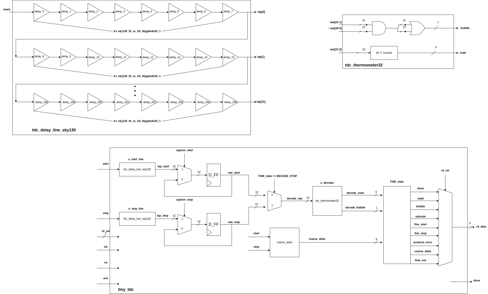

##### 2. Nguyên Lý Hình Học: Tại Sao Công Thức Là `Coarse + Fine START - Fine STOP`?
Như minh họa trên sơ đồ nguyên lý gốc của thiết kế (`TinyTDC.drawio` — tab `TinyTDC_measurement`, Hình 10B bên dưới):

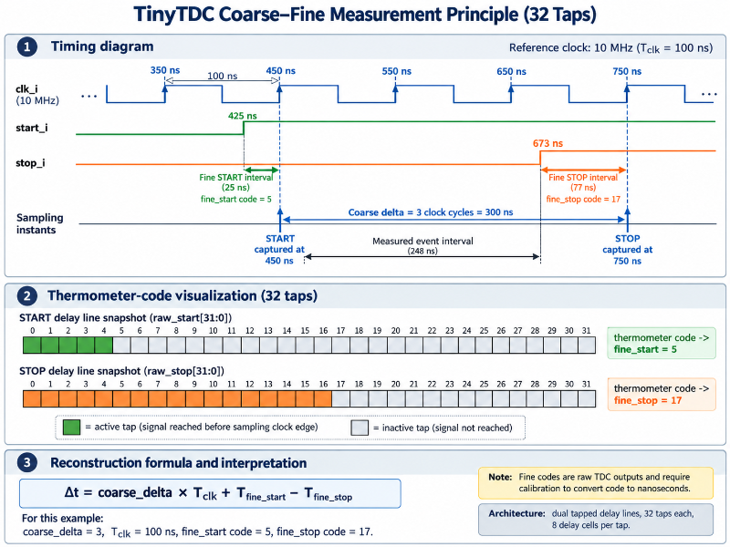

1. **Tầng Thô (`Coarse = 3` $\implies T_{\text{coarse}} = 300\,\text{ns}$):** Máy trạng thái đếm giữa **hai cạnh lên của `clk_i` bắt được sự kiện**: từ cạnh clock $450\,\text{ns}$ (bắt đầu ghi nhận `start_i`) đến cạnh clock $750\,\text{ns}$ (bắt đầu ghi nhận `stop_i`). Khoảng giữa này dài đúng $3 \times 100\,\text{ns} = 300\,\text{ns}$.
2. **Phần bù ở hai đầu (Hình học trục thời gian):** So với khoảng sự kiện thật cần đo ($425\,\text{ns} \rightarrow 673\,\text{ns} = 248\,\text{ns}$), đoạn $T_{\text{coarse}} = 300\,\text{ns}$ đã bị:
   * **Thiếu mất khúc đầu** từ lúc `start_i` tới ($425\,\text{ns}$) chờ đến cạnh `clk` $450\,\text{ns}$ $\implies$ Phải **CỘNG bù vào**: $+T_{\text{fine\_start}}$ *(khoảng lý tưởng $\approx 25\,\text{ns}$)*.
   * **Dư (lố) mất khúc đuôi** từ lúc `stop_i` tới ($673\,\text{ns}$) kéo ra tận cạnh `clk` $750\,\text{ns}$ $\implies$ Phải **TRỪ bớt đi**: $-T_{\text{fine\_stop}}$ *(khoảng lý tưởng $\approx 77\,\text{ns}$)*.
   * Ghép 3 đoạn thu được **phương trình tái tạo $\Delta t$**:
     $$\Delta t = \text{coarse\_delta} \times T_{\text{clk}} + T_{\text{fine\_start}} - T_{\text{fine\_stop}}$$
3. **Cơ chế ảnh chụp Mã Nhiệt kế (`Thermometer Code`):** Trong khoảng chờ trước cạnh clock bắt mẫu, cạnh lên của sự kiện lan truyền dọc theo chuỗi trễ; tại sườn lên clock, dàn `32` D-FF đồng loạt chốt trạng thái thành chuỗi bit `'1'` liên tiếp (bộ giải mã `tdc_thermometer32` đếm ra **`fine_start = 5`** ứng với `tap[0..4]`, và **`fine_stop = 17`** ứng với `tap[0..16]`).

##### 3. Tại Sao Phải Đo Lại Trên GTKWave Thay Vì Nhân Cứng `5 × 4 ns`?
Đúng như lưu ý thiết kế trong Hình 10B (*"Fine codes are raw TDC outputs and require calibration to convert code to nanoseconds"*):
* Con chip học thuật `TinyTDC` chỉ xuất ra **chỉ số đếm nguyên** (`Coarse = 3`, `Fine START = 5`, `Fine STOP = 17`), không tích hợp bộ hiệu chuẩn tự động theo PVT.
* Sau khi OpenROAD đặt cell và đi dây thật, độ trễ từ pad ngoài đi qua IO buffer (`input5`, `input6`), độ trễ `IOPATH` của từng cell `dlygate4sd3_1`, và điện dung dây đồng `INTERCONNECT` + tải nhánh `MUX` đều làm tốc độ lan truyền thực ở góc `nom_tt_25C_1v8` **sai lệch khỏi con số danh định $4.0\,\text{ns/tap}$ và $0.5\,\text{ns/cell}$**. Do đó bắt buộc phải truy vết đúng chân linh kiện trong `tinytdc.nl.v` để đo trực tiếp ở độ phân giải `1 ps` trên GTKWave.

---

#### MỤC 2: PHƯƠNG PHÁP TRUY VẾT NETLIST (`tinytdc.nl.v`) & CÁCH XÁC ĐỊNH CÁC CẶP ĐIỂM ĐO

##### 1. Quy Tắc Ánh Xạ Từ RTL Sang Node Vật Lý Sau Layout
Bằng phân tích kết nối cổng trong file netlist hậu layout `rtl/tinytdc.nl.v`, hệ tọa độ các nút đo được xác định chặt chẽ như sau:
1. **Điểm gốc tại ngõ vào chip (IO Buffers):**
   * Tín hiệu `start_i` đi vào buffer `sky130_fd_sc_hd__clkdlybuf4s25_1` tên instance **`input5`** (`.A(start_i)` $\rightarrow$ `.X(net5)`), rồi đổ vào đầu dây `u_start_line`.
   * Tín hiệu `stop_i` đi vào buffer **`input6`** (`.A(stop_i)` $\rightarrow$ `.X(net6)`), rồi đổ vào đầu dây `u_stop_line`.
2. **Công thức định vị đầu ra `tap[k]` trên chuỗi trễ:**
   * Vì mỗi tap cấu thành bởi `CELLS_PER_TAP = 8` cell nối tiếp (từ chỉ số `0` tới `7` tạo nên `tap[0]`, `8..15` tạo nên `tap[1]`, ...), chân đầu ra vật lý của **`tap[k]`** chính là ngõ ra **`.X`** của cell **`\u_<start|stop>_line.g_stage[8*(k+1)-1].u_delay`**.
   * Đằng sau mỗi điểm `tap[k]` đều nối qua một `MUX2_1` rồi cấp vào chân `D` của thanh ghi chụp `sky130_fd_sc_hd__dfxtp_2`.
3. **Suy ra 5 cặp mốc đo chính xác cho cấu hình `Fine START = 5`, `Fine STOP = 17`, `Coarse = 3`:**

| Đại Lượng Cần Đo | Cách Xác Định Điểm Gốc (`Base`) | Cách Xác Định Điểm Đích (`Primary`) | Cơ Sở Netlist & Kiến Trúc |
| :--- | :--- | :--- | :--- |
| **1. $T_{\text{fine\_start}}$ thực tế** | Cạnh lên **`input5.A`** | Cạnh lên **`\u_start_line.g_stage[39].u_delay.X`** | `Fine START = 5` tương ứng đã qua 5 taps (`tap[0..4]`) $\implies$ điểm cuối ở `8×(4+1)-1 = 39` (nối qua `_501_` vào D-FF `_622_`). |
| **2. Độ trễ `1 Tap` mẫu** | Cạnh lên **`\u_start_line.g_stage[7].u_delay.X`** | Cạnh lên **`\u_start_line.g_stage[15].u_delay.X`** | Hiệu khoảng thời gian giữa ngõ ra `tap[0]` (`stage[7]`, qua `_497_` vào FF `_618_`) và `tap[1]` (`stage[15]`, qua `_498_` vào FF `_619_`). |
| **3. Độ trễ `IOPATH 1 Cell`** | Cạnh lên **`\u_start_line.g_stage[7].u_delay.A`** | Cạnh lên **`\u_start_line.g_stage[7].u_delay.X`** | Đo trực tiếp trễ truyền từ chân vào `.A` tới chân ra `.X` của một cell `dlygate4sd3_1` đơn lẻ có tải `MUX`. |
| **4. $T_{\text{fine\_stop}}$ thực tế** | Cạnh lên **`input6.A`** | Cạnh lên **`\u_stop_line.g_stage[135].u_delay.X`** | `Fine STOP = 17` tương ứng đã qua 17 taps (`tap[0..16]`) $\implies$ điểm cuối ở `8×(16+1)-1 = 135` (nối qua `_546_` vào D-FF `_666_`). |
| **5. Chu kỳ đếm thô $T_{\text{coarse}}$** | Cạnh lên **`clk_i` tại $450\,\text{ns}$** | Cạnh lên **`clk_i` tại $750\,\text{ns}$** | Hai sườn dương `clk_i` đầu tiên lần lượt chốt trạng thái `start_i` và `stop_i`, cách nhau đúng `Coarse = 3` chu kỳ. |

##### 2. Kiểm Chứng Toàn Cảnh Sóng & Đề Bài Chuẩn (`248 ns`) Trước Khi Đo Nội Bộ
Trên file `tinytdc_postlayout.vcd` ($0 \rightarrow 1{,}100\,\text{ns}$), phép kẹp thước chuẩn trên hai chân ngoài `start_i` ($425\,\text{ns}$) và `stop_i` ($673\,\text{ns}$) xác nhận chính xác đề bài $\Delta t_{\text{chuẩn}} = 248\,\text{ns}$, đồng thời cho thấy bộ đếm `\coarse_delta` bước qua các trạng thái `01 -> 10 -> 11` (`3`) và thanh ghi `\fine_start` (`5`), `\fine_stop` (`17`) chốt ổn định trước khi `done_o` lên `1`:

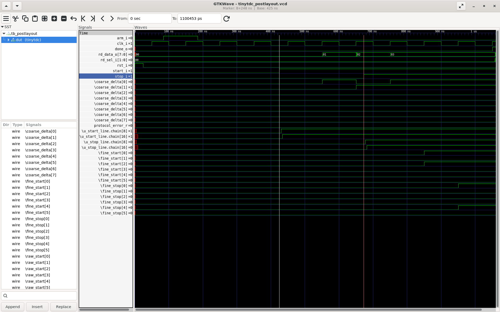

---

#### MỤC 3: KẾT QUẢ 5 PHÉP ĐO THỰC NGHIỆM CẤP PICOSECOND TRÊN GTKWAVE

##### 1. Phép Đo 1: Thời Gian Lan Truyền Tinh $T_{\text{fine\_start}}$ (`Fine START = 5`)
* **Xác định cặp mốc:** Cửa sổ `420 ns .. 455 ns`, `Base` khóa tại cạnh lên **`input5.A`** (`425 ns`), `Primary` khóa tại cạnh lên **`tb_postlayout.dut.\u_start_line.g_stage[39].u_delay .X`** (`tap[4]`).
* **Kết quả đo thực tế:** **`Marker: B+21892 ps`** ($\implies T_{\text{fine\_start}} = \mathbf{21{,}892\,\text{ps}} = 21.892\,\text{ns} \approx 21.9\,\text{ns}$).
* **Phân tích:** Xung `start_i` chạy hết `tap[4]` tại thời điểm $446{,}892\,\text{ps}$ — vẫn **sớm hơn cạnh lên `clk_i` ($450{,}000\,\text{ps}$) đúng $3{,}108\,\text{ps}$**. Tuy nhiên do quãng trễ của 1 tap lớn hơn $3.108\,\text{ns}$ nên xung không kịp đi tới `tap[5]` (`g_stage[47].X`) trước thời điểm $450\,\text{ns}$, giải thích chính xác vì sao phần cứng chốt tại **`Fine START = 5`**.

![Hình 12: Kết quả đo T_fine_start thực tế từ input5.A tới u_start_line.g_stage[39].u_delay.X đạt B+21892 ps (Base: 425 ns)](./images/gtkwave_thuc_hanh_fine_start_21892ps.png)

---

##### 2. Phép Đo 2: Độ Trễ Thực Tế Của `1 Tap` Mẫu (`8` Cell `dlygate4sd3_1`)
* **Xác định cặp mốc:** Cửa sổ `420 ns .. 455 ns`, `Base` đặt tại cạnh lên ngõ ra `tap[0]` (**`g_stage[7].u_delay .X`**, tại $429{,}705\,\text{ps}$), `Primary` đặt tại cạnh lên ngõ ra `tap[1]` (**`g_stage[15].u_delay .X`**).
* **Kết quả đo thực tế:** **`Marker: B+4310 ps`** ($\implies T_{\text{tap[0->1]}} = \mathbf{4{,}310\,\text{ps}} = 4.310\,\text{ns}$).
* **Phân tích:** So với ước lượng danh định trên giấy ($4.000\,\text{ns}$), thực tế sau layout mỗi tap bị kéo chậm thêm **`+310 ps`** ($+7.75\%$) do điện trở/điện dung dây đồng `INTERCONNECT` và tải đầu vào của `MUX2_1` nối rẽ nhánh. Chính giá trị $4.310\,\text{ns} > 3.108\,\text{ns}$ cũng khẳng định lý do `tap[5]` bị lố qua cạnh clock $450\,\text{ns}$ (tới tận $\sim 451.2\,\text{ns}$) ở Phép đo 1.

![Hình 13: Kết quả đo độ trễ 1 tap mẫu giữa g_stage[7].u_delay.X và g_stage[15].u_delay.X đạt B+4310 ps (Base: 429705 ps)](./images/gtkwave_thuc_hanh_tap_delay_4310ps.png)

---

##### 3. Phép Đo 3: Độ Trễ `IOPATH` Thực Tế Của `1 Delay Cell` Đơn Lẻ
* **Xác định cặp mốc:** Cửa sổ `420 ns .. 455 ns`, đo giữa hai chân của cùng một phần tử **`\u_start_line.g_stage[7].u_delay`**: `Base` giữ tại chân ra **`.X`** ($429{,}705\,\text{ps}$), `Primary` đặt tại chân vào **`.A`**.
* **Kết quả đo thực tế:** **`Marker: B-556 ps`** ($\implies t_{\text{cell}} = |\text{B}-556| = \mathbf{556\,\text{ps}} = 0.556\,\text{ns}$). *(Dấu `-` xuất hiện do điểm đích `.A` nằm bên trái mốc chuẩn `.X` trên trục thời gian).*
* **Phân tích:** Cao hơn **`+56 ps`** ($+11.2\%$) so với giả định $500\,\text{ps}$. Đặc biệt lưu ý: nếu nhân 8 lần con số này ta được $8 \times 556 = 4{,}448\,\text{ps}$, **khác với** $4{,}310\,\text{ps}$ đo cả cụm `tap[1]` ở Phép đo 2. Nguyên nhân là vì cell cuối cùng của mỗi tap (`g_stage[7]`, `[15]`...) phải gánh thêm điện dung ngõ vào của `MUX` (`_497_`, `_498_`) nên nặng hơn các cell trung gian (`g_stage[8..14]`), đồng thời khoảng cách dây nối giữa các cell trong thực tế đặt layout không đồng đều nhau.

![Hình 14: Kết quả đo độ trễ IOPATH nội tại của cell mẫu g_stage[7].u_delay từ chân .A tới .X đạt 556 ps (Marker: B-556 ps)](./images/gtkwave_thuc_hanh_cell_iopath_556ps.png)

---

##### 4. Phép Đo 4: Thời Gian Lan Truyền Tinh $T_{\text{fine\_stop}}$ (`Fine STOP = 17`)
* **Xác định cặp mốc:** Cửa sổ `670 ns .. 755 ns`, `Base` khóa tại cạnh lên **`input6.A`** (`673 ns`), `Primary` khóa tại cạnh lên **`tb_postlayout.dut.\u_stop_line.g_stage[135].u_delay .X`** (`tap[16]`).
* **Kết quả đo thực tế:** **`Marker: B+73296 ps`** ($\implies T_{\text{fine\_stop}} = \mathbf{73{,}296\,\text{ps}} = 73.296\,\text{ns} \approx 73.3\,\text{ns}$).
* **Phân tích:** Cạnh lên của `stop_i` đi qua `tap[16]` tại $746{,}296\,\text{ps}$ — chỉ **sớm hơn cạnh clock $750{,}000\,\text{ps}$ đúng $3{,}704\,\text{ps}$**. Khoảng dư này nhỏ hơn chu kỳ 1 tap ($\sim 4.3\,\text{ns}$), do đó `tap[17]` (`g_stage[143].X`) vượt quá cạnh $750\,\text{ns}$ và phần cứng dừng ở **`Fine STOP = 17`**.

![Hình 15: Kết quả đo T_fine_stop thực tế từ input6.A tới u_stop_line.g_stage[135].u_delay.X đạt B+73296 ps (Base: 673 ns)](./images/gtkwave_thuc_hanh_fine_stop_73296ps.png)

---

##### 5. Phép Đo 5: Kiểm Chứng Khoảng Đếm Thô $T_{\text{coarse}}$ (`Coarse = 3`)
* **Xác định cặp mốc:** Cửa sổ `400 ns .. 800 ns`, `Base` khóa tại sườn lên **`clk_i`** ở **$450\,\text{ns}$** (cạnh chốt Start), `Primary` khóa tại sườn lên **`clk_i`** ở **$750\,\text{ns}$** (cạnh chốt Stop).
* **Kết quả đo thực tế:** **`Marker: B+300 ns`** ($\implies T_{\text{coarse}} = \mathbf{300{,}000\,\text{ps}} = 300\,\text{ns}$).
* **Phân tích:** Xác nhận khoảng thời gian giữa hai sườn đồng hồ bắt mẫu bằng chính xác $3 \times T_{\text{clk}} = 300\,\text{ns}$, khớp tuyệt đối với giá trị thanh ghi `Coarse = 3` thu được từ `cvc.log` ở Chương 2.

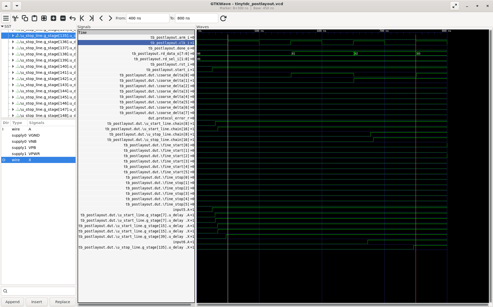

---

#### MỤC 4: TỔNG HỢP TÁI TẠO $\Delta t_{\text{post-layout}}$ & GIẢI MÃ SAI SỐ LƯỢNG TỬ HÓA (`+596 ps`)

##### 1. Bảng Tổng Kết Đối Chứng Toàn Diện (Góc `nom_tt_25C_1v8`)
| Thông Số | Giá Trị Ước Lượng Lý Thuyết | Giá Trị Thực Đo GTKWave | Độ Chênh Lệch Vật Lý |
| :--- | :---: | :---: | :--- |
| **$\Delta t_{\text{chuẩn}}$ (`start_i -> stop_i`)** | $248.000\,\text{ns}$ ($248{,}000\,\text{ps}$) | **`248 ns`** (`248,000 ps`) | $0\,\text{ps}$ *(Khớp chuẩn đầu vào testbench)* |
| **$T_{\text{coarse}}$ (`Coarse = 3`)** | $300.000\,\text{ns}$ ($300{,}000\,\text{ps}$) | **`300 ns`** (`300,000 ps`) | $0\,\text{ps}$ *(Đúng 3 chu kỳ clock $10\,\text{MHz}$)* |
| **$T_{\text{fine\_start}}$ (`Fine START = 5`)** | $25.000\,\text{ns}$ *(chờ tới $450\,\text{ns}$)* | **`21,892 ps`** ($21.892\,\text{ns}$) | **`-3,108 ps`** *(phần dư chưa hết 1 tap trước $450\,\text{ns}$)* |
| **$T_{\text{fine\_stop}}$ (`Fine STOP = 17`)** | $77.000\,\text{ns}$ *(chờ tới $750\,\text{ns}$)* | **`73,296 ps`** ($73.296\,\text{ns}$) | **`-3,704 ps`** *(phần dư chưa hết 1 tap trước $750\,\text{ns}$)* |
| **Độ trễ `1 Tap` (`8` cells)** | $4{,}000\,\text{ps}$ ($4.000\,\text{ns}$) | **`4,310 ps`** ($4.310\,\text{ns}$) | **`+310 ps`** *($+7.75\%$ do dây đồng & tải MUX)* |
| **Độ trễ `IOPATH 1 Cell` (`g_stage[7]`)** | $500\,\text{ps}$ ($0.500\,\text{ns}$) | **`556 ps`** ($0.556\,\text{ns}$) | **`+56 ps`** *($+11.20\%$ do tải rẽ nhánh `_497_`)* |

##### 2. Tái Tạo $\Delta t$ Từ Số Đo Silicon & Chứng Minh Nguồn Gốc Sai Số `+596 ps`
Thay các đại lượng vừa đo từ sóng hậu layout vào công thức TDC:
$$\Delta t_{\text{đo (ps)}} = T_{\text{coarse}} + T_{\text{fine\_start}} - T_{\text{fine\_stop}} = 300{,}000 + 21{,}892 - 73{,}296 = \mathbf{248{,}596\,\text{ps}} = \mathbf{248.596\,\text{ns}} \approx \mathbf{248.6\,\text{ns}}$$

* **Kiểm chứng sai số so với đề bài gốc ($\Delta t_{\text{chuẩn}} = 248{,}000\,\text{ps}$):**
  $$\varepsilon_{\Delta t} = 248{,}596 - 248{,}000 = \mathbf{+596\,\text{ps}} \quad (\text{sai số tương đối } \mathbf{+0.24\%})$$
* **Chứng minh toán học nguồn gốc con số `+596 ps`:** Do bước lượng tử của một tap là $4{,}310\,\text{ps}$, cả hai nhánh đều cắt bỏ phần thời gian lẻ nằm giữa tap cuối cùng bắt được và sườn dương của `clk_i`. Khi đưa vào phép hiệu $T_{\text{fine\_start}} - T_{\text{fine\_stop}}$, phần dư ở hai đầu tự triệt tiêu phần lớn cho nhau (*common-mode quantization cancellation*), chỉ để lại đúng chênh lệch giữa hai phần dư:
  $$\varepsilon_{\Delta t} = \underbrace{(-3{,}108\,\text{ps})}_{\text{Dư nhánh Start}} - \underbrace{(-3{,}704\,\text{ps})}_{\text{Dư nhánh Stop}} = \mathbf{+596\,\text{ps}}$$
* **Kết luận kỹ thuật:** Dù độ phân giải đơn lẻ của một tap lên tới $\sim 4.31\,\text{ns}$, phép nội suy hai đầu kết hợp dữ liệu ký sinh `.sdf` trên Post-Layout GLS cho phép tái tạo khoảng thời gian $\Delta t = 248.596\,\text{ns}$ sát đề bài với sai số chỉ $0.596\,\text{ns}$ ($< 1/7$ độ rộng 1 tap). Trong các chip TDC thương mại, khâu quy đổi này được tích hợp mạch tự hiệu chuẩn theo góc PVT (Voltage/Temperature Calibration), còn với thiết kế học thuật `TinyTDC`, bộ ba dữ liệu thô (`Coarse, Fine START, Fine STOP`) được kết hợp với mô phỏng GLS + SDF ở góc hoạt động thực tế để nội suy chính xác kết quả đo.

---

#### MỤC 5: PHẢN BIỆN KIẾN TRÚC `TinyTDC` (CÂU HỎI 2) & CẦU NỐI SANG GIAI ĐOẠN 3

##### 1. Giải Mã Câu Hỏi 2: Hai Sự Kiện `start_i` ($425\,\text{ns}$) & `stop_i` ($429\,\text{ns}$) Trong Cùng 1 Chu Kỳ
Xét kịch bản hai xung cùng xuất hiện trước một sườn dương `clk_i` ($450\,\text{ns}$), với $\Delta t = 429 - 425 = 4\,\text{ns}$:

1. **Giá trị thanh ghi đếm thô `Coarse` bằng `0` (không phải `1`):**
   * **Trích dẫn bằng chứng từ mã nguồn RTL (`rtl/tinytdc.v` — dòng `35–43`, `71–72`, `83–113`):**
     ```verilog
     // [1] Điều kiện kích hoạt chốt đồng thời hai dây trễ (dòng 35–43):
     wire capture_start = (state == S_WAIT_START) && start_i && !arm_i && !rst_i;
     wire capture_stop  = ((state == S_WAIT_STOP) ||
                          ((state == S_WAIT_START) && start_i)) &&
                          stop_i && !arm_i && !rst_i;

     always @(posedge clk_i) begin
         if (capture_start) raw_start <= tap_start;
         if (capture_stop)  raw_stop  <= tap_stop;
     end
     ```
     ```verilog
     // [2] Logic FSM điều khiển bộ đếm coarse_delta (dòng 71–72 & 83–113):
     // Khi arm_i = 1 ở chu kỳ chuẩn bị:
     state        <= S_WAIT_START;
     coarse_delta <= 8'd0;

     // Trong case (state) tại sườn dương clk_i:
     S_WAIT_START: begin
         if (stop_i && !start_i) begin
             protocol_error_r <= 1'b1;
             done_o <= 1'b1;
             state <= S_IDLE;
         end else if (start_i) begin
             if (stop_i) begin
                 state <= S_DECODE_START;
             end else begin
                 state <= S_WAIT_STOP;
             end
         end
     end

     S_WAIT_STOP: begin
         if (coarse_delta == 8'hff) begin
             timeout_r <= 1'b1;
             done_o <= 1'b1;
             state <= S_IDLE;
         end else begin
             coarse_delta <= coarse_delta + 8'd1;
             if (stop_i) begin
                 state <= S_DECODE_START;
             end
         end
     end
     ```
   * **Giải thích từng bước dựa trên đoạn code trên tại mốc `clk_i = 450 ns`:**
     * Trước đó ở pha kích hoạt `arm_i = 1`, `coarse_delta` được đặt về **`8'd0`** và FSM đứng ở **`S_WAIT_START`**.
     * Tới cạnh lên `clk_i = 450 ns`, cả hai xung `start_i` ($425\,\text{ns}$) và `stop_i` ($429\,\text{ns}$) đều đã lên mức `1`. Nhờ biểu thức `((state == S_WAIT_START) && start_i) && stop_i` (dòng `36–37`), cả hai cờ **`capture_start`** và **`capture_stop`** cùng bằng `1`, khiến **`raw_start`** và **`raw_stop`** đồng loạt chốt trạng thái hai dây trễ ngay tại cùng một sườn clock `450 ns`.
     * Song song đó trong FSM, nhánh `else if (start_i)` $\rightarrow$ `if (stop_i)` (dòng `89–93`) đẩy trạng thái **nhảy thẳng sang `S_DECODE_START`**, bỏ qua hoàn toàn trạng thái `S_WAIT_STOP` — là **nơi duy nhất thực hiện lệnh cộng `coarse_delta <= coarse_delta + 8'd1` (dòng `107`)** $\implies$ **`coarse_delta` giữ nguyên bằng `0`**.
     * Điều này khớp tuyệt đối với ý nghĩa hình học của `Coarse`: đếm số chu kỳ giữa *sườn clock chốt Start* và *sườn clock chốt Stop* ($(450 - 450)/100 = 0$).

2. **Khả năng đo khoảng thời gian gần $4\,\text{ns}$ (`TinyTDC` cấu hình `8 cell/tap`):**
   * **Phân tích theo đúng trường hợp pha cụ thể `425 ns -> 429 ns`:** Căn cứ trên kết quả thực đo ở Mục 3 (`1 tap = 4,310 ps = 4.31 ns`), xung `start_i` ($425\,\text{ns}$) kịp chạm `tap[4]` lúc $446.892\,\text{ns}$ (**`Fine START = 5`**). Xung `stop_i` ($429\,\text{ns}$) đi trễ hơn $+4\,\text{ns}$ nên `tap[4]` trượt qua $450\,\text{ns}$ ($\sim 450.89\,\text{ns}$), chỉ kịp chốt `tap[3]` ($\sim 446.58\,\text{ns}$ $\implies$ **`Fine STOP = 4`**), cờ `valid_r` giữ mức `1`. Lắp vào công thức:
     $$\Delta t_{\text{đo}} \approx 0 \times 100\,\text{ns} + (5 - 4) \times 4.31\,\text{ns} = \mathbf{4.31\,\text{ns}}$$
     Tức tại *riêng* vị trí pha cắt qua ranh giới `tap[4]` này, con chip vẫn phân biệt được `5` với `4` và cho ra kết quả gần đúng $\sim 4.31\,\text{ns}$.
   * **Kết luận bản chất về giới hạn độ mịn (*Single-Tap Dead-Band*):** Xét trên nguyên tắc đo tổng quát ở mọi thời điểm đến bất kỳ, vì khoảng $\Delta t = 4\,\text{ns}$ **nhỏ hơn độ phân giải $1\,\text{LSB}$ của cấu hình hiện tại ($4.31\,\text{ns}$/tap)** nên hệ thống **không thể bảo đảm đo tin cậy**. Nếu dịch pha xuất phát đi một chút để cả cạnh `start_i` và `stop_i` cùng rơi vào giữa khoảng hai tap liền kề, mạch sẽ chốt `Fine START = Fine STOP` $\implies \Delta t_{\text{đo}} = 0\,\text{ns}$ (sai số lên tới $100\%$). Muốn đo ổn định các xung $\le 4\,\text{ns}$ ở mọi pha, bắt buộc phải tăng độ phân giải bằng cách giảm `CELLS_PER_TAP` xuống `4`, `2` hoặc `1` cell/tap.

##### 2. Chốt Giai Đoạn 2 & Đặt Câu Hỏi Dẫn Sang Giai Đoạn 3 (`cpu8bit`)
Như vậy, toàn bộ **Giai đoạn 2 (3 trụ cột: OpenROAD GUI/TCL, CVC64 GLS và GTKWave Picosecond)** đã được làm chủ trọn vẹn. Câu hỏi phản biện cuối cùng ở Trang 40 `Tapeout_LAB3.pdf` — ***"Nếu bộ vi xử lý `cpu8bit` hoạt động ở tần số clock yêu cầu $50\,\text{MHz}$ ($T_{\text{clk}} = 20\,\text{ns}$) trên kích thước tile chuẩn `1×1` thì có được không?"*** — không phải để suy đoán trên giấy, mà chính là **đề bài trinh thám mở khóa Giai đoạn 3** ngay dưới đây để trực tiếp kiểm chứng bằng bộ vũ khí chúng ta vừa thuần thục.

---

---

## PHẦN V: GIAI ĐOẠN 3 - THÍ NGHIỆM 1 (`cpu8bit` @ `50 MHz`) (ĐÃ HOÀN THÀNH 100%)

> [!NOTE]
> **TRẠNG THÁI CHẶNG:** **HOÀN THÀNH 100%** — Đã đi qua khép kín từ khám hồ sơ RTL/Constraints (`Bước 1A`) $\rightarrow$ Baseline gãy Global Routing (`Bước 1B`) $\rightarrow$ đối chiếu Heat Maps OpenROAD GUI (`Bước 2`) $\rightarrow$ thực nghiệm A/B `PL_RESIZER_HOLD_SLACK_MARGIN=0.02` thông chốt 0 DRC/LVS/Hold (`Bước 3`) $\rightarrow$ truy vết Critical Path & OpenROAD TCL phân tách Half-Cycle/Full-Cycle, quét $f_{\max}$ tại `max_ss_100C_1v60` và trực quan hóa Critical Path trên GUI (`Bước 4`). Toàn bộ số liệu đều được đối chứng trực tiếp từ output thực tế.

### 1. Nhiệm Vụ Tổng Quan Của Chặng
* Giải quyết trọn vẹn bài toán kiểm định mở màn từ cuối Chương 3: **Kiểm chứng xem chip `cpu8bit` có thể đóng timing và hoạt động ổn định ở tần số yêu cầu $50\,\text{MHz}$ ($T_{\text{clk}} = 20\,\text{ns}$) trên diện tích khuôn chuẩn `1×1` hay không?**
* Triển khai quy trình chẩn đoán khép kín từ hiện tượng vật lý ngoài vỏ đến nguyên nhân gốc trong ruột: khảo sát mật độ đặt cell (*Global Placement* & *Post-CTS*), phân tích hiện tượng **bùng nổ buffer sửa timing** dẫn tới tắc nghẽn *Detailed Routing*, thử nghiệm tinh chỉnh ngưỡng biên trong `config.json`, và dùng STA/TCL bóc tách *Critical Path* tại *Worst Corner* để kết luận ranh giới giữa lỗi tối ưu Physical Design và giới hạn kiến trúc RTL.

### 2. Lý Do Cần Bộ Công Cụ Giai Đoạn 2 & Bắt Buộc Phải Thực Hiện Chặng Này
* **Không thể đánh giá khả năng đạt $50\,\text{MHz}$ chỉ qua Synthesis hay mạch nhỏ:** Khác với mạch tổ hợp/pipeline gọn nhẹ `mult`, vi xử lý `cpu8bit` mang nhiều thanh ghi trạng thái, bộ giải mã lệnh và cây MUX sâu trong không gian tile `1×1` chật hẹp. Khi ép chu kỳ xuống $20\,\text{ns}$, công cụ PnR tự động bơm buffer sửa Setup/Hold/Max Fanout, làm tổng số cell và mật độ dây dẫn leo thang ngoài dự kiến — đây là bài kiểm tra sinh tử xem kỹ sư có đọc ra được nguyên nhân tắc nghẽn và phân biệt được **vi phạm sửa được bằng PD** với **vi phạm bắt nguồn từ RTL** hay không.

### 3. Móc Nối Với Chặng Trước: Đã Có Gì & Đang Thiếu Gì?
| Trục Đối Chiếu | Đã Có Sau Giai Đoạn 1 & Giai Đoạn 2 | Đang Thiếu Khuyết Mà Chỉ Giai Đoạn 3 Mới Mang Lại |
| :--- | :--- | :--- |
| **Bộ công cụ & Lý thuyết** | • Nắm vững giải phẫu `.odb`, cây xung nhịp, lưới PDN (Giai đoạn 1).<br/>• Thuần thục **OpenROAD GUI (Heat Maps, Inspector, Timing GUI), TCL Scripts, CVC64 GLS & GTKWave** (Giai đoạn 2). | • Chưa trực tiếp vận dụng bộ công cụ đó để "mổ xẻ" một ca vi phạm timing và sụp đổ định tuyến (*Detailed Routing*) trên một CPU 8-bit thực tế bị ép xung nhịp $50\,\text{MHz}$ trong diện tích `1×1`. |
| **Định hướng giải quyết lỗi** | • Đã thấy bản chất buffer insertion cục bộ trên mạch nhỏ `mult` đạt Slack dương. | • Chưa thực chứng cách cô lập **bước gãy đổ của flow**, cách tinh chỉnh tham số PnR (`config.json`), và kỹ thuật đọc `Data Path Details` để trả lời câu hỏi **"50 MHz có khả thi không — và nếu không thì giới hạn tối đa hoặc giải pháp sửa RTL là gì?"**. |

### 4. Mục Tiêu Đầu Ra Sau Khi Hoàn Thành Chặng Này
Sau khi đi hết từng bước của Giai đoạn 3, kỹ sư sẽ làm chủ hoàn toàn:
1. **Quy trình truy vết & gỡ lỗi PnR đa tầng:** Đọc log lỗi routing $\rightarrow$ soi Heat Map mật độ qua các step $\rightarrow$ thống kê biến thiên số cell buffer bằng TCL $\rightarrow$ can thiệp đúng tham số `config.json` thay vì thử mò.
2. **Năng lực khoanh vùng nút thắt Worst Corner:** Biết cách chuyển phân tích về góc xấu nhất (*Slow-Slow, nhiệt độ cao, áp thấp*) và truy vết *Critical Path* bằng lệnh TCL chuyên sâu (`check_setup`, `report_checks`, `EXTRA_EXCLUDED_CELLS`).
3. **Bản lĩnh ký duyệt Signoff cho `cpu8bit`:** Tự tay trả lời thuyết phục dựa trên số liệu thật cho **Câu hỏi `50 MHz`**, định lượng rõ giới hạn tần số thực của `cpu8bit` trên `1×1` trước khi chuyển sang **Giai đoạn 4 (`TinyTDC` PnR & Bảo toàn 512 Delay Cells)**.

---

### 5. Nhật Ký Thực Hành Từng Bước (Đã Thực Hiện)

> *Đối tượng thí nghiệm:* IP **`cpu8bit` (`tt_um_dvxf_dj8` — VHDL, nguồn `dvxf/tt06-dj8`)**, chạy theo flow **`VHDLClassic`** (`72` bước, tổng hợp VHDL qua `Yosys.VHDLSynthesis`) trên PDK `sky130A` (`sky130_fd_sc_hd`).

#### Bước 1A: "Khám Bệnh Từ Hồ Sơ" Trước Khi Bấm Máy (Kết Nối Buổi 1 $\rightarrow$ Buổi 3)

Trước khi chạy PnR, kiểm tra toàn bộ hồ sơ cấu hình và RTL (`info.yaml`, `docs/info.md`, `config.json`, `src/*.vhdl`):

```bash
cd ~/ctwsemi-data/ips/cpu8bit
cat info.yaml
cat config.json
grep -nE "rising_edge|falling_edge" src/*.vhdl
```

1. **Thông số kiến trúc & Ràng buộc thực tế:**
   * **`info.yaml` & `docs/info.md`:** Thiết kế **`tt_um_dvxf_dj8`** (*DJ8 8-bit CPU*, viết bằng **`VHDL`**, gồm `8 × 8-bit register file`, bus địa chỉ 15-bit, bus dữ liệu 8-bit dùng chung chân `uio[7:0]`, Test ROM `256 bytes` nội bộ `tt06rom`), thông số tác giả khai báo **`clock_hz: 14000000` (`14 MHz` $\approx 71.43\,\text{ns}$)** trên kích thước **`tiles: "1x1"`**.
   * **`config.json`:** Khóa cứng diện tích **`FP_SIZING: "absolute"`**, **`DIE_AREA: [0, 0, 161.00, 111.52]`** ($\mu\text{m}^2$) kèm template `dir::def/tt_block_1x1_pg.def`, giới hạn lớp đi dây **`RT_MAX_LAYER: "met4"`**, nhưng đặt **`CLOCK_PERIOD: 20`** (**`50 MHz`** — ép xung nhanh gấp **~3.57 lần** mức `14 MHz` trong `info.yaml`).
2. **Phát hiện xung đột cạnh clock ngay trong mã RTL (`grep`):**
   ```text
   src/register8.vhdl:27:       elsif (rising_edge(clk)) then
   src/top.vhdl:414:    elsif(falling_edge(clk)) then
   src/top.vhdl:427:    elsif(rising_edge(clk)) then
   ```
   * **Cạnh lên (`rising_edge(clk)`):** Chốt toàn bộ 8 thanh ghi 8-bit trong `register_file` (`ACC`, `EF`, `GH`, ...) tại `register8.vhdl:27` và nhóm cờ `flag_C`, `flag_Z`, `mem_bus_we` tại `top.vhdl:427`.
   * **Cạnh xuống (`falling_edge(clk)`):** Chốt máy trạng thái `state`, bộ đếm `pc` (15-bit) và thanh ghi lệnh `ir` (16-bit) tại `top.vhdl:414`.
   * **Hệ quả vật lý theo STA (Buổi 3):** Trên mọi đường truyền đi chéo giữa hai nhóm Flip-Flop (`falling_edge` $\leftrightarrow$ `rising_edge`), quỹ thời gian tối đa không còn là trọn chu kỳ $20\,\text{ns}$ mà bị chặt đôi thành **Half-Cycle Path = $T_{\text{clk}}/2 = 10\,\text{ns}$** (tương đương đòi hỏi tốc độ $100\,\text{MHz}$).
3. **Giả thuyết kỹ sư trước khi chạy thí nghiệm:** Ép chu kỳ xung nhịp xuống $20\,\text{ns}$ trên khuôn `1×1` cố định sẽ buộc công cụ PnR chèn hàng loạt buffer sửa timing, làm **bùng nổ diện tích** và đẩy thiết kế tới quá tải.

---

#### Bước 1B: Chạy Thực Nghiệm Baseline `cpu8bit-20ns` & Phân Tích Log / `.odb` / STA

**1. Thực thi Baseline nguyên bản (`CLOCK_PERIOD = 20`, flow `VHDLClassic`):**
```bash
docker exec -w /home/admin060506/ctwsemi-data/ips/cpu8bit ctwsemi \
  librelane --pdk-root /home/admin060506/ctwsemi-data/.ciel \
  --docker-no-tty --dockerized \
  -f VHDLClassic -p sky130A -s sky130_fd_sc_hd \
  --run-tag cpu8bit-20ns config.json
```

**2. Điểm dừng & Báo cáo lỗi cuối flow (`flow.log`):**
Flow chạy tới **Step 32 — `OpenROAD.GlobalRouting` (`31/72`, sau `0:06:35`)** thì dừng khẩn cấp với lỗi nghẽn định tuyến:
```text
[GRT-0273] Disabled NDR (to reduce congestion) for net: clknet_0_clk
[GRT-0704] Try reduce the layer adjustment from 30.000002% to 14%
[GRT-0116] Global routing finished with congestion. Check the congestion regions in the DRC Viewer.
```
* **Thống kê nghẽn dây định tuyến toàn cục (`GRT-0096`, `1228` nets, `85,649 µm` wirelength, `12,656` vias):**

| Lớp Kim Loại | Tài Nguyên Khả Dụng (*Resource*) | Nhu Cầu (*Demand*) | Tỉ Lệ Dùng (*Usage %*) | Overflow (Max H / Max V / Total) |
| :--- | :---: | :---: | :---: | :---: |
| `li1` | `0` | `0` | `0.00%` | `0 / 0 / 0` |
| `met1` (H) | `3,167` | `2,745` | **`86.68%`** | `1 / 0 / 7` |
| `met2` (V) | `3,150` | `2,799` | **`88.86%`** | `0 / 4 / 33` |
| `met3` (H) | `2,332` | `1,589` | `68.14%` | `2 / 1 / 35` |
| `met4` (V) | `1,410` | `790` | `56.03%` | `0 / 3 / 18` |
| **Tổng (`met1–4`)** | **`10,059`** | **`7,923`** | **`78.77%`** | **`3 / 8 / 93`** |

**3. Kiểm kê danh sách 10 file `.odb` đã xuất xưởng (trước Step 32):**
```text
 1. 08-openroad-floorplan/tt_um_dvxf_dj8.odb
 2. 12-openroad-cutrows/tt_um_dvxf_dj8.odb
 3. 13-openroad-tapendcapinsertion/tt_um_dvxf_dj8.odb
 4. 15-openroad-generatepdn/tt_um_dvxf_dj8.odb
 5. 21-odb-applydeftemplate/tt_um_dvxf_dj8.odb
 6. 22-openroad-globalplacement/tt_um_dvxf_dj8.odb
 7. 25-openroad-repairdesignpostgpl/tt_um_dvxf_dj8.odb
 8. 27-openroad-detailedplacement/tt_um_dvxf_dj8.odb
 9. 28-openroad-cts/tt_um_dvxf_dj8.odb
10. 30-openroad-resizertimingpostcts/tt_um_dvxf_dj8.odb
```
*(Ghi chú: Step 31 chỉ chạy STA nên dùng lại `.odb` của Step 30; Step 32 sập trước khi lưu nên không tạo `.odb`).*

**4. Đường cong "nổ diện tích" & Diễn biến Timing qua từng trạm (`state_out.json`):**

| Step | StdCell | Util% | RepBuf | HoldBuf | SetBuf | SetupWS (ns) | HoldWS (ns) | Ý Nghĩa Chuyển Pha |
| :--- | :---: | :---: | :---: | :---: | :---: | :---: | :---: | :--- |
| `07-openroad-staprepnr` | `-` | `-` | `-` | `-` | `-` | `-11.377` | `0.016` | STA trước đặt cell (ước lượng wire thô) |
| `08-openroad-floorplan` | `925` | **`61.36%`** | `-` | `-` | `-` | `-11.377` | `0.016` | Khung nền logic ban đầu sau Yosys |
| `13-openroad-tapendcapinsertion` | `1,150` | `63.06%` | `-` | `-` | `-` | `-11.377` | `0.016` | Thêm `+225` Tap/Endcap cell |
| `22-openroad-globalplacement` | `1,150` | `63.06%` | `-` | `-` | `-` | `-11.377` | `0.016` | Đặt thô (`PL_TARGET_DENSITY_PCT` auto = `73.06%`) |
| `24-openroad-stamidpnr` | `1,150` | `63.06%` | `-` | `-` | `-` | **`-1.138`** | `0.091` | STA sau GP thực: đã âm Setup `-1.138 ns` |
| `25-openroad-repairdesignpostgpl` | `1,279` | `70.39%` | `129` | `-` | `-` | `-1.138` | `0.091` | Chèn `129` buffer sửa fanout/cap/slew |
| `28-openroad-cts` | `1,308` | `72.56%` | `129` | `-` | `-` | `-1.138` | `0.091` | Dựng cây xung nhịp (`+29` clock cells) |
| `29-openroad-stamidpnr-1` | `1,308` | `72.56%` | `129` | `-` | `-` | **`-3.226`** | `0.129` | Sau CTS, Setup xấu vọt lên `-3.226 ns` |
| `30-openroad-resizertimingpostcts` | **`1,455`** | **`84.28%`** | **`274`** | **`79`** | **`75`** | `-3.226` | `0.129` | **Bùng nổ cell & buffer** trước khi định tuyến |
| `31-openroad-stamidpnr-2` | `1,455` | `84.28%` | `274` | `79` | `75` | `+1.624`* | `+0.322`* | *(\*) Lưu ý: chỉ đo góc `nom_tt_025C_1v80`!* |

**5. Giải phẫu "cơn bão Step 30" (`openroad-resizertimingpostcts.log`) & Bằng chứng Half-Cycle Path (`checks.rpt` Step 31):**
* **Tại sao Step 30 phình tới `84.28%` (`1,533` tổng cell kể cả Fill, `14,193.61 µm²`)?**
  Log của Step 30 chạy tối ưu đa góc qua **9 PVT corners** (`max/nom/min × {tt_025C_1v80, ss_100C_1v60, ff_n40C_1v95}`):
  1. **Gọng kìm Setup (`97` endpoints vi phạm — `[RSZ-0094]`):** Công cụ đã phải phóng đại kích thước tới **`615` cell (`[RSZ-0051] Resized 615 instances: 615 up`)**, chèn mới **`75` setup buffers** (`[RSZ-0040]`, trừ `10` buffer gỡ `[RSZ-0059]`), hoán đổi pin `49` instance (`[RSZ-0043]`), clone `3` cổng (`[RSZ-0049]`). Tuy vậy, ở góc chậm nhất **`ss_100C_1v60`** Setup vẫn không cứu hết nổi (**`[WARNING RSZ-0062] Unable to repair all setup violations`**) — lý giải vì sao bảng `ws.max.rpt` của Step 31 khi chỉ xét góc danh định `nom_tt_025C_1v80` lại in ra con số dương `+1.624 ns` đánh lừa thị giác!
  2. **Gọng kìm Hold liền sau (`79` endpoints vi phạm — `[RSZ-0046]`):** Ngay trong cùng bước, công cụ phát hiện thêm **`79` endpoints lỗi Hold** và nhồi tiếp **`79` hold buffers** (`[RSZ-0032]`), làm diện tích cộng thêm **`+6.2%`**, đưa tổng `Timing Repair Buffer` lên tới **`274` cells (`2,522.42 µm²`)**.
* **Bắt tại trận Half-Cycle Path trong `31-openroad-stamidpnr-2/checks.rpt`:**
  * Báo cáo xác nhận sự tồn tại của pha clock đảo **`clk'`** xuất phát ở **`10.000 ns`** (đi qua `clkbuf_16` $\rightarrow$ `clkbuf_8` $\rightarrow$ inverter `_1584__143` / `_1603__162`, nằm trong số `46` clock inverter của CTS).
  * Trên path đầu (`rst_n` $\rightarrow$ `_1619_/RESET_B`, recovery check với `clk'`), OpenROAD nối tiếp tới **4 tầng delay buffer nặng `sky130_fd_sc_hd__clkdlybuf4s25_1`** + `buf_2` (đạt slack `+4.613 ns`).
  * Ở path thứ hai (`_1638_` $\rightarrow$ `_1645_`), Startpoint `_1638_` (`dfrtp_2`, tín hiệu `ir[10]`) phóng ở **`clk'` (`10.442 ns`)** hướng về Endpoint `_1645_` (`clk` cạnh lên `20 ns`). Dọc đường truyền bị siết `10 ns` này xuất hiện hàng loạt cell bị upsize cỡ lớn (`buf_6`, `buf_8`, `inv_8`, `o221a_4`, `o31ai_4`, `or3b_4`, `a22o_4`, `a211o_4`, `a31o_4`) cùng **2 tầng `clkdlybuf4s25_1`** (`fanout103` trễ `0.464 ns`, `fanout87` trễ `0.455 ns`), kéo thời gian truyền tới `_0648_` lên `15.768 ns`.

> [!TIP]
> **CHỐT BƯỚC 1:**
> Giả thuyết ban đầu được chứng minh chính xác bằng số liệu thực nghiệm: `cpu8bit-20ns` chết ở `GlobalRouting` (`Overflow = 93`) vì mật độ lấp đầy tăng vọt từ **`61.36%` $\rightarrow$ `84.28%`** dưới áp lực gọng kìm **Half-Cycle Setup (`615` upsize + `75` Setup buffer)** và **Hold (`79` Hold buffer)** trên một tile `1×1` khóa cứng.

---

#### Bước 2: Soi Hiện Trường Vật Lý Trên OpenROAD GUI (`Step 22` vs `Step 30`) & Định Hướng Phẫu Thuật Bước 3

**1. Khởi chạy OpenROAD GUI & Đối chứng trực quan Heat Map (*Placement Density*):**

```bash
RUN="$HOME/ctwsemi-data/ips/cpu8bit/runs/cpu8bit-20ns"

# Cửa sổ 1: Trạng thái đặt thô (Step 22 — 1,150 stdcells, 63.06%)
docker run -d --rm \
  -e DISPLAY="$DISPLAY" -v /tmp/.X11-unix:/tmp/.X11-unix -v /mnt/wslg:/mnt/wslg \
  -v "$HOME/ctwsemi-data:$HOME/ctwsemi-data" \
  ghcr.io/librelane/librelane:3.0.14 \
  openroad -gui -db "$RUN/22-openroad-globalplacement/tt_um_dvxf_dj8.odb"

# Cửa sổ 2: Trạng thái sau CTS + Timing Resizer (Step 30 — 1,455 stdcells / 1,533 tổng cell, 84.28%)
docker run -d --rm \
  -e DISPLAY="$DISPLAY" -v /tmp/.X11-unix:/tmp/.X11-unix -v /mnt/wslg:/mnt/wslg \
  -v "$HOME/ctwsemi-data:$HOME/ctwsemi-data" \
  ghcr.io/librelane/librelane:3.0.14 \
  openroad -gui -db "$RUN/30-openroad-resizertimingpostcts/tt_um_dvxf_dj8.odb"
```

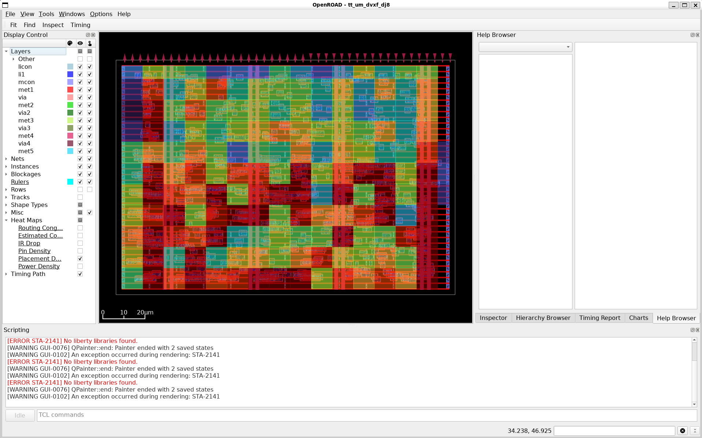

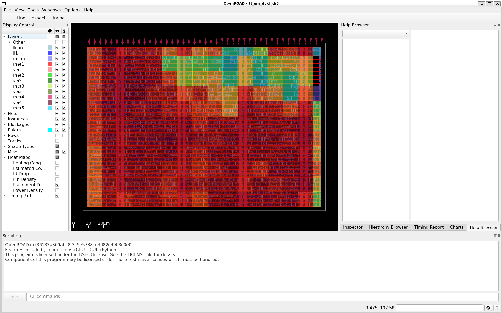

* **Phân tích đối chiếu hai bản đồ nhiệt (`1918×1198` gốc):**
  * **Tại `Step 22 Global Placement` (Hình 17 — `1,150` stdcells, `63.06%`):** Nửa trên của tile `161 × 111.52 µm²` (sát hàng chân I/O đỉnh và góc trên phải) vẫn phủ **tím – xanh dương – xanh lá** (~`20%–55%` mật độ cục bộ), chừa nhiều khe trống giữa các standard cell; các ô đỏ thẫm chỉ xuất hiện thành cụm rải rác vùng giữa/dưới trước bước legalize. *(Ghi chú thao tác: thông báo đỏ `[ERROR STA-2141] No liberty libraries found` ở khung Scripting xuất hiện do checkbox `Timing Path` bên bảng Display Control đang bật khi mở `.odb` trần chưa nạp `.lib`/`.sdc`).*
  * **Tại `Step 30 Resizer Timing Post-CTS` (Hình 18 — `1,455` stdcells / `1,533` tổng cell, `84.28%`):** Hơn **3/4 mặt bằng từ đáy lên gần sát mép trên đã biến thành khối đỏ sậm dày đặc** (sát ngưỡng `90%–100%`), chỉ còn sót dải hẹp xanh/vàng ở khu trên bên phải. Đây chính là hình ảnh vật lý của **`129` buffer ở Step 25 + `29` clock cells ở Step 28 + `615` cổng upsize (`_4/_6/_8`), `75` setup buffers và `79` hold buffers ở Step 30** lấp kín rãnh đi dây, đẩy `Step 32 GlobalRouting` vào thế tắt nghẽn (`93` overflow).

**2. Định hướng chiến lược Bước 3 — Trả lời câu hỏi chọn "Nút Vặn" trong `config.json` (LibreLane `3.0.14`):**

Khi vẫn khóa **`DIE_AREA = [0, 0, 161.00, 111.52]` (`1×1` tile)** và giữ mục tiêu thử nghiệm **`CLOCK_PERIOD = 20 ns` (`50 MHz`)**, đối chiếu trực tiếp bảng biến cấu hình của flow `VHDLClassic` (`librelane 3.0.14`), ta có **3 đòn bẩy vật lý – EDA** tác động đúng vào tâm bão Step 25–32:

| Nhóm Đòn Bẩy | Tên Biến Thực Tế (`LibreLane 3.0.14`) & Mặc Định | Cơ Chế Vật Lý Tác Động Lên "Cơn Sốt Diện Tích `84.28%`" |
| :--- | :--- | :--- |
| **1. Siết "bơm Hold quá tay"** | • `PL_RESIZER_HOLD_SLACK_MARGIN` (mặc định `0.1` ns)<br/>• `PL_RESIZER_HOLD_MAX_BUFFER_PCT` (mặc định `50`)<br/>• `PL_RESIZER_HOLD_MAX_UTIL_PCT` (mặc định `None`) | Mặc định công cụ cố đẩy Hold dư tới $+100\,\text{ps}$ (*overfix*), buộc chèn **`79` Hold buffers** (`+6.2%` diện tích) ở Step 30. Hạ biên margin này sát $0$ (vừa đủ an toàn dương) hoặc đặt trần tỷ lệ buffer/util sẽ cắt giảm hàng chục delay buffer thừa mà vẫn an toàn Hold. |
| **2. Chặn "lạm phát Setup" & cấm cell khổng lồ** | • `PL_RESIZER_SETUP_MAX_UTIL_PCT` (mặc định `None`)<br/>• `PL_RESIZER_SETUP_MAX_BUFFER_PCT` (mặc định `50`)<br/>• `PL_RESIZER_SETUP_SLACK_MARGIN` (mặc định `0.05` ns)<br/>• `EXTRA_EXCLUDED_CELLS` (mặc định `None`) | Vì `SETUP_MAX_UTIL_PCT = None`, khi thấy đường Half-Cycle $10\,\text{ns}$ ở góc `ss` bị âm Setup, công cụ không phanh mà **upsize `615` cổng + chèn `75` setup buffer** đến mức ngộp thở dù cuối cùng vẫn báo `[RSZ-0062]`. Đặt trần diện tích cho Resizer và/hoặc dùng `EXTRA_EXCLUDED_CELLS` loại các cell delay cồng kềnh (như dòng `clkdlybuf` từng xuất hiện cả trên đường data `ir[10]`) giúp giữ mặt bằng thông thoáng. |
| **3. Khoảng thở Placement & Routing** | • `PL_TARGET_DENSITY_PCT` (mặc định `None` $\rightarrow$ tự tính `73.06%`)<br/>• `GRT_ADJUSTMENT` (mặc định `0.3` = trừ `30%` track) | Log `[GRT-0704]` gợi ý giảm `GRT_ADJUSTMENT` từ `0.3` xuống `0.14`. Tuy nhiên lưu ý nguyên tắc: giảm `GRT_ADJUSTMENT` chỉ làm bước Global Route bớt khắt khe trên mô hình tính track, còn để tránh DRC/Short ở Detailed Routing thì **ưu tiên số 1 vẫn là hạ `Util%` vật lý ở Step 25–30 qua Đòn bẩy 1 & 2**. |

> [!TIP]
> **CHỐT BƯỚC 2:** Chốt thực nghiệm **Phương án A** (chỉ thay đổi 1 biến `PL_RESIZER_HOLD_SLACK_MARGIN` trước để cô lập nhân–quả trên cơn bão diện tích).

---

#### Bước 3: Thực Nghiệm A/B Phương Án A (`cpu8bit-20ns-hold02`) — Thông Tắc Step 32 & Xuất GDSII Sạch Vật Lý

**1. Lệnh thực thi Run 2 (`PL_RESIZER_HOLD_SLACK_MARGIN: 0.1 -> 0.02`, giữ nguyên `CLOCK_PERIOD = 20 ns` & die `1×1`):**
```bash
docker exec -w /home/admin060506/ctwsemi-data/ips/cpu8bit ctwsemi \
  librelane --pdk-root /home/admin060506/ctwsemi-data/.ciel \
  --docker-no-tty --dockerized \
  -f VHDLClassic -p sky130A -s sky130_fd_sc_hd \
  -c PL_RESIZER_HOLD_SLACK_MARGIN=0.02 \
  --run-tag cpu8bit-20ns-hold02 config.json
```

**2. Kết quả đối chứng A/B giữa Baseline (`hold=0.10`) và Run 2 (`hold=0.02`):**
* **Trạng thái hoàn tất:** Flow đi thông suốt **`67/72` bước có dữ liệu trạng thái (`67-misc-reportmanufacturability`)**, tạo đầy đủ thư mục **`final/`** (`.gds`, `.odb`, `.nl.v`, `.sdc`, `.spef`), file `error.log` trống (`0` lỗi cứng).
* **Diễn biến mật độ cell qua các mốc mấu chốt (`state_out.json`):**

| Mốc Trong Flow | `StdCell` | `Util%` | `RepBuf` | `HoldBuf` | `SetBuf` | `SetupWS` (ns) | `HoldWS` (ns) | So Sánh Với Baseline (`hold=0.10`) |
| :--- | :---: | :---: | :---: | :---: | :---: | :---: | :---: | :--- |
| `24-openroad-stamidpnr` | `1,150` | `63.06%` | `-` | `-` | `-` | `-1.138` | `0.091` | Giống hệt Baseline (chưa qua CTS/Resizer) |
| `25-openroad-repairdesignpostgpl` | `1,279` | `70.39%` | `129` | `-` | `-` | `-1.138` | `0.091` | Giống hệt Baseline (`+129` Repair Buffers) |
| `29-openroad-stamidpnr-1` | `1,308` | `72.56%` | `129` | `-` | `-` | `-3.226` | `0.129` | Sau CTS |
| **`30-openroad-resizertimingpostcts`** | **`1,378`** | **`79.61%`** | **`197`** | **`2`** | **`75`** | `-3.226` | `0.129` | **`HoldBuf` rớt `79 -> 2` (`-97.5%`), `Util%` tụt `84.28% -> 79.61%`** |
| `32-openroad-globalrouting` | `1,378` | `79.61%` | `197` | `2` | `75` | `+1.700`* | `+0.186`* | **Vượt qua Step 32 thành công!** |
| `37-openroad-detailedrouting` | `1,389` | `79.78%` | `197` | `2` | `75` | `+1.520`* | `+0.198`* | Đi dây chi tiết thành công (`+antenna diodes`) |
| **`48-openroad-stapostpnr` / `67`** | **`1,389`** | **`79.78%`** | **`197`** | **`2`** | **`75`** | **`-7.087`** | **`+0.030`** | **Lộ mức Setup âm thực sự ở Worst Corner `max_ss_100C_1v60`** |

**3. Nghiệm thu Routing / DRC / LVS & Signoff Timing 9 góc PVT (`48-openroad-stapostpnr` & `67-misc-reportmanufacturability`):**
* **Vật lý & Hình học đạt chuẩn 100%:** `route__wirelength = 45,423 µm`, `route__drc_errors = 0`, `route__antenna_violation__count = 0`, `magic__drc_error__count = 0`, `klayout__drc_error__count = 0`, `design__lvs_error__count = 0`.
* **Hold Timing sạch ở 9/9 góc PVT (`vio = 0`, `Hold TNS = 0.0000 ns`):** Kể cả góc nguy hiểm nhất cho Hold (`min_ff_n40C_1v95`, nhanh nhất ở `-40°C / 1.95V`) vẫn đạt **`HoldWS = +0.0297 ns` (`~30 ps`, `0` violations)**.
* **Setup Timing phân cực cực đoan giữa `tt/ff` và `ss` (`summary.rpt` Step 48):**

| Corner PVT | Hold WS (ns) | Hold Vio | Setup WS (ns) | Setup TNS (ns) | Setup Vio (`Reg-to-Reg`) | Max Cap / Max Slew Vio |
| :--- | :---: | :---: | :---: | :---: | :---: | :---: |
| **`nom_tt_025C_1v80`** *(Danh định)* | `+0.1949` | `0` | **`+1.0104`** | `0.0000` | `0` (`0`) | `0` / `10` |
| `min_tt_025C_1v80` / `max_tt_025C_1v80` | `+0.1924` / `+0.1982` | `0` | `+1.1547` / `+0.8648` | `0.0000` | `0` (`0`) | `0` / `0` & `21` |
| `min_ff_n40C_1v95` / `nom` / `max` | **`+0.0297`** / `+0.0317` / `+0.0345` | `0` | `+2.9518` / `+2.8859` / `+2.8174` | `0.0000` | `0` (`0`) | `0` / `0` |
| `min_ss_100C_1v60` | `+0.6282` | `0` | `-6.5713` | `-382.05...` | `83` (`68`) | `0` / `145` |
| `nom_ss_100C_1v60` | `+0.6327` | `0` | `-6.8288` | `-401.23...` | `83` (`68`) | `0` / `145` |
| **`max_ss_100C_1v60`** *(Xấu nhất)* | `+0.6379` | `0` | **`-7.0867`** | **`-420.17...`** | **`83` (`68`)** | **`0` / `164`** |

---

#### Bước 4A: Truy Vết Critical Path Tại Worst Corner (`max_ss_100C_1v60/max.rpt`)

Kiểm tra chi tiết `48-openroad-stapostpnr/max_ss_100C_1v60/max.rpt` và đếm cell trong `final/nl/tt_um_dvxf_dj8.nl.v`:

1. **Đường Critical Path tệ nhất toàn chip (`Slack = -7.086735 ns`):**
   * **Startpoint:** `_1638_` (`sky130_fd_sc_hd__dfrtp_2`, tín hiệu `ir[10]`, nhận clock đảo **`clk'` lúc `10.921601 ns`** sau `clkbuf_16` $\rightarrow$ `clkbuf_8` $\rightarrow$ `_1603__162 inv_2` từ mốc `T/2 = 10.000 ns`).
   * **Endpoint:** `_1645_` (`sky130_fd_sc_hd__dfrtp_2`, chốt cạnh lên **`clk`** lúc `20.897228 ns` $\rightarrow$ trừ `0.250 ns` uncertainty, `+0.04797 ns` CRP, `-0.17271 ns` setup = **`data required time = 20.522490 ns`**).
   * **Độ trễ thực tế:** `data arrival time = 27.609224 ns` $\implies$ **`slack = -7.086735 ns (VIOLATED)`**.
2. **Top 10 đường Setup tệ nhất đều xuất phát từ cùng một nguồn Half-Cycle `_1638_ (clk')`:**
   `10` đường chậm nhất trong `max.rpt` chạy từ `-7.086735 ns` đến `-6.479843 ns` (tới `_1645_`, `_1685_`, `_1701_`, `_1669_`, `_1677_`, `_1709_`, `_1653_`, `_1661_`, `_1693_`, `_1670_`) đều cùng xuất phát tại `_1638_` (kích cạnh xuống `clk'`) và chốt tại các thanh ghi kích cạnh lên `clk`, đồng thời trong `83` endpoint lỗi tại `max_ss` có tới **`68` đường Reg-to-Reg** nội bộ.
3. **Hai tác nhân vật lý cộng hưởng tạo ra mức âm `-7.087 ns`:**
   * **Suy giảm PVT ở góc `ss_100C_1v60` (`100°C / 1.60V`):** Cùng đoạn đường từ `_1638_/CLK` tới `_0648_`, ở góc danh định `nom_tt_025C_1v80` chỉ tốn `5.326 ns`, nhưng ở `max_ss_100C_1v60` tăng vọt lên **`11.160 ns` (`22.082 - 10.922`) — chậm hơn ~`2.1×`**.
   * **Chèn nhầm `clkdlybuf4s25_1` trên đường Setup:** Ngay đầu đường `ir[10]`, OpenROAD dùng tới **2 tầng `sky130_fd_sc_hd__clkdlybuf4s25_1`** (`fanout103` mất **`0.909650 ns`**, slew `0.527 ns`; `fanout87` mất **`1.033397 ns`**, slew `0.720 ns` — ngốn tổng **`1.943 ns`**), và trong `final/nl/tt_um_dvxf_dj8.nl.v` vẫn còn **`40` cell `*clkdlybuf*`** (do `drc_exclude.cells` của `sky130A` chặn `clkdlybuf4s15_1`/`4s18_1` nhưng bỏ sót nhóm `4s25`/`4s50`).

---

#### Bước 4B: Kiểm Định Độc Lập Bằng OpenROAD TCL Trên GUI, Quét $f_{\max}$ & Trực Quan Hóa Critical Path

**1. Nạp môi trường Signoff trực tiếp trên OpenROAD GUI (`final/odb` + `ss_100C_1v60.lib` + `max.spef` + `final/sdc`):**
```bash
RUN="$HOME/ctwsemi-data/ips/cpu8bit/runs/cpu8bit-20ns-hold02"
docker run -d --rm \
  -e DISPLAY="$DISPLAY" -v /tmp/.X11-unix:/tmp/.X11-unix -v /mnt/wslg:/mnt/wslg \
  -v "$HOME/ctwsemi-data:$HOME/ctwsemi-data" \
  ghcr.io/librelane/librelane:3.0.14 \
  openroad -gui -db "$RUN/final/odb/tt_um_dvxf_dj8.odb"
```

Các lệnh TCL thực thi trực tiếp trong khung **`TCL commands`** của OpenROAD GUI:
```tcl
set R "/home/admin060506/ctwsemi-data/ips/cpu8bit/runs/cpu8bit-20ns-hold02"
read_liberty "/home/admin060506/ctwsemi-data/.ciel/sky130A/libs.ref/sky130_fd_sc_hd/lib/sky130_fd_sc_hd__ss_100C_1v60.lib"
read_spef "$R/final/spef/max/tt_um_dvxf_dj8.max.spef"
read_sdc "$R/final/sdc/tt_um_dvxf_dj8.sdc"
report_worst_slack -max; report_worst_slack -min; report_tns -max

# Tách 4 nhóm cạnh clock để cô lập Half-Cycle vs Full-Cycle:
report_checks -path_delay max -fall_from [get_clocks clk] -rise_to [get_clocks clk] -group_path_count 5 -format summary
report_checks -path_delay max -rise_from [get_clocks clk] -fall_to [get_clocks clk] -group_path_count 5 -format summary
report_checks -path_delay max -rise_from [get_clocks clk] -rise_to [get_clocks clk] -group_path_count 5 -format summary
report_checks -path_delay max -fall_from [get_clocks clk] -fall_to [get_clocks clk] -group_path_count 5 -format summary

# Kiểm tra setup & đếm tổng cell clkdlybuf trong DB:
check_setup -verbose
set dly [get_cells -filter "ref_name =~ *clkdlybuf*"]
puts "Tong cell clkdlybuf = [llength $dly]"

# Quét tần số thực nghiệm trong bộ nhớ (T = 20 -> 40 ns) tại góc max_ss_100C_1v60:
foreach T {20 25 30 34 35 36 38 40} {
  create_clock -name clk -period $T [get_ports clk]
  set_propagated_clock [all_clocks]
  set_clock_uncertainty 0.25 [get_clocks clk]
  puts "--- T=${T} ns ([format %.2f [expr 1000.0/$T]] MHz) ---"
  report_worst_slack -max
}
```

**2. Kết quả đo đạc thực tế trên OpenROAD GUI (`max_ss_100C_1v60`):**
* **Chỉ số tổng hợp ban đầu (`20 ns`):** `worst slack max = -7.09 ns`, `worst slack min = +0.64 ns`, `tns max = -420.18 ns`, `check_setup -verbose` không báo thiếu ràng buộc, `Tong cell clkdlybuf = 40`.
* **Phân tách 4 nhóm cạnh clock tại `20 ns` (`50 MHz`) — Bằng chứng định lượng phân đôi bản chất RTL:**

| Nhóm Đường Truyền Clock | Quan Hệ Cạnh | Đại Diện Tệ Nhất (`Startpoint -> Endpoint`) | Slack Thực Tế (ns) | Kết Luận Kỹ Thuật Tại `20 ns` (`50 MHz`) |
| :--- | :---: | :--- | :---: | :--- |
| **`fall_from` $\rightarrow$ `rise_to`** | **Half-Cycle (`clk' -> clk`)** | `_1638_/Q` $\rightarrow$ `_1645_/D` (`-7.09`), `_1685_/D` (`-6.73`), `_1701_/D` (`-6.72`), `_1669_/D` (`-6.71`), `_1677_/D` (`-6.69`) | **`-7.09`** (**VIOLATED**) | **Thủ phạm chính!** Quỹ thời gian bị chặt còn `10 ns` + trễ nhánh `clk'` + `clkdlybuf4s25_1`. |
| **`rise_from` $\rightarrow$ `fall_to`** | **Half-Cycle ngược (`clk -> clk'`)** | `_1705_/Q` $\rightarrow$ `_1635_/D` & `_1643_/D` (`-0.47`); `rst_n` $\rightarrow$ `_1623_` (`+3.40`) | **`-0.47`** (**VIOLATED nhẹ**) | Các path từ thanh ghi cạnh lên quay về `state/pc/ir` cũng vượt ngưỡng `10 ns` nhẹ. |
| **`rise_from` $\rightarrow$ `rise_to`** | **Full-Cycle (`clk -> clk`)** | `_1705_/Q` $\rightarrow$ `_1645_/D` (`+4.71`), `_1685_.._1677_` (`+5.07..+5.11`); `rst_n` (`+12.52`) | **`+4.71`** (**MET 100%**) | **Đạt sạch `50 MHz`!** Nhánh logic dài nhất cùng cạnh chỉ mất `~15.3 ns < 20 ns`. |
| **`fall_from` $\rightarrow$ `fall_to`** | **Full-Cycle (`clk' -> clk'`)** | `_1638_/Q` $\rightarrow$ `_1635_/D` & `_1643_/D` (`+7.85`), `_1640_/D` (`+8.30`), `_1636_/D` (`+8.35`) | **`+7.85`** (**MET 100%**) | **Đạt sạch `50 MHz`!** Nhánh nội bộ cùng cạnh xuống rất thoáng. |

* **Bảng quét tần số thực nghiệm tại góc xấu nhất `max_ss_100C_1v60` (`create_clock -period`):**

| Chu Kỳ Thử `T` (ns) | Tần Số Tương Ứng (MHz) | `worst slack max` (ns) | Trạng Thái | Nhận Xét Toán Học & Vật Lý |
| :---: | :---: | :---: | :---: | :--- |
| `20` | `50.00 MHz` | `-7.09` | FAIL | Quỹ Half-Cycle `10 ns` quá nhỏ so với đường `_1638_ -> _1645_`. |
| `25` | `40.00 MHz` | `-4.59` | FAIL | Tăng `T` thêm **`+5.00 ns`**, Slack chỉ cải thiện đúng **`+2.50 ns`** ($\Delta\text{Slack}/\Delta T = \mathbf{0.50}$)! |
| `30` | `33.33 MHz` | `-2.09` | FAIL | Chứng minh 100% đường tới hạn ăn theo nhịp nửa chu kỳ $T/2$. |
| `34` | `29.41 MHz` | `-0.09` | FAIL sát nút | Điểm cắt `Slack = 0` nằm tại $T \approx 34.18\,\text{ns}$ ($\approx 29.26\,\text{MHz}$). |
| **`35`** | **`28.57 MHz`** | **`+0.41`** | **PASS (`MET`)** | **Mức chu kỳ nguyên đầu tiên đóng Timing hoàn toàn ở Worst Corner `max_ss`!** |
| `36` | `27.78 MHz` | `+0.91` | PASS (`MET`) | Dự phòng margin an toàn gần `1 ns`. |
| `38` | `26.32 MHz` | `+1.91` | PASS (`MET`) | Rộng rãi. |
| `40` | `25.00 MHz` | `+2.91` | PASS (`MET`) | Chạy ổn định ở `25 MHz`. |

**3. Trực quan hóa Critical Path `-7.087 ns` trên OpenROAD GUI (`read_sdc` trả về `20 ns`):**

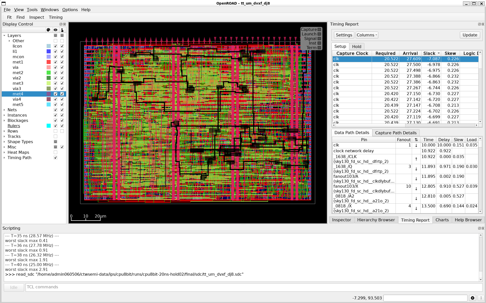

* **Quan sát thực tế trên Hình 19 (`1918×1198` gốc):** Sau khi chạy lại `read_sdc ".../tt_um_dvxf_dj8.sdc"` và chọn dòng đầu tiên (`Required 20.522 | Arrival 27.609 | Slack -7.087 | Skew 0.226`) trong tab `Timing Report`, OpenROAD tô đen đậm đường đi thực tế chạy ngoằn ngoèo xuyên suốt nhiều vùng của die `161 × 111.52 µm²` từ thanh ghi `_1638_` tới `_1645_`, đồng thời khung `Data Path Details` hiển thị khớp hoàn toàn với `max.rpt` (`clk 10.000` $\rightarrow$ `_1638_/CLK 10.922` $\rightarrow$ `_1638_/Q 11.893` $\rightarrow$ `fanout103 clkdlybuf4s25_1 12.805` [delay `0.910 ns`]).

---

### 6. Kết Luận Ký Duyệt Giai Đoạn 3 — Trả Lời Dứt Điểm Câu Hỏi `50 MHz` Cho `cpu8bit`

| Hạng Mục Thẩm Định | Kết Luận Cuối Cùng (Đầy Đủ Bằng Chứng Thực Nghiệm) |
| :--- | :--- |
| **1. `cpu8bit` có chạy được `50 MHz` (`20 ns`) trên tile `1×1` ở chuẩn Signoff không?** | **KHÔNG.** Mặc dù phiên `cpu8bit-20ns-hold02` đạt sạch **0 DRC / 0 LVS / 0 Antenna / 0 Hold** trên 9 góc và báo dương `+1.0104 ns` tại góc danh định `nom_tt_025C_1v80`, ở góc Signoff khắc nghiệt **`max_ss_100C_1v60` (`100°C / 1.60V`)** vẫn vi phạm nặng **`-7.09 ns` (`TNS = -420.18 ns`, `83` endpoints)** — chip thật chạy `50 MHz` ở điều kiện nóng/áp thấp sẽ sập dữ liệu. |
| **2. Nguyên nhân gốc do Physical Design hay do RTL?** | **Bản chất giới hạn nằm ở RTL, không phải bế tắc PD.** Can thiệp PD (`PL_RESIZER_HOLD_SLACK_MARGIN=0.02`) đã chữa dứt điểm bệnh nổ diện tích (`Util: 84.28% -> 79.78%`, `HoldBuf: 79 -> 2`). Lệnh OpenROAD TCL chứng minh toàn bộ đường **Full-Cycle cùng cạnh** đều đạt `50 MHz` dư dả (**`+4.71 ns`** và **`+7.85 ns`**); toàn bộ nút thắt âm rơi vào **Half-Cycle `falling_edge <-> rising_edge`** trong RTL (`top.vhdl:414` vs `register8.vhdl:27`), cộng hưởng thêm `40` `clkdlybuf` (trong đó 2 tầng `clkdlybuf4s25_1` ở đầu đường `ir[10]` đốt oan `1.943 ns`, nhưng kể cả trừ đi `~1.9 ns` vẫn không đủ kéo `-7.09 ns` về dương ở `20 ns`). |
| **3. Trần tần số thực & Hướng giải quyết** | • **Giữ nguyên RTL VHDL hiện tại:** Chạy Signoff an toàn tối đa ở **`T = 35 ns` (`28.57 MHz`)** trên cả 9 góc PVT (vẫn nhanh gấp **2×** mức `14 MHz` mà tác giả ghi trong `info.yaml`).<br/>• **Nếu bắt buộc phải chạy `50 MHz` (`20 ns`):** Bắt buộc phải sửa **tầng RTL (Buổi 1)** chuyển khối `state / pc / ir` sang dùng chung một cạnh `rising_edge(clk)` (và cấu hình `EXTRA_EXCLUDED_CELLS` chặn họ `clkdlybuf4s25`/`4s50`). |

---

---

## PHẦN VI: GIAI ĐOẠN 4 - THÍ NGHIỆM 2 (`TinyTDC` PnR & BẢO TOÀN 512 DELAY CELLS) (KHỞI ĐỘNG CHẶNG - TỔNG QUAN)

> [!NOTE]
> **TRẠNG THÁI CHẶNG:** Mới khởi động — Phần mở đầu chỉ trình bày bức tranh tổng quan 4 trụ cột theo đúng quy chuẩn. Toàn bộ quá trình cấu hình SDC, chạy PnR `TinyTDC`, viết lệnh OpenROAD TCL kiểm kê chuỗi trễ và nghiệm thu kết quả sẽ được trực tiếp thực hiện từng bước trước khi cập nhật vào báo cáo.

### 1. Nhiệm Vụ Tổng Quan Của Chặng
* Điều khiển và thẩm định hoàn chỉnh dây chuyền vật lý RTL-to-GDSII cho chip đo thời gian độ phân giải pico-giây **`TinyTDC`**, đảm bảo chip vừa sạch 100% quy tắc chế tạo (DRC/LVS/Timing Signoff), vừa **giữ nguyên vẹn kiến trúc vật lý đặc thù** của hai chuỗi trễ đo lường (`u_start_line` và `u_stop_line`).
* Thực hành thiết kế ràng buộc đa giai đoạn (tách biệt ràng buộc lúc chạy PnR `PNR_SDC_FILE` và ràng buộc ký duyệt `SIGNOFF_SDC_FILE`) và sử dụng **OpenROAD TCL** kiểm kê trực tiếp trên ODB nhằm xác nhận không bị công cụ tự ý xóa/biến dạng các phần tử trễ chức năng.

### 2. Lý Do Cần Thực Hiện Chặng Này
* **Bài toán trái ngược hoàn toàn với `cpu8bit`:** Ở `cpu8bit` (Giai đoạn 3), công cụ được tự do tối ưu logic, gộp/phóng to/bơm buffer để chạy càng nhanh càng tốt. Ngược lại, **`TinyTDC` dùng chính độ trễ vật lý của các chuỗi buffer lặp (`512` delay cells)** làm "thước đo lượng tử thời gian". Nếu áp dụng PnR mặc định mà thiếu ràng buộc đúng cho các đường bất đồng bộ hoặc thiếu bước kiểm kê TCL trên `.odb`, bộ tối ưu có thể "sửa nhầm" làm mất phần tử đo hoặc tạo kết quả sai lệch mà các checker DRC/Setup thông thường vẫn báo xanh giả tạo.

### 3. Móc Nối Với Chặng Trước: Đã Có Gì & Đang Thiếu Gì?
| Trục Đối Chiếu | Đã Có Sau Giai Đoạn 1, 2 & 3 | Đang Thiếu Khuyết Mà Chỉ Giai Đoạn 4 Mới Mang Lại |
| :--- | :--- | :--- |
| **Góc nhìn đa miền thiết kế** | • Thuần thục **OpenROAD GUI/TCL, CVC64 GLS, GTKWave** kiểm chứng netlist sau layout của `TinyTDC` (Giai đoạn 2).<br/>• Làm chủ phương pháp chẩn đoán & gỡ lỗi PnR, STA đa góc PVT trên CPU số `cpu8bit` (Giai đoạn 3). | • Chưa tự tay chạy **flow PnR tạo ra `.odb` / `.gds` cho `TinyTDC`** từ mã nguồn RTL & SDC.<br/>• Chưa trực tiếp xử lý xung đột giữa bộ tối ưu timing của EDA với yêu cầu **bảo toàn phần tử trễ vật lý (`dont_touch` / `false_path` / SDC)**. |
| **Kiểm soát SDC & ODB TCL** | • Đã biết dùng OpenROAD TCL tách nhóm đường clock & quét $f_{\max}$ trên DB đã route. | • Chưa thực hành đọc/sửa **`PNR_SDC_FILE` vs `SIGNOFF_SDC_FILE`** và viết vòng lặp **OpenROAD TCL** truy vấn toàn bộ `getInsts` trong ODB để kiểm đếm chính xác chỉ số từng cell trễ. |

### 4. Mục Tiêu Đầu Ra Sau Khi Hoàn Thành Chặng Này
Sau khi hoàn thành Giai đoạn 4, kỹ sư sẽ làm chủ hoàn toàn:
1. **Kỹ thuật thiết lập SDC hai tầng (`PNR_SDC` vs `SIGNOFF_SDC`):** Hiểu rõ lúc nào cần *overconstraint* khi PnR, lúc nào cần `set_false_path` cho tín hiệu bất đồng bộ để không đánh lừa bộ tối ưu.
2. **Năng lực lập trình TCL kiểm kê `.odb` ở mức phần tử:** Tự viết script TCL OpenROAD rà soát tên instance theo cấu trúc phân cấp, phát hiện ngay mọi cell bị mất hoặc bị tối ưu hóa ngoài ý muốn.
3. **Nền tảng khép kín cho Giai đoạn 5 (Tape-out Signoff Dossier):** Sẵn sàng đóng gói toàn diện kết quả của cả 2 con chip (`cpu8bit` + `TinyTDC`) từ RTL tới Signoff cuối cùng.
