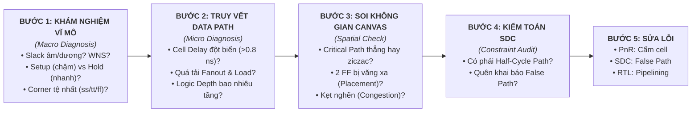
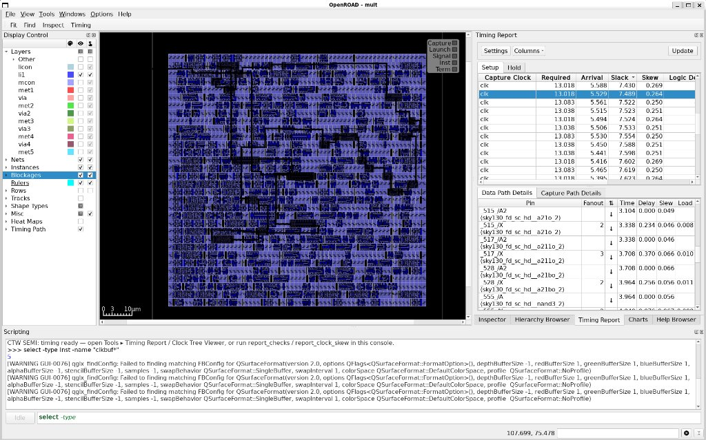
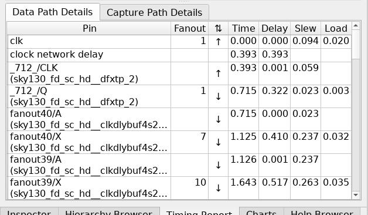
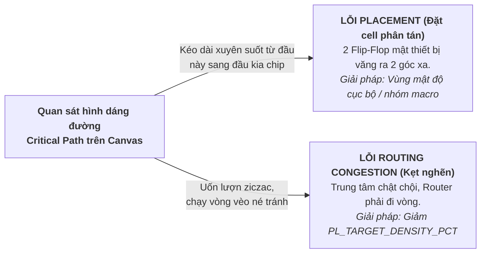

# CẨM NANG THỰC CHIẾN PnR: QUY TRÌNH 5 BƯỚC VÀNG TÌM LỖI & ĐÓNG TIMING (TIMING CLOSURE)

> **Tài liệu độc quyền dành cho Kỹ sư Physical Design & Tape-out Signoff**  
> **Dự án:** CTW SEMI ASIC Training Series — Lab 3 (Buổi 4 & Buổi 5)  
> **Nền tảng kiểm định:** OpenROAD GUI & OpenSTA Engine trên tiến trình SkyWater 130nm (`sky130_fd_sc_hd`)

---

## I. TỔNG QUAN: TIMING CLOSURE TRONG THỰC TẾ LÀ GÌ?

Trong các tập đoàn thiết kế vi mạch hàng đầu thế giới (như Intel, Qualcomm, Marvell, Ampere...), công đoạn **Timing Closure (Đóng Thời Gian)** là nhiệm vụ sống còn, phức tạp và tiêu tốn nhiều thời gian nhất của một Kỹ sư Physical Design (PnR Engineer).

Khi một con chip chạy xong toàn bộ flow tự động (từ Tổng hợp logic đến Định tuyến chi tiết), câu hỏi đầu tiên của Giám đốc Kỹ thuật (Tapeout Director) luôn là:
> **"Slack âm hay dương? Âm bao nhiêu nano-giây và con cell nào đang làm nghẽn mạch?"**

Nếu con chip bị vi phạm thời gian (Slack âm), chip chế tạo ra sẽ bị lỗi hoạt động ở tần số danh định (chạy sai logic hoặc chỉ chạy được ở tốc độ rất thấp), dẫn tới thất bại hàng triệu USD. 

Cẩm nang này đúc kết **Lộ trình 5 Bước Thực Chiến Chuẩn Quốc Tế** mà kỹ sư PnR sử dụng để chẩn đoán, vạch mặt thủ phạm gây trễ và ra quyết định sửa lỗi trên bảng công cụ **Timing Report** của OpenROAD GUI.

---

## II. LỘ TRÌNH 5 BƯỚC VÀNG CHẨN ĐOÁN & SỬA LỖI TIMING

---

*Giao diện Timing Report trên OpenROAD GUI: Cửa sổ trên hiển thị danh sách các đường trễ Setup, cửa sổ dưới hiển thị chi tiết Data Path Details, và khung Canvas bên trái vẽ trực tiếp lộ trình dây dẫn Critical Path trên mặt chip silicon.*

---

### BƯỚC 1: KHÁM NGHIỆM VĨ MÔ (Đọc Bảng Setup/Hold List Trong 15 Giây)

Ngay khi mở tab `Timing Report` trong OpenROAD GUI, kỹ sư phải quét nhanh qua 3 chỉ số đầu tiên:

1. **Phân loại vi phạm:**
   * **Nếu tab `Setup` bị âm:** Dữ liệu chạy **QUÁ CHẬM**, không kịp chạm chân Flip-Flop thu trước khi chu kỳ clock kết thúc. *(Phổ biến nhất, quyết định tần số xung nhịp cực đại $F_{\text{max}}$ của chip)*.
   * **Nếu tab `Hold` bị âm:** Dữ liệu chạy **QUÁ NHANH**, đè nát dữ liệu cũ trước khi Flip-Flop kịp chốt an toàn. *(Nguy hiểm vì không thể hạ tần số clock để cứu vãn)*.

2. **Đo lường độ lớn của Slack âm (Worst Negative Slack - WNS):**
   * **Slack âm nhẹ ($-0.01\,\text{ns}$ đến $-0.3\,\text{ns}$):** Bệnh nhẹ. PnR Tool có thể tự động sửa được bằng thuật toán phóng to kích thước transistor của cổng (Gate Sizing) hoặc nới nhẹ mật độ cell.
   * **Slack âm trung bình ($-0.3\,\text{ns}$ đến $-2.0\,\text{ns}$):** Bệnh vừa. Cần can thiệp cấu hình `config.json` (cấm cell đệm trễ cao, tăng công suất đệm clock).
   * **Slack âm nặng ($> -5.0\,\text{ns}$, ví dụ thiết kế `cpu8bit` bị âm tới $\mathbf{-7.457\,\text{ns}}$):** **BỆNH NAN Y Ở TẦNG KIẾN TRÚC RTL HOẶC SDC!** Không có bất kỳ công cụ PnR tự động nào sửa nổi, bắt buộc phải mổ xẻ code RTL hoặc viết lại file SDC.

3. **Xác định góc PVT tệ nhất:**
   * Setup thường vi phạm nặng nhất ở **Slow Corner (`max_ss_100C_1v60`)**: Điện áp nguồn tụt xuống $1.6\,\text{V}$, nhiệt độ môi trường nóng $100^\circ\text{C}$, transistor dẫn dòng yếu nhất.
   * Hold thường vi phạm nặng nhất ở **Fast Corner (`min_ff_n40C_1v95`)**: Điện áp vọt lên $1.95\,\text{V}$, nhiệt độ lạnh $-40^\circ\text{C}$, transistor dẫn dòng cực nhanh.

---

*Ảnh chụp phóng to bảng Data Path Details: Cho phép kỹ sư kiểm tra từng trạm dừng, bắt các cell có Delay đột biến hoặc chân bị quá tải Fanout.*

---

### BƯỚC 2: TRUY VẾT VI MÔ TRONG `Data Path Details` (Bắt 3 Thủ Phạm Gây Nghẽn)

Nhấp đúp chuột vào đường vi phạm nặng nhất (Worst Path) để mở khung `Data Path Details` và lần theo từng dòng từ trên xuống dưới:

#### 1. Thủ phạm 1: Cổng Logic Có Độ Trễ Đột Biến (High Cell Delay)
* Trong tiến trình SkyWater 130nm, một cổng logic thông thường chỉ trễ khoảng $0.1\,\text{ns} - 0.25\,\text{ns}$.
* **Nếu phát hiện một dòng có `Delay` vọt lên $> 0.8\,\text{ns} - 1.5\,\text{ns}$:** 👉 **ĐÂY CHÍNH LÀ NƠI NGHẼN MẠCH!**
* *Bằng chứng từ Lab 3 (`cpu8bit`):* Cổng `clkdlybuf4s25_1` nuốt mất $1.43\,\text{ns}$, cổng `clk_buf_2` mất $0.95\,\text{ns}$. Kỹ sư phát hiện ra ngay 2 con cell này quá chậm và phải ra lệnh cấm tool sử dụng (`EXTRA_EXCLUDED_CELLS`).

#### 2. Thủ phạm 2: Quá Tải Fanout & Điện Dung Tải (`Load` quá nặng)
* Soi sang cột **`Fanout`** và **`Load`**:
  * Nếu một chân ngõ ra phải kéo `Fanout > 10` hoặc `Load > 0.04 - 0.05\,\text{pF}`: Chân đó đang bị "quá tải", không đủ khả năng nạp xả dòng điện cho các cổng phía sau.
  * Hậu quả kéo theo: Cột **`Slew`** sẽ bị bẹt ra ($> 0.3 - 0.5\,\text{ns}$), làm tốc độ chuyển mạch của các cell phía sau sụt giảm nghiêm trọng.

#### 3. Thủ phạm 3: Độ Sâu Logic (Logic Depth) Quá Dài
* Đếm tổng số dòng cổng logic từ Flip-Flop phát đến Flip-Flop thu:
  * Nếu tín hiệu phải bò qua hơn 20 - 30 tầng cổng liên tiếp, dù mỗi cổng chỉ mất $0.2\,\text{ns}$, tổng thời gian cộng dồn vẫn sẽ nuốt trọn chu kỳ clock ($4 - 6\,\text{ns}$).

---

### BƯỚC 3: ĐỐI CHỨNG VỊ TRÍ KHÔNG GIAN TRÊN LAYOUT SILICON (Spatial Audit)

Quan sát đường bao dây nối Critical Path được OpenROAD vẽ trực tiếp trên màn hình GUI:

---

### BƯỚC 4: KIỂM TOÁN RÀNG BUỘC THỜI GIAN SDC (Constraint Audit)

Rất nhiều trường hợp mạch bị âm thời gian không phải do phần cứng bị lỗi, mà do file ràng buộc SDC bị viết sai:

1. **Bắt lỗi đường nửa chu kỳ (Half-Cycle Path):**
   * Kiểm tra cạnh kích hoạt ở 2 đầu: Flip-Flop phát ăn cạnh lên (`rise`), nhưng Flip-Flop thu lại ăn cạnh xuống (`fall`).
   * Hậu quả: Chu kỳ danh định là $13\,\text{ns}$ nhưng dữ liệu chỉ có **$6.5\,\text{ns}$** để chạy, khiến mạch bị âm oan uổng! *(Lỗi kinh điển trong bài `cpu8bit`)*.
2. **Bắt lỗi thiếu khai báo đường giả (False Path):**
   * Tín hiệu reset bất đồng bộ (`rst_i`) hoặc tín hiệu giao tiếp giữa hai miền xung nhịp độc lập không bao giờ cần đóng timing trong 1 chu kỳ. Nếu quên khai báo `set_false_path`, OpenROAD sẽ chèn hàng trăm con buffer vô ích để cố sửa một đường không có thực.

---

### BƯỚC 5: RA QUYẾT ĐỊNH & THỰC THI SỬA LỖI (Action Plan)

Dựa trên kết quả thu được ở 4 bước trên, Kỹ sư PnR đưa ra **đơn thuốc đặc trị**:

| Triệu chứng phát hiện từ Timing Report | Căn nguyên vật lý | Hành động xử lý chuẩn xác của Kỹ sư PnR |
| :--- | :--- | :--- |
| **Một vài con cell có Delay đột biến ($> 1\,\text{ns}$)** | Tool dùng nhầm cell đệm trễ cao (`clkdlybuf`) hoặc Drive strength quá yếu. | Thêm danh sách cấm vào `config.json`: `"EXTRA_EXCLUDED_CELLS": ["sky130_fd_sc_hd__clkdlybuf4s25_*"]` |
| **Mặt chip đỏ rực, đường dây ziczac né tránh** | Mật độ cell quá dày làm nghẽn các track kim loại (Routing Congestion). | Giảm `PL_TARGET_DENSITY_PCT` từ $75\% \rightarrow 60\%$ hoặc nới rộng diện tích Core `FP_CORE_UTIL`. |
| **Đường truyền nửa chu kỳ (Half-cycle)** | Dữ liệu phát ở cạnh lên nhưng chốt ở cạnh xuống (chỉ có $0.5 \times T_{\text{clk}}$ để chạy). | Sửa RTL chuyển về cùng cạnh lên (Full-cycle path) để có trọn vẹn chu kỳ chạy. |
| **Đường logic quá dài (Slack âm $> 5\,\text{ns}$)** | Khối tính toán tổ hợp quá nặng (như bộ nhân 32-bit chưa tối ưu). | **Chèn thanh ghi Pipelining (`b_p`, `a_p`) trong RTL** để chém đôi đường truyền thành 2 chu kỳ *(Chiến công ta đã làm ở Buổi 3)*. |

---

## III. BẰNG CHỨNG THỰC CHIẾN TRÊN THIẾT KẾ `mult`

Soi lại kết quả thực tế trên thiết kế `mult` của chúng ta sau khi áp dụng quy trình trên:
* **Worst Setup Slack:** đạt **$+7.489\,\text{ns}$** (Dương an toàn tuyệt đối).
* **Data Path Delay:** chỉ tốn **$5.529\,\text{ns}$** trên tổng ngân sách $13.018\,\text{ns}$.
* **Hình thái Critical Path trên GUI:** Đường dây kết nối từ Flip-Flop `_712_` xuyên qua mảng nhân đến Flip-Flop `_697_` chạy thẳng tắp, không bị uốn lượn ziczac.
* **Số lỗi DRC sau Detailed Routing:** **0 vi phạm**.

> **Kết Luận Signoff:** Thiết kế `mult` hoàn toàn sạch lỗi timing, chuẩn bị sẵn sàng cho công đoạn kiểm định chức năng bằng mô phỏng cấp cổng (GLS CVC64) và đo xung picosecond trên GTKWave!
